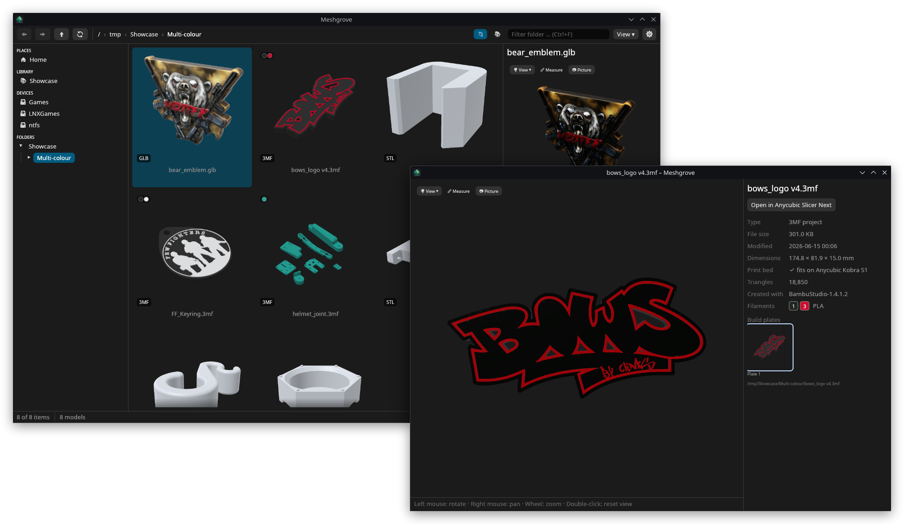
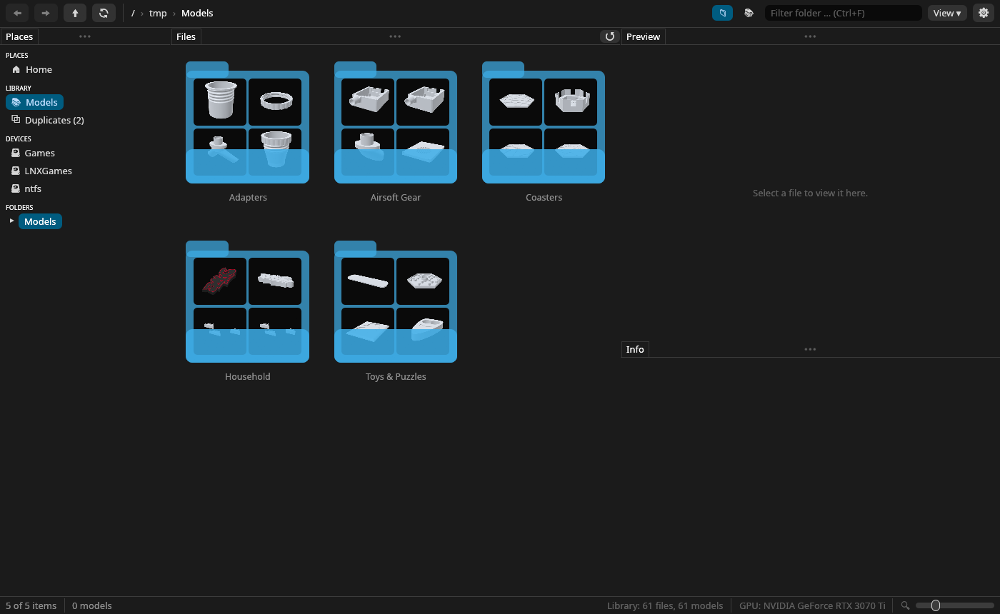
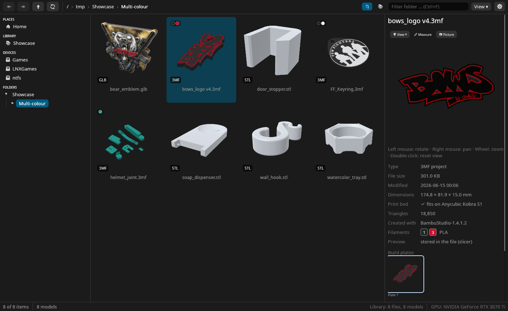
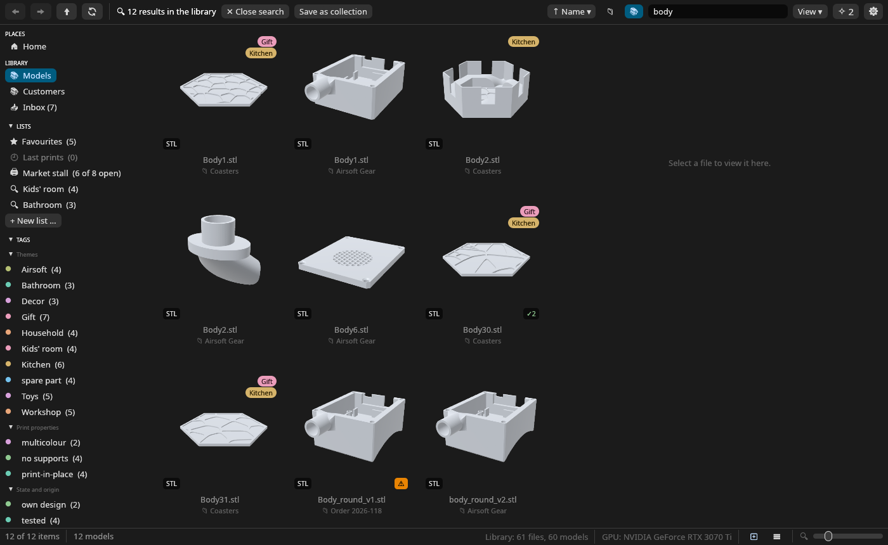
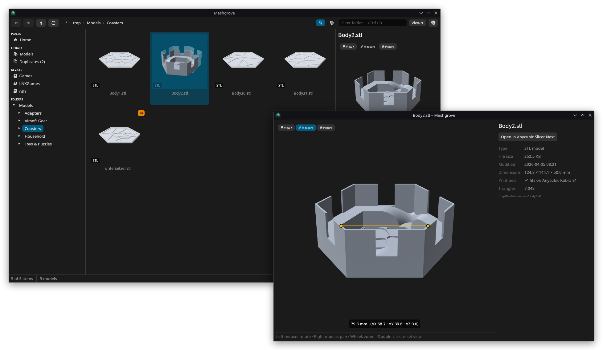
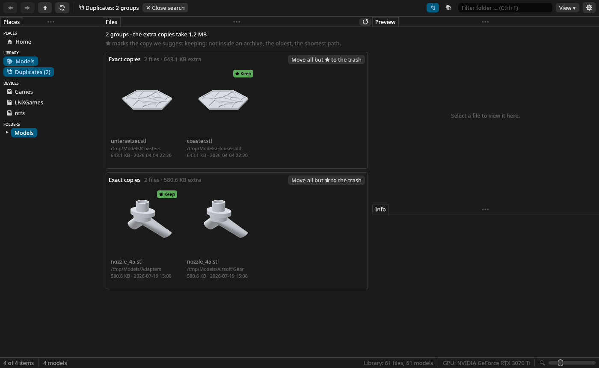
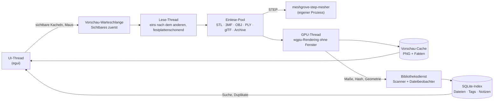

<p align="center">
  
</p>

<p align="center">
  <b>Eine schnelle, native Galerie für deine 3D-Druck-Dateien.</b><br>
  STL-, 3MF-, STEP-, OBJ- und glTF-Modelle durchblättern wie Fotos: echte Vorschauen für jedes Modell, jedes Archiv und jedes PDF.
</p>

<p align="center">
  <a href="https://github.com/DonDavis-vibe/MeshGrove/actions/workflows/ci.yml"></a>
  <a href="LICENSE"></a>
  
  
  <a href="https://ko-fi.com/don_davis"></a>
</p>

<p align="center">
  <a href="README.md">🇬🇧 English version</a>
</p>

---



## Inhalt

- [Warum Meshgrove?](#warum-meshgrove)
- [Funktionen im Überblick](#funktionen-im-überblick)
- [Screenshots](#screenshots)
- [Installation](#installation)
- [Erste Schritte](#erste-schritte)
- [Anleitung](#anleitung)
  - [Die Galerie](#die-galerie)
  - [Der 3D-Viewer und seine Werkzeuge](#der-3d-viewer-und-seine-werkzeuge)
  - [Die Detailansicht](#die-detailansicht)
  - [Bibliothek, Suche und Filter](#bibliothek-suche-und-filter)
  - [Tags und Notizen](#tags-und-notizen)
  - [Druckbett-Check](#druckbett-check)
  - [Duplikate finden](#duplikate-finden)
  - [Zusammenarbeit mit Slicer und anderen Programmen](#zusammenarbeit-mit-slicer-und-anderen-programmen)
  - [Archive (ZIP, 7z, RAR, TAR)](#archive-zip-7z-rar-tar)
  - [Dateien in den Papierkorb](#dateien-in-den-papierkorb)
  - [Sicherung, Export und Import](#sicherung-export-und-import)
  - [Vorschauen in Dolphin und Dateidialogen (Linux)](#vorschauen-in-dolphin-und-dateidialogen-linux)
- [Tastatur und Maus](#tastatur-und-maus)
- [Unterstützte Dateitypen](#unterstützte-dateitypen)
- [Einstellungen und Dateien auf der Platte](#einstellungen-und-dateien-auf-der-platte)
- [Datenschutz und Sicherheit](#datenschutz-und-sicherheit)
- [Geschwindigkeit](#geschwindigkeit)
- [Plattformen](#plattformen)
- [Probleme und häufige Fragen](#probleme-und-häufige-fragen)
- [Aus dem Quellcode bauen](#aus-dem-quellcode-bauen)
- [Aufbau](#aufbau)
- [Entwicklung](#entwicklung)
- [Ausblick](#ausblick)
- [Mitmachen](#mitmachen)
- [Trinkgeld](#trinkgeld)
- [Danksagung](#danksagung)
- [Lizenz](#lizenz)

## Warum Meshgrove?

Wer viel druckt, hat irgendwann Ordner voller Dateien namens `Body1.stl`,
`final_v3_fixed.3mf` und `pack.zip`. Ein normaler Dateimanager zeigt dafür nur ein
Standard-Symbol. Also öffnet man Modell für Modell im Slicer, bis man das richtige gefunden hat.

Meshgrove zeigt solche Ordner als Galerie mit einer gerenderten Vorschau jedes Modells. Das
gilt auch für die Modelle in ZIP-, 7z- und RAR-Paketen und für die Plattenbilder, die dein
Slicer in 3MF-Projekten speichert. Dazu kommt, was eine Modellsammlung braucht: eine
blitzschnelle Suche über die ganze Bibliothek, Tags und Notizen, eine Duplikatsuche, ein
Druckbett-Check und die Übergabe an den Slicer mit einem Klick.

Was Meshgrove von anderen Modell-Verwaltungen unterscheidet:

- **Deine Ordner bleiben, wie sie sind.** Meshgrove zeigt und indiziert die Dateien dort, wo
  sie liegen. Es importiert, kopiert, benennt und sortiert nichts um, und es funktioniert auch
  auf schreibgeschützten Laufwerken.
- **Nativ und schnell.** Meshgrove ist in Rust geschrieben und rendert auf der Grafikkarte
  (Vulkan, Metal oder DirectX 12 über [wgpu](https://wgpu.rs)). Es gibt kein Electron, keine
  Web-Ansicht und keinen Server. Tausende Dateien und Modelle mit Millionen Dreiecken laufen
  flüssig.
- **Frei und quelloffen** unter der GPL, ohne Konto, Abo oder Telemetrie.
- **Gemacht für echte Sammlungen auf Festplatten.** Die Lesezugriffe sind so geplant, dass
  sichtbare Kacheln zuerst kommen; alles andere wird zwischengespeichert.

## Funktionen im Überblick

| Bereich | Was du bekommst |
|---|---|
| **Galerie** | Vorschauen für STL, 3MF, STEP, OBJ, PLY, glTF/GLB, Bilder und PDFs; Ordner- und Archiv-Kacheln zeigen ein 2×2-Mosaik ihres Inhalts; Kachelgröße einstellbar; Sortieren nach Name, Datum, Größe oder Typ; „Nur 3D-Modelle“; „Unterordner einbeziehen“ (alle Dateien unter einem Ordner in einem Raster); Mehrfachauswahl |
| **Drehvorschau** | Mit der Maus über eine Modell-Kachel fahren, und das Modell dreht sich. Ziehen dreht es von Hand, Mausrad beim Ziehen zoomt |
| **3D-Viewer** | In der Seitenleiste, oder **Doppelklick auf ein Modell für ein eigenes Fenster** (frei vergrößerbar, mehrere gleichzeitig, mit „In Slicer öffnen“); Drehen, Verschieben und Zoomen um einen festen Drehpunkt (das Modell springt beim Drehen nie); Standardansichten (vorne, hinten, links, rechts, oben, unten, schräg); **Messen zwischen zwei Punkten in mm**; **Bildexport** als PNG mit 2048 px |
| **3MF-Projekte** | Eingebettete Plattenbilder der Slicer (Bambu Studio, OrcaSlicer, Anycubic, Elegoo, Creality Print, PrusaSlicer); Klick auf ein Plattenbild zeigt diese Platte in 3D; **mehrfarbig**: Filamentfarben pro Objekt und Teil, bemalte Modelle (Multi-Material-Bemalung) und 3MF-Materialfarben im Viewer und in selbst gerenderten Vorschauen; Filament-Farbfelder auf Kacheln und in den Details; Titel, Designer und Programm aus den Metadaten |
| **STEP / STP** | CAD-Dateien werden von OpenCascade in einem eigenen Hilfsprozess vernetzt, eine kaputte Datei kann die App also nicht abstürzen lassen; das Ergebnis wird zwischengespeichert |
| **Archive** | ZIP, 7z, RAR und TAR öffnen wie Ordner; jedes enthaltene Modell bekommt eine Vorschau; entpackt wird nur, wenn ein anderes Programm die Datei braucht |
| **Bibliothek** | Index (SQLite) aller Bibliotheksordner; Sofortsuche wie `drache ext:3mf tag:bemalt`; Änderungen auf der Platte werden automatisch erkannt |
| **Tags und Notizen** | Tags und Notizen hängen am *Inhalt* der Datei und überleben so Umbenennen und Verschieben; die Suche findet auch Notiztext; tägliche automatische Sicherung; Export und Import als JSON |
| **Druckbett-Check** | Liest den in Anycubic Slicer Next, OrcaSlicer oder Bambu Studio gewählten Drucker (oder deinen eigenen Bauraum) und markiert Modelle, die nur gedreht passen (↻ 41°) oder zu groß sind (✕) |
| **Duplikate** | Findet exakte Kopien und dasselbe Modell in anderer Form (ASCII- statt Binär-STL, STL statt 3MF, gedrehte oder verschobene Kopien), schlägt vor, welche Kopie bleiben soll, und kann die anderen in den Papierkorb legen |
| **Slicer und Programme** | „In Slicer öffnen“ für ein oder viele Modelle (erkennt Anycubic Slicer Next, OrcaSlicer, Bambu Studio, PrusaSlicer), ins schon offene Slicer-Fenster, wo der Slicer das erlaubt; **Strg+C kopiert die Dateien** zum Einfügen im Dateimanager oder Slicer; „Im Dateimanager zeigen“; Öffnen mit dem Standardprogramm |
| **Desktop-Einbindung** | Menüeintrag, Symbol, Dateizuordnungen; unter Linux liefert derselbe Renderer auch **Vorschauen in Dolphin und Dateidialogen** |
| **Sprachen** | Deutsch und Englisch, folgt der Systemsprache (in den Einstellungen umstellbar) |

## Screenshots

**Ordner-Kacheln zeigen, was drin ist.** Jeder Ordner und jedes Archiv bekommt ein Mosaik der
ersten Modelle. Du findest dich also über das Bild zurecht, statt Namen zu lesen.



**Modelle in ihren Farben.** Mehrfarbige 3MF-Projekte zeigen das Filament jedes Teils und ihre
bemalten Flächen, einfache 3MF-Dateien ihre Materialfarben, OBJ, PLY und glTF ihre
Vertex-Farben und Texturen. Kacheln bekommen einen Punkt pro Filament, die Details nennen Slot
und Material.



**Eine Suche für die ganze Bibliothek.** Hier findet `body` jedes Modell mit „body“ im Namen,
aus vier verschiedenen Ordnern.



**Jedes Modell im eigenen Fenster.** Ein Doppelklick öffnet ein Modell neben der Galerie, so
groß du willst und mit denselben Werkzeugen. Hier wird ein Untersetzer-Halter vermessen: Zwei
Punkte auf der Oberfläche anklicken, und du bekommst den Abstand in mm und die Differenz entlang
jeder Achse.



**Duplikate finden.** Exakte Kopien und gleiche Geometrie, gruppiert, mit Vorschlag, welche
Kopie bleiben soll, und einem Klick, um die anderen in den Papierkorb zu legen.



## Installation

> **Stand:** Meshgrove ist jung. Hauptplattform ist Linux: Es wird auf Fedora/Nobara mit KDE
> Plasma unter Wayland entwickelt und täglich genutzt. Die Windows- und macOS-Versionen sind
> neu. Sie werden automatisch gebaut und getestet, wurden aber im Alltag erst wenig benutzt.
> Bitte [melde Probleme](https://github.com/DonDavis-vibe/MeshGrove/issues).

Zu jedem [Release](https://github.com/DonDavis-vibe/MeshGrove/releases) gibt es fertige
Pakete, alle mit STEP-Vorschauen. Bauen musst du nichts:

| System | Download |
|---|---|
| Windows 10/11 (x64) | `Meshgrove-<version>-windows-x64-setup.exe` (Installer) oder `…-windows-x64-portable.zip` |
| macOS 11 oder neuer (Apple Silicon und Intel) | `Meshgrove-<version>-macos-universal.dmg` |
| Ubuntu 24.04 / 26.04, Debian 13 | `meshgrove_<version>-1_<release>_amd64.deb` |
| Fedora 44 | `meshgrove-<version>-1.fc44.x86_64.rpm` |
| Jedes andere Linux (x86_64) | `Meshgrove-<version>-x86_64.AppImage` |

### Linux

#### Pakete für Ubuntu, Debian und Fedora

Das Paket für deine Version herunterladen und installieren:

```bash
sudo apt install ./meshgrove_<version>-1_ubuntu24.04_amd64.deb   # Ubuntu, Debian
sudo dnf install ./meshgrove-<version>-1.fc44.x86_64.rpm         # Fedora
```

Die Pakete nutzen libarchive und OpenCascade deines Systems. Sie richten den Menüeintrag, das
Symbol, den Dateityp `model/step` und den
[Vorschau-Dienst für Dolphin](#vorschauen-in-dolphin-und-dateidialogen-linux) und andere
Dateimanager ein. Starte **Meshgrove** aus dem Anwendungsmenü oder mit `meshgrove`, auf Wunsch
mit Ordner oder Datei: `meshgrove ~/3D-Modelle`. Systeme, die auf einer unterstützten Version
aufbauen, nehmen deren Paket, etwa Linux Mint 22 das für Ubuntu 24.04. Ein Paket lässt sich nur
auf der Version installieren, für die es gebaut ist; überall sonst nimm das AppImage. Entfernen
mit `sudo apt remove meshgrove` oder `sudo dnf remove meshgrove`.

#### AppImage (jede Distribution)

```bash
chmod +x Meshgrove-<version>-x86_64.AppImage
./Meshgrove-<version>-x86_64.AppImage
```

Das AppImage bringt alles mit, auch die STEP-Unterstützung, und läuft auf x86_64-Distributionen
mit glibc 2.35 oder neuer (Ubuntu 22.04, Debian 12 und alles Neuere). Einen Menüeintrag legt
es nicht selbst an (das erledigen Werkzeuge wie
[Gear Lever](https://flathub.org/apps/it.mijorus.gearlever) oder AppImageLauncher), und
Vorschauen im Dateimanager bringt es nicht mit; dafür ein Paket oder den Eigenbau nehmen.

#### Aus dem Quellcode

Das Bauen dauert ein paar Minuten und klappt auf jeder Distribution.

1. Rust und die Bibliotheken installieren:

   | Distribution | Befehl |
   |---|---|
   | Fedora / Nobara | `sudo dnf install rust cargo gcc-c++ libarchive-devel opencascade-devel poppler-utils` |
   | Debian / Ubuntu | `sudo apt install cargo g++ pkg-config libarchive-dev libxkbcommon-dev libwayland-dev libocct-data-exchange-dev poppler-utils` |
   | Arch / Manjaro | `sudo pacman -S rust gcc libarchive opencascade poppler` |

   OpenCascade (Version 7.5 oder neuer) ist optional; ohne geht alles außer den
   STEP-Vorschauen. Auch poppler ist optional und liefert nur die PDF-Vorschauen. Ist das Rust
   deiner Distribution älter als 1.95 (Ubuntu 24.04, Debian 13), installiere ein aktuelles mit
   [rustup](https://rustup.rs).

2. Bauen und für deinen Benutzer installieren (ohne Root-Rechte):

   ```bash
   git clone https://github.com/DonDavis-vibe/MeshGrove.git
   cd MeshGrove
   packaging/install.sh
   ```

   Das Skript baut die Programme und legt sie in `~/.local/bin`. Dazu richtet es in
   `~/.local/share` den Menüeintrag, das Symbol, den Dateityp `model/step` und den
   Vorschau-Dienst (Thumbnailer) ein.

3. Später aktualisieren mit `git pull && packaging/install.sh`. Entfernen mit
   `packaging/install.sh --uninstall`. Einstellungen, Index und Cache bleiben erhalten; wie du
   auch die löschst, steht unter
   [Einstellungen und Dateien auf der Platte](#einstellungen-und-dateien-auf-der-platte).

### Windows

1. `Meshgrove-<version>-windows-x64-setup.exe` von den
   [Releases](https://github.com/DonDavis-vibe/MeshGrove/releases) herunterladen und ausführen.
   Windows SmartScreen warnt eventuell, weil das Programm nicht signiert ist: *Weitere
   Informationen → Trotzdem ausführen*.
2. Der Installer braucht keine Adminrechte: Er installiert für deinen Benutzer, oder für alle
   Benutzer, wenn du das auf seiner ersten Seite wählst. Er legt einen Startmenü-Eintrag an, auf
   Wunsch eine Desktop-Verknüpfung, und trägt Meshgrove unter *Öffnen mit* für STL-, 3MF-, STEP-,
   OBJ-, PLY- und glTF-Dateien ein. Entfernen unter *Einstellungen → Apps*.
3. Optional für PDF-Vorschauen: [poppler](https://github.com/oschwartz10612/poppler-windows)
   installieren und dafür sorgen, dass `pdftoppm.exe` im `PATH` liegt.

Lieber ohne Installation? `Meshgrove-<version>-windows-x64-portable.zip` enthält dieselben
Programme: irgendwohin entpacken und `meshgrove.exe` starten.

### macOS

1. `Meshgrove-<version>-macos-universal.dmg` von den
   [Releases](https://github.com/DonDavis-vibe/MeshGrove/releases) herunterladen. Die App läuft
   nativ auf Macs mit Apple Silicon und Intel ab macOS 11.
2. Öffnen und **Meshgrove** auf *Programme* ziehen.
3. Die App ist nicht notarisiert. Beim ersten Start mit Rechtsklick → *Öffnen* starten, oder
   einmal `xattr -dr com.apple.quarantine /Applications/Meshgrove.app` ausführen.
4. Optional für PDF-Vorschauen: `brew install poppler`.

## Erste Schritte

1. **Einen Ordner öffnen.** Meshgrove startet im zuletzt benutzten Ordner oder in deinem
   persönlichen Ordner. Navigiere über die Seitenleiste (*Orte*, *Geräte*, Ordnerbaum), die
   Pfadleiste oben oder per Doppelklick. Die Vorschauen erscheinen sofort: sichtbare Kacheln
   zuerst, der Rest im Hintergrund.
2. **Deine Modellordner zur Bibliothek hinzufügen.** In der Seitenleiste auf *➕ Diesen Ordner
   zur Bibliothek hinzufügen* klicken (oder *Einstellungen → Bibliotheksordner*).
   Bibliotheksordner werden indiziert: Du kannst sie durchsuchen, Dateien taggen, Notizen
   schreiben und Duplikate finden. Die erste Erfassung einer großen Sammlung läuft im
   Hintergrund; die Statusleiste zeigt den Fortschritt.
3. **Ein Modell ansehen.** Eine Kachel anklicken, und rechts erscheint das Modell im
   3D-Viewer, mit Maßen, Dreiecken und dem Hinweis, ob es auf deinen Drucker passt. Mit der
   Maus über eine Kachel fahren, und das Modell dreht sich.
4. **An den Slicer geben.** Rechtsklick → *In Anycubic Slicer Next öffnen* (oder welcher
   Slicer gefunden wurde). Vorher mehrere Modelle auswählen, um alle auf einmal zu öffnen.

## Anleitung

### Die Galerie

- **Navigieren** per Doppelklick (Ordner und Archive öffnen sich, Modelle in einem eigenen
  Fenster, andere Dateien im Standardprogramm), über die Pfadleiste, die Seitenleiste oder die Tastatur: Pfeiltasten
  bewegen die Auswahl, Enter öffnet, Rücktaste oder Alt+↑ geht eine Ebene hoch, Alt+← und
  Alt+→ gehen zurück und vor.
- **Kachelgröße:** Strg + Mausrad, Strg + `+` / `-` oder der Regler im Menü *Ansicht*.
- **Menü Ansicht:** Sortieren nach Name, Änderungsdatum, Größe oder Typ (auf- oder absteigend);
  *Nur 3D-Modelle* blendet alles außer 3D-Modellen aus (Ordner bleiben zum Navigieren
  sichtbar); *Unterordner einbeziehen* zeigt alle Dateien unterhalb des aktuellen Ordners in
  einem Raster, jeweils mit dem Ordnernamen darunter.
- **Ordner filtern:** Mit dem 📁-Bereich gewählt ins Suchfeld tippen (Strg+F), um den aktuellen
  Ordner nach Namen einzugrenzen.
- **Mehrere Dateien auswählen:** Strg+Klick schaltet einzelne um, Umschalt+Klick wählt einen
  Bereich, Strg+A wählt alles Angezeigte. Aktionen im Kontextmenü (Rechtsklick) gelten für die
  ganze Auswahl.
- **Drehvorschau:** Mit der Maus über eine Modell-Kachel fahren, dann dreht sich das Modell
  langsam um die eigene Achse. Mit gedrückter linker Maustaste ziehen dreht es von Hand;
  Mausrad bei gedrückter Taste zoomt in die Kachel.
- **Markierungen auf Kacheln:** unten links der Dateityp; oben rechts `2×`, `3×` …, wenn es in
  der Bibliothek Duplikate dieser Datei gibt; unten rechts ↻ mit Winkel oder ✕ vom
  Druckbett-Check.

### Der 3D-Viewer und seine Werkzeuge

Rechts siehst du das ausgewählte Modell in 3D. Ein **Doppelklick auf ein Modell** (oder Enter)
öffnet es in einem eigenen Fenster: Es lässt sich bildschirmgroß ziehen, mehrere Modelle können
nebeneinander offen sein, jedes mit eigener Kamera, und das Fenster hat dieselben Werkzeuge, die
Fakten des Modells und einen Knopf *In Slicer öffnen*. Esc oder das Schließen-Kreuz schließt es.

| Aktion | Maus |
|---|---|
| Drehen | Mit linker Taste ziehen |
| Verschieben | Mit rechter oder mittlerer Taste ziehen |
| Zoomen | Mausrad |
| Ansicht zurücksetzen | Doppelklick |

Die Kamera dreht sich immer um die Mitte des Modells und hält dabei denselben Abstand. Das
Modell springt oder zoomt also nicht, während du es drehst.

Die Knöpfe über der Ansicht:

- **🎥 Ansicht:** springt zu einer Standardansicht: schräg (Standard), vorne, hinten, links,
  rechts, oben, unten.
- **📏 Messen:** Einen Punkt auf dem Modell anklicken, dann einen zweiten. Meshgrove zeigt den
  Abstand in Millimetern und die Differenz in X, Y und Z, zum Beispiel `47,2 mm (ΔX 3,1 ·
  ΔY 5,4 · ΔZ 46,8)`. Ein dritter Klick beginnt eine neue Messung. Ein erneuter Klick auf
  *Messen* beendet den Modus. Die Punkte sitzen genau auf der Oberfläche; dafür wird das
  Modell einmal in den Speicher geladen.
- **📷 Bild:** speichert genau das, was du siehst, als PNG mit 2048 Pixeln und transparentem
  Hintergrund unter `Bilder/Meshgrove`. Praktisch für Dokumentation, Verkaufsanzeigen oder
  Chats.

**3MF-Projekte mit mehreren Platten** (Bambu Studio, OrcaSlicer, Anycubic Slicer Next) zeigen
unter den Fakten die Bilder aller Platten. Ein Klick auf ein Plattenbild zeigt diese Platte im
Viewer.

**Mehrfarbige 3MF-Projekte** zeigen ihre Farben im Viewer, in der Drehvorschau und in den
Vorschauen, die Meshgrove selbst rendert:

- jedes Objekt und jedes Teil in der Farbe des Filaments, das der Slicer ihm zugewiesen hat
  (Bambu Studio, OrcaSlicer, Anycubic Slicer Next, PrusaSlicer)
- bemalte Modelle: Die Multi-Material-Bemalung (`paint_color` / `mmu_segmentation`) wird
  entschlüsselt und flächengenau eingefärbt
- einfache 3MF-Dateien mit Standard-Materialfarben (`basematerials`, `colorgroup`), wie sie
  CAD-Programme schreiben
- Modifier, negative Volumen und Stützblocker werden nicht gezeichnet, so wie sie auch nicht
  gedruckt werden

Kacheln von Slicer-Projekten zeigen einen Punkt pro Filamentfarbe, und die Details listen die
Filamente mit Slot-Nummer und Material.

### Die Detailansicht

Unter dem Viewer stehen:

- Typ, Dateigröße und Änderungsdatum
- **Maße** in mm (X × Y × Z) und die Anzahl der **Dreiecke**
- das Ergebnis des **Druckbett-Checks** (siehe [Druckbett-Check](#druckbett-check))
- bei 3MF: Titel, Designer, das erzeugende Programm, die **Filamente** (Farbe, Slot und
  Material) und ob die Vorschau das eingebettete Bild des Slicers ist
- **Tags** und die **Notiz** (für Dateien in der Bibliothek)
- der vollständige Pfad

Sind mehrere Dateien ausgewählt, zeigt die Ansicht, wie viele es sind und wie groß sie
zusammen sind. Tags und Notiz gelten dann für alle.

### Bibliothek, Suche und Filter

**Bibliotheksordner** sind die Ordner, die Meshgrove indiziert. Füge so viele hinzu, wie du
möchtest (Seitenleiste oder *Einstellungen → Bibliotheksordner*). Der Index speichert Namen,
Größen, Daten, Maße, Dreiecke, Inhalts-Fingerabdrücke, Tags und Notizen. Er bleibt von selbst
aktuell: Änderungen erfährt Meshgrove über die Dateibenachrichtigungen des Betriebssystems, und
zur Sicherheit gibt es in regelmäßigen Abständen eine schnelle Prüfung.

**Bibliothekssuche:** neben dem Suchfeld den 📚-Bereich wählen (oder Strg+Umschalt+F drücken)
und tippen. Die Treffer kommen aus allen Bibliotheksordnern zugleich.

| Du tippst | Findet |
|---|---|
| `drache` | Dateien, deren Name, Ordnerpfad oder Notiz „drache“ enthält (Groß-/Kleinschreibung egal) |
| `castle tower` | Dateien, die beide Wörter enthalten, egal wo |
| `"castle tower"` | genau diese Wortfolge |
| `ext:3mf` (auch `type:` / `typ:`) | nur 3MF-Dateien; funktioniert mit `stl`, `step`, `obj`, `ply`, `glb`, `zip`, `pdf`, `png` … |
| `tag:bemalt` | nur Dateien mit diesem Tag |
| `tag:"zu drucken"` | Tags mit Leerzeichen |
| `drache ext:stl tag:bemalt` | alle Bedingungen zusammen |

Rechtsklick auf einen Treffer → *Im Ordner anzeigen* springt in den Ordner der Datei.
*✕ Suche beenden* (oder Esc im Suchfeld) kehrt zum Ordner zurück.

Der Abschnitt **TAGS** in der Seitenleiste listet alle Tags mit ihrer Anzahl. Ein Klick sucht
danach.

### Tags und Notizen

- **Tag hinzufügen:** Eine oder mehrere Dateien der Bibliothek auswählen, in der Detailansicht
  in *Tag hinzufügen …* tippen und Enter drücken, oder einen der vorgeschlagenen vorhandenen
  Tags anklicken. Rechtsklick → *Tags bearbeiten …* springt direkt ins Feld.
- **Tag entfernen:** auf das Tag-Kärtchen klicken (`bemalt ✕`). Bei mehreren ausgewählten
  Dateien zeigen die Kärtchen, wie viele davon den Tag tragen (`bemalt (2/5)`).
- **Notizen:** Ins Feld *Notiz* schreiben, was du willst: Druckeinstellungen, Farben, was
  beim letzten Mal schiefging. Gespeichert wird automatisch kurz nach dem Tippen. Bei mehreren
  ausgewählten Dateien bekommen alle die Notiz. Hatten sie verschiedene Notizen, weist das Feld
  darauf hin, und dein Text ersetzt sie.
- **Sie folgen dem Inhalt:** Tags und Notizen hängen an einem Fingerabdruck des Dateiinhalts
  (BLAKE3), nicht am Pfad. Benenne eine Datei um oder verschiebe sie, sogar in einen anderen
  Bibliotheksordner, und Tags und Notiz ziehen mit. Identische Kopien teilen sie sich.

### Druckbett-Check

Meshgrove vergleicht die Größe jedes Modells mit dem Bauraum deines Druckers:

- **Passt so, wie es ist:** keine Markierung; die Detailansicht sagt *✔ passt auf Anycubic
  Kobra S1*.
- **Passt nur gedreht:** eine gelbe ↻-Markierung mit Winkel (zum Beispiel ↻ 41° für ein langes
  Teil, das nur diagonal passt). Auch die Detailansicht sagt das.
- **Zu groß:** eine rote ✕-Markierung. Die Detailansicht sagt, um wie viel, zum Beispiel *zu
  groß für Anycubic Kobra S1: X +50,0 mm*.

Der Drucker wird aus dem gerade gewählten Profil in **Anycubic Slicer Next**, **OrcaSlicer**
oder **Bambu Studio** gelesen, auch wenn es von einem Systemprofil erbt. Unter *Einstellungen →
Drucker* kannst du einen eigenen Namen und Bauraum eintragen oder mit *Aus Slicer übernehmen*
zurückwechseln.

### Duplikate finden

In der Seitenleiste auf **Duplikate (n)** klicken. Meshgrove gruppiert:

- **Exakte Kopien:** byte-gleiche Dateien (gleicher BLAKE3-Hash).
- **Gleiche Geometrie:** dasselbe Modell, anders gespeichert, etwa ASCII- statt Binär-STL, STL
  statt 3MF, neu exportiert, verschoben oder gedreht. Erkannt wird das über eine
  drehungsunabhängige Signatur des Netzes (Dreiecke, Oberfläche, Volumen, Trägheitsmomente).

Die Gruppen sind nach verschwendetem Platz sortiert. Die Markierung ★ *Behalten* zeigt den
Vorschlag: eine Kopie außerhalb eines Archivs, dann die älteste, dann die mit dem kürzesten
Pfad. *Alle außer ★ in den Papierkorb* räumt eine Gruppe nach Rückfrage auf. Überall in der
Galerie tragen Dateien mit Duplikaten eine `2×`/`3×`-Markierung.

### Zusammenarbeit mit Slicer und anderen Programmen

- **In Slicer öffnen** (Kontextmenü, Knopf in der Detailansicht oder im Modell-Fenster):
  öffnet die ausgewählten Modelle, gern mehrere auf einmal (STL, 3MF, STEP und OBJ; PLY und
  glTF öffnen die Slicer nicht). Dateien aus Archiven werden vorher in einen Cache-Ordner
  entpackt. Diese Slicer findet Meshgrove von selbst:

  | System | Erkannt |
  |---|---|
  | Linux | Anycubic Slicer Next (in `~/opt/AnycubicSlicer`), OrcaSlicer, PrusaSlicer (Systempaket oder Flatpak), Bambu Studio (Flatpak) |
  | Windows | Anycubic Slicer Next, OrcaSlicer, Bambu Studio, PrusaSlicer unter *Programme* oder im benutzereigenen *Programs*-Ordner |
  | macOS | Anycubic Slicer Next, OrcaSlicer, Bambu Studio, PrusaSlicer in */Programme* oder *~/Programme* |

  **Ist der Slicer schon offen**, landen die Dateien in diesem Fenster statt in einem neuen:
  Anycubic Slicer Next und OrcaSlicer bekommen sie unter Linux über D-Bus, PrusaSlicer wird in
  seinem Einzelinstanz-Modus gestartet. Nur wenn kein Fenster offen ist, startet ein neues. Die
  Statusleiste sagt, was passiert ist. (Unter macOS reicht das System Dateien ohnehin an eine
  laufende App weiter; unter Windows öffnet sich vorerst ein neues Fenster.)

  Jeden anderen Slicer (Cura, Simplify3D, ElegooSlicer, …) richtest du unter *Einstellungen →
  Slicer* ein: Name, Programm und auf Wunsch ein Arbeitsordner.
- **Kopieren (Strg+C):** legt die ausgewählten Dateien als echte Dateien in die
  Zwischenablage. Du kannst sie in Dolphin, im Explorer oder Finder, in vielen Slicern oder in
  einem Chat einfügen. Dateien aus Archiven werden vorher entpackt. *Pfad kopieren* legt
  stattdessen die Pfade als Text ab.
- **Im Dateimanager zeigen:** öffnet Dolphin/Nautilus, den Explorer oder den Finder mit den
  Dateien markiert.
- **Mit Standardprogramm öffnen** (Kontextmenü): öffnet ein Modell im Standardprogramm des
  Systems, zum Beispiel dem Slicer, der für STL-Dateien eingetragen ist; andere Dateien öffnen
  sich dort per Doppelklick.

### Archive (ZIP, 7z, RAR, TAR)

Ein Doppelklick auf ein Archiv öffnet es wie einen Ordner, mit Unterordnern im Archiv. Jedes
Modell, Bild und PDF darin bekommt eine Vorschau. Die Archiv-Kachel zeigt ein Mosaik des
Inhalts. Archive werden wie Ordner indiziert, also beziehen Bibliothekssuche, Tags, Notizen und
Duplikatsuche ihren Inhalt mit ein. Archive werden nie verändert. Solide 7z/RAR-Archive werden
einmal pro Besuch entpackt, nicht einmal pro Datei.

### Dateien in den Papierkorb

Entf oder Rechtsklick → *In den Papierkorb verschieben* legt die ausgewählten Dateien nach
einer Rückfrage in den Papierkorb des Systems (freedesktop-Papierkorb unter Linux, Papierkorb
unter Windows und macOS). Dort kannst du sie wiederherstellen. Für Dateien in Archiven ist
Löschen nicht möglich. Unter Linux erkennt Meshgrove schreibgeschützt eingehängte Laufwerke
(etwa eine NTFS-Platte, die nur lesend eingehängt ist) und sperrt die Aktion mit einer
Erklärung.

### Sicherung, Export und Import

- **Automatische Sicherung:** Einmal am Tag (wenn sich etwas geändert hat) schreibt Meshgrove
  alle Tags und Notizen in `user-data-JJJJ-MM-TT.json` im Sicherungsordner und behält die
  sieben neuesten. *Einstellungen → Tags & Notizen sichern → Ordner öffnen* zeigt sie.
- **Export:** schreibt alle Tags und Notizen nach `meshgrove-tags-notizen-JJJJ-MM-TT.json` in
  deinen Dokumente-Ordner. Die Datei ist lesbares JSON und nennt zu jedem Fingerabdruck die
  Pfade, unter denen die Dateien lagen.
- **Import:** liest so eine Datei (oder eine Sicherung) und führt sie zusammen: Tags kommen
  dazu, Notizen werden für Dateien ohne Notiz übernommen. Gelöscht wird nichts. Weil alles am
  Inhalt hängt, klappt der Import auch, nachdem du deine Ordner umsortiert hast oder auf einen
  anderen Rechner umgezogen bist.

### Vorschauen in Dolphin und Dateidialogen (Linux)

Die .deb- und .rpm-Pakete und `install.sh` richten einen freedesktop-Thumbnailer ein. Dolphin,
die Dateidialoge von KDE und GTK und andere Dateimanager zeigen dann dieselben Vorschauen für
STL-, 3MF-, STEP-, OBJ-, PLY- und glTF-Dateien. In Dolphin einmal einschalten: *Einstellungen → Dolphin einrichten → Oberfläche →
Vorschauen*. Dort die 3D-Modell-Einträge anhaken, falls sie aufgeführt sind, und für große
Modelle die Größengrenze für Vorschauen lokaler Dateien erhöhen. Danach den Ordner neu öffnen. Der
Thumbnailer teilt sich den Cache mit Meshgrove, also erscheinen Dateien, die du schon in der
App gesehen hast, sofort.

## Tastatur und Maus

Strg heißt auf macOS ⌘ Cmd.

| Tasten | Aktion |
|---|---|
| ← → ↑ ↓, Pos1, Ende | Auswahl bewegen |
| Enter | Ausgewählten Ordner oder Archiv öffnen; ein Modell im eigenen Fenster; andere Dateien im Standardprogramm |
| Esc (im Modell-Fenster) | Fenster schließen |
| Rücktaste, Alt+↑ | Übergeordneter Ordner |
| Alt+←, Alt+→ | Zurück, vor |
| F5 | Ordner neu laden |
| Strg+A | Alle angezeigten Dateien auswählen |
| Strg+Klick, Umschalt+Klick | Datei umschalten, Bereich auswählen |
| Strg+C | Ausgewählte Dateien in die Zwischenablage kopieren |
| Entf | Auswahl in den Papierkorb (mit Rückfrage) |
| Strg+F | Aktuellen Ordner filtern |
| Strg+Umschalt+F | Ganze Bibliothek durchsuchen |
| Esc (im Suchfeld) | Suche leeren |
| Strg + `+` / `-`, Strg + Mausrad | Kachelgröße |
| Strg+, | Einstellungen |
| **Maus auf einer Modell-Kachel** | Darüberfahren: dreht sich · Ziehen: von Hand drehen · Mausrad beim Ziehen: zoomen |
| **Maus im 3D-Viewer** | Linke Taste ziehen: drehen · rechte/mittlere Taste ziehen: verschieben · Mausrad: zoomen · Doppelklick: zurücksetzen |

## Unterstützte Dateitypen

| Typ | Endungen | Vorschau | 3D-Viewer | Hinweise |
|---|---|---|---|---|
| STL | `.stl` | ✔ | ✔ | Binär und ASCII; Binärdateien, die mit „solid“ beginnen, werden richtig erkannt |
| 3MF | `.3mf` | ✔ | ✔ | Zuerst das eingebettete Slicer-Bild (leere Platten werden übersprungen), sonst gerendert; Komponenten, Transformationen, Einheiten, Production-Erweiterung (`p:path`), mehrere Druckplatten, Filament-, Bemalungs- und Materialfarben |
| STEP | `.step`, `.stp` | ✔ | ✔ | Braucht den OpenCascade-Helfer `meshgrove-step-mesher`; einmal vernetzt, dann zwischengespeichert |
| OBJ | `.obj` | ✔ | ✔ | Farben aus der `.mtl` daneben (Grundfarbe oder Textur) und Vertex-Farben; wie bei den Slicern in Millimetern gelesen |
| PLY | `.ply` | ✔ | ✔ | ASCII und binär; Vertex- und Flächenfarben (Scans, MeshLab); Punktwolken ohne Flächen werden nicht gezeigt |
| glTF | `.glb`, `.gltf` | ✔ | ✔ | Alle Netze der Szene mit Grundfarben, Vertex-Farben und Texturen; externe Puffer und Texturen werden neben der Datei gelesen. glTF rechnet in **Metern**, ein Modell mit 1 Einheit Breite erscheint also als 1000 mm; für Modelle in Millimetern (KI-Generatoren, viele Exporte) *Einstellungen → 3D-Modelle → Millimeter* wählen |
| Archive | `.zip`, `.7z`, `.rar`, `.tar`, `.tar.gz`, `.tgz`, … | Mosaik | Inhalt | Wie Ordner durchsuchbar, über libarchive |
| Bilder | `.png`, `.jpg`, `.jpeg`, `.webp`, `.gif`, `.bmp` | ✔ | – | In der Detailansicht groß angezeigt |
| PDF | `.pdf` | Erste Seite | – | Braucht `pdftoppm` von poppler |
| Alles andere | | Dateisymbol | – | Mit Endung angezeigt, damit die Ordneransicht vollständig ist |

## Einstellungen und Dateien auf der Platte

Alles lässt sich im Einstellungsfenster ändern (⚙ oben rechts oder Strg+,): Sprache,
Bibliotheksordner, Slicer, Drucker, die Einheit von glTF-Modellen, Sicherungen und der Vorschau-Cache (mit Größe und *Cache
leeren*). Der Abschnitt *Über* nennt die genauen Pfade auf deinem System.

| Was | Linux | Windows | macOS |
|---|---|---|---|
| Einstellungen (`config.toml`) | `~/.config/meshgrove/` | `%APPDATA%\meshgrove\` | `~/Library/Application Support/meshgrove/` |
| Bibliotheks-Index (`library.db`) und `backups/` | `~/.local/share/meshgrove/` | `%APPDATA%\meshgrove\` | `~/Library/Application Support/meshgrove/` |
| Cache: Vorschauen, STEP-Netze, entpackte Archivdateien | `~/.cache/meshgrove/` | `%LOCALAPPDATA%\meshgrove\` | `~/Library/Caches/meshgrove/` |
| Exportierte Bilder | `~/Bilder/Meshgrove` | `Bilder\Meshgrove` | `~/Bilder/Meshgrove` |

Den Cache kannst du jederzeit löschen; er wird bei Bedarf neu aufgebaut. Auch den Index kannst
du löschen, aber **darin stehen deine Tags und Notizen**: Exportiere sie vorher oder behalte die
Sicherungen.

`config.toml` ist reiner Text. Das Einstellungsfenster deckt alles ab, aber zum Nachschlagen:

```toml
library_roots = ["/home/ich/3D-Modelle", "/mnt/nas/drucke"]
last_folder = "/home/ich/3D-Modelle/minis"
tile_size = 160.0          # 96 … 384
only_models = false
sort_by = "name"           # name | modified | size | type
sort_descending = false
language = "de"            # "de", "en"; weglassen = Systemsprache

[slicer]                   # weglassen = automatisch erkennen
name = "Mein Slicer"
program = "/opt/meinslicer/bin/meinslicer"
args = []                  # stehen vor den Dateinamen
env = [["LD_LIBRARY_PATH", "/opt/meinslicer/lib"]]
workdir = "/opt/meinslicer"

[printer]                  # weglassen = aus dem Slicer übernehmen
name = "Anycubic Kobra S1"
x = 250.0
y = 250.0
z = 250.0
```

Umgebungsvariablen für Sonderfälle:

| Variable | Wirkung |
|---|---|
| `WGPU_BACKEND=gl` (oder `vulkan`, `dx12`, `metal`) | Grafik-Schnittstelle wählen, etwa wenn das Fenster schwarz bleibt |
| `RUST_LOG=meshgrove=debug` | Mehr Ausgaben im Terminal |
| `MESHGROVE_STEP_MESHER=/pfad/zu/meshgrove-step-mesher` | Einen bestimmten STEP-Helfer benutzen |

Während der Entwicklung hieß Meshgrove *STL-Browser*. Beim ersten Start zieht es die Ordner
unter diesem Namen (`~/.config/stl-browser` …) in die neuen um, und Exporte unter dem alten
Namen lassen sich weiter importieren.

## Datenschutz und Sicherheit

- **Offline.** Meshgrove baut keine Netzwerkverbindungen auf: keine Telemetrie, keine
  Update-Prüfung, keine Konten.
- **Grundsätzlich nur lesend.** Deine Modelldateien werden nur gelesen. Meshgrove schreibt in
  seine eigenen Ordner für Einstellungen, Index und Cache, und sonst nur, wenn du ausdrücklich
  Dateien in den Papierkorb legst, Tags und Notizen exportierst oder ein Bild speicherst.
- **Absturzsichere Helfer.** STEP-Vernetzung und PDF-Darstellung laufen als eigene Prozesse mit
  Zeitlimit; eine kaputte Datei kann die App nicht mitreißen. Eine Datei, die nicht klappt,
  bekommt eine ⚠-Kachel mit dem Grund im Tooltip.

## Geschwindigkeit

Meshgrove ist für Sammlungen mit Tausenden Dateien auf ganz normalen Festplatten gebaut:

- Ein einzelner Lese-Thread liest die Dateien in Ordnerreihenfolge, sichtbare Kacheln zuerst,
  damit die Platte nicht hin und her springt. Das Einlesen läuft auf allen Kernen, ein
  GPU-Thread rendert die Vorschauen.
- Vorschauen liegen als PNG im Cache, ein schon besuchter Ordner erscheint also sofort. In
  einem Test waren 450 Vorschauen eines noch nie gesehenen Ordnerbaums auf einer Festplatte
  nach 21 Sekunden fertig (RTX 3070 Ti); aus dem Cache erscheinen sie sofort.
- Der Bibliotheks-Index macht die Suche über Tausende Dateien sofort, und bei Änderungen
  werden nur die betroffenen Ordner neu gelesen.
- Modelle mit Millionen Dreiecken (zum Beispiel eine Miniatur mit 210 MB und 4,2 Millionen
  Dreiecken) lassen sich flüssig anzeigen und drehen. Normalen berechnet die Grafikkarte, sie
  kosten keinen Speicher.
- Im Leerlauf braucht die App keine CPU.

## Plattformen

| Funktion | Linux | Windows | macOS |
|---|---|---|---|
| Galerie, Viewer, Bibliothek, Tags, Notizen, Duplikate, Druckbett-Check | ✔ | ✔ | ✔ |
| ZIP / 7z / RAR / TAR | ✔ | ✔ | ✔ |
| PDF-Vorschauen | ✔ mit poppler | ✔ mit poppler | ✔ mit poppler |
| STEP-Vorschauen | ✔ alle Pakete; Eigenbau mit OpenCascade | ✔ | ✔ |
| Dateien in die Zwischenablage kopieren | ✔ Wayland (X11: Pfade als Text) | ✔ | ✔ |
| Im Dateimanager zeigen | ✔ D-Bus (Dolphin, Nautilus, …) | ✔ Explorer | ✔ Finder |
| Slicer-Erkennung | ✔ | ✔ | ✔ |
| Schreibgeschützte Laufwerke erkennen | ✔ | – | – |
| Vorschauen im System-Dateimanager | ✔ freedesktop-Thumbnailer (.deb, .rpm, `install.sh`) | – | – |
| Menüeintrag und Symbol | ✔ .deb, .rpm, `install.sh` | ✔ Installer (Startmenü, *Öffnen mit*) | ✔ App-Bundle |

## Probleme und häufige Fragen

**Das Fenster bleibt schwarz oder die App startet nicht.**
Meshgrove braucht Vulkan (Linux, Windows), Metal (macOS) oder DirectX 12 (Windows). Aktualisiere
den Grafiktreiber. Als Ausweg eine andere Schnittstelle probieren: `WGPU_BACKEND=gl meshgrove`.
Im Terminal gestartet, siehst du die Ausgaben.

**Änderungen auf der Platte erscheinen erst nach einer Weile (Linux).**
Linux begrenzt, wie viele Programme Ordner beobachten dürfen
(`fs.inotify.max_user_instances`, oft 128). Auf vollen Desktops ist das Limit aufgebraucht;
Meshgrove prüft dann jede Minute selbst. Das Limit anheben:
`sudo sysctl fs.inotify.max_user_instances=512`. Damit es einen Neustart übersteht,
`fs.inotify.max_user_instances=512` in `/etc/sysctl.d/90-inotify.conf` eintragen. F5 lädt
einen Ordner sofort neu.

**Dolphin zeigt keine 3D-Vorschauen.**
Die Vorschauen in Dolphins Einstellungen einschalten (siehe
[Vorschauen in Dolphin](#vorschauen-in-dolphin-und-dateidialogen-linux)) und die
Größengrenze erhöhen. `~/.cache/thumbnails/fail` löschen (das macht install.sh) und den Ordner
neu öffnen. Von Hand testen: `meshgrove-thumbnailer -s 256 modell.stl /tmp/test.png`. Das
AppImage bringt keinen Thumbnailer mit; dafür ein Paket oder den Eigenbau nehmen.

**STEP-Dateien melden „built without OpenCascade“.**
Das kommt nur beim Eigenbau vor: Der STEP-Helfer wurde ohne OpenCascade gebaut, oder mit einer
Version älter als 7.5. Die Entwicklungsdateien von OpenCascade installieren (siehe
[Aus dem Quellcode](#aus-dem-quellcode)) und `packaging/install.sh` erneut ausführen.

**PDFs zeigen nur ein Symbol.**
poppler installieren (`pdftoppm` muss im `PATH` liegen).

**„In den Papierkorb“ ist ausgegraut.**
Die Datei liegt in einem Archiv, oder das Laufwerk ist schreibgeschützt eingehängt. Unter
Linux werden NTFS-Platten oft nur lesend eingehängt, wenn Windows nicht sauber heruntergefahren
wurde (Schnellstart).

**Der Slicer wird nicht gefunden oder startet nicht.**
Unter *Einstellungen → Slicer* einrichten. Anycubic Slicer Next braucht unter Linux seinen
Bibliotheksordner in `LD_LIBRARY_PATH`. Die automatische Erkennung richtet das ein, und die
Einstellungen behalten es, wenn du nur den Namen änderst.

**Beim Einfügen kommt nur Text an (Linux).**
Echte Dateien kopieren klappt in einer Wayland-Sitzung. Unter X11 kopiert Meshgrove
ersatzweise die Pfade als Text.

**Wo sind meine Tags nach einer Neuinstallation?**
Im Bibliotheks-Index und in den täglichen Sicherungen (siehe die
[Tabelle](#einstellungen-und-dateien-auf-der-platte)). Vor einem Umzug auf einen anderen
Rechner *Einstellungen → Tags & Notizen sichern → Exportieren* nutzen, dort dann
*Importieren*.

**Verändert Meshgrove meine 3MF-/STL-Dateien?**
Nein. Modelldateien und Archive werden nie beschrieben.

## Aus dem Quellcode bauen

Du brauchst Rust 1.95 oder neuer und libarchive. OpenCascade (STEP) und poppler (PDF, nur zur
Laufzeit) sind optional.

**Linux:** siehe [Aus dem Quellcode](#aus-dem-quellcode). Zum Entwickeln:

```bash
cargo run --release -p meshgrove -- ~/3D-Modelle
```

**Windows** (MSVC-Toolchain):

```powershell
# libarchive als statische Bibliothek über vcpkg
git clone https://github.com/microsoft/vcpkg C:\vcpkg
C:\vcpkg\bootstrap-vcpkg.bat
C:\vcpkg\vcpkg install libarchive:x64-windows-static
$env:VCPKG_ROOT = "C:\vcpkg"; $env:VCPKGRS_TRIPLET = "x64-windows-static"
cargo build --release -p meshgrove -p meshgrove-step
```

**macOS:**

```bash
brew install libarchive pkg-config
cargo build --release -p meshgrove -p meshgrove-step
```

**STEP auf jedem System:** OpenCascade 7.5 oder neuer installieren (`dnf install
opencascade-devel`, `apt install libocct-data-exchange-dev`, `brew install opencascade`,
`vcpkg install opencascade`, …). Liegen die Header nicht in `/usr/include/opencascade`, zeigt
`OCCT_INCLUDE` (und `OCCT_LIB` für den Bibliotheksordner) dem Build den Weg; dann
`-p meshgrove-step` bauen. Für ein statisches OpenCascade, etwa aus den statischen Triplets von
vcpkg, zusätzlich `OCCT_STATIC=1` setzen. Der entstandene `meshgrove-step-mesher` muss neben dem
Programm `meshgrove` oder im `PATH` liegen.

**Release-Pakete:** [`.github/workflows/release.yml`](.github/workflows/release.yml) baut sie
alle. Windows, macOS und das AppImage binden libarchive und OpenCascade statisch aus einem
festgelegten vcpkg ein ([`packaging/vcpkg/install.sh`](packaging/vcpkg)); .deb und .rpm nutzen
die Bibliotheken der Distribution. Die Skripte für die einzelnen Formate liegen in
[`packaging`](packaging).

## Aufbau

Meshgrove ist ein Cargo-Workspace aus fünf Crates:

| Crate | Aufgabe |
|---|---|
| [`meshgrove-core`](crates/meshgrove-core) | Alles ohne Fenster und Grafikkarte: Dateiformate (STL, 3MF, STEP, OBJ, PLY, glTF, Archive, Bilder, PDF), der SQLite-Bibliotheks-Index, Scanner, Suchsyntax, Duplikat-Signaturen, Tags, Notizen und Sicherungen, Vorschau-Cache, Einstellungen, Druckerprofile |
| [`meshgrove-render`](crates/meshgrove-render) | Der wgpu-Renderer, gemeinsam für Vorschauen (ohne Fenster), 3D-Viewer, Drehvorschau und den Dolphin-Thumbnailer |
| [`meshgrove`](crates/meshgrove) | Die egui-Anwendung |
| [`meshgrove-step`](crates/meshgrove-step) | `meshgrove-step-mesher`: STEP → STL mit OpenCascade, als eigener Prozess |
| [`meshgrove-thumbnailer`](crates/meshgrove-thumbnailer) | Der freedesktop-Thumbnailer für Dolphin und Dateidialoge |

Wie die Arbeit durch die App läuft:



Ein paar Entscheidungen dahinter:

- **Ein Renderer für alles.** Vorschauen, Viewer, Drehvorschau und der Dolphin-Thumbnailer
  nutzen dieselbe wgpu-Pipeline, ein Modell sieht also überall gleich aus. Die flache
  Schattierung berechnet die Normalen im Shader aus Bildschirm-Ableitungen. Das ignoriert die
  oft falschen Normalen in STL-Dateien und halbiert den Speicher pro Modell.
- **Orbit-Ausrichtung.** Viewer und Drehvorschau drehen um die Mitte der Bounding-Box mit
  einem Abstand, der für jeden Winkel passt. Drehen verschiebt oder zoomt das Modell also nie.
  Vorschauen nutzen dagegen für jeden Winkel den knappsten Ausschnitt.
- **Inhalts-Fingerabdrücke.** Den BLAKE3-Hash jedes Modells rechnet Meshgrove mit, während die
  Datei ohnehin für die Vorschau gelesen wird. Tags, Notizen und die Erkennung exakter Kopien
  hängen daran. Eine zweite, drehungsunabhängige Geometrie-Signatur findet Neu-Exporte.
- **Eingebettete Bilder zuerst.** Bei 3MF-Projekten ist das Bild, das der Slicer gespeichert
  hat, die beste Vorschau, und es kostet kein Einlesen. Leere Plattenbilder von Slicern ohne
  Oberfläche werden erkannt und übersprungen.
- **Kein WebKit.** WebKitGTK hat unter NVIDIA und Wayland noch Darstellungsprobleme. Eine native
  egui-Oberfläche auf wgpu umgeht sie ganz.

## Entwicklung

```bash
cargo test --workspace                       # Unit-, Format-, Datenbank- und GPU-Render-Tests
cargo clippy --workspace --all-targets -- -D warnings
cargo fmt --all
scripts/ui-screenshot.sh out.png 8 ~/3D-Modelle   # Screenshot der Oberfläche in einer unsichtbaren KWin-Sitzung
```

`scripts/ui-screenshot.sh` startet die App in einer virtuellen KWin-Sitzung und speichert ihr
Fenster. So lassen sich Änderungen an der Oberfläche prüfen, ohne den Desktop anzufassen.
Test-Hooks (Umgebungsvariablen) steuern die Sitzung. Eigene `XDG_CONFIG_HOME`,
`XDG_DATA_HOME` und `XDG_CACHE_HOME` halten Testläufe von deinen echten Einstellungen fern:

| Variable | Wirkung |
|---|---|
| `MESHGROVE_SCREENSHOT=out.png`, `MESHGROVE_SCREENSHOT_DELAY=8` | Fenster nach der Wartezeit speichern und beenden |
| `MESHGROVE_POINTER=x,y` | Mauszeiger festhalten, etwa für die Drehvorschau |
| `MESHGROVE_HOLD=1`, `MESHGROVE_WHEEL=dy` | Taste gedrückt halten / Mausrad am Zeiger drehen |
| `MESHGROVE_CLICKS=x,y;x,y` | Diese Punkte nacheinander anklicken (ab 3 s, alle 0,8 s); `x,y*2` klickt doppelt |
| `MESHGROVE_MEASURE=fx,fy;fx,fy` | Im ersten Modell-Fenster zwischen diesen Punkten messen (Anteile der Ansicht) |
| `MESHGROVE_WINDOW_VIEW=top` | Das erste Modell-Fenster in einer Standardansicht öffnen (`front`, `left` …) |
| `MESHGROVE_TYPE=text` | Nach den Klicks Text tippen |
| `MESHGROVE_SEARCH=suche` | Mit einer Bibliothekssuche starten |
| `MESHGROVE_FLATTEN=1` | Mit „Unterordner einbeziehen“ starten |
| `MESHGROVE_VIEW=duplicates` / `settings` | Duplikatansicht / Einstellungen öffnen |

Die CI prüft Formatierung, Clippy und die Tests unter Linux, Windows und macOS. Render-Tests
laufen unter Linux auf Software-Vulkan (lavapipe). Ein Tag `v*` baut die Release-Pakete für
alle drei Systeme und legt einen Release-Entwurf an.

Die Übersetzungen liegen in [`crates/meshgrove/locales`](crates/meshgrove/locales) (`de.yml`,
`en.yml`). Ein Test stellt sicher, dass jeder im Code benutzte Schlüssel in jeder Sprache
existiert.

## Ausblick

Ideen und nächste Schritte, grob nach Reihenfolge:

- [x] STEP-Unterstützung in allen Release-Paketen
- [x] AppImage, .deb und .rpm für Linux, ein Installer für Windows, eine universelle DMG für macOS
- [ ] Flatpak, eine notarisierte macOS-App
- [ ] Mehr Formate: OBJ, PLY, G-Code-Vorschauen (eingebettete Bilder)
- [ ] Sammlungen (handverlesene Sets über Ordner hinweg) und Druckstatus (gedruckt,
  misslungen, offen)
- [ ] Vorschauen im Windows-Explorer und im macOS-Finder
- [ ] Weitere Sprachen (Beiträge willkommen)

## Mitmachen

Fehlermeldungen, Ideen und Pull Requests sind im
[Issue-Tracker](https://github.com/DonDavis-vibe/MeshGrove/issues) willkommen. Hilfreich in
einer Fehlermeldung: Betriebssystem, Grafikkarte, was du getan hast, und die Ausgabe von
`meshgrove`, im Terminal gestartet (mit `RUST_LOG=meshgrove=debug` für mehr Details). Eine
Beispieldatei hilft sehr, wenn ein Modell falsch dargestellt wird, sofern du sie teilen darfst.

Für Code: Vor einem Pull Request `cargo fmt`, `cargo clippy` und `cargo test` ausführen.
Kommentare und Bezeichner bleiben englisch. Neuer sichtbarer Text läuft über `t!("…")`, mit
Einträgen in beiden Sprachdateien. Mit dem Einreichen eines Beitrags stimmst du zu, dass er
unter denselben Bedingungen wie Meshgrove lizenziert wird (GPL-3.0-or-later).

## Trinkgeld

Meshgrove ist kostenlos und bleibt es. Wenn es dir Zeit spart oder Ordnung in deine
Druckbibliothek bringt, kannst du auf **[Ko-fi](https://ko-fi.com/don_davis)** ein Trinkgeld
dalassen. Fehlermeldungen, Ideen und ein ⭐ auf GitHub sind genauso willkommen.

## Danksagung

Meshgrove wird von **Davis** als Projekt von
**[German Redneck Engineering](https://redneck-design.de/)** entwickelt.

Es baut auf großartiger Open-Source-Arbeit auf: [egui/eframe](https://github.com/emilk/egui),
[wgpu](https://wgpu.rs), [glam](https://github.com/bitshifter/glam-rs),
[rusqlite](https://github.com/rusqlite/rusqlite) mit [SQLite](https://sqlite.org),
[libarchive](https://libarchive.org) über
[compress-tools](https://github.com/OSSystems/compress-tools-rs),
[OpenCascade](https://dev.opencascade.org), [poppler](https://poppler.freedesktop.org),
[notify](https://github.com/notify-rs/notify), [zip](https://github.com/zip-rs/zip2),
[quick-xml](https://github.com/tafia/quick-xml), [image](https://github.com/image-rs/image),
[BLAKE3](https://github.com/BLAKE3-team/BLAKE3), [trash](https://github.com/Byron/trash-rs),
[wl-clipboard-rs](https://github.com/YaLTeR/wl-clipboard-rs),
[clipboard-rs](https://github.com/ChurchTao/clipboard-rs) und
[rust-i18n](https://github.com/longbridge/rust-i18n) und vielen mehr. Logo und Banner sind mit
dem Bildmodell Krea 2 entstanden.

Alle Modelle auf den Screenshots sind eigene Designs von German Redneck Engineering.

## Lizenz

Copyright © 2026 Davis · German Redneck Engineering

Meshgrove ist freie Software: Du kannst es unter den Bedingungen der
[GNU General Public License](LICENSE), wie von der Free Software Foundation veröffentlicht,
weitergeben und/oder verändern, entweder gemäß Version 3 der Lizenz oder (nach deiner Wahl)
jeder späteren Version.

Meshgrove wird in der Hoffnung verbreitet, dass es nützlich ist, aber OHNE JEDE GEWÄHRLEISTUNG,
sogar ohne die implizite Gewährleistung der MARKTFÄHIGKEIT oder EIGNUNG FÜR EINEN BESTIMMTEN
ZWECK. Details stehen in der [GNU General Public License](LICENSE). Rechtlich verbindlich ist
der englische Lizenztext.

Der STEP-Helfer nutzt OpenCascade (LGPL-2.1 mit Ausnahme) als eigenes Programm; für
PDF-Vorschauen wird `pdftoppm` von poppler (GPL) als externes Programm aufgerufen. Die Lizenzen
aller Bibliotheken und Schriften, die in das Programm eingebaut sind, stehen in
`THIRD-PARTY-LICENSES.md`, die jedem Release-Paket beiliegt. In den Paketen für Windows, macOS
und im AppImage ist OpenCascade in den STEP-Helfer eingebaut; der Quellcode dieser
OpenCascade-Version hängt an jedem Release.

Anycubic, OrcaSlicer, Bambu Studio, PrusaSlicer, KDE, Dolphin, Windows und macOS sind Marken
ihrer jeweiligen Inhaber. Meshgrove ist ein unabhängiges Projekt und steht mit ihnen in keiner
Verbindung.

[Impressum](https://redneck-design.de/impressum.html) und
[Datenschutzerklärung](https://redneck-design.de/datenschutz.html) von German Redneck
Engineering.
