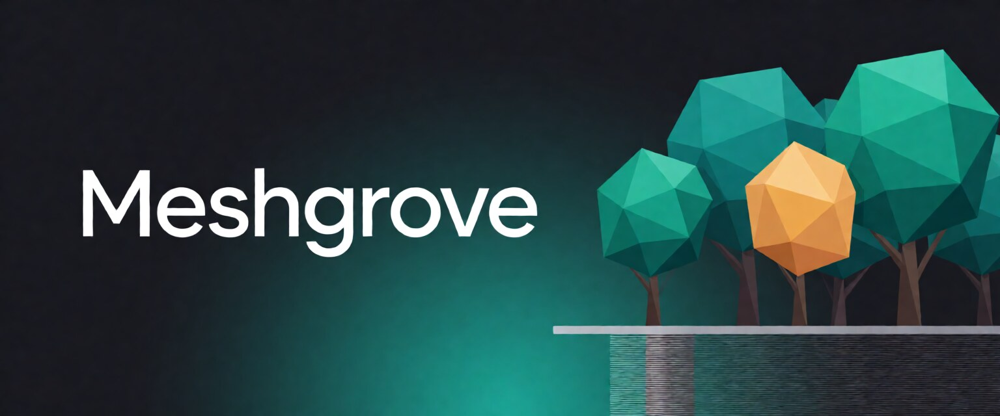
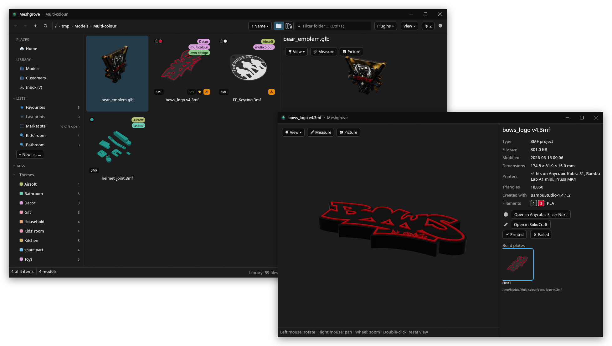
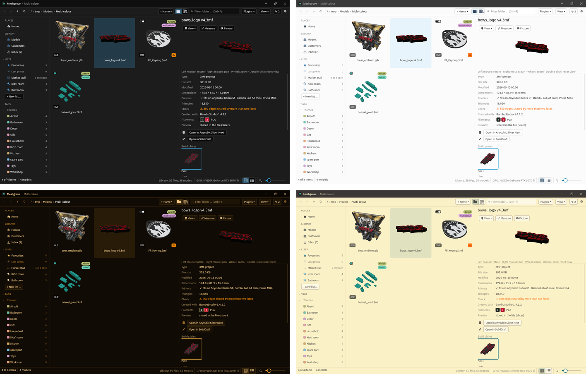
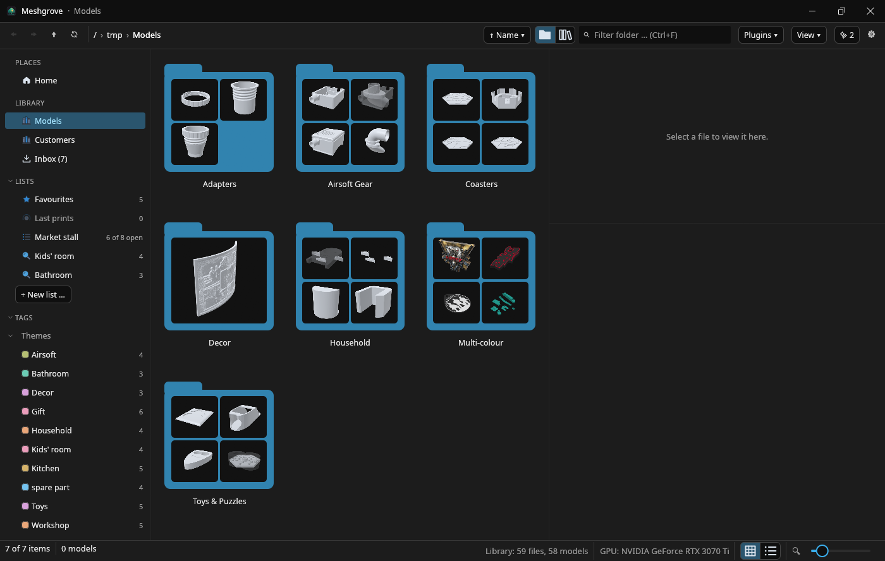
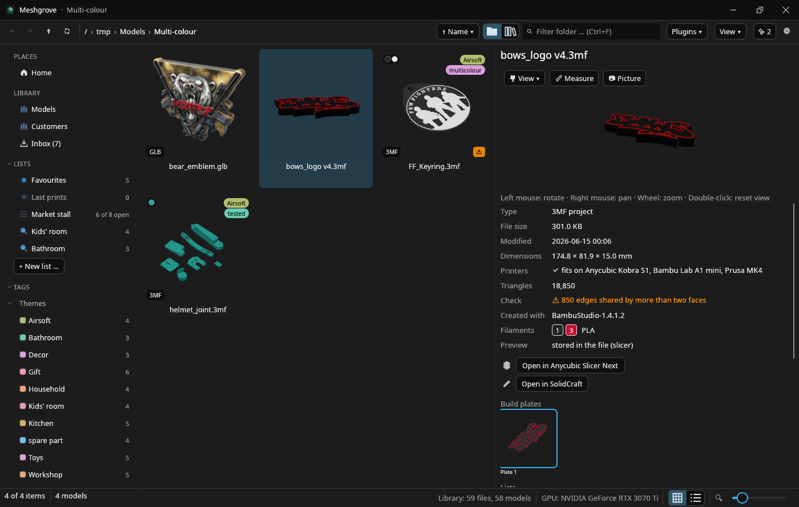
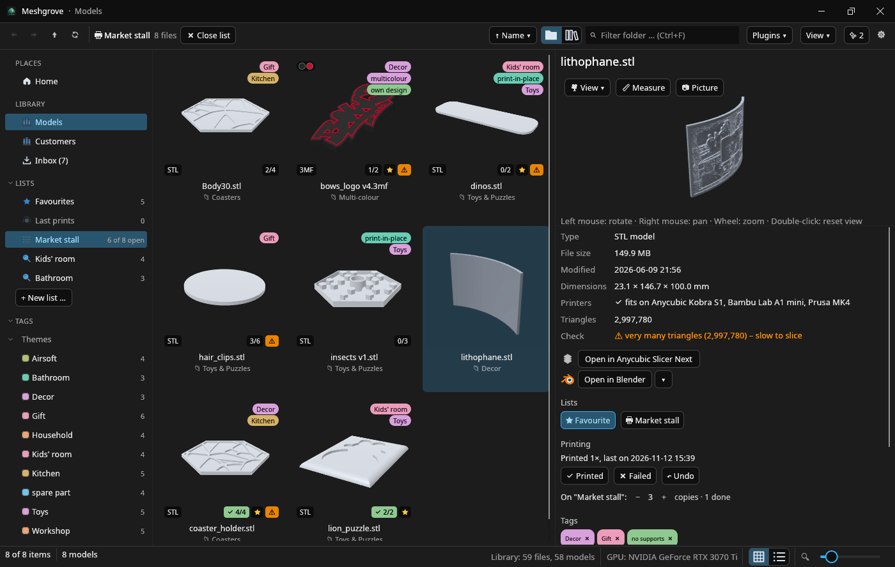
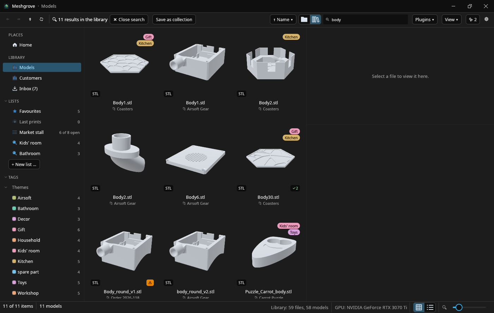
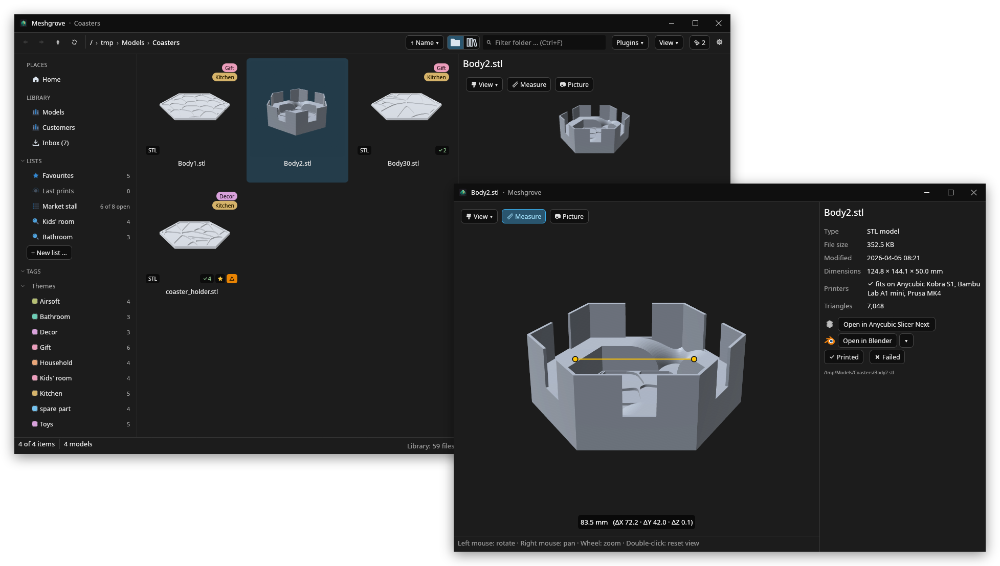
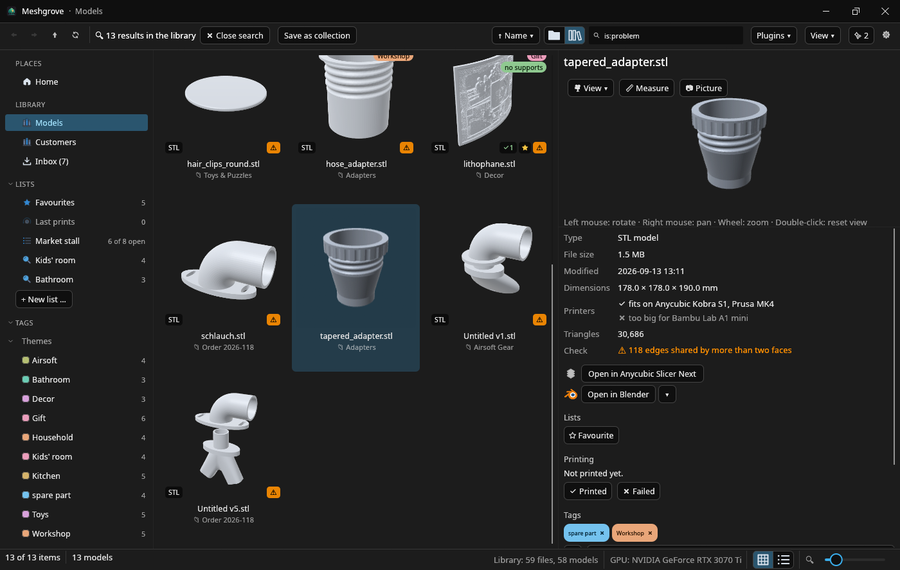
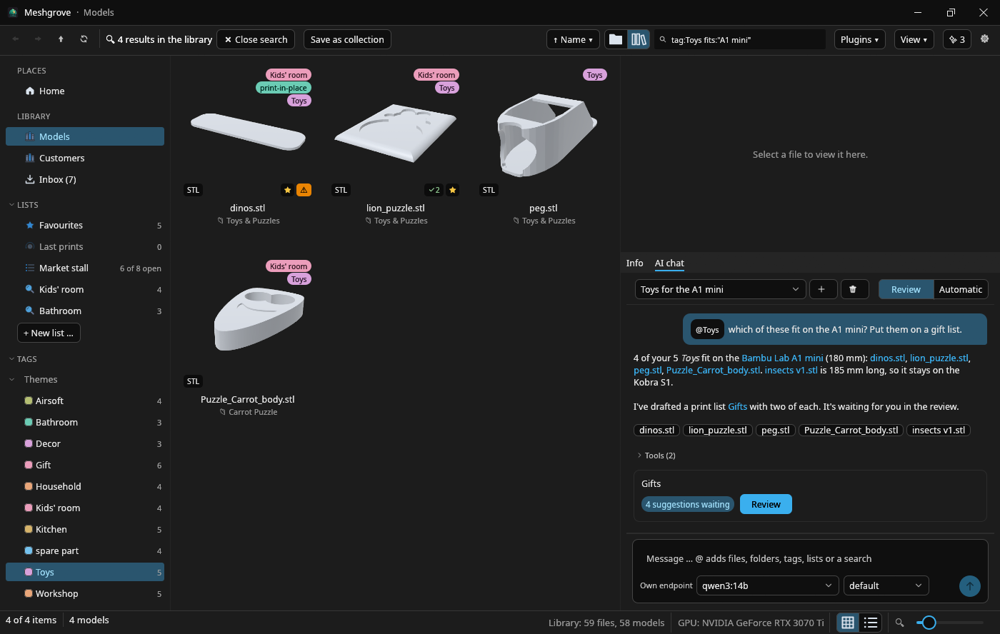

<p align="center">
  
</p>

<p align="center">
  <b>Eine schnelle, native Galerie für deine 3D-Druck-Dateien.</b><br>
  STL, 3MF, STEP, OBJ, glTF und G-code durchblättern wie Fotos, Favoriten und Drucklisten führen und wissen, was du schon gedruckt hast.
</p>

<p align="center">
  <a href="https://github.com/DonDavis-vibe/MeshGrove/actions/workflows/ci.yml"></a>
  <a href="LICENSE"></a>
  
  
  <a href="https://ko-fi.com/don_davis"></a>
</p>

<p align="center">
  <a href="https://meshgrove.redneck-design.de/de/">🌐 Website: meshgrove.redneck-design.de</a> · <a href="README.md">🇬🇧 English version</a>
</p>

---



<p align="center">
  <a href="#installation">Installation</a> · <a href="#erste-schritte">Erste Schritte</a> · <a href="https://github.com/DonDavis-vibe/MeshGrove/blob/main/docs/guide.de.md">Anleitung</a> · <a href="#dokumentation">Dokumentation</a> · <a href="https://github.com/DonDavis-vibe/MeshGrove/releases">Releases</a>
</p>

## Warum Meshgrove?

Wer viel druckt, hat irgendwann Ordner voller Dateien namens `Body1.stl`,
`final_v3_fixed.3mf` und `pack.zip`, und ein Dateimanager zeigt für alle dasselbe Symbol.
Meshgrove zeigt solche Ordner als Galerie mit einer gerenderten Vorschau jedes Modells, auch in
ZIP-, 7z- und RAR-Paketen und aus den Plattenbildern, die dein Slicer in 3MF-Projekten speichert.
Dazu kommt, was eine Sammlung braucht: eine blitzschnelle Suche, Tags und Notizen, Drucklisten,
ein Druckprotokoll, eine Duplikatsuche, ein Druckbett-Check und die Übergabe an den Slicer mit
einem Klick. Deine Ordner bleiben, wie sie sind: Nichts bewegt sich ohne dein Okay, und jede
Änderung lässt sich rückgängig machen. Meshgrove ist nativ und schnell (Rust, gerendert auf der
Grafikkarte über [wgpu](https://wgpu.rs), kein Electron, kein Server), gemacht für große
Sammlungen auf Festplatten und freie Software unter der GPL, ohne Konto, Abo oder Telemetrie.

## Funktionen

- **Galerie und Listenansicht:** Vorschauen für STL, 3MF, STEP, OBJ, PLY, glTF/GLB, G-code, Bilder, PDFs und Readmes; Ordner- und Archiv-Kacheln zeigen ein Mosaik ihres Inhalts; Modelle drehen sich, wenn die Maus darüber ist ([Anleitung](https://github.com/DonDavis-vibe/MeshGrove/blob/main/docs/guide.de.md#die-galerie))
- **3D-Viewer:** in der Seitenleiste, als große Vorschau (Leertaste) oder im eigenen Fenster; Messen in mm, Standardansichten, Bildexport, 3D-Mäuse ([Anleitung](https://github.com/DonDavis-vibe/MeshGrove/blob/main/docs/guide.de.md#der-3d-viewer-und-seine-werkzeuge))
- **3MF-Projekte in Farbe:** die Plattenbilder des Slicers, Filamentfarben pro Teil, bemalte Modelle und Materialfarben
- **Archive:** ZIP, 7z, RAR und TAR öffnen wie Ordner; entpacken, packen und zu ZIPs hinzufügen ([Anleitung](https://github.com/DonDavis-vibe/MeshGrove/blob/main/docs/guide.de.md#archive-zip-7z-rar-tar))
- **Bibliothek und Suche:** ein Index aller deiner Modellordner, sofort durchsucht: `drache ext:3mf tag:bemalt is:ungedruckt` ([Anleitung](https://github.com/DonDavis-vibe/MeshGrove/blob/main/docs/guide.de.md#bibliothek-suche-und-filter))
- **Tags und Notizen** in Farbe, am Inhalt der Datei, damit sie Umbenennen und Verschieben überleben ([Anleitung](https://github.com/DonDavis-vibe/MeshGrove/blob/main/docs/guide.de.md#tags-und-notizen))
- **Favoriten, Sammlungen und Drucklisten** mit der gewünschten Stückzahl, beim Drucken abgehakt, und ein Druckprotokoll, was geklappt hat ([Anleitung](https://github.com/DonDavis-vibe/MeshGrove/blob/main/docs/guide.de.md#favoriten-sammlungen-und-drucklisten))
- **Drucker und Prüfungen:** auf welche deiner Drucker ein Modell passt, dazu Löcher, lose Teile oder verdächtige Größen, bevor du slicest ([Anleitung](https://github.com/DonDavis-vibe/MeshGrove/blob/main/docs/guide.de.md#drucker-und-druckbett-check))
- **G-code:** das Bild des Slicers oder die Druckbahnen, Druckzeit, Filament und eine Warnung, wenn er für einen anderen Drucker gesliced wurde ([Anleitung](https://github.com/DonDavis-vibe/MeshGrove/blob/main/docs/guide.de.md#g-code-dateien))
- **Eingang und Import:** neue Dateien nach dem Ordner oder ZIP gruppiert, mit dem sie kamen; ein Download-Ordner, in die Bibliothek geholt und nach Tag abgelegt ([Anleitung](https://github.com/DonDavis-vibe/MeshGrove/blob/main/docs/guide.de.md#der-eingang))
- **Duplikate finden:** exakte Kopien und dasselbe Modell in anderer Form, in einem Rutsch aufgeräumt ([Anleitung](https://github.com/DonDavis-vibe/MeshGrove/blob/main/docs/guide.de.md#duplikate-finden))
- **Slicer und andere Programme:** ein oder viele Modelle im Slicer oder Mesh-Editor öffnen; echte Dateien kopieren, ausschneiden und einfügen ([Anleitung](https://github.com/DonDavis-vibe/MeshGrove/blob/main/docs/guide.de.md#zusammenarbeit-mit-slicer-und-anderen-programmen))
- **KI, nur wenn du willst:** dein eigener Assistent über MCP oder der Chat mit eigenem Endpunkt oder einem KI-Agenten auf deinem Rechner; nichts ändert sich, bevor du es annimmst ([Anleitung](https://github.com/DonDavis-vibe/MeshGrove/blob/main/docs/guide.de.md#ki-assistent-und-mcp-freiwillig))
- **Plugins:** abgeschottete Werkzeuge wie [Bingrove](https://github.com/DonDavis-vibe/Bingrove) (Gridfinity-Einsätze) und [Texgrove](https://github.com/DonDavis-vibe/Texgrove) (Texturen als echte Geometrie) ([Anleitung](https://github.com/DonDavis-vibe/MeshGrove/blob/main/docs/guide.de.md#plugins-freiwillig))
- **Dein Aussehen:** 27 Themes, Bereiche, die du anordnest, wie du willst, und Meshgroves eigene Titelleiste ([Anleitung](https://github.com/DonDavis-vibe/MeshGrove/blob/main/docs/guide.de.md#die-galerie))
- **Linux, Windows und macOS**, auf Deutsch und Englisch; unter Linux auch Vorschauen in Dolphin und Dateidialogen ([Anleitung](https://github.com/DonDavis-vibe/MeshGrove/blob/main/docs/guide.de.md#plattformen))

Alle Funktionen in einer Tabelle: [Funktionen im Überblick](https://github.com/DonDavis-vibe/MeshGrove/blob/main/docs/guide.de.md#funktionen-im-überblick).

## Screenshots

**Dein Aussehen:** dasselbe Fenster in vier der 27 Themes.


**Ordner-Kacheln zeigen, was drin ist.** Du findest dich über das Bild zurecht, statt Namen zu lesen.


**Modelle in ihren Farben:** Filamente pro Teil, bemalte Flächen, Material- und Vertex-Farben.


**Drucklisten** zählen die fertigen von den gewünschten Stück; die Seitenleiste hält Listen und Tags.


**Eine Suche für die ganze Bibliothek**, über alle deine Ordner.


**Jedes Modell im eigenen Fenster**, mit denselben Werkzeugen, hier beim Messen in mm.


**Mehrere Drucker und eine Druckbarkeits-Prüfung:** wo ein Modell passt und was zu prüfen ist.


**Deine eigene KI, wenn du willst:** Antworten verlinken die Modelle, und Änderungen warten auf dein Okay.


## Installation

Zu jedem [Release](https://github.com/DonDavis-vibe/MeshGrove/releases) gibt es fertige
Pakete, alle mit STEP-Vorschauen. Bauen musst du nichts:

| System | Download |
|---|---|
| Windows 10/11 (x64) | `Meshgrove-<version>-windows-x64-setup.exe` (Installer) oder `…-windows-x64-portable.zip` |
| macOS 11 oder neuer (Apple Silicon und Intel) | `Meshgrove-<version>-macos-universal.dmg` |
| Ubuntu 24.04 / 26.04, Debian 13 | `meshgrove_<version>-1_<release>_amd64.deb` |
| Fedora 44 | `meshgrove-<version>-1.fc44.x86_64.rpm` |
| Jedes andere Linux (x86_64) | `Meshgrove-<version>-x86_64.AppImage` |

Hauptplattform ist Linux: Meshgrove wird auf Fedora/Nobara mit KDE Plasma unter Wayland
entwickelt und täglich genutzt. Die Windows- und macOS-Versionen werden automatisch gebaut und
getestet, wurden im Alltag aber weniger benutzt; bitte [melde Probleme](https://github.com/DonDavis-vibe/MeshGrove/issues).

### Linux

```bash
sudo apt install ./meshgrove_<version>-1_ubuntu24.04_amd64.deb   # Ubuntu, Debian
sudo dnf install ./meshgrove-<version>-1.fc44.x86_64.rpm         # Fedora
```

Die Pakete richten den Menüeintrag, das Symbol, den Dateityp `model/step` und den
[Vorschau-Dienst für Dolphin](https://github.com/DonDavis-vibe/MeshGrove/blob/main/docs/guide.de.md#vorschauen-in-dolphin-und-dateidialogen-linux)
und andere Dateimanager ein. Starte **Meshgrove** aus dem Anwendungsmenü oder mit `meshgrove`,
auf Wunsch mit Ordner oder Datei: `meshgrove ~/3D-Modelle`. Systeme, die auf einer unterstützten
Version aufbauen, nehmen deren Paket, etwa Linux Mint 22 das für Ubuntu 24.04. Entfernen mit
`sudo apt remove meshgrove` oder `sudo dnf remove meshgrove`.

**AppImage:** `chmod +x Meshgrove-<version>-x86_64.AppImage`, dann starten. Es bringt alles mit,
auch STEP, und läuft auf x86_64-Distributionen mit glibc 2.35 oder neuer (Ubuntu 22.04, Debian 12
und neuer). Einen Menüeintrag legt es nicht selbst an (das erledigen Werkzeuge wie
[Gear Lever](https://flathub.org/apps/it.mijorus.gearlever) oder AppImageLauncher), und
Vorschauen im Dateimanager bringt es nicht mit.

#### Aus dem Quellcode

Rust 1.95 oder neuer und libarchive installieren, auf Wunsch OpenCascade (STEP-Vorschauen) und
poppler (PDF-Vorschauen); die Paketnamen für jede Distribution stehen in der
[Entwickler-Doku](https://github.com/DonDavis-vibe/MeshGrove/blob/main/docs/development.de.md#aus-dem-quellcode-bauen).
Dann für deinen Benutzer bauen und installieren (ohne Root-Rechte), mit Menüeintrag, Symbol und
Vorschau-Dienst (Thumbnailer):

```bash
git clone https://github.com/DonDavis-vibe/MeshGrove.git
cd MeshGrove
packaging/install.sh
```

Aktualisieren mit `git pull && packaging/install.sh`, entfernen mit `packaging/install.sh --uninstall`.

### Windows

`Meshgrove-<version>-windows-x64-setup.exe` von den
[Releases](https://github.com/DonDavis-vibe/MeshGrove/releases) herunterladen und ausführen.
SmartScreen warnt eventuell, weil das Programm nicht signiert ist: *Weitere Informationen →
Trotzdem ausführen*. Der Installer braucht keine Adminrechte (er installiert für deinen Benutzer
oder, wenn du das wählst, für alle) und legt einen Startmenü-Eintrag an und Meshgrove unter
*Öffnen mit* für STL-, 3MF-, STEP-, OBJ-, PLY- und glTF-Dateien; entfernen unter
*Einstellungen → Apps*. Lieber ohne Installation? `…-windows-x64-portable.zip` irgendwohin
entpacken und `meshgrove.exe` starten. Für PDF-Vorschauen
[poppler](https://github.com/oschwartz10612/poppler-windows) installieren, mit `pdftoppm.exe` im `PATH`.

### macOS

`Meshgrove-<version>-macos-universal.dmg` öffnen und **Meshgrove** auf *Programme* ziehen. Die
App ist nicht notarisiert: Beim ersten Start mit Rechtsklick → *Öffnen* starten, oder einmal
`xattr -dr com.apple.quarantine /Applications/Meshgrove.app` ausführen. Für PDF-Vorschauen:
`brew install poppler`.

## Erste Schritte

1. **Einen Ordner öffnen.** Meshgrove startet im zuletzt benutzten Ordner oder in deinem
   persönlichen Ordner. Navigiere über die Seitenleiste (*Orte*, *Geräte*, Ordnerbaum), die
   Pfadleiste oben oder per Doppelklick. Die Vorschauen erscheinen sofort: sichtbare Kacheln
   zuerst, der Rest im Hintergrund.
2. **Deine Modellordner zur Bibliothek hinzufügen.** In der Seitenleiste auf *➕ Diesen Ordner
   zur Bibliothek hinzufügen* klicken (oder *Einstellungen → Bibliothek → Bibliotheksordner*).
   Bibliotheksordner werden indiziert: Du kannst sie durchsuchen, Dateien taggen, Notizen
   schreiben und Duplikate finden. Die erste Erfassung einer großen Sammlung läuft im
   Hintergrund; die Statusleiste zeigt den Fortschritt.
3. **Ein Modell ansehen.** Eine Kachel anklicken, und rechts erscheint das Modell im
   3D-Viewer, mit Maßen, Dreiecken und dem Hinweis, ob es auf deinen Drucker passt. Mit der
   Maus über eine Kachel fahren, und das Modell dreht sich.
4. **An den Slicer geben.** Rechtsklick → *In Anycubic Slicer Next öffnen* (oder welcher
   Slicer gefunden wurde). Vorher mehrere Modelle auswählen, um alle auf einmal zu öffnen.
5. **Den Überblick behalten.** Strg+D macht ein Modell zum Favoriten. Rechtsklick → *Zur Liste*
   legt es auf eine Druckliste oder in eine Sammlung, und *Als gedruckt eintragen* merkt sich,
   dass du es gedruckt hast.

## Dokumentation

- [Anleitung](https://github.com/DonDavis-vibe/MeshGrove/blob/main/docs/guide.de.md): alles, was Meshgrove kann, Schritt für Schritt, mit allen Funktionen im Überblick
- [Tastatur und Maus](https://github.com/DonDavis-vibe/MeshGrove/blob/main/docs/guide.de.md#tastatur-und-maus) und [unterstützte Dateitypen](https://github.com/DonDavis-vibe/MeshGrove/blob/main/docs/guide.de.md#unterstützte-dateitypen)
- [Einstellungen und Dateien auf der Platte](https://github.com/DonDavis-vibe/MeshGrove/blob/main/docs/guide.de.md#einstellungen-und-dateien-auf-der-platte): das Einstellungsfenster, `config.toml` und wo Meshgrove seine Daten ablegt
- [Datenschutz und Sicherheit](https://github.com/DonDavis-vibe/MeshGrove/blob/main/docs/guide.de.md#datenschutz-und-sicherheit)
- [Probleme und häufige Fragen](https://github.com/DonDavis-vibe/MeshGrove/blob/main/docs/guide.de.md#probleme-und-häufige-fragen)
- [Plugins](https://github.com/DonDavis-vibe/MeshGrove/blob/main/docs/plugins.md) (englisch): Plugins installieren, freigeben und schreiben
- [Entwicklung](https://github.com/DonDavis-vibe/MeshGrove/blob/main/docs/development.de.md): Bauen auf jedem System, Aufbau, Tests und Ausblick
- [Release-Notes](https://github.com/DonDavis-vibe/MeshGrove/releases) (englisch): was in jeder Version neu ist

## Mitmachen

Fehlermeldungen, Ideen und Pull Requests sind im
[Issue-Tracker](https://github.com/DonDavis-vibe/MeshGrove/issues) willkommen. Hilfreich in
einer Fehlermeldung: Betriebssystem, Grafikkarte, was du getan hast, und die Log-Datei
`meshgrove.log` (den Pfad zeigt *Einstellungen → Über Meshgrove*; mit `RUST_LOG=meshgrove=debug`
gestartet, steht mehr darin). Eine Beispieldatei hilft sehr, wenn ein Modell falsch dargestellt
wird, sofern du sie teilen darfst.

Für Code: Vor einem Pull Request `cargo fmt`, `cargo clippy` und `cargo test` ausführen.
Kommentare und Bezeichner bleiben englisch. Neuer sichtbarer Text läuft über `t!("…")`, mit
Einträgen in beiden Sprachdateien. Mit dem Einreichen eines Beitrags stimmst du zu, dass er
unter denselben Bedingungen wie Meshgrove lizenziert wird (GPL-3.0-or-later).

## Trinkgeld

Meshgrove ist kostenlos und bleibt es. Wenn es dir Zeit spart oder Ordnung in deine
Druckbibliothek bringt, kannst du auf **[Ko-fi](https://ko-fi.com/don_davis)** ein Trinkgeld
dalassen. Fehlermeldungen, Ideen und ein ⭐ auf GitHub sind genauso willkommen.

## Danksagung

Meshgrove wird von **Davis** und **[@Rec0iL](https://github.com/Rec0iL)** als Projekt von
**[German Redneck Engineering](https://redneck-design.de/)** entwickelt. Die neue Oberfläche auf
dem UI-Kit von [SolidCraft](https://github.com/tangency-labs/solidcraft) (0.12), die KI-Agenten,
die Prüfliste, die Archive und die Arbeit an den Duplikaten stammen von Rec0iL.

Es baut auf großartiger Open-Source-Arbeit auf: [egui/eframe](https://github.com/emilk/egui) mit
[egui_tiles](https://github.com/rerun-io/egui_tiles), [egui_extras](https://github.com/emilk/egui)
und [egui_commonmark](https://github.com/lampsitter/egui_commonmark) (mit
[pulldown-cmark](https://github.com/pulldown-cmark/pulldown-cmark)), [wgpu](https://wgpu.rs),
[glam](https://github.com/bitshifter/glam-rs), [rusqlite](https://github.com/rusqlite/rusqlite) mit
[SQLite](https://sqlite.org), [libarchive](https://libarchive.org) über
[compress-tools](https://github.com/OSSystems/compress-tools-rs),
[OpenCascade](https://dev.opencascade.org), [poppler](https://poppler.freedesktop.org),
[notify](https://github.com/notify-rs/notify), [zip](https://github.com/zip-rs/zip2),
[quick-xml](https://github.com/tafia/quick-xml), [image](https://github.com/image-rs/image),
[krilla](https://github.com/LaurenzV/krilla) (PDF-Checklisten),
[ab_glyph](https://github.com/alexheretic/ab-glyph),
[BLAKE3](https://github.com/BLAKE3-team/BLAKE3), [trash](https://github.com/Byron/trash-rs),
[wl-clipboard-rs](https://github.com/YaLTeR/wl-clipboard-rs),
[clipboard-rs](https://github.com/ChurchTao/clipboard-rs) und
[rust-i18n](https://github.com/longbridge/rust-i18n) und vielen mehr. Das Finden und Verbinden der
KI-Assistenten ist von [SolidCraft](https://github.com/tangency-labs/solidcraft) übernommen (MIT).
Logo und Banner sind mit dem Bildmodell Krea 2 entstanden.

Alle Modelle auf den Screenshots sind eigene Designs von German Redneck Engineering.

## Lizenz

Copyright © 2026 Davis und Rec0iL · German Redneck Engineering

Meshgrove ist freie Software: Du kannst es unter den Bedingungen der
[GNU General Public License](LICENSE), wie von der Free Software Foundation veröffentlicht,
weitergeben und/oder verändern, entweder gemäß Version 3 der Lizenz oder (nach deiner Wahl)
jeder späteren Version.

Meshgrove wird in der Hoffnung verbreitet, dass es nützlich ist, aber OHNE JEDE GEWÄHRLEISTUNG,
sogar ohne die implizite Gewährleistung der MARKTFÄHIGKEIT oder EIGNUNG FÜR EINEN BESTIMMTEN
ZWECK. Details stehen in der [GNU General Public License](LICENSE). Rechtlich verbindlich ist
der englische Lizenztext.

Die Themes der Oberfläche und die daraus gezeichneten Bedienelemente sind das UI-Kit von
SolidCraft (MIT OR Apache-2.0); es liegt in `vendor/`, seine Theme-Dateien und Icons in `assets/`.
Die Theme-Schrift ist IBM Plex Sans (SIL Open Font License 1.1).

Der STEP-Helfer nutzt OpenCascade (LGPL-2.1 mit Ausnahme) als eigenes Programm; für
PDF-Vorschauen wird `pdftoppm` von poppler (GPL) als externes Programm aufgerufen. Die Lizenzen
aller Bibliotheken und Schriften, die in das Programm eingebaut sind, stehen in
`THIRD-PARTY-LICENSES.md`, die jedem Release-Paket beiliegt. In den Paketen für Windows, macOS
und im AppImage ist OpenCascade in den STEP-Helfer eingebaut; der Quellcode dieser
OpenCascade-Version hängt an jedem Release.

Anycubic, OrcaSlicer, Bambu Studio, PrusaSlicer, KDE, Dolphin, Windows und macOS sind Marken
ihrer jeweiligen Inhaber. Meshgrove ist ein unabhängiges Projekt und steht mit ihnen in keiner
Verbindung.

[Impressum](https://redneck-design.de/impressum.html) und
[Datenschutzerklärung](https://redneck-design.de/datenschutz.html) von German Redneck
Engineering.
