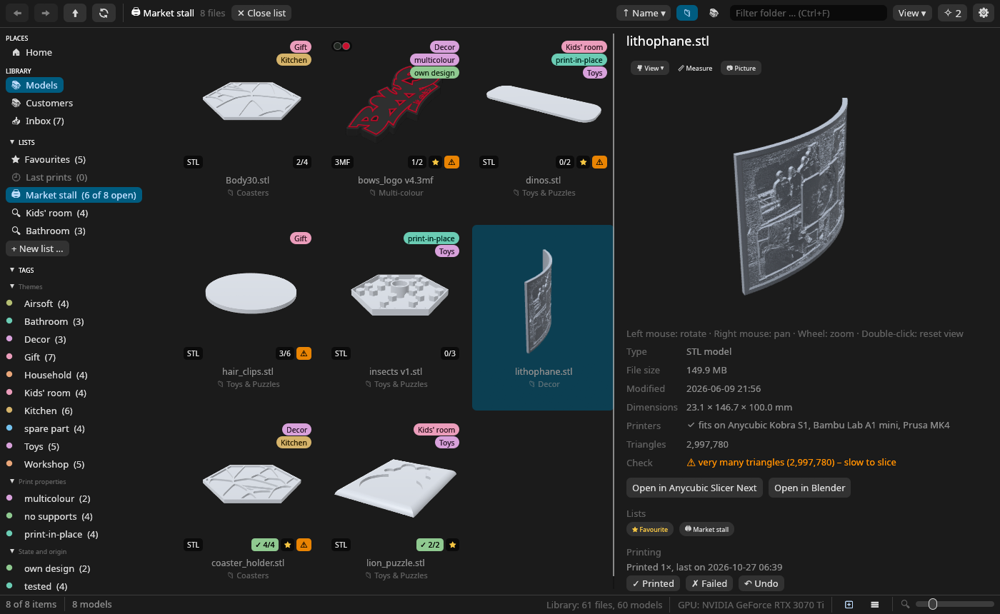
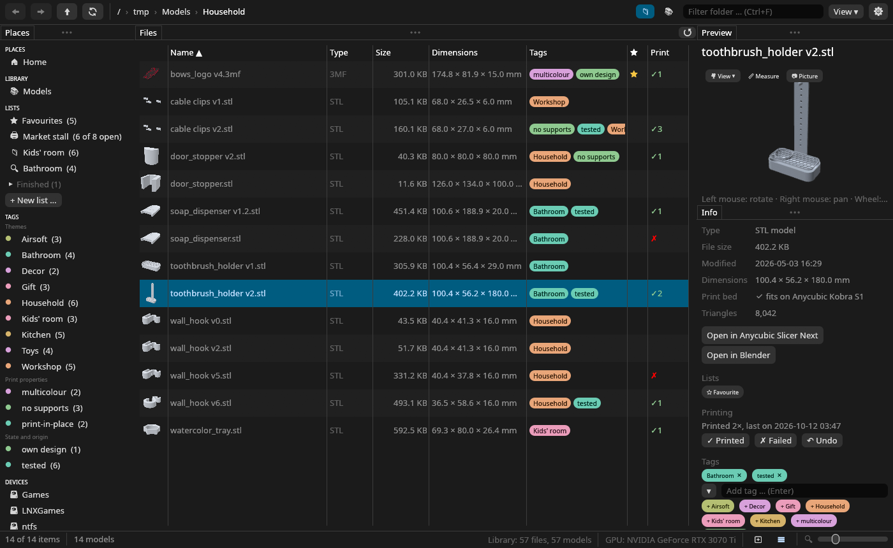
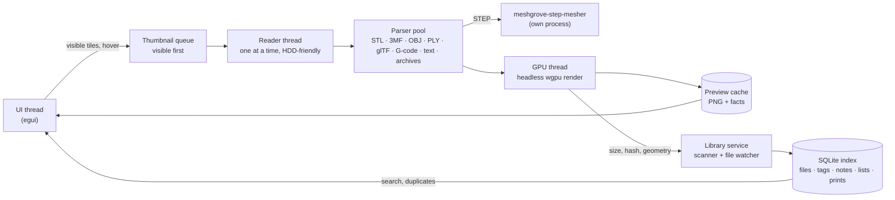

<p align="center">
  
</p>

<p align="center">
  <b>A fast, native gallery for your 3D-print files.</b><br>
  Browse STL, 3MF, STEP, OBJ, glTF and G-code files like photos, keep favourites and print lists, and know what you have printed.
</p>

<p align="center">
  <a href="https://github.com/DonDavis-vibe/MeshGrove/actions/workflows/ci.yml"></a>
  <a href="LICENSE"></a>
  
  
  <a href="https://ko-fi.com/don_davis"></a>
</p>

<p align="center">
  <a href="README.de.md">🇩🇪 Deutsche Version</a>
</p>

---


## Contents

- [Why Meshgrove?](#why-meshgrove)
- [Features at a glance](#features-at-a-glance)
- [Screenshots](#screenshots)
- [Installation](#installation)
- [Getting started](#getting-started)
- [User guide](#user-guide)
  - [Browsing the gallery](#browsing-the-gallery)
  - [The 3D viewer and its tools](#the-3d-viewer-and-its-tools)
  - [The details panel](#the-details-panel)
  - [Library, search and filters](#library-search-and-filters)
  - [Tags and notes](#tags-and-notes)
  - [Favourites, collections and print lists](#favourites-collections-and-print-lists)
  - [The print log](#the-print-log)
  - [G-code files](#g-code-files)
  - [Readmes and text files](#readmes-and-text-files)
  - [Print bed check](#print-bed-check)
  - [Duplicate finder](#duplicate-finder)
  - [Working with your slicer and other apps](#working-with-your-slicer-and-other-apps)
  - [Archives (ZIP, 7z, RAR, TAR)](#archives-zip-7z-rar-tar)
  - [Moving files to the trash](#moving-files-to-the-trash)
  - [Backups, export and import](#backups-export-and-import)
  - [Thumbnails in Dolphin and file dialogs (Linux)](#thumbnails-in-dolphin-and-file-dialogs-linux)
- [Keyboard and mouse reference](#keyboard-and-mouse-reference)
- [Supported file types](#supported-file-types)
- [Settings and files on disk](#settings-and-files-on-disk)
- [Privacy and safety](#privacy-and-safety)
- [Performance](#performance)
- [Platform support](#platform-support)
- [Troubleshooting and FAQ](#troubleshooting-and-faq)
- [Building from source](#building-from-source)
- [Architecture](#architecture)
- [Development](#development)
- [Roadmap](#roadmap)
- [Contributing](#contributing)
- [Tip jar](#tip-jar)
- [Credits](#credits)
- [License](#license)

## Why Meshgrove?

Anyone who prints a lot ends up with folders full of files called `Body1.stl`,
`final_v3_fixed.3mf` and `pack.zip`. A normal file manager shows a generic icon for each of
them, so you open model after model in the slicer just to find the right one.

Meshgrove shows those folders as a gallery with a rendered preview of every model. That
includes the models inside ZIP/7z/RAR packs and the plate pictures your slicer stored in 3MF
projects. It also gives you what a model collection needs: an instant search across the whole
library, tags and notes, favourites, collections and print lists, a log of what you printed, a
duplicate finder, a print-bed check, and a one-click hand-over to your slicer.

What makes it different from other model managers:

- **Your folders stay as they are.** Meshgrove browses and indexes files where they are. It
  never imports, copies, renames or reorganises anything, and it works fine on read-only
  drives.
- **Native and fast.** It is written in Rust and renders with the GPU (Vulkan, Metal or
  DirectX 12 through [wgpu](https://wgpu.rs)). There is no Electron, no web view and no server.
  Thousands of files and models with millions of triangles stay fluid.
- **Free and open source** under the GPL, with no account, subscription or telemetry.
- **Made for real libraries on spinning hard drives.** Reads are scheduled so visible tiles
  come first, and everything else is cached.

## Features at a glance

| Area | What you get |
|---|---|
| **Gallery** | Thumbnails for STL, 3MF, STEP, OBJ, PLY, glTF/GLB, G-code, images, PDFs and readmes; folder and archive tiles show a 2×2 mosaic of what is inside (optionally also models from subfolders on disk, fading through them); **tiles or a sortable list** with the columns you choose; resizable tiles (slider in the status bar, growing smoothly towards the pointer); sort by name, date, size or type; "models and G-code only"; "include subfolders" (all files below a folder in one grid); multi-selection |
| **Panes** | Places, files, preview and info are panes: drag a header to move one, drop it on an edge to split or on another header to stack; the dividers resize them; *Lock the panes* in the settings keeps them where they are |
| **Hover turntable** | Point at a model tile and the model spins in place. Drag to turn it yourself, and turn the wheel while dragging to zoom |
| **3D viewer** | In the side panel, or **double-click a model for a window of its own** (resizable, several at once, with "open in slicer"), or **press Space for a large preview** over the window (just the model until you click ☰); smoother edges and optional studio lighting for both; what a double-click does can be changed (model window, large preview, slicer, mesh editor or the default app); orbit, pan and zoom with a fixed pivot (turning never shifts the model); standard views (front, back, left, right, top, bottom, angled); **point-to-point measuring in mm**; **picture export** as a 2048 px PNG |
| **3MF projects** | Embedded slicer plate pictures (Bambu Studio, OrcaSlicer, Anycubic, Elegoo, Creality Print, PrusaSlicer); click a plate picture to see that plate in 3D; **multi-colour**: filament colours per object and part, painted models (multi-material painting) and 3MF material colours in the viewer and in rendered previews; filament swatches on tiles and in the details; title, designer and application from the metadata |
| **STEP / STP** | CAD files are tessellated by OpenCascade in a separate helper process, so a broken file cannot crash the app; results are cached |
| **Archives** | Open ZIP, 7z, RAR and TAR like folders; every model inside gets a preview; files are extracted only when another program needs them |
| **Library** | Index (SQLite) of all library folders; instant search such as `dragon ext:3mf tag:painted is:unprinted`; changes on disk are picked up automatically, and *Rescan folder* catches anything else |
| **Tags and notes** | Tags and notes belong to the file *content*, so they survive renames and moves; **tags in colours**, as pills or dots on the tiles; suggested tags for themes (garden, workshop, kids' room …), print properties and state; the search finds note text too; daily automatic backups; export and import as JSON |
| **Favourites and lists** | ★ favourites (Ctrl+D); **collections** across folders, hand-picked or a saved search that stays current; **print lists** with the copies you need of each model, ticked off as you print, then archived; a print list becomes a **PDF checklist** with pictures or a CSV file |
| **Print log** | Log a print as printed or failed (and undo it); tiles show ✓2 or ✗; show only what is not printed yet, printed or failed; search with `is:printed`, `is:unprinted`, `is:failed` |
| **G-code** | Previews from the picture the slicer embedded (PNG, JPG, QOI), or the toolpaths drawn when there is none; slicer, printer, print time, filament (grams, metres, material, colour), layers, nozzle and cost; a warning when a file was sliced for another printer |
| **Readmes** | Text files (`.txt`, `.md`, `.nfo`, `README`, `LICENSE`) get a page preview; the preview pane shows them in full, Markdown formatted with links that open in the browser; a selected folder shows its readme |
| **Print bed check** | Reads the printer selected in Anycubic Slicer Next, OrcaSlicer or Bambu Studio (or takes your own build volume) and marks models that only fit when turned (↻ 41°) or are too big (✕) |
| **Duplicates** | Finds exact copies and the same model saved differently (ASCII vs binary STL, STL vs 3MF, rotated or moved copies), suggests which copy to keep and can move the others to the trash |
| **Slicer and apps** | "Open in slicer" for one or many models (finds the 10 most common filament and 10 resin slicers, whether installed as a package, Flatpak, Snap or AppImage; add the ones you use with a ＋ in the settings, pick a default, the others sit in a submenu), into the slicer window that is already open where the slicer allows it; "open in" your **mesh editors or CAD programs** (finds Blender, FreeCAD, Autodesk Fusion, MeshLab, Meshmixer, SolidCraft, OpenSCAD, SolveSpace, CloudCompare, Rhino and SketchUp, again in every install variant; add and choose a default in the settings); **Ctrl+C copies the files** for pasting into the file manager or slicer; "show in file manager"; open with the default app |
| **Desktop integration** | Menu entry, icon, file associations; on Linux the same renderer also provides **thumbnails in Dolphin and file dialogs** |
| **Languages** | English and German, following the system language (switchable in the settings) |

## Screenshots

**Folder tiles show what is inside.** Every folder and archive gets a mosaic of its first
models, so you can navigate by looking instead of reading names.


**Models in their colours.** Multi-colour 3MF projects show the filament of every part and
their painted areas, plain 3MF files their material colours, and OBJ, PLY and glTF their vertex
colours and textures. Tiles get a dot per filament; the details list slot and material.


**Favourites, collections and print lists.** A print list for a market stall: every model with
the copies done of those needed (`1/3`), finished ones in green at the end, tags in their
colours, and a 150 MB lithophane in the viewer. The sidebar holds the favourites, print
lists and collections (hand-picked or a saved search), and the tags in groups.



**The list view.** The same files as a table, with dimensions, tags, favourites and the print log
at a glance. Click a column title to sort by it, right-click it to choose the columns.



**One search for the whole library.** Here `body` finds every model with "body" in its name,
from four different folders.


**Every model in a window of its own.** Double-click a model to open it next to the gallery, as
large as you like and with the same tools. Here it measures a coaster holder: click two points
on the surface to get the distance in mm, with the difference along each axis.


**Duplicate finder.** Exact copies and identical geometry, grouped, with a suggestion which
copy to keep and one click to move the others to the trash.


## Installation

> **Status:** Meshgrove is young. Linux (developed and used daily on Fedora/Nobara with KDE
> Plasma on Wayland) is the main platform. The Windows and macOS builds are new. They are
> built and tested automatically, but have seen little real-world use so far. Please
> [report problems](https://github.com/DonDavis-vibe/MeshGrove/issues).

Every [release](https://github.com/DonDavis-vibe/MeshGrove/releases) has ready-made packages,
all with STEP previews. Nothing needs to be built:

| System | Download |
|---|---|
| Windows 10/11 (x64) | `Meshgrove-<version>-windows-x64-setup.exe` (installer) or `…-windows-x64-portable.zip` |
| macOS 11 or newer (Apple Silicon and Intel) | `Meshgrove-<version>-macos-universal.dmg` |
| Ubuntu 24.04 / 26.04, Debian 13 | `meshgrove_<version>-1_<release>_amd64.deb` |
| Fedora 44 | `meshgrove-<version>-1.fc44.x86_64.rpm` |
| Any other Linux (x86_64) | `Meshgrove-<version>-x86_64.AppImage` |

### Linux

#### Packages for Ubuntu, Debian and Fedora

Download the package for your release and install it:

```bash
sudo apt install ./meshgrove_<version>-1_ubuntu24.04_amd64.deb   # Ubuntu, Debian
sudo dnf install ./meshgrove-<version>-1.fc44.x86_64.rpm         # Fedora
```

The packages use your system's libarchive and OpenCascade. They add the menu entry, the icon,
the `model/step` file type and the [thumbnailer for Dolphin](#thumbnails-in-dolphin-and-file-dialogs-linux)
and other file managers. Start **Meshgrove** from your application menu, or run `meshgrove`
(optionally with a folder or file: `meshgrove ~/3D-Models`). Systems based on a supported
release take its package, e.g. Linux Mint 22 the one for Ubuntu 24.04. A package only installs
on the release it was made for; elsewhere, use the AppImage. Remove Meshgrove with
`sudo apt remove meshgrove` or `sudo dnf remove meshgrove`.

#### AppImage (any distribution)

```bash
chmod +x Meshgrove-<version>-x86_64.AppImage
./Meshgrove-<version>-x86_64.AppImage
```

The AppImage brings everything it needs, STEP support included, and runs on x86_64
distributions with glibc 2.35 or newer (Ubuntu 22.04, Debian 12 and everything newer). It adds
no menu entry by itself (tools like [Gear Lever](https://flathub.org/apps/it.mijorus.gearlever)
or AppImageLauncher do that) and no file-manager thumbnails; for those, use a package or the
source build.

#### From source

Building takes a few minutes and works on any distribution.

1. Install Rust and the libraries:

   | Distribution | Command |
   |---|---|
   | Fedora / Nobara | `sudo dnf install rust cargo gcc-c++ libarchive-devel opencascade-devel poppler-utils` |
   | Debian / Ubuntu | `sudo apt install cargo g++ pkg-config libarchive-dev libxkbcommon-dev libwayland-dev libocct-data-exchange-dev poppler-utils` |
   | Arch / Manjaro | `sudo pacman -S rust gcc libarchive opencascade poppler` |

   OpenCascade (version 7.5 or newer) is optional. Without it everything works except STEP
   previews. poppler is optional too and only provides PDF previews. If your distribution's
   Rust is older than 1.95 (Ubuntu 24.04, Debian 13), install a current one with
   [rustup](https://rustup.rs).

2. Build and install for your user (no root needed):

   ```bash
   git clone https://github.com/DonDavis-vibe/MeshGrove.git
   cd MeshGrove
   packaging/install.sh
   ```

   This builds release binaries and puts them in `~/.local/bin`. It also adds the menu entry,
   the icon, the `model/step` file type and the thumbnailer in `~/.local/share`.

3. Update later with `git pull && packaging/install.sh`. Remove it with
   `packaging/install.sh --uninstall`. Your settings, index and cache are kept; see
   [Settings and files on disk](#settings-and-files-on-disk) if you want to delete them too.

### Windows

1. Download `Meshgrove-<version>-windows-x64-setup.exe` from the
   [releases](https://github.com/DonDavis-vibe/MeshGrove/releases) and run it. Windows
   SmartScreen may warn because the program is not signed: choose *More info → Run anyway*.
2. The installer needs no admin rights: it installs for your user, or for all users if you
   choose so on its first page. It adds a Start menu entry, optionally a desktop shortcut, and
   Meshgrove under *Open with* for STL, 3MF, STEP, OBJ, PLY and glTF files. Remove it under *Settings → Apps*.
3. Optional, for PDF previews: install [poppler](https://github.com/oschwartz10612/poppler-windows)
   and make sure `pdftoppm.exe` is on your `PATH`.

Prefer not to install? `Meshgrove-<version>-windows-x64-portable.zip` holds the same programs:
unpack it anywhere and start `meshgrove.exe`.

### macOS

1. Download `Meshgrove-<version>-macos-universal.dmg` from the
   [releases](https://github.com/DonDavis-vibe/MeshGrove/releases). It runs natively on Apple
   Silicon and Intel Macs with macOS 11 or newer.
2. Open it and drag **Meshgrove** onto *Applications*.
3. The app is not notarized. On the first start, right-click it and choose *Open*, or run
   `xattr -dr com.apple.quarantine /Applications/Meshgrove.app` once.
4. Optional, for PDF previews: `brew install poppler`.

## Getting started

1. **Open a folder.** Meshgrove starts in the folder you used last, or your home folder. Use
   the sidebar (*Places*, *Devices*, the folder tree), the breadcrumb at the top, or
   double-click folders. Previews appear within moments: visible tiles first, the rest in the
   background.
2. **Add your model folders to the library.** Click *➕ Add this folder to the library* in the
   sidebar (or use *Settings → Library folders*). Library folders are indexed, so you can
   search them, tag files, write notes and find duplicates. The first indexing of a big
   collection runs in the background; the status bar shows the progress.
3. **Look at a model.** Click a tile to see it in the 3D viewer on the right, with its
   dimensions, triangle count and whether it fits your printer. Point at a tile to make the
   model spin.
4. **Hand it to your slicer.** Right-click → *Open in Anycubic Slicer Next* (or whichever
   slicer was found). Select several models first to open them all at once.
5. **Keep track.** Ctrl+D makes a model a favourite. Right-click → *Add to list* puts it on a
   print list or a collection, and *Log as printed* remembers that you printed it.

## User guide

### Browsing the gallery

- **Navigate** with double-click (folders and archives open, models open in a window of their
  own or as set in *Settings → Double-click on a model*, other files in their default app), the breadcrumb, the sidebar, or the keyboard: arrow keys move the selection, Enter
  opens, Backspace or Alt+↑ goes up, Alt+← / Alt+→ or the mouse buttons 4 / 5 go back and forward.
- **Tile size:** Ctrl + mouse wheel, Ctrl + `+` / `-`, or the slider in the status bar or the
  *View* menu. The tiles grow smoothly, and the one under the pointer stays where it is.
- **View menu:** tiles or list (also the two buttons next to the size slider, or Ctrl+1 and
  Ctrl+2); sort by name, modified date, size or type (ascending or descending); *Models and
  G-code only* hides everything else (folders stay so you can navigate); *Include subfolders*
  lists every file below the current folder in one grid, each with its folder name under it;
  *Print state* shows everything, only what is not printed yet, what was printed or what failed
  last time.
- **List view:** the same files as a table with a small preview, name, type, size, dimensions,
  modification date, tags, ★ and print state, plus the folder in search results, lists and
  *Include subfolders*. Click a column title to sort by it (again for the other direction),
  drag the borders between the titles to make columns wider, and right-click a title to show or
  hide columns. The row height follows the size slider. Selecting, the keyboard, the context menu
  and double-click work as in the grid.
- **Filter the folder:** type into the search field (Ctrl+F) with the 📁 scope selected to
  narrow the current folder by name.
- **Select several files:** Ctrl+click toggles, Shift+click selects a range, Ctrl+A selects
  everything shown. Actions in the context menu (right-click) apply to the whole selection.
- **Hover turntable:** point at a model tile and it turns slowly around its own axis. Hold the
  left mouse button and drag to turn it by hand; turn the mouse wheel while holding the button
  to zoom into the tile.
- **Badges on tiles:** the file type at the bottom left; `2×`, `3×` … at the top right when the
  library holds duplicates of this file, and the file's tags below it (as pills or dots, see
  *Settings → Tags*); at the bottom right the print bed check (↻ angle or ✕), ★ for favourites
  and the print state (✓2 printed twice, ✗ last print failed, on a print list the copies done
  of those needed); `⚠ 🖨` on G-code sliced for another printer.
- **Panes:** drag a pane's header to move it; drop it on the edge of another pane to split
  that, or on another header to stack both as tabs. The dividers between panes resize them.
  *Settings → Panes* can lock them, so they can only be resized, and resets the layout.
- **Large preview:** Space shows the selected model large over the window, at first nothing but
  the model. ☰ in its top right corner adds the file name, the viewer's tools and the hints
  (Meshgrove remembers the choice). Space, Esc or a click outside closes it.
  *Settings → Large preview and model windows* sets the picture quality: *High* renders at
  twice the resolution for smooth edges, *Studio* adds glossy studio lighting.
- **Double-click on a model** opens its model window. *Settings → Double-click on a model* can
  make it show the large preview, open the model in the slicer or the mesh editor, or open it
  with the system's default application instead (Enter does the same). Models that program
  does not open still get a model window.
- **Folder previews from disk:** folder tiles outside the library can show models from their
  subfolders too (*Settings → Folder previews*, off by default, up to five levels deep). With
  more than four models the pictures slowly fade through them.

### The 3D viewer and its tools

The right panel shows the selected model in 3D. **Double-click a model** (or press Enter) to
open it in a window of its own: it can be made as large as the screen, several models can be
open side by side, each with its own camera, and the window has the same tools, the model's
facts and buttons to open it in the slicer or the mesh editor. Esc or the close button closes it.

| Action | Mouse |
|---|---|
| Turn | Drag with the left button |
| Move (pan) | Drag with the right or middle button |
| Zoom | Mouse wheel |
| Reset the view | Double-click |

The camera always turns around the centre of the model at a fixed distance, so the model never
jumps or zooms while you turn it.

The buttons above the view:

- **🎥 View** — jump to a standard view: angled (default), front, back, left, right, top,
  bottom.
- **📏 Measure** — click a point on the model, then a second one. Meshgrove shows the
  distance in millimetres and the difference along X, Y and Z (for example `47.2 mm (ΔX 3.1 ·
  ΔY 5.4 · ΔZ 46.8)`). A third click starts a new measurement. Click *Measure* again to leave
  the mode. Points snap to the real surface; the model is loaded into memory once for this.
- **📷 Picture** — saves exactly what you see as a 2048-pixel PNG with a transparent
  background in `Pictures/Meshgrove` (on Linux `~/Bilder/Meshgrove` or `~/Pictures/Meshgrove`,
  depending on your language). This is useful for documentation, sales listings or chats.

**Multi-plate 3MF projects** (Bambu Studio, OrcaSlicer, Anycubic Slicer Next) show the
pictures of all plates below the facts. Click a plate picture to show that plate in the
viewer.

**Multi-colour 3MF projects** show their colours in the viewer, the hover turntable and the
previews Meshgrove renders itself:

- each object and part in the colour of the filament the slicer assigned to it (Bambu Studio,
  OrcaSlicer, Anycubic Slicer Next, PrusaSlicer)
- painted models: multi-material painting (`paint_color` / `mmu_segmentation`) is decoded
  into the painted areas
- plain 3MF files with standard material colours (`basematerials`, `colorgroup`), as CAD
  programs write them
- modifiers, negative volumes and support blockers are not drawn, just as they are not printed

Tiles of slicer projects show a dot per filament colour, and the details list the filaments
with their slot number and material.

### The details panel

The *Info* pane (below the viewer unless you move it) shows:

- type, file size and modification date
- **dimensions** in mm (X × Y × Z) and the **triangle** count
- the **print bed** result (see [Print bed check](#print-bed-check))
- for 3MF: title, designer, the application that wrote it, the **filaments** (colour, slot and
  material) and whether the preview comes from the slicer's embedded picture
- for G-code: slicer, printer, print time, filament, layers, nozzle and cost (see
  [G-code files](#g-code-files))
- buttons to open the model in the slicer or the mesh editor
- the **lists** the file is on and its ★ (click a list to show it), the **print log** with
  *Printed* / *Failed* / *Undo*, and on a shown print list the copies with − and +
- **tags** and the **note** (for files in the library)
- the full path

With several files selected, the panel shows how many and their total size. Tags and the note
then apply to all of them.

### Library, search and filters

**Library folders** are the folders Meshgrove indexes. Add as many as you like (sidebar or
*Settings → Library folders*). The index stores names, sizes, dates, dimensions, triangle
counts, content fingerprints, tags and notes. It is kept current automatically: changes are
noticed through the operating system's file notifications, and a quick check runs in regular
intervals as a safety net.

**Library search:** select the 📚 scope next to the search field (or press Ctrl+Shift+F) and
type. Results come from all library folders at once.

| You type | Finds |
|---|---|
| `dragon` | files whose name, folder path or note contains "dragon" (case-insensitive) |
| `castle tower` | files containing both words, anywhere |
| `"castle tower"` | the exact phrase |
| `ext:3mf` (also `type:` / `typ:`) | only 3MF files; works with `stl`, `step`, `obj`, `ply`, `glb`, `zip`, `pdf`, `png` … |
| `tag:painted` | only files with that tag |
| `tag:"to print"` | tags with spaces |
| `is:fav` | favourites (also `is:favourite`, `is:favorit`) |
| `is:printed`, `is:unprinted`, `is:failed` | printed at least once, never printed (models and G-code only), newest print failed |
| `list:market` (also `liste:`) | files on the list "market" |
| `dragon ext:stl tag:painted` | all conditions combined |

Right-click a search result → *Show in folder* jumps to the folder containing it. *✕ Close
search* (or Esc in the field) returns to the folder.

The sidebar's **TAGS** section lists every tag with its count, grouped into themes, print
properties, state and your own. Click one to search for it; Ctrl+click adds it to the tags
searched for, or takes it out again. *Save as collection* in the search bar keeps a search as
a collection that stays current.

**Rescan folder:** the index normally follows every change by itself. If something was missed,
for example files copied while Meshgrove was closed onto a drive that another system changed,
right-click a library folder in the sidebar or its tile → *Rescan folder*. Meshgrove reads that
folder and everything below it again and says what changed; only changed files are hashed
again. F5 re-reads the current folder.

### Tags and notes

- **Add a tag:** select one or more files in the library, type into *Add tag …* in the details
  panel and press Enter, or click one of the suggested existing tags. The ▾ button next to the
  field offers ready-made tags: themes (household, garden, workshop, kids' room, tabletop,
  cosplay …), print properties (multicolour, print-in-place, no supports, magnets …) and state
  (own design, remix, tested, needs tweaking …). Right-click → *Edit tags …* jumps straight
  into the field.
- **Colours:** every tag gets a colour of its own, the same everywhere. Right-click a tag in the
  sidebar to choose another one. *Settings → Tags* turns colours off, chooses whether tiles show
  tags as names or as coloured dots, and how many.
- **Remove a tag:** click the tag chip (`painted ✕`). With several files selected, chips show
  how many of them carry the tag (`painted (2/5)`).
- **Notes:** write anything into the *Note* field: print settings, colours, what went wrong
  last time. It is saved automatically a moment after you stop typing. With several files
  selected, the note is written to all of them. If they had different notes, the field says
  so and your text replaces them.
- **They follow the content:** tags and notes are attached to a fingerprint of the file's
  content (BLAKE3), not to its path. Rename or move a file, even into another library folder,
  and its tags and note come along. Identical copies share them.

### Favourites, collections and print lists

The sidebar's **LISTS** section holds three kinds of lists. All of them hold files of the
library and, like tags, follow the file's content, so moving or renaming a file keeps it on its
lists.

- **★ Favourites:** Ctrl+D, the ☆ *Favourite* chip in the *Info* pane or the context menu mark
  the selection; a gold ★ on the tile shows it.
- **Collections** (📁) gather files from any folders, for a project or a theme. A collection can
  also be a saved search: search the library (for example `tag:garden ext:3mf`) and click *Save as
  collection* above the results. It then always shows the current results.
- **Print lists** (🖨) are for what you want to print, say for a market stall or a gift. Each file
  on it has a number of copies (− and + in the *Info* pane while the list is shown). Logging a
  print while the list is shown counts a copy as done; tiles show `1/3`, turning green when all
  copies are done, and finished files sink to the end. The sidebar shows how many are still open.

Create a list with *+ New list …*, or right-click files → *Add to list* → type a new name. The
context menu also takes files off the shown list. Right-click a list in the sidebar to rename or
delete it (the files stay where they are), or for print lists:

- **✓ Finish the list:** it moves to the collapsed *Finished* section below, where *Open again*
  brings it back. The print log stays.
- **Export as PDF checklist:** an A4 page with a picture of each model, its folder, size and
  filament colours, and a box per copy to tick by hand (copies already done are ticked). It is
  saved in your Documents folder and opened right away, ready to print.
- **Export as CSV:** the same as a table for spreadsheets (with `;` as separator in German).

### The print log

*✓ Log as printed* and *✗ Log as failed* (context menu, the *Printing* row in the *Info* pane,
or the buttons in a model window) record a print with its date. The *Info* pane then says
*Printed 2×, last on 12.10.2026* or *Last print failed*, and *↶ Undo* takes back the newest
entry. Tiles show `✓2` in green or a red `✗`. *View → Print state* shows only what is not
printed yet, what was printed, or what failed last time; the search knows `is:printed`,
`is:unprinted` and `is:failed`. Models and G-code have a print state; other files do not.

### G-code files

G-code files (`.gcode`, `.gco`, `.g`) get a preview like models:

- **The slicer's own picture** when the file contains one (PrusaSlicer, OrcaSlicer, Bambu Studio,
  Anycubic Slicer Next, Cura with a thumbnail plugin; PNG, JPG and QOI). The largest one is used.
- **Otherwise the toolpaths**, drawn from above at an angle in the filament colour and shaded by
  height. The purge line of the start code is left out. Even a 50 MB file takes well under a
  second.

The *Info* pane lists what the slicer wrote into the file: slicer and version, the printer, print
time, filament in grams and metres with material and colour, the number of layers and the layer
height, nozzle and filament cost (in the currency of your slicer profile). When a file was sliced
for another printer than yours (see [Print bed check](#print-bed-check)), the printer is shown in
orange and the tile gets a small `⚠ 🖨` badge, so a file for the wrong machine does not end up on
the SD card. G-code counts as printable: it has a print log and passes *Models and G-code only*.
A double-click opens the file in its default app, usually the slicer's G-code viewer.

### Readmes and text files

Readmes, licences and notes (`.txt`, `.md`, `.markdown`, `.nfo`, and `README`, `LICENSE`,
`COPYING` without an extension) show the beginning of their first page on the tile. Selected,
the preview pane shows the whole text: Markdown with headings, lists, tables and links (they
open in your browser), `.nfo` files in a fixed-width font for their ASCII art, everything else
as wrapped text. Select a **folder** and the preview pane shows its readme (or else its licence),
with a button to open it. Model packs from Thingiverse and similar sites usually bring one, with
the designer, the licence and print tips.

### Print bed check

Meshgrove compares every model's size with your printer's build volume:

- **Fits as it is:** nothing on the tile; the details panel says *✔ fits on Anycubic Kobra S1*.
- **Fits only when turned:** an amber ↻ badge with the angle (for example ↻ 41° for a long
  part that fits only diagonally). The details panel says so too.
- **Too big:** a red ✕ badge. The details panel tells you by how much, for example
  *too big for Anycubic Kobra S1: X +50.0 mm*.

The printer is read from the profile currently selected in **Anycubic Slicer Next**,
**OrcaSlicer** or **Bambu Studio**, including profiles that inherit from system profiles. In
*Settings → Printer* you can enter your own name and build volume, or go back to *Take from
slicer*.

### Duplicate finder

Click **Duplicates (n)** in the sidebar. Meshgrove groups:

- **Exact copies:** byte-identical files (same BLAKE3 hash).
- **Same geometry:** the same model saved differently, such as ASCII vs binary STL, STL vs 3MF,
  re-exported, moved or rotated. These are detected by a rotation-independent signature of the
  mesh (triangle count, surface area, volume, moments of inertia).

Groups are sorted by wasted space. The ★ *Keep* badge marks the suggested copy: one that is
not inside an archive, then the oldest, then the one with the shortest path. *Move all but ★
to the trash* cleans up a group after a confirmation. Tiles everywhere in the gallery show a
`2×` / `3×` badge for files that have duplicates.

### Working with your slicer and other apps

- **Open in slicer** (context menu, or the button below the facts in the *Info* pane and in a
  model window, next to the print bed check):
  opens the selected models, several at once if you like (STL, 3MF, STEP and OBJ; the slicers
  do not open PLY and glTF). Files inside archives are extracted to a cache folder first.
  Meshgrove finds these slicers automatically:

  | System | Detected |
  |---|---|
  | Linux | Anycubic Slicer Next (in `~/opt/AnycubicSlicer`), OrcaSlicer, PrusaSlicer (system package or Flatpak), Bambu Studio (Flatpak) |
  | Windows | Anycubic Slicer Next, OrcaSlicer, Bambu Studio, PrusaSlicer in *Program Files* or the per-user *Programs* folder |
  | macOS | Anycubic Slicer Next, OrcaSlicer, Bambu Studio, PrusaSlicer in */Applications* or *~/Applications* |

  **If the slicer is already open**, the files go into that window instead of a new one:
  Meshgrove hands them to Anycubic Slicer Next and OrcaSlicer over D-Bus on Linux, and starts
  PrusaSlicer in its single-instance mode. Only when no window is open does a new one start.
  The status bar says which happened. (On macOS the system passes files to a running app
  anyway; on Windows a new window opens for now.)

  Any other slicer (Cura, Simplify3D, ElegooSlicer, …) can be set in *Settings → Slicer*:
  give it a name, the program and optionally a working folder.
- **Open in the mesh editor** (context menu, or the button next to *Open in slicer*): opens the
  selected models in a mesh editor or CAD program to repair or change them. Meshgrove finds
  these automatically:

  | System | Detected |
  |---|---|
  | Linux | FreeCAD, Blender, MeshLab (system package, Snap or Flatpak) |
  | Windows | Autodesk Fusion, FreeCAD, Blender, MeshLab, Meshmixer |
  | macOS | Autodesk Fusion, FreeCAD, Blender, MeshLab, Meshmixer in */Applications* or *~/Applications* |

  Blender only opens its own files, so Meshgrove starts it with a short import script: an
  empty scene in millimetres with the models (STL, OBJ, PLY, glTF) in it. FreeCAD and the
  others get the files directly. Any other program can be set in *Settings → Mesh editor*.
- **Copy (Ctrl+C):** puts the selected files on the clipboard as real files. Paste them into
  Dolphin, Explorer or Finder, into many slicers, or into a chat. Archive members are
  extracted first. *Copy path* puts the paths as text instead.
- **Show in file manager:** opens Dolphin/Nautilus, Explorer or Finder with the files selected.
- **Open with default app** (context menu): opens a model in the system's default application,
  for example the slicer registered for STL files; other files open there with a double-click.

### Archives (ZIP, 7z, RAR, TAR)

Double-click an archive to browse it like a folder, including subfolders inside the archive.
Every model, image and PDF inside gets a preview. The archive's tile shows a mosaic of its
contents. Archives are indexed like folders, so the library search, tags, notes and the
duplicate finder include their contents. Archives are never modified. Solid 7z/RAR archives
are unpacked once per visit, not once per file.

### Moving files to the trash

Delete or right-click → *Move to trash* moves the selected files to the system trash (the
freedesktop trash on Linux, the Recycle Bin on Windows, the Trash on macOS) after a
confirmation. You can restore them from there. Deleting is not possible for files inside
archives, and on Linux Meshgrove detects read-only mounts (such as an NTFS drive mounted
read-only) and disables the action with an explanation.

### Backups, export and import

- **Automatic backups:** once a day (when something changed) Meshgrove writes all tags, notes,
  lists, the print log and tag colours to `user-data-YYYY-MM-DD.json` in the backup folder and
  keeps the newest seven.
  *Settings → Back up tags, notes & lists → Open folder* shows them.
- **Export:** writes all of that to `meshgrove-tags-notes-YYYY-MM-DD.json` in your Documents
  folder. The file is readable JSON and lists, for each fingerprint, the paths where those files
  were.
- **Import:** reads such a file (or a backup) and merges it: tags are added, notes are taken
  over for files that have none, lists are merged by name and prints are added once. Nothing is
  deleted. Because everything is keyed by content, an import also works after you reorganised
  your folders or moved to another computer. Exports from older versions (tags and notes only)
  import as well.

### Thumbnails in Dolphin and file dialogs (Linux)

The .deb and .rpm packages and `install.sh` register a freedesktop thumbnailer, so Dolphin,
the KDE and GTK file dialogs and other file managers show the same previews for STL, 3MF,
STEP, OBJ, PLY, glTF and G-code files. In
Dolphin, enable them once: *Settings → Configure Dolphin → Interface → Previews*. Tick the
3D-model entries if they are listed, and raise *Skip previews for local files above* for big
models. Then reopen the folder. The thumbnailer shares Meshgrove's cache, so files you have
already seen in the app show up instantly.

## Keyboard and mouse reference

Ctrl means ⌘ Cmd on macOS.

| Keys | Action |
|---|---|
| ← → ↑ ↓, Home, End | Move the selection |
| Enter | Open the selected folder or archive; a model in its own window (or as set for double-click); other files in their default app |
| Esc (in a model window) | Close the window |
| Backspace, Alt+↑ | Parent folder |
| Alt+←, Alt+→, mouse buttons 4 / 5 | Back, forward |
| Space | Large preview of the selected model (Esc or Space closes it; ☰ shows its tools) |
| F5 | Reload the folder and read it into the index again |
| Ctrl+D | Favourite on or off |
| Ctrl+1, Ctrl+2 | Tiles, list |
| Ctrl+A | Select all shown files |
| Ctrl+click, Shift+click | Toggle a file, select a range |
| Ctrl+C | Copy the selected files to the clipboard |
| Delete | Move the selection to the trash (with confirmation) |
| Ctrl+F | Filter the current folder |
| Ctrl+Shift+F | Search the whole library |
| Esc (in the search field) | Clear the search |
| Ctrl + `+` / `-`, Ctrl + wheel | Tile size (row height in the list) |
| Ctrl+, | Settings |
| **Mouse on a model tile** | Hover: spin · drag: turn · wheel while dragging: zoom |
| **Mouse on a pane header** | Drag: move the pane (not when locked in the settings) |
| **Mouse in the 3D viewer** | Left drag: turn · right/middle drag: pan · wheel: zoom · double-click: reset |

## Supported file types

| Type | Extensions | Preview | 3D viewer | Notes |
|---|---|---|---|---|
| STL | `.stl` | ✔ | ✔ | Binary and ASCII; binary files that start with "solid" are recognised correctly |
| 3MF | `.3mf` | ✔ | ✔ | Embedded slicer picture first (blank plates are skipped), otherwise rendered; components, transforms, units, Production extension (`p:path`), multiple build plates, filament, paint and material colours |
| STEP | `.step`, `.stp` | ✔ | ✔ | Needs the OpenCascade helper `meshgrove-step-mesher`; tessellated once, then cached |
| OBJ | `.obj` | ✔ | ✔ | Colours from the `.mtl` next to it (diffuse colour or texture) and vertex colours; read as millimetres like the slicers do |
| PLY | `.ply` | ✔ | ✔ | ASCII and binary; vertex and face colours (scans, MeshLab); point clouds without faces are not shown |
| glTF | `.glb`, `.gltf` | ✔ | ✔ | All meshes of the scene with base colours, vertex colours and textures; external buffers and textures are read from next to the file. glTF counts in **metres**, so a model 1 unit wide shows as 1000 mm; for models meant in millimetres (AI generators, many exports) choose *Settings → 3D models → Millimetres* |
| Archives | `.zip`, `.7z`, `.rar`, `.tar`, `.tar.gz`, `.tgz`, … | Mosaic | Members | Browsed like folders through libarchive |
| G-code | `.gcode`, `.gco`, `.g` | ✔ | – | The picture the slicer embedded (PNG, JPG, QOI), otherwise the toolpaths; print facts from the comments (OrcaSlicer, Anycubic, Bambu Studio, PrusaSlicer, Cura). Binary G-code (`.bgcode`) is not read yet |
| Images | `.png`, `.jpg`, `.jpeg`, `.webp`, `.gif`, `.bmp` | ✔ | – | Shown large in the preview pane |
| PDF | `.pdf` | First page | – | Needs `pdftoppm` from poppler |
| Text | `.txt`, `.md`, `.markdown`, `.nfo`, `README`, `LICENSE`, `COPYING` | First page | – | Shown in full in the preview pane, Markdown formatted; UTF-8, UTF-16 and Latin-1 |
| Everything else | | File icon | – | Shown with its extension so the folder view is complete |

## Settings and files on disk

Everything can be changed in the settings window (⚙ at the top right, or Ctrl+,), sorted into
categories on the left: *General* (language, what a double-click on a model does, the panes),
*Library* (library folders, folder previews), *Tags* (colours, names or dots on the tiles, how
many), *3D view* (picture quality of the large preview and the model windows, the unit of glTF
models), *Programs* (slicer and mesh editor), *Printer*, *Data and storage* (backups, and the
preview cache with its size and a *Clear cache* button) and *About Meshgrove*, which lists the
exact paths on your system.

| What | Linux | Windows | macOS |
|---|---|---|---|
| Settings (`config.toml`) and pane layout (`layout.json`) | `~/.config/meshgrove/` | `%APPDATA%\meshgrove\` | `~/Library/Application Support/meshgrove/` |
| Library index (`library.db`) and `backups/` | `~/.local/share/meshgrove/` | `%APPDATA%\meshgrove\` | `~/Library/Application Support/meshgrove/` |
| Cache: previews, STEP meshes, extracted archive files | `~/.cache/meshgrove/` | `%LOCALAPPDATA%\meshgrove\` | `~/Library/Caches/meshgrove/` |
| Exported pictures | `~/Pictures/Meshgrove` (localised, e.g. `~/Bilder`) | `Pictures\Meshgrove` | `~/Pictures/Meshgrove` |
| Exported print lists (PDF, CSV), tags and notes | Documents folder | Documents folder | Documents folder |

The cache can always be deleted; it is rebuilt when needed. The index can be deleted too, but
**tags, notes, lists and the print log live in it**, so export them first or keep the backups.

`config.toml` is plain text. The settings window covers everything, but for reference:

```toml
library_roots = ["/home/me/3D-Models", "/mnt/nas/prints"]
last_folder = "/home/me/3D-Models/minis"
tile_size = 160.0          # 96 … 384
only_models = false
sort_by = "name"           # name | modified | size | type
sort_descending = false
language = "en"            # "de", "en"; leave out to follow the system
lock_panes = false         # true: panes can only be resized, not moved
double_click = "window"    # window | preview | slicer | editor | default_app
preview_quality = "high"   # large preview and model windows: standard | high | studio
preview_controls = false   # large preview: show name, tools and hints
gallery_view = "grid"      # grid | list
print_filter = "all"       # all | unprinted | printed | failed
colored_tags = true        # tags in colours (otherwise grey)
tags_on_tiles = true
tile_tags = "names"        # names | dots
tile_tag_count = 3         # 1 … 8

[list_columns]
hidden = ["type"]          # preview, folder, type, size, dimensions, modified, tags, favorite, print
widths = { name = 320.0 }  # columns you made wider or narrower

[folder_previews]
enabled = false            # models from subfolders on folder tiles
depth = 2                  # 1 … 5 levels
cycle = true               # fade through more than four

[slicer]                   # leave out to detect automatically
name = "My Slicer"
program = "/opt/myslicer/bin/myslicer"
args = []                  # put before the file names
env = [["LD_LIBRARY_PATH", "/opt/myslicer/lib"]]
workdir = "/opt/myslicer"

[editor]                   # mesh editor; leave out to detect automatically
name = "FreeCAD"
program = "/usr/bin/freecad"

[printer]                  # leave out to take it from the slicer
name = "Anycubic Kobra S1"
x = 250.0
y = 250.0
z = 250.0
```

Environment variables for special cases:

| Variable | Effect |
|---|---|
| `WGPU_BACKEND=gl` (or `vulkan`, `dx12`, `metal`) | Choose the graphics backend, e.g. if the window stays black |
| `RUST_LOG=meshgrove=debug` | More log output on the terminal |
| `MESHGROVE_STEP_MESHER=/path/to/meshgrove-step-mesher` | Use a specific STEP helper |

Meshgrove was called *STL-Browser* during development. On the first start it moves the
folders of that name (`~/.config/stl-browser` …) to the new ones, and it imports exports
made under the old name.

## Privacy and safety

- **Offline.** Meshgrove makes no network connections: no telemetry, no update checks, no
  accounts.
- **Read-only by design.** It only reads your model files. It writes to its own settings, index
  and cache folders, and otherwise only when you explicitly move files to the trash, export
  tags and notes or a print list, or save a picture.
- **Crash-safe helpers.** STEP tessellation and PDF rendering run as separate processes with
  timeouts, so a malformed file cannot take the app down. A file that fails gets a ⚠ tile with
  the reason in its tooltip.

## Performance

Meshgrove is built for collections of thousands of files on ordinary hard drives:

- A single reader thread reads files in folder order, visible tiles first, to avoid seeking.
  Parsing runs on all cores, and one GPU thread renders the previews.
- Previews are stored as PNGs in the cache, so a folder you have seen before appears
  instantly. In a test, 450 previews of a folder tree on a hard drive, never seen before, were
  ready in 21 seconds (RTX 3070 Ti); from the cache they appear immediately.
- The library index makes searching thousands of files instant, and only changed folders are
  re-read when something changes.
- Models with millions of triangles (for example a 210 MB, 4.2-million-triangle miniature)
  display and turn smoothly. Normals are computed on the GPU, so no memory is spent on them.
- The app uses no CPU while idle.

## Platform support

| Feature | Linux | Windows | macOS |
|---|---|---|---|
| Gallery, list view, viewer, library, tags, notes, lists, print log, duplicates, bed check | ✔ | ✔ | ✔ |
| G-code and readme previews, PDF checklists | ✔ | ✔ | ✔ |
| ZIP / 7z / RAR / TAR | ✔ | ✔ | ✔ |
| PDF previews | ✔ with poppler | ✔ with poppler | ✔ with poppler |
| STEP previews | ✔ all packages; source build with OpenCascade | ✔ | ✔ |
| Copy files to the clipboard | ✔ Wayland (X11: paths as text) | ✔ | ✔ |
| Show in file manager | ✔ D-Bus (Dolphin, Nautilus, …) | ✔ Explorer | ✔ Finder |
| Slicer detection | ✔ | ✔ | ✔ |
| Read-only drive detection | ✔ | – | – |
| Thumbnails in the system file manager | ✔ freedesktop thumbnailer (.deb, .rpm, `install.sh`) | – | – |
| Menu entry and icon | ✔ .deb, .rpm, `install.sh` | ✔ installer (Start menu, *Open with*) | ✔ app bundle |

## Troubleshooting and FAQ

**The window stays black or the app does not start.**
Meshgrove needs Vulkan (Linux, Windows), Metal (macOS) or DirectX 12 (Windows). Update the
graphics driver. As a workaround, try another backend: `WGPU_BACKEND=gl meshgrove`. Start it
from a terminal to see the log.

**Changes on disk show up only after a while (Linux).**
Linux limits how many programs may watch folders (`fs.inotify.max_user_instances`, often 128).
On busy desktops that limit is used up, and Meshgrove then falls back to checking every
minute. To raise the limit: `sudo sysctl fs.inotify.max_user_instances=512`. To keep it
after a reboot, put `fs.inotify.max_user_instances=512` into
`/etc/sysctl.d/90-inotify.conf`. F5 reads the current folder again immediately, and
right-click → *Rescan folder* a whole library folder with everything below it.

**Dolphin shows no 3D previews.**
Enable the previews in Dolphin's settings (see
[Thumbnails in Dolphin](#thumbnails-in-dolphin-and-file-dialogs-linux)) and raise the size
limit. Delete `~/.cache/thumbnails/fail` (install.sh does this) and reopen the folder.
`meshgrove-thumbnailer -s 256 model.stl /tmp/test.png` tests the thumbnailer by hand. The
AppImage brings no thumbnailer; use a package or the source build for that.

**STEP files show "built without OpenCascade".**
This only happens with a source build: the STEP helper was built without OpenCascade, or with
a version older than 7.5. Install the OpenCascade development files (see
[From source](#from-source)) and run `packaging/install.sh` again.

**PDFs show only an icon.**
Install poppler (`pdftoppm` must be on the `PATH`).

**"Move to trash" is greyed out.**
The file is inside an archive, or the drive is mounted read-only. On Linux, NTFS drives are
often mounted read-only when Windows was not shut down cleanly (Fast Startup).

**The slicer is not found or does not start.**
Set it in *Settings → Slicer*. Anycubic Slicer Next on Linux needs its library folder in
`LD_LIBRARY_PATH`. The automatic detection sets that up, and the settings keep it when you
only change the name.

**Copying files pastes only text (Linux).**
Copying real files needs a Wayland session. Under X11, Meshgrove falls back to copying the
paths as text.

**Where are my tags if I reinstall?**
In the library index and in the daily backups (see the [table](#settings-and-files-on-disk)).
Use *Settings → Back up tags, notes & lists → Export* before moving to another computer, then
*Import* there.

**Does Meshgrove change my 3MF/STL files?**
No. It never writes to model files or archives.

## Building from source

You need Rust 1.95 or newer and libarchive. OpenCascade (STEP) and poppler (PDF, at runtime
only) are optional.

**Linux:** see [From source](#from-source). For development:

```bash
cargo run --release -p meshgrove -- ~/3D-Models
```

**Windows** (MSVC toolchain):

```powershell
# libarchive as a static library through vcpkg
git clone https://github.com/microsoft/vcpkg C:\vcpkg
C:\vcpkg\bootstrap-vcpkg.bat
C:\vcpkg\vcpkg install libarchive:x64-windows-static
$env:VCPKG_ROOT = "C:\vcpkg"; $env:VCPKGRS_TRIPLET = "x64-windows-static"
cargo build --release -p meshgrove -p meshgrove-step
```

**macOS:**

```bash
brew install libarchive pkg-config
cargo build --release -p meshgrove -p meshgrove-step
```

**STEP support on any system:** install OpenCascade 7.5 or newer (`dnf install
opencascade-devel`, `apt install libocct-data-exchange-dev`, `brew install opencascade`,
`vcpkg install opencascade`, …). If its headers are not in `/usr/include/opencascade`, point the
build at them with `OCCT_INCLUDE` (and `OCCT_LIB` for the library folder), then build
`-p meshgrove-step`. For a static OpenCascade, such as vcpkg's static triplets, also set
`OCCT_STATIC=1`. The resulting `meshgrove-step-mesher` must sit next to the `meshgrove`
executable or be on the `PATH`.

**Release packages:** [`.github/workflows/release.yml`](.github/workflows/release.yml) builds
them all. Windows, macOS and the AppImage link libarchive and OpenCascade statically from a
pinned vcpkg ([`packaging/vcpkg/install.sh`](packaging/vcpkg)); the .deb and .rpm use the
distribution's libraries. The scripts for each format are in [`packaging`](packaging).

## Architecture

Meshgrove is a Cargo workspace of five crates:

| Crate | Purpose |
|---|---|
| [`meshgrove-core`](crates/meshgrove-core) | Everything without a window or GPU: file formats (STL, 3MF, STEP, OBJ, PLY, glTF, G-code, archives, images, PDF, text), the SQLite library index, scanner, search syntax, duplicate signatures, tags, notes, lists, the print log and backups, thumbnail cache, settings, printer profiles |
| [`meshgrove-render`](crates/meshgrove-render) | The wgpu mesh renderer, shared by thumbnails (headless), the 3D viewer, the hover turntable and the Dolphin thumbnailer |
| [`meshgrove`](crates/meshgrove) | The egui application |
| [`meshgrove-step`](crates/meshgrove-step) | `meshgrove-step-mesher`: STEP → STL with OpenCascade, as a separate process |
| [`meshgrove-thumbnailer`](crates/meshgrove-thumbnailer) | The freedesktop thumbnailer for Dolphin and file dialogs |

How work flows through the app:



Some design decisions:

- **One renderer everywhere.** Thumbnails, viewer, turntable and the Dolphin thumbnailer use
  the same wgpu pipeline, so a model looks the same wherever you see it. Flat shading uses
  normals computed from screen-space derivatives in the shader. That ignores the often wrong
  normals stored in STL files and halves the memory per model.
- **Orbit framing.** The viewer and turntable turn around the bounding-box centre at one
  distance that fits every angle, so turning never shifts or zooms the model. Thumbnails use
  a tight fit per angle instead.
- **Content fingerprints.** Every model's BLAKE3 hash is computed while it is read for its
  preview anyway. Tags, notes and exact-duplicate detection hang off that hash. A second,
  rotation-independent geometry signature finds re-exports.
- **Embedded pictures first.** For 3MF projects, the picture the slicer saved is the best
  preview, and it costs no parsing. Blank plate pictures from headless slicing are detected and
  skipped.
- **No WebKit.** WebKitGTK still has rendering problems on NVIDIA + Wayland. A native egui UI on
  wgpu avoids them entirely.

## Development

```bash
cargo test --workspace                       # unit, format, database and GPU render tests
cargo clippy --workspace --all-targets -- -D warnings
cargo fmt --all
scripts/ui-screenshot.sh out.png 8 ~/3D-Models   # screenshot of the UI in a headless nested KWin
```

`scripts/ui-screenshot.sh` runs the app in a virtual KWin session and saves its window, so UI
changes can be checked without touching your desktop. Test hooks (environment variables) can
script the session. Use separate `XDG_CONFIG_HOME` / `XDG_DATA_HOME` / `XDG_CACHE_HOME`
folders to keep test runs away from your real settings:

| Variable | Effect |
|---|---|
| `MESHGROVE_SCREENSHOT=out.png`, `MESHGROVE_SCREENSHOT_DELAY=8` | Save the window after the delay and quit |
| `MESHGROVE_POINTER=x,y` | Pin the pointer, e.g. to test the hover turntable |
| `MESHGROVE_HOLD=1`, `MESHGROVE_WHEEL=dy` | Hold the button / turn the wheel at the pointer |
| `MESHGROVE_CLICKS=x,y;x,y` | Click these points one after another (from 3 s, every 0.8 s); `x,y*2` double-clicks |
| `MESHGROVE_MEASURE=fx,fy;fx,fy` | Measure between these points (fractions of the view) in the first model window |
| `MESHGROVE_WINDOW_VIEW=top` | Start the first model window in a standard view (`front`, `left`, …) |
| `MESHGROVE_TYPE=text` | Type text after the clicks |
| `MESHGROVE_SEARCH=query` | Start with a library search |
| `MESHGROVE_FLATTEN=1` | Start with "include subfolders" |
| `MESHGROVE_VIEW=duplicates` / `settings` | Open the duplicate view / the settings |

CI runs formatting, clippy and the tests on Linux, Windows and macOS. Render tests run on
software Vulkan (lavapipe) on Linux. Pushing a tag `v*` builds the release packages for all
three systems and creates a draft release.

Translations live in [`crates/meshgrove/locales`](crates/meshgrove/locales) (`de.yml`,
`en.yml`). A test makes sure every key used in the code exists in every language.

## Roadmap

Ideas and next steps, roughly in order:

- [x] STEP support in all release packages
- [x] AppImage, .deb and .rpm for Linux, an installer for Windows, a universal DMG for macOS
- [x] OBJ, PLY and glTF with their colours and textures (0.2)
- [x] Favourites, collections, print lists and a print log; G-code and readme previews; a list
  view (0.4)
- [ ] Tag suggestions from file and folder names, optionally from a local AI model (Ollama with a
  vision model) that also describes what a model looks like
- [ ] Source, designer and licence per model; multi-part models as one set
- [ ] A light theme (light, dark or as the system)
- [ ] "Open in slicer" links from Printables, MakerWorld and Thingiverse straight into the library
- [ ] Filament: your own spool list or Spoolman, and whether a project's colours are in stock
- [ ] Viewer: angle measuring, orthographic view, a G-code layer preview, a large view for
  G-code, pictures and texts
- [ ] Several printers; fonts for Chinese and Japanese text; Prusa's binary G-code (`.bgcode`)
- [ ] Flatpak, a notarized macOS app
- [ ] Thumbnails in Windows Explorer and macOS Finder
- [ ] More languages (contributions welcome)

## Contributing

Bug reports, ideas and pull requests are welcome in the
[issue tracker](https://github.com/DonDavis-vibe/MeshGrove/issues). Helpful details in a bug
report: your operating system, graphics card, what you did, and the log from starting
`meshgrove` in a terminal (with `RUST_LOG=meshgrove=debug` for more detail). A sample file
helps a lot when a model shows wrongly, if you are allowed to share it.

For code: run `cargo fmt`, `cargo clippy` and `cargo test` before opening a pull request, and
keep comments and identifiers in English. New user-visible text goes through `t!("…")`, with
entries in both locale files. By submitting a contribution you agree that it is licensed under
the same terms as Meshgrove (GPL-3.0-or-later).

## Tip jar

Meshgrove is free and stays free. If it saves you time or tidies up your print library, you can
leave a tip on **[Ko-fi](https://ko-fi.com/don_davis)**. Bug reports, ideas and a ⭐ on GitHub
are just as welcome.

## Credits

Meshgrove is developed by **Davis** as a project of
**[German Redneck Engineering](https://redneck-design.de/)**.

Built on excellent open-source work: [egui/eframe](https://github.com/emilk/egui) with
[egui_tiles](https://github.com/rerun-io/egui_tiles),
[egui_extras](https://github.com/emilk/egui) and
[egui_commonmark](https://github.com/lampsitter/egui_commonmark) (with
[pulldown-cmark](https://github.com/pulldown-cmark/pulldown-cmark)),
[wgpu](https://wgpu.rs), [glam](https://github.com/bitshifter/glam-rs),
[rusqlite](https://github.com/rusqlite/rusqlite) with [SQLite](https://sqlite.org),
[libarchive](https://libarchive.org) through
[compress-tools](https://github.com/OSSystems/compress-tools-rs),
[OpenCascade](https://dev.opencascade.org), [poppler](https://poppler.freedesktop.org),
[notify](https://github.com/notify-rs/notify), [zip](https://github.com/zip-rs/zip2),
[quick-xml](https://github.com/tafia/quick-xml), [image](https://github.com/image-rs/image),
[krilla](https://github.com/LaurenzV/krilla) (PDF checklists),
[ab_glyph](https://github.com/alexheretic/ab-glyph),
[BLAKE3](https://github.com/BLAKE3-team/BLAKE3), [trash](https://github.com/Byron/trash-rs),
[wl-clipboard-rs](https://github.com/YaLTeR/wl-clipboard-rs),
[clipboard-rs](https://github.com/ChurchTao/clipboard-rs) and
[rust-i18n](https://github.com/longbridge/rust-i18n), among others. Logo and banner were
created with the Krea 2 image model.

All models in the screenshots are our own designs (German Redneck Engineering).

## License

Copyright © 2026 Davis · German Redneck Engineering

Meshgrove is free software: you can redistribute it and/or modify it under the terms of the
[GNU General Public License](LICENSE) as published by the Free Software Foundation, either
version 3 of the License, or (at your option) any later version.

Meshgrove is distributed in the hope that it will be useful, but WITHOUT ANY WARRANTY;
without even the implied warranty of MERCHANTABILITY or FITNESS FOR A PARTICULAR PURPOSE. See
the [GNU General Public License](LICENSE) for more details.

The STEP helper uses OpenCascade (LGPL-2.1 with an exception) as a separate program; PDF
previews call poppler's `pdftoppm` (GPL) as an external program. The licenses of all libraries
and fonts built into the program are listed in `THIRD-PARTY-LICENSES.md`, which comes with every
release package. In the Windows, macOS and AppImage packages, OpenCascade is built into the STEP
helper; the source code of that OpenCascade version is attached to each release.

Anycubic, OrcaSlicer, Bambu Studio, PrusaSlicer, KDE, Dolphin, Windows and macOS are trademarks
of their respective owners. Meshgrove is an independent project and is not affiliated with or
endorsed by them.

Legal notice and privacy policy of German Redneck Engineering:
[Impressum](https://redneck-design.de/impressum.html) ·
[Datenschutz](https://redneck-design.de/datenschutz.html)
