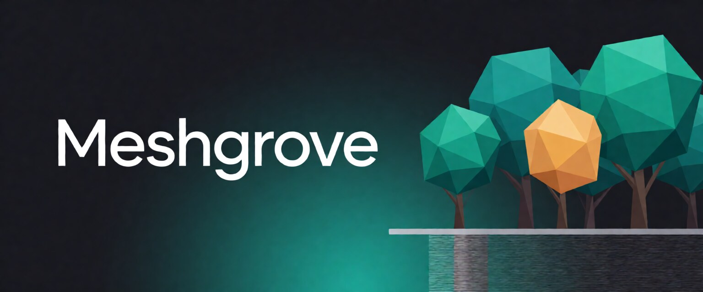
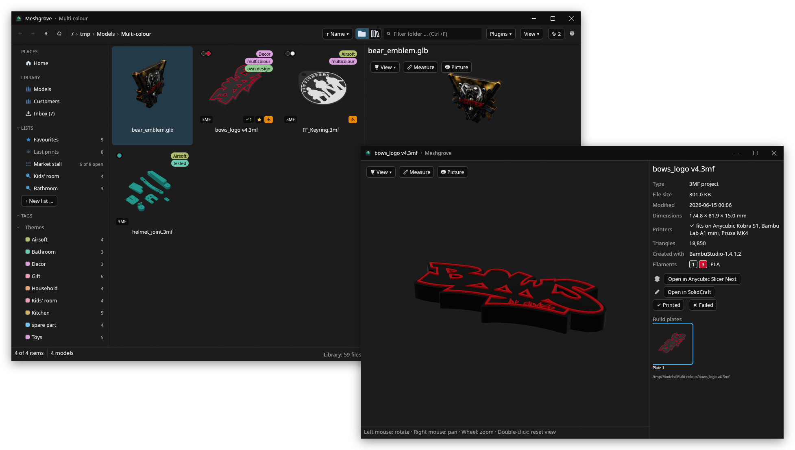
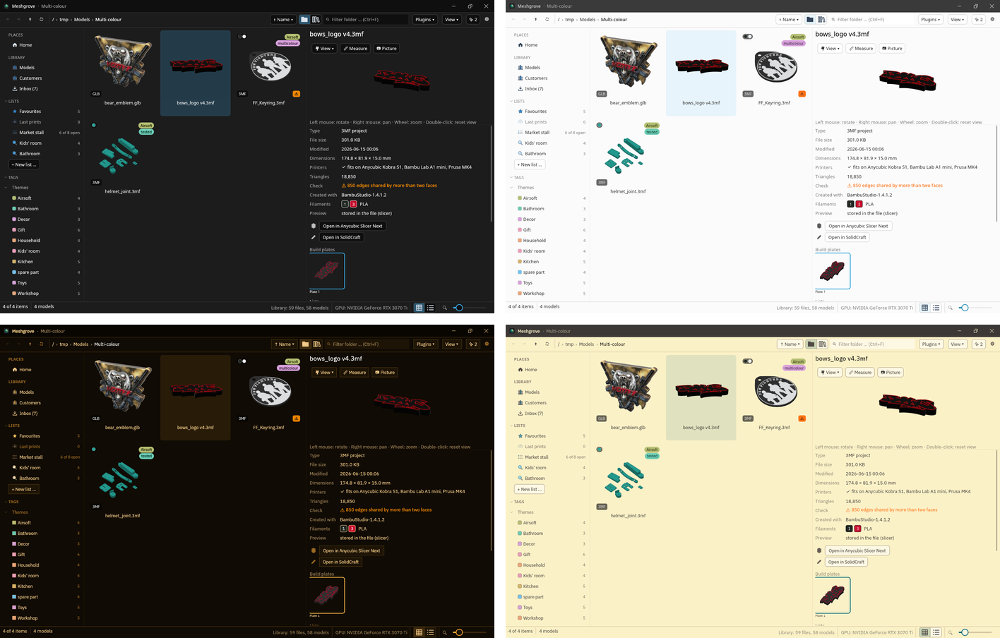
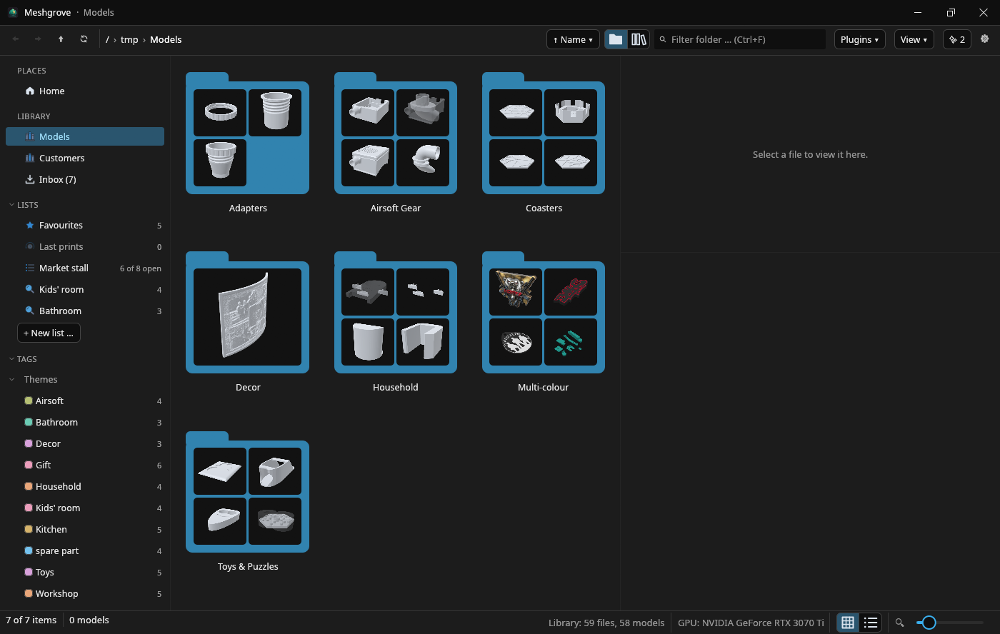
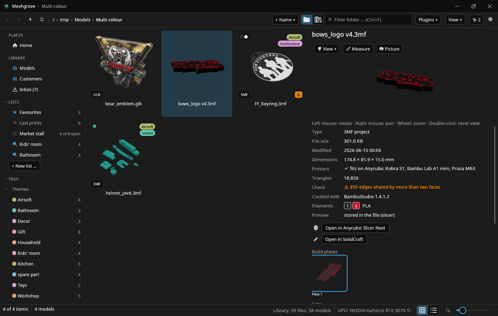
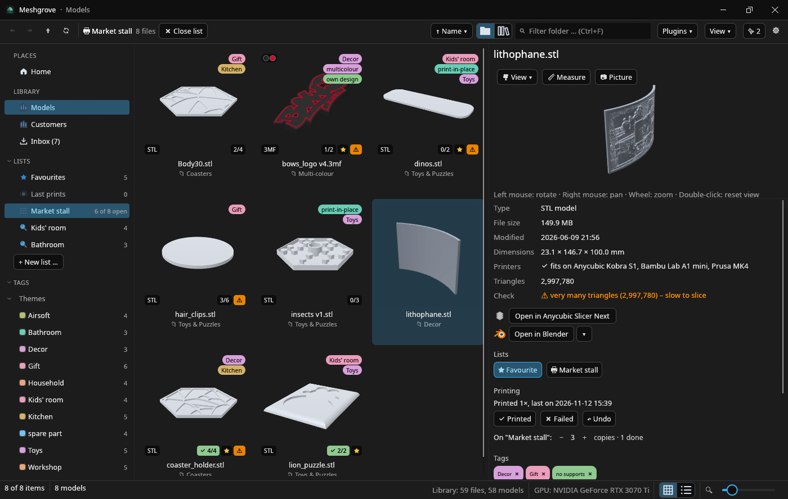
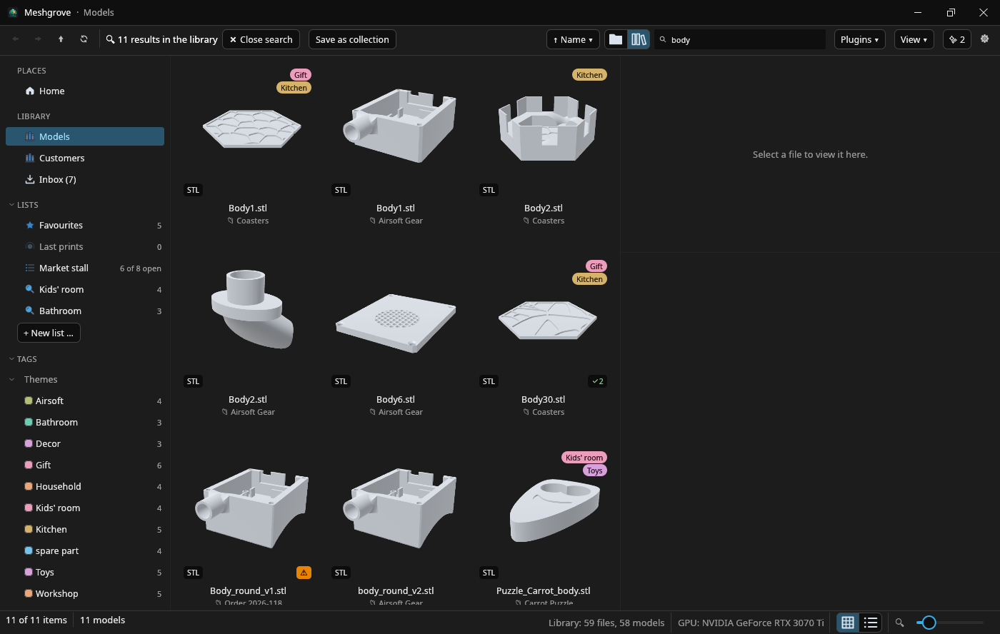
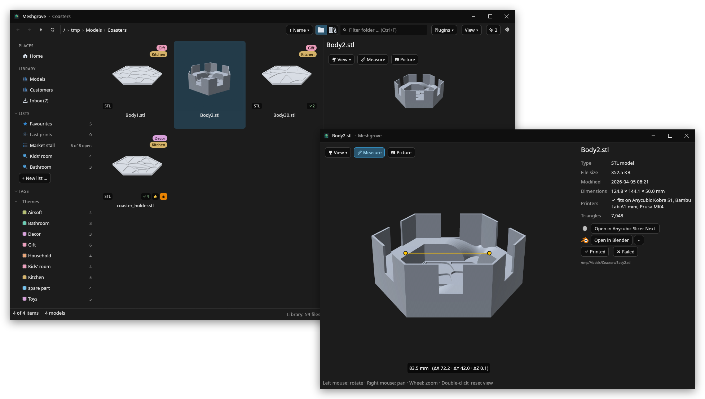
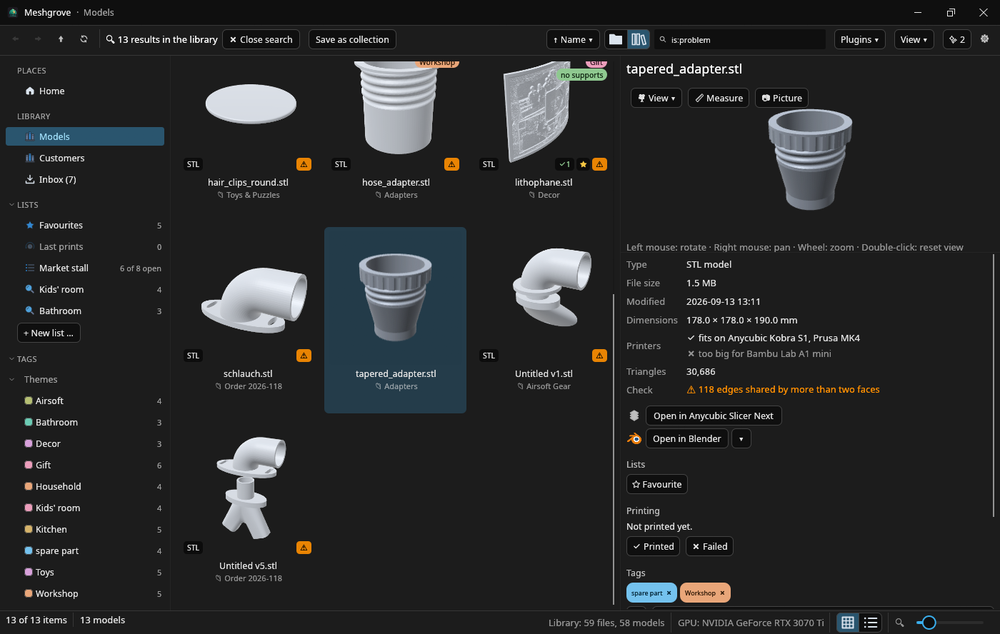
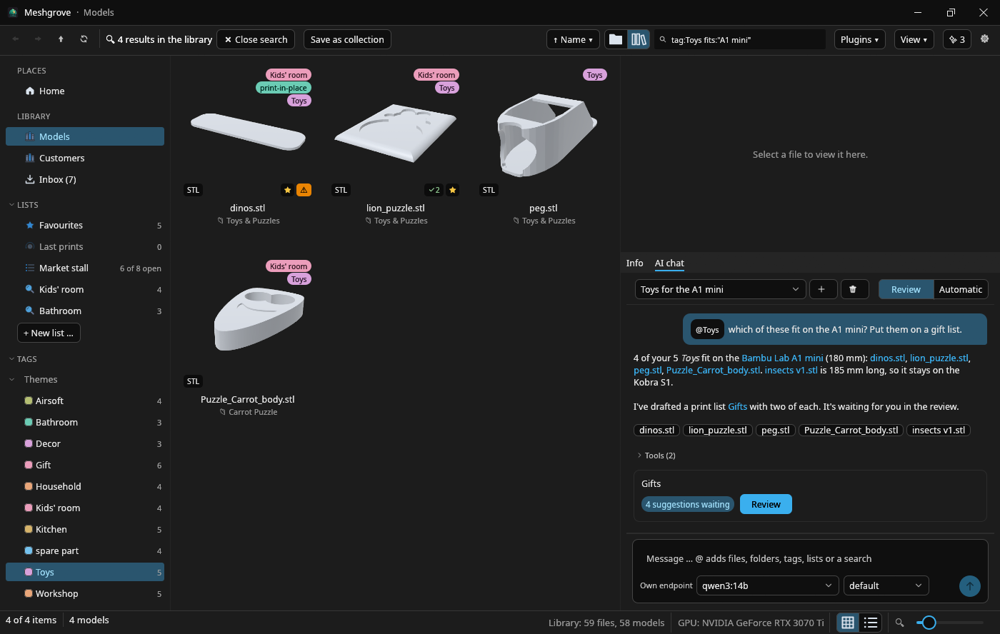

<p align="center">
  
</p>

<p align="center">
  <b>A fast, native gallery for your 3D-print files.</b><br>
  Browse STL, 3MF, STEP, OBJ, glTF and G-code files like photos, keep favourites and print lists, and know what you have printed.
</p>

<p align="center">
  <a href="https://github.com/DonDavis-vibe/MeshGrove/actions/workflows/ci.yml"></a>
  <a href="LICENSE"></a>
  
  
  <a href="https://ko-fi.com/don_davis"></a>
</p>

<p align="center">
  <a href="https://meshgrove.redneck-design.de">🌐 Website: meshgrove.redneck-design.de</a> · <a href="README.de.md">🇩🇪 Deutsche Version</a>
</p>

---



<p align="center">
  <a href="#installation">Installation</a> · <a href="#getting-started">Getting started</a> · <a href="https://github.com/DonDavis-vibe/MeshGrove/blob/main/docs/guide.md">User guide</a> · <a href="#documentation">Documentation</a> · <a href="https://github.com/DonDavis-vibe/MeshGrove/releases">Releases</a>
</p>

## Why Meshgrove?

Anyone who prints a lot ends up with folders full of files called `Body1.stl`,
`final_v3_fixed.3mf` and `pack.zip`, and a file manager that shows the same icon for all of
them. Meshgrove shows those folders as a gallery with a rendered preview of every model, also
inside ZIP/7z/RAR packs and from the plate pictures your slicer stored in 3MF projects, and adds
what a collection needs: an instant search, tags and notes, print lists, a print log, a
duplicate finder, a print-bed check and a one-click hand-over to your slicer. Your folders stay
as they are: nothing moves without your okay, and every change can be undone. It is native and
fast (Rust, rendered on the GPU through [wgpu](https://wgpu.rs), no Electron, no server), made
for big libraries on spinning hard drives, and free software under the GPL, with no account,
subscription or telemetry.

## Features

- **Gallery and list view:** previews for STL, 3MF, STEP, OBJ, PLY, glTF/GLB, G-code, images, PDFs and readmes; folder and archive tiles show a mosaic of what is inside; models spin when you point at them ([guide](https://github.com/DonDavis-vibe/MeshGrove/blob/main/docs/guide.md#browsing-the-gallery))
- **3D viewer:** in the side pane, as a large preview (Space) or in a window of its own; measuring in mm, standard views, picture export, 3D mice ([guide](https://github.com/DonDavis-vibe/MeshGrove/blob/main/docs/guide.md#the-3d-viewer-and-its-tools))
- **3MF projects in colour:** the slicer's plate pictures, filament colours per part, painted models and material colours
- **Archives:** ZIP, 7z, RAR and TAR open like folders; unpack, pack and add to ZIPs ([guide](https://github.com/DonDavis-vibe/MeshGrove/blob/main/docs/guide.md#archives-zip-7z-rar-tar))
- **Library and search:** one index of all your model folders, searched instantly: `dragon ext:3mf tag:painted is:unprinted` ([guide](https://github.com/DonDavis-vibe/MeshGrove/blob/main/docs/guide.md#library-search-and-filters))
- **Tags and notes** in colours, attached to the file's content, so they survive renames and moves ([guide](https://github.com/DonDavis-vibe/MeshGrove/blob/main/docs/guide.md#tags-and-notes))
- **Favourites, collections and print lists** with the copies you need, ticked off as you print, and a print log of what worked ([guide](https://github.com/DonDavis-vibe/MeshGrove/blob/main/docs/guide.md#favourites-collections-and-print-lists))
- **Printers and checks:** which of your printers a model fits on, and holes, loose parts or suspicious sizes before you slice ([guide](https://github.com/DonDavis-vibe/MeshGrove/blob/main/docs/guide.md#printers-and-the-bed-check))
- **G-code:** the slicer's picture or the toolpaths, print time, filament, and a warning when it was sliced for another printer ([guide](https://github.com/DonDavis-vibe/MeshGrove/blob/main/docs/guide.md#g-code-files))
- **Inbox and import:** new files grouped by the folder or ZIP they came in; a downloads folder brought into the library and placed by tag ([guide](https://github.com/DonDavis-vibe/MeshGrove/blob/main/docs/guide.md#the-inbox))
- **Duplicate finder:** exact copies and the same model saved differently, cleaned up in one go ([guide](https://github.com/DonDavis-vibe/MeshGrove/blob/main/docs/guide.md#duplicate-finder))
- **Slicers and other apps:** open one or many models in your slicer or mesh editor; copy, cut and paste real files ([guide](https://github.com/DonDavis-vibe/MeshGrove/blob/main/docs/guide.md#working-with-your-slicer-and-other-apps))
- **AI, only if you want it:** your own assistant over MCP, or the chat with your own endpoint or an AI agent on your computer; nothing changes until you accept it ([guide](https://github.com/DonDavis-vibe/MeshGrove/blob/main/docs/guide.md#ai-assistant-and-mcp-optional))
- **Plugins:** tools that run sealed off, such as [Bingrove](https://github.com/DonDavis-vibe/Bingrove) (Gridfinity inserts) and [Texgrove](https://github.com/DonDavis-vibe/Texgrove) (textures as real geometry) ([guide](https://github.com/DonDavis-vibe/MeshGrove/blob/main/docs/guide.md#plugins-optional))
- **Your look:** 27 themes, panes you arrange as you like, and Meshgrove's own title bar ([guide](https://github.com/DonDavis-vibe/MeshGrove/blob/main/docs/guide.md#browsing-the-gallery))
- **Linux, Windows and macOS**, in English and German; on Linux also thumbnails in Dolphin and file dialogs ([guide](https://github.com/DonDavis-vibe/MeshGrove/blob/main/docs/guide.md#platform-support))

All features in one table: [Features at a glance](https://github.com/DonDavis-vibe/MeshGrove/blob/main/docs/guide.md#features-at-a-glance).

## Screenshots

**Your look:** the same window in four of the 27 themes.


**Folder tiles show what is inside**, so you navigate by looking instead of reading names.


**Models in their colours:** filaments per part, painted areas, material and vertex colours.


**Print lists** count the copies done of those needed; the sidebar holds lists and tags.


**One search for the whole library**, across all your folders.


**Every model in a window of its own**, with the same tools, here measuring in mm.


**Several printers and a printability check:** where a model fits, and what to look at.


**Your own AI, if you want it:** answers link to the models, and changes wait for your okay.


## Installation

Every [release](https://github.com/DonDavis-vibe/MeshGrove/releases) has ready-made packages,
all with STEP previews. Nothing needs to be built:

| System | Download |
|---|---|
| Windows 10/11 (x64) | `Meshgrove-<version>-windows-x64-setup.exe` (installer) or `…-windows-x64-portable.zip` |
| macOS 11 or newer (Apple Silicon and Intel) | `Meshgrove-<version>-macos-universal.dmg` |
| Ubuntu 24.04 / 26.04, Debian 13 | `meshgrove_<version>-1_<release>_amd64.deb` |
| Fedora 44 | `meshgrove-<version>-1.fc44.x86_64.rpm` |
| Any other Linux (x86_64) | `Meshgrove-<version>-x86_64.AppImage` |

Linux (developed and used daily on Fedora/Nobara with KDE Plasma on Wayland) is the main
platform. The Windows and macOS builds are built and tested automatically but have seen less
real-world use, so please [report problems](https://github.com/DonDavis-vibe/MeshGrove/issues).

### Linux

```bash
sudo apt install ./meshgrove_<version>-1_ubuntu24.04_amd64.deb   # Ubuntu, Debian
sudo dnf install ./meshgrove-<version>-1.fc44.x86_64.rpm         # Fedora
```

The packages add the menu entry, the icon, the `model/step` file type and the
[thumbnailer for Dolphin](https://github.com/DonDavis-vibe/MeshGrove/blob/main/docs/guide.md#thumbnails-in-dolphin-and-file-dialogs-linux)
and other file managers. Start **Meshgrove** from your application menu, or run `meshgrove`
(optionally with a folder or file: `meshgrove ~/3D-Models`). Systems based on a supported release
take its package, e.g. Linux Mint 22 the one for Ubuntu 24.04. Remove it with
`sudo apt remove meshgrove` or `sudo dnf remove meshgrove`.

**AppImage:** `chmod +x Meshgrove-<version>-x86_64.AppImage`, then start it. It brings
everything, STEP included, and runs on x86_64 distributions with glibc 2.35 or newer (Ubuntu
22.04, Debian 12 and newer), but adds no menu entry by itself (tools like
[Gear Lever](https://flathub.org/apps/it.mijorus.gearlever) or AppImageLauncher do that) and no
file-manager thumbnails.

#### From source

Install Rust 1.95 or newer and libarchive, optionally OpenCascade (STEP previews) and poppler
(PDF previews); the package names for each distribution are in the
[development guide](https://github.com/DonDavis-vibe/MeshGrove/blob/main/docs/development.md#building-from-source).
Then build and install for your user (no root needed), with menu entry, icon and thumbnailer:

```bash
git clone https://github.com/DonDavis-vibe/MeshGrove.git
cd MeshGrove
packaging/install.sh
```

Update with `git pull && packaging/install.sh`, remove with `packaging/install.sh --uninstall`.

### Windows

Download `Meshgrove-<version>-windows-x64-setup.exe` from the
[releases](https://github.com/DonDavis-vibe/MeshGrove/releases) and run it. SmartScreen may warn
because the program is not signed: choose *More info → Run anyway*. The installer needs no admin
rights (it installs for your user, or for all users if you choose so) and adds a Start menu
entry and Meshgrove under *Open with* for STL, 3MF, STEP, OBJ, PLY and glTF files; remove it
under *Settings → Apps*. Prefer not to install? Unpack `…-windows-x64-portable.zip` anywhere and
start `meshgrove.exe`. For PDF previews, install
[poppler](https://github.com/oschwartz10612/poppler-windows) with `pdftoppm.exe` on your `PATH`.

### macOS

Open `Meshgrove-<version>-macos-universal.dmg` and drag **Meshgrove** onto *Applications*. The
app is not notarized: on the first start, right-click it and choose *Open*, or run
`xattr -dr com.apple.quarantine /Applications/Meshgrove.app` once. For PDF previews:
`brew install poppler`.

## Getting started

1. **Open a folder.** Meshgrove starts in the folder you used last, or your home folder. Use
   the sidebar (*Places*, *Devices*, the folder tree), the breadcrumb at the top, or
   double-click folders. Previews appear within moments: visible tiles first, the rest in the
   background.
2. **Add your model folders to the library.** Click *➕ Add this folder to the library* in the
   sidebar (or use *Settings → Library → Library folders*). Library folders are indexed, so you
   can search them, tag files, write notes and find duplicates. The first indexing of a big
   collection runs in the background; the status bar shows the progress.
3. **Look at a model.** Click a tile to see it in the 3D viewer on the right, with its
   dimensions, triangle count and whether it fits your printer. Point at a tile to make the
   model spin.
4. **Hand it to your slicer.** Right-click → *Open in Anycubic Slicer Next* (or whichever
   slicer was found). Select several models first to open them all at once.
5. **Keep track.** Ctrl+D makes a model a favourite. Right-click → *Add to list* puts it on a
   print list or a collection, and *Log as printed* remembers that you printed it.

## Documentation

- [User guide](https://github.com/DonDavis-vibe/MeshGrove/blob/main/docs/guide.md): everything Meshgrove does, step by step, with all features at a glance
- [Keyboard and mouse](https://github.com/DonDavis-vibe/MeshGrove/blob/main/docs/guide.md#keyboard-and-mouse-reference) and [supported file types](https://github.com/DonDavis-vibe/MeshGrove/blob/main/docs/guide.md#supported-file-types)
- [Settings and files on disk](https://github.com/DonDavis-vibe/MeshGrove/blob/main/docs/guide.md#settings-and-files-on-disk): the settings window, `config.toml` and where Meshgrove keeps its data
- [Privacy and safety](https://github.com/DonDavis-vibe/MeshGrove/blob/main/docs/guide.md#privacy-and-safety)
- [Troubleshooting and FAQ](https://github.com/DonDavis-vibe/MeshGrove/blob/main/docs/guide.md#troubleshooting-and-faq)
- [Plugins](https://github.com/DonDavis-vibe/MeshGrove/blob/main/docs/plugins.md): installing, granting and writing plugins
- [Development](https://github.com/DonDavis-vibe/MeshGrove/blob/main/docs/development.md): building on every system, architecture, tests and roadmap
- [Release notes](https://github.com/DonDavis-vibe/MeshGrove/releases): what is new in each version

## Contributing

Bug reports, ideas and pull requests are welcome in the
[issue tracker](https://github.com/DonDavis-vibe/MeshGrove/issues). Helpful details in a bug
report: your operating system, graphics card, what you did, and the log file `meshgrove.log`
(its path is under *Settings → About Meshgrove*; start Meshgrove with `RUST_LOG=meshgrove=debug`
for more detail). A sample file helps a lot when a model shows wrongly, if you are allowed to
share it.

For code: run `cargo fmt`, `cargo clippy` and `cargo test` before opening a pull request, and
keep comments and identifiers in English. New user-visible text goes through `t!("…")`, with
entries in both locale files. By submitting a contribution you agree that it is licensed under
the same terms as Meshgrove (GPL-3.0-or-later).

## Tip jar

Meshgrove is free and stays free. If it saves you time or tidies up your print library, you can
leave a tip on **[Ko-fi](https://ko-fi.com/don_davis)**. Bug reports, ideas and a ⭐ on GitHub
are just as welcome.

## Credits

Meshgrove is developed by **Davis** and **[@Rec0iL](https://github.com/Rec0iL)** as a project
of **[German Redneck Engineering](https://redneck-design.de/)**. The new interface on
[SolidCraft](https://github.com/tangency-labs/solidcraft)'s UI kit (0.12), the AI agents, the
review, archives and the duplicates work are Rec0iL's.

Built on excellent open-source work: [egui/eframe](https://github.com/emilk/egui) with
[egui_tiles](https://github.com/rerun-io/egui_tiles), [egui_extras](https://github.com/emilk/egui)
and [egui_commonmark](https://github.com/lampsitter/egui_commonmark) (with
[pulldown-cmark](https://github.com/pulldown-cmark/pulldown-cmark)), [wgpu](https://wgpu.rs),
[glam](https://github.com/bitshifter/glam-rs), [rusqlite](https://github.com/rusqlite/rusqlite) with
[SQLite](https://sqlite.org), [libarchive](https://libarchive.org) through
[compress-tools](https://github.com/OSSystems/compress-tools-rs),
[OpenCascade](https://dev.opencascade.org), [poppler](https://poppler.freedesktop.org),
[notify](https://github.com/notify-rs/notify), [zip](https://github.com/zip-rs/zip2),
[quick-xml](https://github.com/tafia/quick-xml), [image](https://github.com/image-rs/image),
[krilla](https://github.com/LaurenzV/krilla) (PDF checklists),
[ab_glyph](https://github.com/alexheretic/ab-glyph),
[BLAKE3](https://github.com/BLAKE3-team/BLAKE3), [trash](https://github.com/Byron/trash-rs),
[wl-clipboard-rs](https://github.com/YaLTeR/wl-clipboard-rs),
[clipboard-rs](https://github.com/ChurchTao/clipboard-rs) and
[rust-i18n](https://github.com/longbridge/rust-i18n), among others. Finding and connecting the AI
assistants is adapted from [SolidCraft](https://github.com/tangency-labs/solidcraft) (MIT). Logo and
banner were created with the Krea 2 image model.

All models in the screenshots are our own designs (German Redneck Engineering).

## License

Copyright © 2026 Davis · German Redneck Engineering

Meshgrove is free software: you can redistribute it and/or modify it under the terms of the
[GNU General Public License](LICENSE) as published by the Free Software Foundation, either
version 3 of the License, or (at your option) any later version.

Meshgrove is distributed in the hope that it will be useful, but WITHOUT ANY WARRANTY;
without even the implied warranty of MERCHANTABILITY or FITNESS FOR A PARTICULAR PURPOSE. See
the [GNU General Public License](LICENSE) for more details.

The interface themes and the controls drawn from them are SolidCraft's UI kit (MIT OR
Apache-2.0), kept in `vendor/` with its theme files and icons in `assets/`; the theme font is IBM
Plex Sans (SIL Open Font License 1.1).

The STEP helper uses OpenCascade (LGPL-2.1 with an exception) as a separate program; PDF
previews call poppler's `pdftoppm` (GPL) as an external program. The licenses of all libraries
and fonts built into the program are listed in `THIRD-PARTY-LICENSES.md`, which comes with every
release package. In the Windows, macOS and AppImage packages, OpenCascade is built into the STEP
helper; the source code of that OpenCascade version is attached to each release.

Anycubic, OrcaSlicer, Bambu Studio, PrusaSlicer, KDE, Dolphin, Windows and macOS are trademarks
of their respective owners. Meshgrove is an independent project and is not affiliated with or
endorsed by them.

Legal notice and privacy policy of German Redneck Engineering:
[Impressum](https://redneck-design.de/impressum.html) ·
[Datenschutz](https://redneck-design.de/datenschutz.html)
