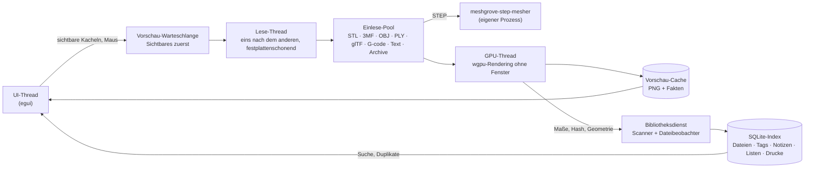

# Meshgrove entwickeln

[← Zurück zum README](../README.de.md) · [🇬🇧 English version](development.md)

Wie du Meshgrove baust, wie es aufgebaut ist und was als Nächstes kommt. Wie du einen Fehler
meldest oder einen Pull Request schickst, steht unter [Mitmachen](../README.de.md#mitmachen);
wie man ein Plugin schreibt, in [docs/plugins.md](plugins.md) (englisch).

## Inhalt

- [Aus dem Quellcode bauen](#aus-dem-quellcode-bauen)
- [Aufbau](#aufbau)
- [Entwicklung](#entwicklung)
- [Ausblick](#ausblick)

## Aus dem Quellcode bauen

Du brauchst Rust 1.95 oder neuer und libarchive. OpenCascade (STEP) und poppler (PDF, nur zur
Laufzeit) sind optional.

**Linux:** Das Bauen dauert ein paar Minuten und klappt auf jeder Distribution.

1. Rust und die Bibliotheken installieren:

   | Distribution | Befehl |
   |---|---|
   | Fedora / Nobara | `sudo dnf install rust cargo gcc-c++ libarchive-devel opencascade-devel poppler-utils` |
   | Debian / Ubuntu | `sudo apt install cargo g++ pkg-config libarchive-dev libxkbcommon-dev libwayland-dev libocct-data-exchange-dev poppler-utils` |
   | Arch / Manjaro | `sudo pacman -S rust gcc libarchive opencascade poppler` |

   OpenCascade (Version 7.5 oder neuer) ist optional; ohne geht alles außer den
   STEP-Vorschauen. Auch poppler ist optional und liefert nur die PDF-Vorschauen. Ist das Rust
   deiner Distribution älter als 1.95 (Ubuntu 24.04, Debian 13), installiere ein aktuelles mit
   [rustup](https://rustup.rs).

2. Bauen und für deinen Benutzer installieren (ohne Root-Rechte):

   ```bash
   git clone https://github.com/DonDavis-vibe/MeshGrove.git
   cd MeshGrove
   packaging/install.sh
   ```

   Das Skript baut die Programme und legt sie in `~/.local/bin`. Dazu richtet es in
   `~/.local/share` den Menüeintrag, das Symbol, den Dateityp `model/step` und den
   Vorschau-Dienst (Thumbnailer) ein.

3. Später aktualisieren mit `git pull && packaging/install.sh`. Entfernen mit
   `packaging/install.sh --uninstall`. Einstellungen, Index und Cache bleiben erhalten; wie du
   auch die löschst, steht unter
   [Einstellungen und Dateien auf der Platte](guide.de.md#einstellungen-und-dateien-auf-der-platte).

Zum Entwickeln:

```bash
cargo run --release -p meshgrove -- ~/3D-Modelle
```

**Windows** (MSVC-Toolchain):

```powershell
# libarchive als statische Bibliothek über vcpkg
git clone https://github.com/microsoft/vcpkg C:\vcpkg
C:\vcpkg\bootstrap-vcpkg.bat
C:\vcpkg\vcpkg install libarchive:x64-windows-static
$env:VCPKG_ROOT = "C:\vcpkg"; $env:VCPKGRS_TRIPLET = "x64-windows-static"
cargo build --release -p meshgrove -p meshgrove-step
```

**macOS:**

```bash
brew install libarchive pkg-config
cargo build --release -p meshgrove -p meshgrove-step
```

**STEP auf jedem System:** OpenCascade 7.5 oder neuer installieren (`dnf install
opencascade-devel`, `apt install libocct-data-exchange-dev`, `brew install opencascade`,
`vcpkg install opencascade`, …). Liegen die Header nicht in `/usr/include/opencascade`, zeigt
`OCCT_INCLUDE` (und `OCCT_LIB` für den Bibliotheksordner) dem Build den Weg; dann
`-p meshgrove-step` bauen. Für ein statisches OpenCascade, etwa aus den statischen Triplets von
vcpkg, zusätzlich `OCCT_STATIC=1` setzen. Der entstandene `meshgrove-step-mesher` muss neben dem
Programm `meshgrove` oder im `PATH` liegen.

**Release-Pakete:** [`.github/workflows/release.yml`](../.github/workflows/release.yml) baut sie
alle. Windows, macOS und das AppImage binden libarchive und OpenCascade statisch aus einem
festgelegten vcpkg ein ([`packaging/vcpkg/install.sh`](../packaging/vcpkg)); .deb und .rpm nutzen
die Bibliotheken der Distribution. Die Skripte für die einzelnen Formate liegen in
[`packaging`](../packaging).

## Aufbau

Meshgrove ist ein Cargo-Workspace aus acht Crates:

| Crate | Aufgabe |
|---|---|
| [`meshgrove-core`](../crates/meshgrove-core) | Alles ohne Fenster und Grafikkarte: Dateiformate (STL, 3MF, STEP, OBJ, PLY, glTF, G-code, Archive, Bilder, PDF, Text), der SQLite-Bibliotheks-Index, Scanner, Suchsyntax, Duplikat-Signaturen, Tags, Notizen, Listen, das Druckprotokoll und Sicherungen, Vorschau-Cache, Einstellungen, Druckerprofile, Druckbarkeits-Prüfung, der Eingang, das Änderungsjournal, und `ai`: was ein Assistent sehen und vorschlagen darf |
| [`meshgrove-render`](../crates/meshgrove-render) | Der wgpu-Renderer, gemeinsam für Vorschauen (ohne Fenster), 3D-Viewer, Drehvorschau und den Dolphin-Thumbnailer |
| [`meshgrove`](../crates/meshgrove) | Die egui-Anwendung |
| [`meshgrove-step`](../crates/meshgrove-step) | `meshgrove-step-mesher`: STEP → STL mit OpenCascade, als eigener Prozess |
| [`meshgrove-thumbnailer`](../crates/meshgrove-thumbnailer) | Der freedesktop-Thumbnailer für Dolphin und Dateidialoge |
| [`meshgrove-mcp`](../crates/meshgrove-mcp) | `meshgrove-mcp`: der freiwillige MCP-Server, den der eigene Assistent startet (stdio); liest den Index, schreibt nur Vorschläge |
| [`meshgrove-plugin-api`](../crates/meshgrove-plugin-api) | Die Plugin-Schnittstelle (MIT OR Apache-2.0): WIT-Welt, Manifest, Werkzeuge, Panel-Widgets, Bundles; mit `guest` die Bindungen zum Schreiben eines Plugins ([docs/plugins.md](plugins.md)) |
| [`meshgrove-plugins`](../crates/meshgrove-plugins) | Der Plugin-Host: wasmtime-Sandbox, Rechte, Panels, Jobs, Staging, die KI-Werkzeuge der Plugins und `meshgrove-plugin-run`, das ein Plugin ohne Meshgrove ausführt |

Wie die Arbeit durch die App läuft:



Ein paar Entscheidungen dahinter:

- **Ein Renderer für alles.** Vorschauen, Viewer, Drehvorschau und der Dolphin-Thumbnailer
  nutzen dieselbe wgpu-Pipeline, ein Modell sieht also überall gleich aus. Die flache
  Schattierung berechnet die Normalen im Shader aus Bildschirm-Ableitungen. Das ignoriert die
  oft falschen Normalen in STL-Dateien und halbiert den Speicher pro Modell.
- **Orbit-Ausrichtung.** Viewer und Drehvorschau drehen um die Mitte der Bounding-Box mit
  einem Abstand, der für jeden Winkel passt. Drehen verschiebt oder zoomt das Modell also nie.
  Vorschauen nutzen dagegen für jeden Winkel den knappsten Ausschnitt.
- **Inhalts-Fingerabdrücke.** Den BLAKE3-Hash jedes Modells rechnet Meshgrove mit, während die
  Datei ohnehin für die Vorschau gelesen wird. Tags, Notizen und die Erkennung exakter Kopien
  hängen daran. Eine zweite, drehungsunabhängige Geometrie-Signatur findet Neu-Exporte.
- **Eingebettete Bilder zuerst.** Bei 3MF-Projekten ist das Bild, das der Slicer gespeichert
  hat, die beste Vorschau, und es kostet kein Einlesen. Leere Plattenbilder von Slicern ohne
  Oberfläche werden erkannt und übersprungen.
- **Kein WebKit.** WebKitGTK hat unter NVIDIA und Wayland noch Darstellungsprobleme. Eine native
  egui-Oberfläche auf wgpu umgeht sie ganz.
- **Die KI schlägt vor, du entscheidest.** Meshgroves eigene Ablage-Regeln gehen denselben Weg:
  Vorschlag, Prüfliste, Verlauf. `meshgrove-mcp` schreibt nie in die Bibliothek:
  Vorschläge landen in einer eigenen Datenbank (`proposals.db`), und nur Meshgroves
  Bibliotheksdienst wendet an, was du annimmst – mit jedem Schritt im Journal, damit er sich
  rückgängig machen lässt.

## Entwicklung

```bash
cargo test --workspace                       # Unit-, Format-, Datenbank- und GPU-Render-Tests
cargo clippy --workspace --all-targets -- -D warnings
cargo fmt --all
scripts/ui-screenshot.sh out.png 8 ~/3D-Modelle   # Screenshot der Oberfläche in einer unsichtbaren KWin-Sitzung
```

`scripts/ui-screenshot.sh` startet die App in einer virtuellen KWin-Sitzung und speichert ihr
Fenster. So lassen sich Änderungen an der Oberfläche prüfen, ohne den Desktop anzufassen.
Test-Hooks (Umgebungsvariablen) steuern die Sitzung. Eigene `XDG_CONFIG_HOME`,
`XDG_DATA_HOME` und `XDG_CACHE_HOME` halten Testläufe von deinen echten Einstellungen fern:

| Variable | Wirkung |
|---|---|
| `MESHGROVE_SCREENSHOT=out.png`, `MESHGROVE_SCREENSHOT_DELAY=8` | Fenster nach der Wartezeit speichern und beenden |
| `MESHGROVE_POINTER=x,y` | Mauszeiger festhalten, etwa für die Drehvorschau |
| `MESHGROVE_HOLD=1`, `MESHGROVE_WHEEL=dy` | Taste gedrückt halten / Mausrad am Zeiger drehen |
| `MESHGROVE_CLICKS=x,y;x,y` | Diese Punkte nacheinander anklicken (ab 3 s, alle 0,8 s); `x,y*2` klickt doppelt |
| `MESHGROVE_MEASURE=fx,fy;fx,fy` | Im ersten Modell-Fenster zwischen diesen Punkten messen (Anteile der Ansicht) |
| `MESHGROVE_WINDOW_VIEW=top` | Das erste Modell-Fenster in einer Standardansicht öffnen (`front`, `left` …) |
| `MESHGROVE_TYPE=text` | Nach den Klicks Text tippen |
| `MESHGROVE_SEARCH=suche` | Mit einer Bibliothekssuche starten |
| `MESHGROVE_FLATTEN=1` | Mit „Unterordner einbeziehen“ starten |
| `MESHGROVE_VIEW=duplicates` / `settings` | Duplikatansicht / Einstellungen öffnen |

Die CI prüft Formatierung, Clippy und die Tests unter Linux, Windows und macOS. Render-Tests
laufen unter Linux auf Software-Vulkan (lavapipe). Ein Tag `v*` baut die Release-Pakete für
alle drei Systeme und legt einen Release-Entwurf an.

Die Übersetzungen liegen in [`crates/meshgrove/locales`](../crates/meshgrove/locales) (`de.yml`,
`en.yml`). Ein Test stellt sicher, dass jeder im Code benutzte Schlüssel in jeder Sprache
existiert.

## Ausblick

Ideen und nächste Schritte, grob nach Reihenfolge:

- [x] STEP-Unterstützung in allen Release-Paketen
- [x] AppImage, .deb und .rpm für Linux, ein Installer für Windows, eine universelle DMG für macOS
- [x] OBJ, PLY und glTF mit ihren Farben und Texturen (0.2)
- [x] Favoriten, Sammlungen, Drucklisten und ein Druckprotokoll; G-code- und Readme-Vorschauen;
  eine Listenansicht (0.4)
- [x] Mehrere Drucker, jeder mit seinem Bauraum (0.5)
- [x] Helles Design (hell, dunkel oder wie das System), unter 27 Themes (0.12)
- [ ] Tag-Vorschläge aus Datei- und Ordnernamen, auf Wunsch von einem lokalen KI-Modell (Ollama
  mit Vision-Modell), das auch beschreibt, wie ein Modell aussieht
- [ ] Quelle, Designer und Lizenz pro Modell; mehrteilige Modelle als ein Set
- [ ] „In Slicer öffnen“-Links von Printables, MakerWorld und Thingiverse direkt in die Bibliothek
- [ ] Filament: eigene Spulenliste oder Spoolman, und ob die Farben eines Projekts vorrätig sind
- [ ] Viewer: Winkel messen, Ortho-Ansicht, G-code-Schichtvorschau, große Ansicht für G-code,
  Bilder und Texte
- [ ] Schrift für chinesische und japanische Texte; Prusas binärer G-code (`.bgcode`)
- [ ] Flatpak, eine notarisierte macOS-App
- [ ] Vorschauen im Windows-Explorer und im macOS-Finder
- [ ] Weitere Sprachen (Beiträge willkommen)
