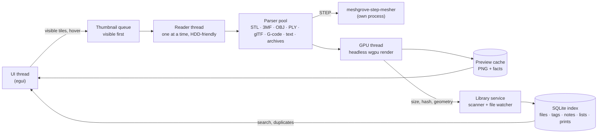

# Developing Meshgrove

[← Back to the README](../README.md) · [🇩🇪 Deutsche Version](development.de.md)

How to build Meshgrove, how it is put together, and what comes next. How to report a bug or
send a pull request is under [Contributing](../README.md#contributing); writing a plugin is in
[docs/plugins.md](plugins.md).

## Contents

- [Building from source](#building-from-source)
- [Architecture](#architecture)
- [Development](#development)
- [Roadmap](#roadmap)

## Building from source

You need Rust 1.95 or newer and libarchive. OpenCascade (STEP) and poppler (PDF, at runtime
only) are optional.

**Linux:** building takes a few minutes and works on any distribution.

1. Install Rust and the libraries:

   | Distribution | Command |
   |---|---|
   | Fedora / Nobara | `sudo dnf install rust cargo gcc-c++ libarchive-devel opencascade-devel poppler-utils` |
   | Debian / Ubuntu | `sudo apt install cargo g++ pkg-config libarchive-dev libxkbcommon-dev libwayland-dev libocct-data-exchange-dev poppler-utils` |
   | Arch / Manjaro | `sudo pacman -S rust gcc libarchive opencascade poppler` |

   OpenCascade (version 7.5 or newer) is optional. Without it everything works except STEP
   previews. poppler is optional too and only provides PDF previews. If your distribution's
   Rust is older than 1.95 (Ubuntu 24.04, Debian 13), install a current one with
   [rustup](https://rustup.rs).

2. Build and install for your user (no root needed):

   ```bash
   git clone https://github.com/DonDavis-vibe/MeshGrove.git
   cd MeshGrove
   packaging/install.sh
   ```

   This builds release binaries and puts them in `~/.local/bin`. It also adds the menu entry,
   the icon, the `model/step` file type and the thumbnailer in `~/.local/share`.

3. Update later with `git pull && packaging/install.sh`. Remove it with
   `packaging/install.sh --uninstall`. Your settings, index and cache are kept; see
   [Settings and files on disk](guide.md#settings-and-files-on-disk) if you want to delete them too.

For development:

```bash
cargo run --release -p meshgrove -- ~/3D-Models
```

**Windows** (MSVC toolchain):

```powershell
# libarchive as a static library through vcpkg
git clone https://github.com/microsoft/vcpkg C:\vcpkg
C:\vcpkg\bootstrap-vcpkg.bat
C:\vcpkg\vcpkg install libarchive:x64-windows-static
$env:VCPKG_ROOT = "C:\vcpkg"; $env:VCPKGRS_TRIPLET = "x64-windows-static"
cargo build --release -p meshgrove -p meshgrove-step
```

**macOS:**

```bash
brew install libarchive pkg-config
cargo build --release -p meshgrove -p meshgrove-step
```

**STEP support on any system:** install OpenCascade 7.5 or newer (`dnf install
opencascade-devel`, `apt install libocct-data-exchange-dev`, `brew install opencascade`,
`vcpkg install opencascade`, …). If its headers are not in `/usr/include/opencascade`, point the
build at them with `OCCT_INCLUDE` (and `OCCT_LIB` for the library folder), then build
`-p meshgrove-step`. For a static OpenCascade, such as vcpkg's static triplets, also set
`OCCT_STATIC=1`. The resulting `meshgrove-step-mesher` must sit next to the `meshgrove`
executable or be on the `PATH`.

**Release packages:** [`.github/workflows/release.yml`](../.github/workflows/release.yml) builds
them all. Windows, macOS and the AppImage link libarchive and OpenCascade statically from a
pinned vcpkg ([`packaging/vcpkg/install.sh`](../packaging/vcpkg)); the .deb and .rpm use the
distribution's libraries. The scripts for each format are in [`packaging`](../packaging).

## Architecture

Meshgrove is a Cargo workspace of eight crates:

| Crate | Purpose |
|---|---|
| [`meshgrove-core`](../crates/meshgrove-core) | Everything without a window or GPU: file formats (STL, 3MF, STEP, OBJ, PLY, glTF, G-code, archives, images, PDF, text), the SQLite library index, scanner, search syntax, duplicate signatures, tags, notes, lists, the print log and backups, thumbnail cache, settings, printer profiles, printability checks, the inbox, the change journal, and `ai`: what an assistant may see and suggest |
| [`meshgrove-render`](../crates/meshgrove-render) | The wgpu mesh renderer, shared by thumbnails (headless), the 3D viewer, the hover turntable and the Dolphin thumbnailer |
| [`meshgrove`](../crates/meshgrove) | The egui application |
| [`meshgrove-step`](../crates/meshgrove-step) | `meshgrove-step-mesher`: STEP → STL with OpenCascade, as a separate process |
| [`meshgrove-thumbnailer`](../crates/meshgrove-thumbnailer) | The freedesktop thumbnailer for Dolphin and file dialogs |
| [`meshgrove-mcp`](../crates/meshgrove-mcp) | `meshgrove-mcp`: the optional MCP server the user's own assistant starts (stdio); reads the index, writes only suggestions |
| [`meshgrove-plugin-api`](../crates/meshgrove-plugin-api) | The plugin interface (MIT OR Apache-2.0): the WIT world, manifest, tools, panel widgets, bundles; with `guest` the bindings for writing a plugin ([docs/plugins.md](plugins.md)) |
| [`meshgrove-plugins`](../crates/meshgrove-plugins) | The plugin host: wasmtime sandbox, grants, panels, jobs, staging, the AI tools of plugins, and `meshgrove-plugin-run` for running a plugin without Meshgrove |

How work flows through the app:



Some design decisions:

- **One renderer everywhere.** Thumbnails, viewer, turntable and the Dolphin thumbnailer use
  the same wgpu pipeline, so a model looks the same wherever you see it. Flat shading uses
  normals computed from screen-space derivatives in the shader. That ignores the often wrong
  normals stored in STL files and halves the memory per model.
- **Orbit framing.** The viewer and turntable turn around the bounding-box centre at one
  distance that fits every angle, so turning never shifts or zooms the model. Thumbnails use
  a tight fit per angle instead.
- **Content fingerprints.** Every model's BLAKE3 hash is computed while it is read for its
  preview anyway. Tags, notes and exact-duplicate detection hang off that hash. A second,
  rotation-independent geometry signature finds re-exports.
- **Embedded pictures first.** For 3MF projects, the picture the slicer saved is the best
  preview, and it costs no parsing. Blank plate pictures from headless slicing are detected and
  skipped.
- **No WebKit.** WebKitGTK still has rendering problems on NVIDIA + Wayland. A native egui UI on
  wgpu avoids them entirely.
- **AI proposes, the user decides.** Meshgrove's own placement rules use the same path: a
  suggestion, the review, the history. `meshgrove-mcp` never writes the library: suggestions go to a
  database of their own (`proposals.db`), and only Meshgrove's library service applies what the
  user accepts, journalling every step so it can be undone.

## Development

```bash
cargo test --workspace                       # unit, format, database and GPU render tests
cargo clippy --workspace --all-targets -- -D warnings
cargo fmt --all
scripts/ui-screenshot.sh out.png 8 ~/3D-Models   # screenshot of the UI in a headless nested KWin
```

`scripts/ui-screenshot.sh` runs the app in a virtual KWin session and saves its window, so UI
changes can be checked without touching your desktop. Test hooks (environment variables) can
script the session. Use separate `XDG_CONFIG_HOME` / `XDG_DATA_HOME` / `XDG_CACHE_HOME`
folders to keep test runs away from your real settings:

| Variable | Effect |
|---|---|
| `MESHGROVE_SCREENSHOT=out.png`, `MESHGROVE_SCREENSHOT_DELAY=8` | Save the window after the delay and quit |
| `MESHGROVE_POINTER=x,y` | Pin the pointer, e.g. to test the hover turntable |
| `MESHGROVE_HOLD=1`, `MESHGROVE_WHEEL=dy` | Hold the button / turn the wheel at the pointer |
| `MESHGROVE_CLICKS=x,y;x,y` | Click these points one after another (from 3 s, every 0.8 s); `x,y*2` double-clicks |
| `MESHGROVE_MEASURE=fx,fy;fx,fy` | Measure between these points (fractions of the view) in the first model window |
| `MESHGROVE_WINDOW_VIEW=top` | Start the first model window in a standard view (`front`, `left`, …) |
| `MESHGROVE_TYPE=text` | Type text after the clicks |
| `MESHGROVE_SEARCH=query` | Start with a library search |
| `MESHGROVE_FLATTEN=1` | Start with "include subfolders" |
| `MESHGROVE_VIEW=duplicates` / `settings` | Open the duplicate view / the settings |

CI runs formatting, clippy and the tests on Linux, Windows and macOS. Render tests run on
software Vulkan (lavapipe) on Linux. Pushing a tag `v*` builds the release packages for all
three systems and creates a draft release.

Translations live in [`crates/meshgrove/locales`](../crates/meshgrove/locales) (`de.yml`,
`en.yml`). A test makes sure every key used in the code exists in every language.

## Roadmap

Ideas and next steps, roughly in order:

- [x] STEP support in all release packages
- [x] AppImage, .deb and .rpm for Linux, an installer for Windows, a universal DMG for macOS
- [x] OBJ, PLY and glTF with their colours and textures (0.2)
- [x] Favourites, collections, print lists and a print log; G-code and readme previews; a list
  view (0.4)
- [x] Several printers, each with its build volume (0.5)
- [x] A light theme (light, dark or as the system), among 27 themes (0.12)
- [ ] Tag suggestions from file and folder names, optionally from a local AI model (Ollama with a
  vision model) that also describes what a model looks like
- [ ] Source, designer and licence per model; multi-part models as one set
- [ ] "Open in slicer" links from Printables, MakerWorld and Thingiverse straight into the library
- [ ] Filament: your own spool list or Spoolman, and whether a project's colours are in stock
- [ ] Viewer: angle measuring, orthographic view, a G-code layer preview, a large view for
  G-code, pictures and texts
- [ ] Fonts for Chinese and Japanese text; Prusa's binary G-code (`.bgcode`)
- [ ] Flatpak, a notarized macOS app
- [ ] Thumbnails in Windows Explorer and macOS Finder
- [ ] More languages (contributions welcome)
