# Meshgrove-Anleitung

[← Zurück zum README](../README.de.md) · [🇬🇧 English version](guide.md)

Alles, was Meshgrove kann, und wie es geht. Installation und erste Schritte stehen im
[README](../README.de.md#installation), wie du Meshgrove selbst baust, in der
[Entwickler-Doku](development.de.md).

## Inhalt

- [Funktionen im Überblick](#funktionen-im-überblick)
- [Anleitung](#anleitung)
  - [Die Galerie](#die-galerie)
  - [Der 3D-Viewer und seine Werkzeuge](#der-3d-viewer-und-seine-werkzeuge)
  - [Die Detailansicht](#die-detailansicht)
  - [Bibliothek, Suche und Filter](#bibliothek-suche-und-filter)
  - [Tags und Notizen](#tags-und-notizen)
  - [Favoriten, Sammlungen und Drucklisten](#favoriten-sammlungen-und-drucklisten)
  - [Das Druckprotokoll](#das-druckprotokoll)
  - [G-code-Dateien](#g-code-dateien)
  - [Readmes und Textdateien](#readmes-und-textdateien)
  - [Drucker und Druckbett-Check](#drucker-und-druckbett-check)
  - [Druckbarkeits-Check](#druckbarkeits-check)
  - [Der Eingang](#der-eingang)
  - [Duplikate finden](#duplikate-finden)
  - [KI-Assistent und MCP (freiwillig)](#ki-assistent-und-mcp-freiwillig)
  - [Plugins (freiwillig)](#plugins-freiwillig)
  - [Zusammenarbeit mit Slicer und anderen Programmen](#zusammenarbeit-mit-slicer-und-anderen-programmen)
  - [Archive (ZIP, 7z, RAR, TAR)](#archive-zip-7z-rar-tar)
  - [Dateien in den Papierkorb](#dateien-in-den-papierkorb)
  - [Sicherung, Export und Import](#sicherung-export-und-import)
  - [Vorschauen in Dolphin und Dateidialogen (Linux)](#vorschauen-in-dolphin-und-dateidialogen-linux)
  - [Updates](#updates)
- [Tastatur und Maus](#tastatur-und-maus)
- [Unterstützte Dateitypen](#unterstützte-dateitypen)
- [Einstellungen und Dateien auf der Platte](#einstellungen-und-dateien-auf-der-platte)
- [Datenschutz und Sicherheit](#datenschutz-und-sicherheit)
- [Geschwindigkeit](#geschwindigkeit)
- [Plattformen](#plattformen)
- [Probleme und häufige Fragen](#probleme-und-häufige-fragen)

## Funktionen im Überblick

| Bereich | Was du bekommst |
|---|---|
| **Galerie** | Vorschauen für STL, 3MF, STEP, OBJ, PLY, glTF/GLB, G-code, Bilder, PDFs und Readmes; Ordner- und Archiv-Kacheln zeigen ein 2×2-Mosaik ihres Inhalts (auf Wunsch auch Modelle aus Unterordnern auf der Platte, die langsam durchblenden); **Kacheln oder sortierbare Liste** mit den Spalten, die du willst; Kachelgröße einstellbar (Regler in der Statusleiste, Kacheln wachsen fließend zur Maus hin); Sortieren nach Name, Datum, Größe oder Typ; „Nur Modelle und G-code“; „Unterordner einbeziehen“ (alle Dateien unter einem Ordner in einem Raster); Mehrfachauswahl |
| **Bereiche** | Orte, Dateien, Vorschau und Info sind Bereiche: Kopfzeile ziehen verschiebt einen, am Rand eines anderen ablegen teilt ihn, auf einer anderen Kopfzeile ablegen stapelt beide; die Trennlinien ändern die Größe; *Bereiche fixieren* in den Einstellungen hält sie an ihrem Platz |
| **Aussehen** | 27 Themes: die 25 von SolidCraft und Meshgroves eigener Look als Meshgrove Dark und Meshgrove Light; ist keins gewählt, folgt Meshgrove dem System von dunkel zu hell und zurück; eine eigene Titelleiste in den Farben des Themes unter Linux und Windows |
| **Drehvorschau** | Mit der Maus über eine Modell-Kachel fahren, und das Modell dreht sich. Ziehen dreht es von Hand, Mausrad beim Ziehen zoomt |
| **3D-Viewer** | In der Seitenleiste, oder **Doppelklick auf ein Modell für ein eigenes Fenster** (frei vergrößerbar, mehrere gleichzeitig, mit „In Slicer öffnen“), oder **Leertaste für eine große Vorschau** über dem Fenster (nur das Modell, bis du auf ☰ klickst); für beide glattere Kanten und auf Wunsch Studiolicht; was ein Doppelklick tut, ist einstellbar (Modellfenster, große Vorschau, Slicer, Mesh-Editor oder Standardprogramm); Drehen, Verschieben und Zoomen um einen festen Drehpunkt (das Modell springt beim Drehen nie); Standardansichten (vorne, hinten, links, rechts, oben, unten, schräg); **Messen zwischen zwei Punkten in mm**; **Bildexport** als PNG mit 2048 px |
| **3D-Maus** | Die 3D-Ansichten mit einer **3Dconnexion SpaceMouse / SpaceNavigator oder einer selbstgebauten 3D-Maus** steuern (alles, was sich als HID-Multi-Achsen-Controller meldet; Linux liest `/dev/hidraw` direkt, Windows und macOS nutzen HID): drehen oder kippen dreht das Modell, schieben verschiebt, vor/zurück zoomt, linke Taste setzt die Ansicht zurück, rechte Taste zeigt die nächste Standardansicht; ein 3D-Bild der Maus in den Einstellungen folgt dem echten Knopf; Geschwindigkeit und Umkehrung je Achse, Totzone, frei wählbare Belegung der Bewegungen und eine **Kalibrierung**, die herausfindet, welche Achse welche ist |
| **3MF-Projekte** | Eingebettete Plattenbilder der Slicer (Bambu Studio, OrcaSlicer, Anycubic, Elegoo, Creality Print, PrusaSlicer); Klick auf ein Plattenbild zeigt diese Platte in 3D; **mehrfarbig**: Filamentfarben pro Objekt und Teil, bemalte Modelle (Multi-Material-Bemalung) und 3MF-Materialfarben im Viewer und in selbst gerenderten Vorschauen; Filament-Farbfelder auf Kacheln und in den Details; Titel, Designer und Programm aus den Metadaten |
| **STEP / STP** | CAD-Dateien werden von OpenCascade in einem eigenen Hilfsprozess vernetzt, eine kaputte Datei kann die App also nicht abstürzen lassen; das Ergebnis wird zwischengespeichert |
| **Archive** | ZIP, 7z, RAR und TAR öffnen wie Ordner; jedes enthaltene Modell bekommt eine Vorschau; entpackt wird nur, wenn ein anderes Programm die Datei braucht. Rechtsklick: Archiv neben sich entpacken, Auswahl als neues ZIP packen, Dateien zu einem ZIP hinzufügen (oder in ein geöffnetes einfügen); alles im Verlauf rückgängig |
| **Bibliothek** | Index (SQLite) aller Bibliotheksordner; Sofortsuche wie `drache ext:3mf tag:bemalt is:ungedruckt`; Änderungen auf der Platte werden automatisch erkannt, und *Ordner neu einlesen* holt den Rest |
| **Tags und Notizen** | Tags und Notizen hängen am *Inhalt* der Datei und überleben so Umbenennen und Verschieben; **farbige Tags**, als Kärtchen oder Punkte auf den Kacheln; vorgeschlagene Tags für Themen (Garten, Werkstatt, Kinderzimmer …), Druck-Eigenschaften und Zustand; die Suche findet auch Notiztext; tägliche automatische Sicherung; Export und Import als JSON |
| **Favoriten und Listen** | ★ Favoriten (Strg+D); **Sammlungen** über Ordner hinweg, von Hand oder als gespeicherte Suche, die aktuell bleibt; **Drucklisten** mit der gewünschten Stückzahl je Modell, beim Drucken abgehakt und danach archiviert; eine Druckliste wird zur **PDF-Checkliste** mit Bildern oder zur CSV-Datei |
| **Druckprotokoll** | Drucke als gedruckt oder fehlgeschlagen eintragen (und zurücknehmen); Kacheln zeigen ✓2 oder ✗; nur Ungedrucktes, Gedrucktes oder Fehlgeschlagenes zeigen; Suche mit `is:gedruckt`, `is:ungedruckt`, `is:fehlgeschlagen` |
| **G-code** | Vorschau aus dem Bild, das der Slicer eingebettet hat (PNG, JPG, QOI), sonst aus den gezeichneten Druckbahnen; Slicer, Drucker, Druckzeit, Filament (Gramm, Meter, Material, Farbe), Schichten, Düse und Kosten; eine Warnung, wenn eine Datei für einen anderen Drucker gesliced wurde |
| **Readmes** | Textdateien (`.txt`, `.md`, `.nfo`, `README`, `LICENSE`) bekommen eine Seitenvorschau; der Vorschau-Bereich zeigt sie ganz, Markdown formatiert, Links öffnen im Browser; ein gewählter Ordner zeigt sein Readme |
| **Drucker** | Alle deine Drucker mit Bauraum, gefunden in Anycubic Slicer Next, OrcaSlicer, Bambu Studio und PrusaSlicer oder von Hand eingetragen; jedes Modell sagt, auf welche Drucker es passt, Kacheln markieren Modelle, die nur gedreht (↻ 41°) oder auf keinen Drucker passen (✕); G-code wird seinem Drucker zugeordnet; Suche mit `passt:"Kobra S1"` und `is:zugross` |
| **Druckbarkeits-Check** | Jedes Modell wird auf Löcher (offene Kanten), Kanten an mehr als zwei Flächen, Dreiecke ohne Fläche, getrennte Teile und Volumen geprüft, dazu auf verdächtige Größen (in Zoll gezeichnet?); ⚠ auf der Kachel, Einzelheiten im Bereich *Info*, `is:problem` in der Suche |
| **Eingang** | Neue Dateien landen im Eingang, gruppiert nach dem Ordner oder Archiv, mit dem sie kamen (das ZIP eines Kunden, ein neuer Download); Kopien bekannter Modelle werden getrennt gezählt; abhaken, wenn eingeordnet |
| **KI (freiwillig)** | Meshgrove bringt keine KI mit, aber dein eigener Assistent (Claude, LM Studio, Cursor …) kann über MCP in den freigegebenen Bibliotheken suchen und Tags, Notizen, Listen und Verschiebungen vorschlagen; der eingebaute KI-Chat mit `@`-Verweisen spricht mit einem eigenen Endpunkt (Ollama, LM Studio, OpenAI-kompatibel) oder mit einem KI-Agenten auf deinem Rechner (Claude Code, Codex, Antigravity, OpenCode …), mit durchsuchbarer Modellwahl; mit einem Endpunkt gibt es dazu Ein-Klick-Aktionen. Nichts ändert sich, bevor du es annimmst, und alles lässt sich rückgängig machen |
| **Import und Ablage** | Nenne deinen Download-Ordner, und Meshgrove bietet dessen neue Modelle, G-Codes und Archive zum Import in den Landeordner der Bibliothek an (verschoben, nummeriert, wenn der Name vergeben ist, Archive ganz oder entpackt; rückgängig machbar). Eine Datei im Landeordner, die einen Themen-Tag bekommt, wird in den Ordner des Tags abgelegt – nach einer Regel von dir oder durch deinen Assistenten, mit deinem Okay oder, nur aus dem Landeordner, von selbst |
| **Duplikate** | Findet exakte Kopien und dasselbe Modell in anderer Form (ASCII- statt Binär-STL, STL statt 3MF, gedrehte oder verschobene Kopien), schlägt vor, welche Kopie bleiben soll, und kann die anderen in den Papierkorb legen |
| **Slicer und Programme** | „In Slicer öffnen“ für ein oder viele Modelle (erkennt über 30 gängige Filament- und Resin-Slicer, darunter Anycubic Slicer Next, OrcaSlicer, Bambu Studio, PrusaSlicer, Cura, Creality Print, QIDI Studio, FlashPrint, Lychee, ChiTuBox und UVtools, egal ob als Paket, Flatpak, Snap oder AppImage installiert; die, die du nutzt, fügst du in den Einstellungen mit ＋ hinzu und wählst einen Standard, die anderen stehen in einem Untermenü), ins schon offene Slicer-Fenster, wo der Slicer das erlaubt; „In … öffnen“ für deine **Mesh-Editoren oder CAD-Programme** (erkennt über 20 Programme, darunter Blender, FreeCAD, Autodesk Fusion, MeshLab, SolidCraft, OpenSCAD, SolveSpace, Rhino, SketchUp, SolidWorks und fstl, auch hier in jeder Installationsart; hinzufügen und Standard wählen in den Einstellungen); **Strg+C kopiert die Dateien** zum Einfügen im Dateimanager oder Slicer, **Strg+X schneidet aus, Strg+V fügt** Dateien aus der Zwischenablage in den Ordner ein; „Im Dateimanager zeigen“; Öffnen mit dem Standardprogramm |
| **Desktop-Einbindung** | Menüeintrag, Symbol, Dateizuordnungen; unter Linux liefert derselbe Renderer auch **Vorschauen in Dolphin und Dateidialogen** |
| **Sprachen** | Deutsch und Englisch, folgt der Systemsprache (in den Einstellungen umstellbar) |


## Anleitung

### Die Galerie

- **Navigieren** per Doppelklick (Ordner und Archive öffnen sich, Modelle in einem eigenen
  Fenster oder wie unter *Einstellungen → Allgemein → Modelle öffnen* gewählt, andere Dateien im
  Standardprogramm), über die Pfadleiste, die Seitenleiste oder die Tastatur: Pfeiltasten
  bewegen die Auswahl, Enter öffnet, Rücktaste oder Alt+↑ geht eine Ebene hoch, Alt+← und
  Alt+→ oder die Maustasten 4 / 5 gehen zurück und vor.
- **Kachelgröße:** Strg + Mausrad, Strg + `+` / `-` oder der Regler in der Statusleiste oder im
  Menü *Ansicht*. Die Kacheln wachsen fließend, die Kachel unter der Maus bleibt an ihrem Platz.
- **Menü Ansicht:** Kacheln oder Liste (auch die zwei Knöpfe neben dem Größenregler, oder Strg+1
  und Strg+2); Sortieren nach Name, Änderungsdatum, Größe oder Typ (auf- oder absteigend); *Nur
  Modelle und G-code* blendet alles andere aus (Ordner bleiben zum Navigieren sichtbar);
  *Unterordner einbeziehen* zeigt alle Dateien unterhalb des aktuellen Ordners in einem Raster,
  jeweils mit dem Ordnernamen darunter; *Druckstatus* zeigt alles, nur noch nicht Gedrucktes,
  Gedrucktes oder zuletzt Fehlgeschlagenes.
- **Listenansicht:** dieselben Dateien als Tabelle mit kleiner Vorschau, Name, Typ, Größe, Maßen,
  Änderungsdatum, Tags, ★ und Druckstatus, dazu der Ordner bei Suchergebnissen, Listen und
  *Unterordner einbeziehen*. Ein Klick auf einen Spaltentitel sortiert danach (noch einmal: in
  die andere Richtung), die Grenzen zwischen den Titeln ziehen macht Spalten breiter, ein
  Rechtsklick auf einen Titel blendet Spalten ein und aus. Die Zeilenhöhe folgt dem
  Größenregler, bis du die Vorschauspalte breiter ziehst: Dann haben die Vorschauen (und die
  Zeilen) diese Größe, bis der Regler wieder benutzt wird. Die Vorschauen können alles, was eine
  Kachel kann: Ordner blenden durch ihre Bilder, die Maus auf einem Modell dreht es, Ziehen dreht
  es von Hand, und das Mausrad zoomt, solange eine Taste gedrückt ist. Auswählen, Tastatur,
  Kontextmenü und Doppelklick funktionieren wie im Raster.
- **Ordner filtern:** Mit dem 📁-Bereich gewählt ins Suchfeld tippen (Strg+F), um den aktuellen
  Ordner nach Namen einzugrenzen.
- **Mehrere Dateien auswählen:** Strg+Klick schaltet einzelne um, Umschalt+Klick wählt einen
  Bereich, Strg+A wählt alles Angezeigte. Aktionen im Kontextmenü (Rechtsklick) gelten für die
  ganze Auswahl.
- **Drehvorschau:** Mit der Maus über eine Modell-Kachel fahren, dann dreht sich das Modell
  langsam um die eigene Achse. Mit gedrückter linker Maustaste ziehen dreht es von Hand;
  Mausrad bei gedrückter Taste zoomt in die Kachel.
- **Markierungen auf Kacheln:** unten links der Dateityp; oben rechts `2×`, `3×` …, wenn es in
  der Bibliothek Duplikate dieser Datei gibt, darunter die Tags der Datei (als Kärtchen oder
  Punkte); unten rechts der Druckbett-Check (↻ mit Winkel oder ✕), ★ für Favoriten und der
  Druckstatus (✓2 zweimal gedruckt, ✗ letzter Druck fehlgeschlagen, auf einer Druckliste die
  fertigen von den gewünschten Stück); `⚠ 🖨` bei G-code für einen anderen Drucker.
  *Einstellungen → Kacheln* zeigt eine Beispielkachel: Markierungen in andere Ecken oder aus dem
  Bild ziehen und festlegen, wie Tags, Filamente, der Check und der Name aussehen.
- **Bereiche:** Die Kopfzeile eines Bereichs ziehen verschiebt ihn; am Rand eines anderen
  Bereichs abgelegt teilt er diesen, auf einer anderen Kopfzeile werden beide zu Tabs. Beim
  Ziehen zeigt Meshgrove, wo der Bereich landen wird, und er gleitet an seinen Platz. Die
  Trennlinien zwischen den Bereichen ändern ihre Größe. *Einstellungen → Allgemein → Bereiche →
  Bereiche fixieren* hält sie an ihrem Platz, dann lässt sich nur noch die Größe ändern (ein
  einzelner Bereich zeigt dann keine Kopfzeile); *Layout zurücksetzen* dort stellt die
  Anordnung wieder her.
- **Themes und Titelleiste:** *Einstellungen → Allgemein → Erscheinungsbild* bietet 27 Themes:
  die 25 von SolidCraft und Meshgroves eigenen Look als Meshgrove Dark und Meshgrove Light. Ist
  keins gewählt, folgt Meshgrove dem System von dunkel zu hell und zurück. Die Schriftliste dort
  zeigt jede Schrift in sich selbst. Unter Linux und Windows zeichnet Meshgrove seine eigene
  Titelleiste in den Farben des Themes, für das Hauptfenster und die Modellfenster;
  *Titelleiste → System* holt die des Desktops zurück.
- **Große Vorschau:** Die Leertaste zeigt das gewählte Modell groß über dem Fenster, zuerst
  nichts als das Modell. ☰ oben rechts blendet Dateiname, Werkzeuge und Hinweise ein (Meshgrove
  merkt sich das). Leertaste, Esc oder ein Klick daneben schließt sie. *Einstellungen → 3D-Ansicht → Große
  Vorschau und Modellfenster* stellt die Bildqualität ein: *Hoch* rendert mit doppelter Auflösung
  für glatte Kanten, *Studio* fügt glänzendes Studiolicht hinzu.
- **Doppelklick auf ein Modell** öffnet sein Modellfenster. Unter *Einstellungen → Allgemein
  → Modelle öffnen* kannst du stattdessen die große Vorschau, den Slicer, den Mesh-Editor oder das
  Standardprogramm des Systems wählen (Enter macht dasselbe). Modelle, die das gewählte Programm
  nicht öffnet, bekommen trotzdem ein Modellfenster.
- **Ordnervorschau von der Platte:** Ordnerkacheln außerhalb der Bibliothek können auch Modelle
  aus ihren Unterordnern zeigen (*Einstellungen → Kacheln → Ordnervorschau*, standardmäßig aus,
  bis zu fünf Ebenen tief). Bei mehr als vier Modellen blenden die Bilder langsam durch.

**Dein Aussehen.** Dasselbe Fenster in vier der 27 Themes.

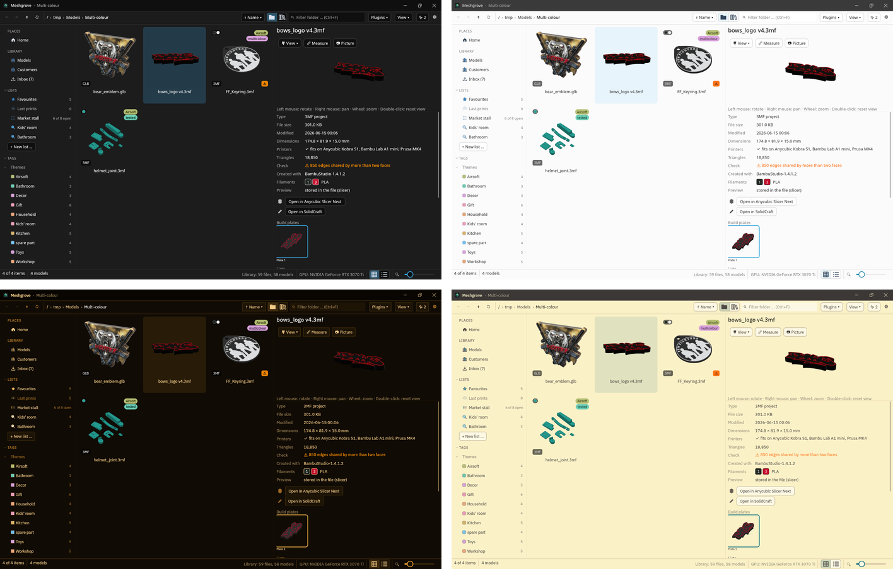

**Ordner-Kacheln zeigen, was drin ist.** Jeder Ordner und jedes Archiv bekommt ein Mosaik der
ersten Modelle. Du findest dich also über das Bild zurecht, statt Namen zu lesen.

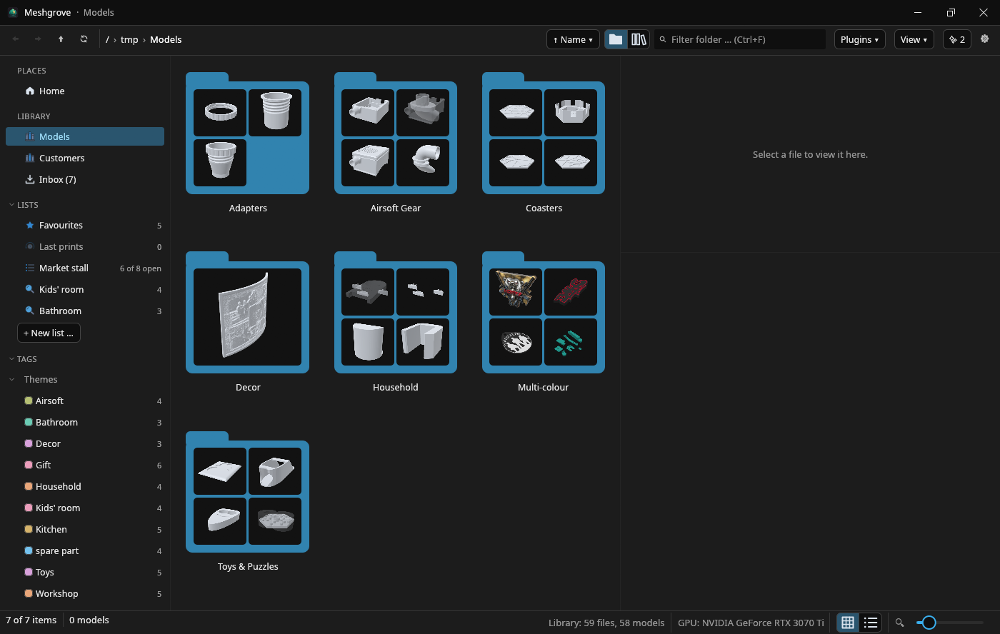

**Die Listenansicht.** Dieselben Dateien als Tabelle, mit Maßen, Tags, Favoriten und
Druckprotokoll auf einen Blick. Ein Klick auf einen Spaltentitel sortiert, ein Rechtsklick wählt
die Spalten.

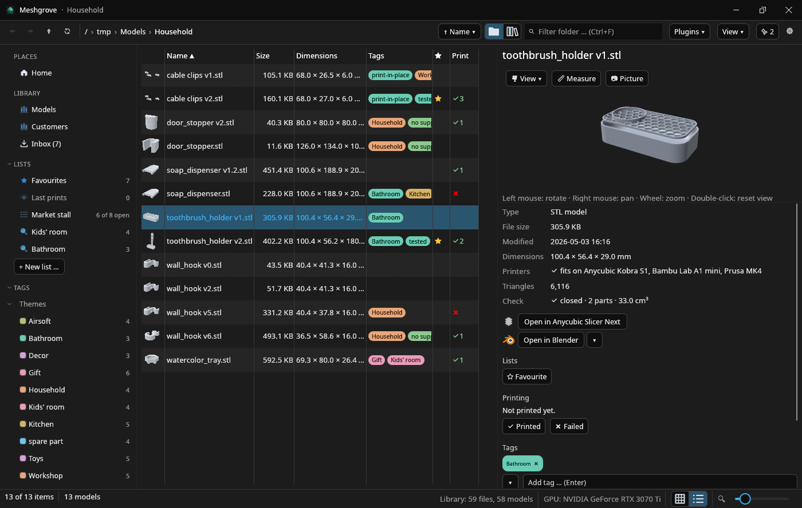

### Der 3D-Viewer und seine Werkzeuge

Rechts siehst du das ausgewählte Modell in 3D. Ein **Doppelklick auf ein Modell** (oder Enter)
öffnet es in einem eigenen Fenster: Es lässt sich bildschirmgroß ziehen, mehrere Modelle können
nebeneinander offen sein, jedes mit eigener Kamera, und das Fenster hat dieselben Werkzeuge, die
Fakten des Modells und Knöpfe, um es im Slicer oder im Mesh-Editor zu öffnen. Esc oder das
Schließen-Kreuz schließt es.

| Aktion | Maus |
|---|---|
| Drehen | Mit linker Taste ziehen |
| Verschieben | Mit rechter oder mittlerer Taste ziehen |
| Zoomen | Mausrad |
| Ansicht zurücksetzen | Doppelklick |

Die Kamera dreht sich immer um die Mitte des Modells und hält dabei denselben Abstand. Das
Modell springt oder zoomt also nicht, während du es drehst.

Die Knöpfe über der Ansicht:

- **🎥 Ansicht:** springt zu einer Standardansicht: schräg (Standard), vorne, hinten, links,
  rechts, oben, unten.
- **📏 Messen:** Einen Punkt auf dem Modell anklicken, dann einen zweiten. Meshgrove zeigt den
  Abstand in Millimetern und die Differenz in X, Y und Z, zum Beispiel `47,2 mm (ΔX 3,1 ·
  ΔY 5,4 · ΔZ 46,8)`. Ein dritter Klick beginnt eine neue Messung. Ein erneuter Klick auf
  *Messen* beendet den Modus. Die Punkte sitzen genau auf der Oberfläche; dafür wird das
  Modell einmal in den Speicher geladen.
- **📷 Bild:** speichert genau das, was du siehst, als PNG mit 2048 Pixeln und transparentem
  Hintergrund unter `Bilder/Meshgrove`. Praktisch für Dokumentation, Verkaufsanzeigen oder
  Chats.

**3MF-Projekte mit mehreren Platten** (Bambu Studio, OrcaSlicer, Anycubic Slicer Next) zeigen
unter den Fakten die Bilder aller Platten. Ein Klick auf ein Plattenbild zeigt diese Platte im
Viewer.

**Mehrfarbige 3MF-Projekte** zeigen ihre Farben im Viewer, in der Drehvorschau und in den
Vorschauen, die Meshgrove selbst rendert:

- jedes Objekt und jedes Teil in der Farbe des Filaments, das der Slicer ihm zugewiesen hat
  (Bambu Studio, OrcaSlicer, Anycubic Slicer Next, PrusaSlicer)
- bemalte Modelle: Die Multi-Material-Bemalung (`paint_color` / `mmu_segmentation`) wird
  entschlüsselt und flächengenau eingefärbt
- einfache 3MF-Dateien mit Standard-Materialfarben (`basematerials`, `colorgroup`), wie sie
  CAD-Programme schreiben
- Modifier, negative Volumen und Stützblocker werden nicht gezeichnet, so wie sie auch nicht
  gedruckt werden

Kacheln von Slicer-Projekten zeigen einen Punkt pro Filamentfarbe, und die Details listen die
Filamente mit Slot-Nummer und Material.

**Jedes Modell im eigenen Fenster.** Ein Doppelklick öffnet ein Modell neben der Galerie, so
groß du willst und mit denselben Werkzeugen. Hier wird ein Untersetzer-Halter vermessen: Zwei
Punkte auf der Oberfläche anklicken, und du bekommst den Abstand in mm und die Differenz entlang
jeder Achse.

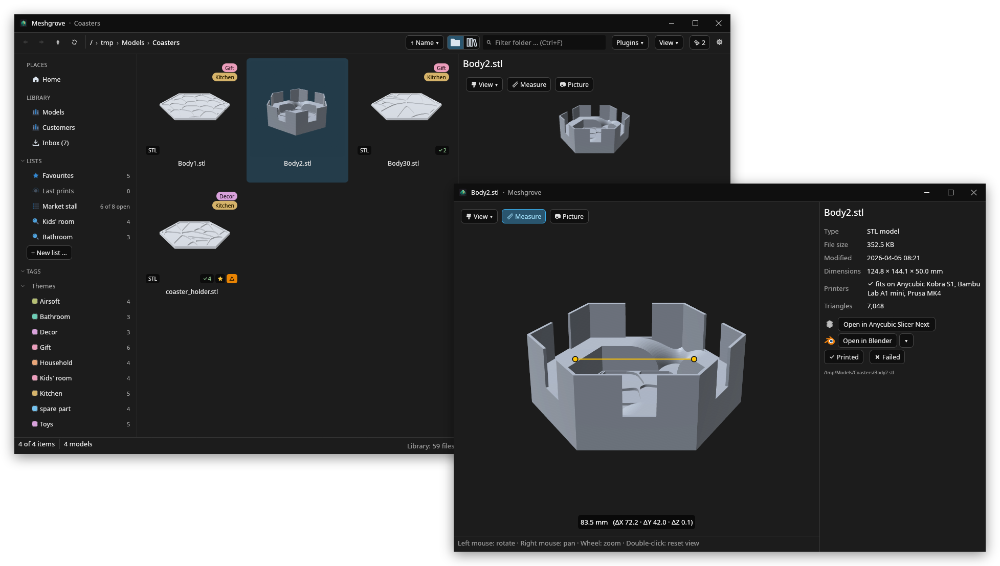

**Modelle in ihren Farben.** Mehrfarbige 3MF-Projekte zeigen das Filament jedes Teils und ihre
bemalten Flächen, einfache 3MF-Dateien ihre Materialfarben, OBJ, PLY und glTF ihre
Vertex-Farben und Texturen. Kacheln bekommen einen Punkt pro Filament, die Details nennen Slot
und Material.

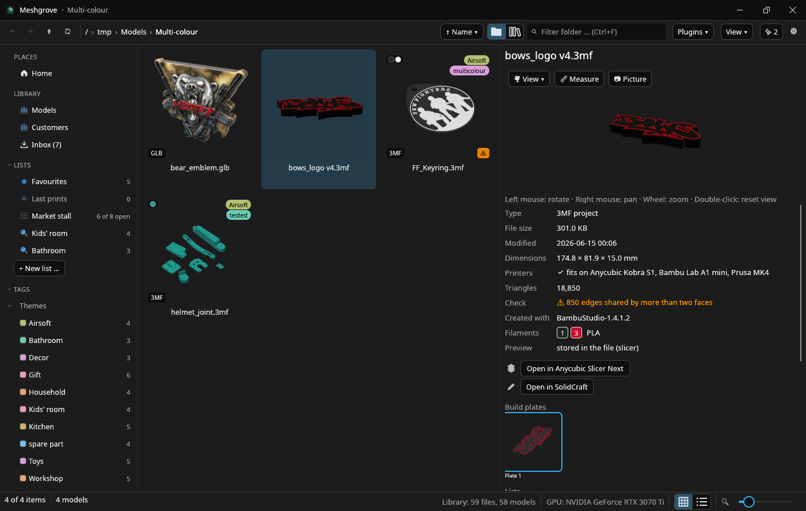

### Die Detailansicht

Der Bereich *Info* (unter dem Viewer, solange du ihn nicht verschiebst) zeigt:

- Typ, Dateigröße und Änderungsdatum
- **Maße** in mm (X × Y × Z) und die Anzahl der **Dreiecke**
- auf welche deiner **Drucker** es passt (siehe [Drucker und Druckbett-Check](#drucker-und-druckbett-check))
- die **Druckbarkeits-Prüfung** (siehe [Druckbarkeits-Check](#druckbarkeits-check))
- bei 3MF: Titel, Designer, das erzeugende Programm, die **Filamente** (Farbe, Slot und
  Material) und ob die Vorschau das eingebettete Bild des Slicers ist
- bei G-code: Slicer, Drucker, Druckzeit, Filament, Schichten, Düse und Kosten (siehe
  [G-code-Dateien](#g-code-dateien))
- Knöpfe, um das Modell im Slicer oder im Mesh-Editor zu öffnen
- die **Listen**, auf denen die Datei steht, und ihr ★ (ein Klick auf eine Liste zeigt sie), das
  **Druckprotokoll** mit *Gedruckt* / *Fehlgeschlagen* / *Rückgängig*, und auf einer gezeigten
  Druckliste die Stückzahl mit − und +
- **Tags** und die **Notiz** (für Dateien in der Bibliothek)
- der vollständige Pfad

Sind mehrere Dateien ausgewählt, zeigt die Ansicht, wie viele es sind und wie groß sie
zusammen sind. Tags und Notiz gelten dann für alle.

### Bibliothek, Suche und Filter

**Bibliotheksordner** sind die Ordner, die Meshgrove indiziert. Füge so viele hinzu, wie du
möchtest (Seitenleiste oder *Einstellungen → Bibliothek → Bibliotheksordner*). Der Index speichert Namen,
Größen, Daten, Maße, Dreiecke, Inhalts-Fingerabdrücke, Tags und Notizen. Er bleibt von selbst
aktuell: Änderungen erfährt Meshgrove über die Dateibenachrichtigungen des Betriebssystems, und
zur Sicherheit gibt es in regelmäßigen Abständen eine schnelle Prüfung.

**Bibliothekssuche:** neben dem Suchfeld den 📚-Bereich wählen (oder Strg+Umschalt+F drücken)
und tippen. Die Treffer kommen aus allen Bibliotheksordnern zugleich.

| Du tippst | Findet |
|---|---|
| `drache` | Dateien, deren Name, Ordnerpfad oder Notiz „drache“ enthält (Groß-/Kleinschreibung egal) |
| `castle tower` | Dateien, die beide Wörter enthalten, egal wo |
| `"castle tower"` | genau diese Wortfolge |
| `ext:3mf` (auch `type:` / `typ:`) | nur 3MF-Dateien; funktioniert mit `stl`, `step`, `obj`, `ply`, `glb`, `zip`, `pdf`, `png` … |
| `tag:bemalt` | nur Dateien mit diesem Tag |
| `tag:"zu drucken"` | Tags mit Leerzeichen |
| `is:favorit` | Favoriten (auch `is:fav`, `is:favoriten`) |
| `is:gedruckt`, `is:ungedruckt`, `is:fehlgeschlagen` | mindestens einmal gedruckt, nie gedruckt (nur Modelle und G-code), letzter Druck fehlgeschlagen; auch englisch `is:printed` … |
| `passt:"Kobra S1"` (auch `fits:`) | passt auf diesen Drucker (G-code: für ihn gesliced) |
| `is:zugross` (auch `is:toobig`), `is:problem` | passt auf keinen deiner Drucker; mögliche Druckprobleme |
| `is:neu` (auch `is:new`), `is:ohne-tags` (auch `is:untagged`) | wartet im Eingang; Modelle und G-code ohne Tags |
| `liste:markt` (auch `list:`) | Dateien auf der Liste „markt“ |
| `drache ext:stl tag:bemalt` | alle Bedingungen zusammen |

Rechtsklick auf einen Treffer → *Im Ordner anzeigen* springt in den Ordner der Datei.
*✕ Suche beenden* (oder Esc im Suchfeld) kehrt zum Ordner zurück.

Der Abschnitt **TAGS** in der Seitenleiste listet alle Tags mit ihrer Anzahl, gruppiert nach
Themen, Druck-Eigenschaften, Zustand und Herkunft und deinen eigenen. Ein Klick sucht danach;
Strg+Klick nimmt den Tag zu den gesuchten dazu oder wieder heraus. *Als Sammlung speichern* über
den Treffern hebt eine Suche als Sammlung auf, die immer aktuell bleibt.

**Ordner neu einlesen:** Normalerweise folgt der Index jeder Änderung von selbst. Falls doch
etwas fehlt, etwa weil Dateien kopiert wurden, während Meshgrove zu war, auf ein Laufwerk, das
ein anderes System geändert hat: Rechtsklick auf einen Bibliotheksordner in der Seitenleiste oder
auf seine Kachel → *Ordner neu einlesen*. Meshgrove liest diesen Ordner und alles darunter neu
und meldet, was sich geändert hat; neu berechnet werden nur die Fingerabdrücke geänderter
Dateien. F5 liest den aktuellen Ordner neu ein.

**Eine Suche für die ganze Bibliothek.** Hier findet `body` jedes Modell mit „body“ im Namen,
aus vier verschiedenen Ordnern.

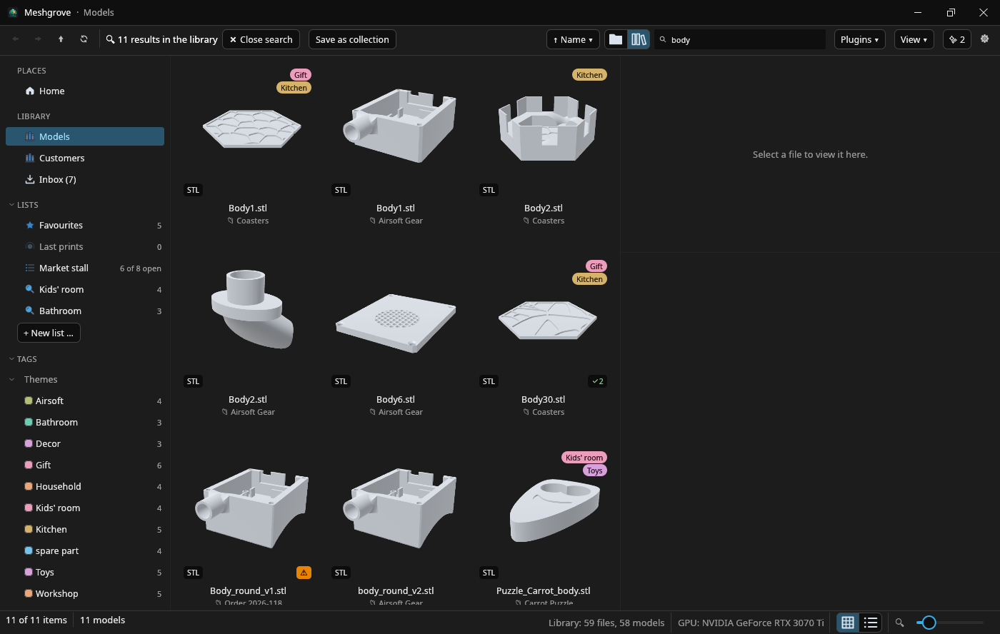

### Tags und Notizen

- **Tag hinzufügen:** Eine oder mehrere Dateien der Bibliothek auswählen, in der Detailansicht
  in *Tag hinzufügen …* tippen und Enter drücken, oder einen der vorgeschlagenen vorhandenen
  Tags anklicken. Der Knopf ▾ neben dem Feld bietet fertige Tags an: Themen (Haushalt, Garten,
  Werkstatt, Kinderzimmer, Tabletop, Cosplay …), Druck-Eigenschaften (mehrfarbig, Print-in-Place,
  ohne Stützen, Magnete …) und Zustand (eigenes Design, Remix, getestet, muss angepasst werden …).
  Rechtsklick → *Tags bearbeiten …* springt direkt ins Feld.
- **Farben:** Jeder Tag bekommt eine eigene Farbe, überall dieselbe. Per Rechtsklick auf einen Tag
  in der Seitenleiste wählst du eine andere. *Einstellungen → Tags* schaltet die Farben ab;
  *Einstellungen → Kacheln* legt fest, ob Kacheln Tags als Namen oder als Farbpunkte zeigen, und
  wie viele.
- **Tag entfernen:** auf das Tag-Kärtchen klicken (`bemalt ✕`). Bei mehreren ausgewählten
  Dateien zeigen die Kärtchen, wie viele davon den Tag tragen (`bemalt (2/5)`).
- **Notizen:** Ins Feld *Notiz* schreiben, was du willst: Druckeinstellungen, Farben, was
  beim letzten Mal schiefging. Gespeichert wird automatisch kurz nach dem Tippen. Bei mehreren
  ausgewählten Dateien bekommen alle die Notiz. Hatten sie verschiedene Notizen, weist das Feld
  darauf hin, und dein Text ersetzt sie.
- **Sie folgen dem Inhalt:** Tags und Notizen hängen an einem Fingerabdruck des Dateiinhalts
  (BLAKE3), nicht am Pfad. Benenne eine Datei um oder verschiebe sie, sogar in einen anderen
  Bibliotheksordner, und Tags und Notiz ziehen mit. Identische Kopien teilen sie sich.

### Favoriten, Sammlungen und Drucklisten

Der Abschnitt **LISTEN** in der Seitenleiste kennt drei Arten von Listen. Alle enthalten Dateien
der Bibliothek und folgen wie Tags dem Inhalt: Eine verschobene oder umbenannte Datei bleibt auf
ihren Listen.

- **★ Favoriten:** Strg+D, das Kärtchen ☆ *Favorit* im Bereich *Info* oder das Kontextmenü
  markieren die Auswahl; ein goldener ★ auf der Kachel zeigt es.
- **🕘 Zuletzt gedruckt:** die Modelle, die du zuletzt an den Slicer geschickt hast, das neueste
  zuerst (von Haus aus 10; wie viele, steht unter *Einstellungen → Programme*).
- **Sammlungen** (📁) fassen Dateien aus beliebigen Ordnern zusammen, für ein Projekt oder ein
  Thema. Eine Sammlung kann auch eine gespeicherte Suche sein: die Bibliothek durchsuchen (etwa
  `tag:garten ext:3mf`) und über den Treffern *Als Sammlung speichern* klicken. Sie zeigt dann
  immer die aktuellen Treffer.
- **Drucklisten** (🖨) sind für das, was du drucken willst, etwa für einen Marktstand oder als
  Geschenk. Jede Datei darauf hat eine Stückzahl (− und + im Bereich *Info*, solange die Liste
  gezeigt wird). Wer einen Druck einträgt, während die Liste gezeigt wird, hakt damit ein Stück
  ab; Kacheln zeigen `1/3` und werden grün, wenn alle Stück fertig sind, und fertige Dateien
  rutschen ans Ende. Die Seitenleiste zeigt, wie viele noch offen sind.

Eine Liste legst du mit *+ Neue Liste …* an, oder per Rechtsklick auf Dateien → *Zur Liste* →
neuen Namen eintippen. Das Kontextmenü nimmt Dateien auch wieder von der gezeigten Liste.
Rechtsklick auf eine Liste in der Seitenleiste benennt sie um oder löscht sie (die Dateien bleiben,
wo sie sind), und bei Drucklisten:

- **✓ Liste abschließen:** Sie wandert in den zugeklappten Abschnitt *Abgeschlossen* darunter;
  *Wieder öffnen* holt sie zurück. Das Druckprotokoll bleibt.
- **Als PDF-Checkliste exportieren:** eine A4-Seite mit Bild jedes Modells, Ordner, Maßen und
  Filamentfarben und einem Kästchen je Stück zum Abhaken von Hand (schon fertige sind
  angehakt). Sie landet in deinem Dokumente-Ordner und öffnet sich gleich zum Drucken.
- **Als CSV exportieren:** dasselbe als Tabelle für Tabellenkalkulationen (auf Deutsch mit `;`
  als Trennzeichen).

**Favoriten, Sammlungen und Drucklisten.** Eine Druckliste für einen Marktstand: jedes Modell
mit den fertigen von den gewünschten Stück (`1/3`), fertige grün am Ende, Tags in ihren Farben
und ein 150 MB großes Lithophane im Viewer. Die Seitenleiste hält die Favoriten, Drucklisten und
Sammlungen (von Hand oder als gespeicherte Suche) und die Tags in Gruppen.

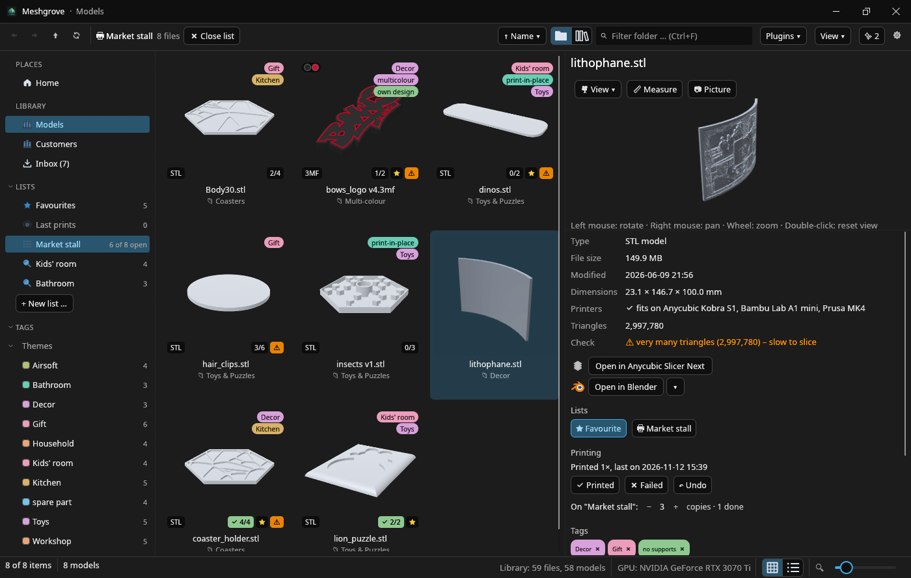

### Das Druckprotokoll

*✓ Als gedruckt eintragen* und *✗ Als fehlgeschlagen eintragen* (Kontextmenü, die Zeile *Druck*
im Bereich *Info* oder die Knöpfe im Modellfenster) halten einen Druck mit Datum fest. Der Bereich
*Info* zeigt dann *2× gedruckt, zuletzt am 12.10.2026* oder *Zuletzt fehlgeschlagen*, und
*↶ Rückgängig* nimmt den letzten Eintrag zurück. Kacheln zeigen ein grünes `✓2` oder ein rotes
`✗`. *Ansicht → Druckstatus* zeigt nur noch nicht Gedrucktes, Gedrucktes oder zuletzt
Fehlgeschlagenes; die Suche kennt `is:gedruckt`, `is:ungedruckt` und `is:fehlgeschlagen`.
Modelle und G-code haben einen Druckstatus, andere Dateien nicht.

### G-code-Dateien

G-code-Dateien (`.gcode`, `.gco`, `.g`) bekommen eine Vorschau wie Modelle:

- **Das Bild des Slicers**, wenn die Datei eines enthält (PrusaSlicer, OrcaSlicer, Bambu Studio,
  Anycubic Slicer Next, Cura mit Vorschau-Plugin; PNG, JPG und QOI). Genommen wird das größte.
- **Sonst die Druckbahnen**, schräg von oben in der Filamentfarbe gezeichnet und nach der Höhe
  schattiert. Die Reinigungslinie des Start-Codes bleibt weg. Selbst eine 50-MB-Datei braucht
  deutlich unter einer Sekunde.

Der Bereich *Info* zeigt, was der Slicer in die Datei geschrieben hat: Slicer und Version, den
Drucker, die Druckzeit, das Filament in Gramm und Metern mit Material und Farbe, die Zahl der
Schichten und die Schichthöhe, die Düse und die Filamentkosten (in der Währung deines
Slicer-Profils). Wurde eine Datei für keinen deiner Drucker gesliced (siehe
[Drucker und Druckbett-Check](#drucker-und-druckbett-check)), steht der Drucker in Orange da und die Kachel bekommt ein
kleines `⚠ 🖨`, damit keine Datei für die falsche Maschine auf der SD-Karte landet. G-code zählt
als druckbar: Er hat ein Druckprotokoll und bleibt bei *Nur Modelle und G-code* sichtbar. Ein
Doppelklick öffnet die Datei im Standardprogramm, meist der G-code-Ansicht des Slicers.

### Readmes und Textdateien

Readmes, Lizenzen und Notizen (`.txt`, `.md`, `.markdown`, `.nfo` sowie `README`, `LICENSE`,
`COPYING` ohne Endung) zeigen auf der Kachel den Anfang ihrer ersten Seite. Ausgewählt zeigt der
Vorschau-Bereich den ganzen Text: Markdown mit Überschriften, Listen, Tabellen und Links (die im
Browser aufgehen), `.nfo`-Dateien in fester Zeichenbreite für ihre ASCII-Kunst, alles andere als
umbrochenen Text. Wählst du einen **Ordner**, zeigt der Vorschau-Bereich sein Readme (oder sonst
seine Lizenz), mit einem Knopf zum Öffnen. Modellpakete von Thingiverse und ähnlichen Seiten
bringen meist eins mit, mit Designer, Lizenz und Drucktipps.

### Drucker und Druckbett-Check

Meshgrove vergleicht die Größe jedes Modells mit dem Bauraum jedes deiner Drucker:

- **Passt auf alle:** keine Markierung. Der Bereich *Info* sagt *✔ passt auf Anycubic Kobra S1,
  Bambu Lab A1 mini* (bei einem Drucker: *✔ passt auf Anycubic Kobra S1*).
- **Passt nur gedreht:** eine gelbe ↻-Markierung mit Winkel, zum Beispiel ↻ 41° für ein langes
  Teil, das nur diagonal passt.
- **Passt auf manche:** *Info* nennt sie und die, für die es zu groß ist (*✕ zu groß für Bambu Lab
  A1 mini*); mit der Maus darüber steht, um wie viel.
- **Passt auf keinen:** eine rote ✕-Markierung auf der Kachel.

*Einstellungen → Drucker* listet deine Drucker. Beim ersten Start übernimmt Meshgrove jeden
Drucker, der in **Anycubic Slicer Next**, **OrcaSlicer**, **Bambu Studio** und **PrusaSlicer**
eingerichtet ist: den gewählten, deine eigenen Profile und die im Einrichtungs-Assistenten
gewählten Modelle, auch wenn sie von Systemprofilen erben. Weitere fügst du mit ＋ hinzu, du kannst
sie bearbeiten, entfernen oder einen von Hand eintragen (Name, Bauraum, Düse, Materialien). Der ●
markiert den Hauptdrucker, der zuerst genannt wird.

G-code zeigt den Drucker, für den er gesliced wurde; ein ⚠ erscheint nur, wenn das keiner deiner
Drucker ist. In der Suche findet `passt:"Kobra S1"` (auch `fits:`), was auf diesen Drucker passt,
und G-code für ihn, `is:zugross` (auch `is:toobig`), was auf keinen passt.

**Mehrere Drucker und eine Druckbarkeits-Prüfung.** Auf welche Drucker ein Modell passt und was
die Prüfung gefunden hat: offene oder nicht-mannigfaltige Kanten, mehrere Teile, verdächtige
Größen.

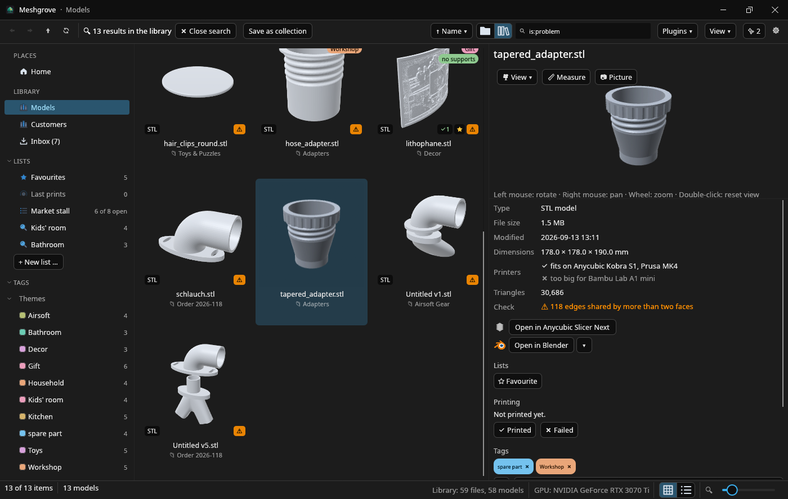

### Druckbarkeits-Check

Jedes Modell (STL, 3MF, OBJ, PLY, glTF) wird einmal geprüft: wenn sein Vorschaubild entsteht oder,
bei Dateien, die schon im Cache sind, und sehr großen Netzen, im Hintergrund, wenn sonst nichts
die Platte braucht:

- **Offene Kanten:** Löcher in der Oberfläche. Kleine repariert der Slicer selbst, aber bei
  Kundendateien lohnt sich ein Blick.
- **Kanten an mehr als zwei Flächen** und **Dreiecke ohne Fläche.**
- **Teile:** wie viele getrennte Stücke die Datei enthält, und das **Volumen** einer
  geschlossenen Oberfläche.
- **Verdächtige Größen:** Ein Modell von wenigen Millimetern ist vielleicht in Zoll gezeichnet
  (*sehr klein (3,2 mm) – in Zoll gezeichnet? Dann wären es 81 mm*); eines von mehreren Metern hat
  die falsche Einheit.
- **Unlesbare Dateien** werden als solche vermerkt.

Das Ergebnis steht als ⚠ auf der Kachel, mit den Gründen im Tooltip, und als Zeile *Prüfung* im
Bereich *Info* (*✔ geschlossen · 1 Teil · 41,2 cm³*). `is:problem` findet alle Modelle, bei denen
es etwas zu prüfen gibt, auch die, die auf keinen Drucker passen. Die Prüfung gehört zum
Dateiinhalt, Kopien teilen sie.

### Der Eingang

Dateien, deren Inhalt Meshgrove noch nicht kannte, landen im **Eingang**: Die Seitenleiste zeigt
*📥 Eingang (n)*, sobald etwas Neues da ist. Was beim ersten Durchsuchen einer Bibliothek schon da
ist, zählt nicht als neu, der Eingang beginnt also leer.

Der Eingang gruppiert die neuen Dateien nach dem, womit sie kamen: dem obersten neuen Ordner oder
dem Archiv, etwa dem ZIP eines Kunden oder einem Modellpaket. Jede Gruppe sagt, wie viele Dateien
neu sind, wie viele Kopien von Modellen sind, die die Bibliothek schon hatte, seit wann, und wie
viele mögliche Druckprobleme haben. Ordne die Dateien ein (Tags, Listen) und klick dann *✓ Erledigt*
für die Gruppe, per Rechtsklick *✓ Erledigt* für eine Datei, oder *✓ Alle erledigt*. Taggen allein
nimmt eine Datei nicht aus dem Eingang.

`is:neu` (auch `is:new`) findet die Dateien im Eingang, `is:ohne-tags` (auch `is:untagged`) Modelle
und G-code ohne Tags. *Einstellungen → Bibliothek → Eingang* schaltet den Eingang ab.

**Ein Eingang für neue Lieferungen.** Neue Dateien nach Ordner oder ZIP gruppiert, Kopien
bekannter Dateien mitgezählt, mögliche Druckprobleme markiert; *✧ Einordnen* schlägt Tags vor.

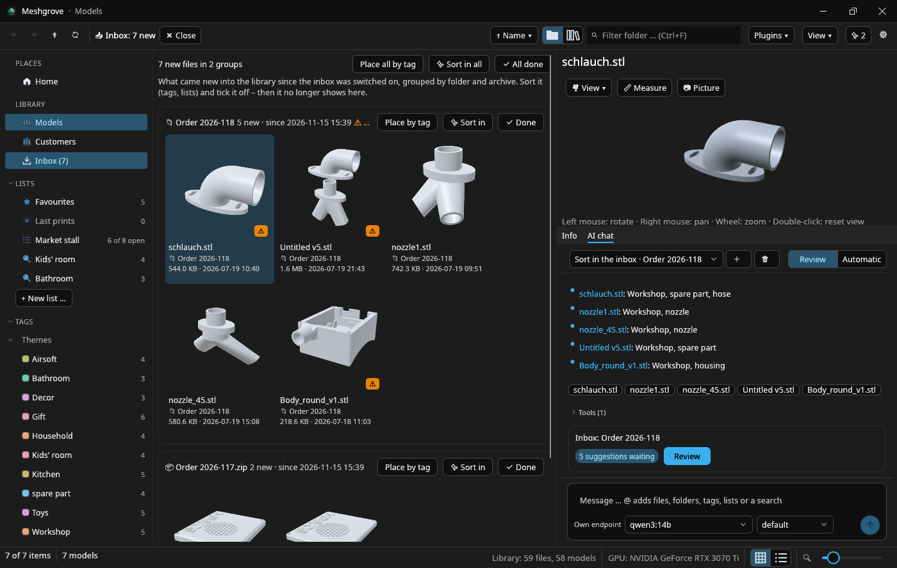

### Duplikate finden

In der Seitenleiste auf **Duplikate (n)** klicken. Meshgrove gruppiert:

- **Exakte Kopien:** byte-gleiche Dateien (gleicher BLAKE3-Hash).
- **Gleiche Geometrie:** dasselbe Modell, anders gespeichert, etwa ASCII- statt Binär-STL, STL
  statt 3MF, neu exportiert, verschoben oder gedreht. Erkannt wird das über eine
  drehungsunabhängige Signatur des Netzes (Dreiecke, Oberfläche, Volumen, Trägheitsmomente).

Die Gruppen sind nach verschwendetem Platz sortiert. Die Markierung ★ *Behalten* zeigt den
Vorschlag: eine Kopie außerhalb eines Archivs (oder darin, wie unter *Einstellungen → Bibliothek
→ Duplikate* gewählt), dann die älteste, dann die mit dem kürzesten Pfad; lieber eine andere
Kopie behalten: auf sie zeigen und ☆ *Behalten* klicken. *Alle außer ★
in den Papierkorb* räumt eine Gruppe nach Rückfrage auf. Nach der Sichtung hakst du die Gruppen
ab, bei denen es passt (oder *Alle Vorschläge passen*), und *Ausgewählte bereinigen* räumt sie
alle mit einer Rückfrage auf. Kopien, die so bleiben sollen, bekommen *Ignorieren*: Die Gruppe
wird nicht mehr gelistet, in der Seitenleiste gezählt oder auf ihren Kacheln markiert;
*Ignorierte zeigen* listet solche Gruppen wieder, mit *Wieder beachten* zum Zurücknehmen. Was
ignoriert ist, bleibt bei deinen Tags und Notizen (auch im Export der Benutzerdaten). Während
eine Bereinigung läuft, zeigt ein Balken oben, wie viele Dateien durch sind, und jede Gruppe und
jedes Archiv, dessen Kopien gerade gehen, färbt sich von links grün, so weit es ist; seine Knöpfe
ruhen solange. Überall in der Galerie tragen Dateien mit Duplikaten eine `2×`/`3×`-Markierung.

**Gepackt und entpackt.** Ein Modellpaket, das als ZIP und entpackt in der Bibliothek liegt,
ergibt eine Gruppe je Modell, und ein Eintrag eines Archivs lässt sich nicht einzeln löschen. Die
Einstellung *Ein Modell gepackt und entpackt: behalten – die entpackte Kopie | die gepackte Kopie*
bestimmt, welche Seite ★ vorschlägt, sodass *Alle Vorschläge passen* → *Ausgewählte bereinigen*
alles auf einmal erledigt. Über den Gruppen listet *Archive mit entpackten Kopien* jedes solche
Archiv mit der Zahl seiner entpackten Modelle und den Ordnern der Kopien und erledigt es mit einem
Klick: das Archiv behalten und seine entpackten Kopien in den Papierkorb, oder die Kopien behalten
und das Archiv in den Papierkorb – Letzteres erst, wenn jedes Modell darin entpackt ist (der Knopf
sagt, wie viele sonst verloren gingen). Zwei Knöpfe über den Zeilen tun dasselbe für alle Archive
auf einmal. Die Gruppen dieser Archive werden dort erledigt und sind unter den Gruppen eingeklappt
(*Unten zeigen* listet sie); eine gesperrte Gruppe nennt ihr Archiv und verweist auf diese Zeile.
*Archive mit denselben Modellen* listet Paare von Archiven, von denen eines nichts enthält, was
das andere nicht auch hat (ein Paket, das zweimal in der Bibliothek liegt): Dieses kann als Ganzes
in den Papierkorb, was Gruppen erledigt, deren Kopien beide in Archiven stecken. Konfiguration: `duplicates_keep = "extracted" | "packed"`.

**Duplikate finden.** Exakte Kopien und gleiche Geometrie, gruppiert, mit Vorschlag, welche
Kopie bleiben soll, und einem Klick, um die anderen in den Papierkorb zu legen.

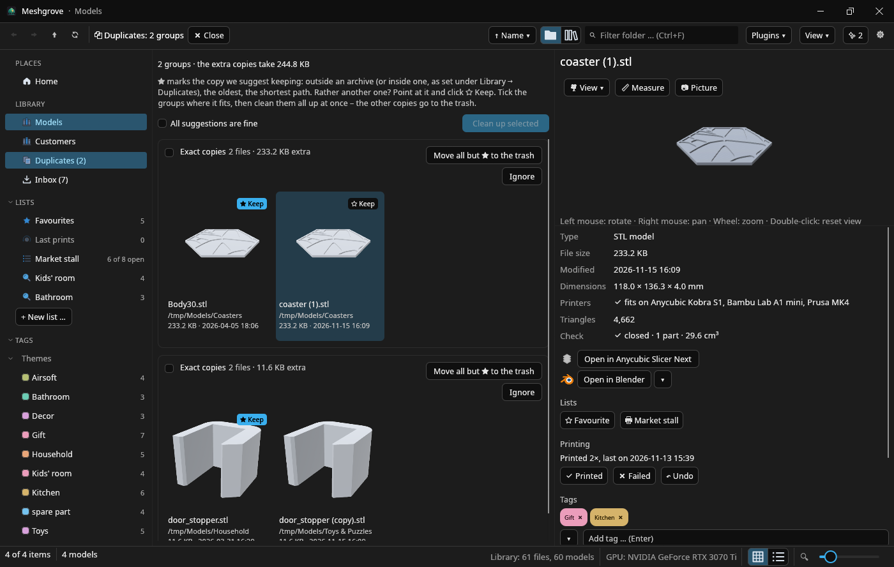

### KI-Assistent und MCP (freiwillig)

Meshgrove bringt **keine eigene KI** mit und ist ab Werk ohne KI. Nutzt du einen KI-Assistenten,
der das [Model Context Protocol](https://modelcontextprotocol.io) spricht – Claude Desktop, Claude
Code, LM Studio, Cursor, VS Code und andere –, kann er mit deiner Bibliothek arbeiten: darin suchen
(„alle Gartenmodelle unter 2 Stunden, die auf den A1 mini passen“), neue Kundendateien ansehen und
Tags, Notizen oder Drucklisten vorschlagen. **Nichts ändert sich, bevor du es in Meshgrove
annimmst**, und Angenommenes lässt sich rückgängig machen.

**Einrichten:**

1. *Einstellungen → KI & MCP:* *KI-Funktionen einschalten* anhaken.
2. *Was die KI sehen darf:* für jede Bibliothek *keine KI*, *nur lokale KI* oder *auch Cloud-KI*
   wählen, und ob Vorschaubilder mitgehen dürfen. Neue Bibliotheken sind erst einmal versteckt.
   *Nur lokale KI* passt für Kundendateien, wenn dein Assistent ein Modell auf deinem Rechner oder
   im eigenen Netz nutzt (LM Studio, Ollama) – so ein Assistent wird mit `--local` eingerichtet.
3. *Meshgrove den KI-Apps auf diesem Rechner bereitstellen* (von Haus aus an): Meshgrove trägt
   sich bei den Assistenten ein, die es findet – Claude Desktop, Claude Code, LM Studio, Cursor,
   VS Code, Codex, Gemini CLI, Copilot CLI, Windsurf, Zed, OpenCode – und listet sie dort auf. Nur
   sein eigener Eintrag ändert sich; jede Datei wird vorher als `.bak` gesichert. Den Assistenten
   neu starten. Jeder andere Assistent: *Von Hand einrichten* zeigt den Eintrag zum Kopieren.

Der Assistent startet `meshgrove-mcp` selbst; Meshgrove muss dafür nicht laufen. Er sieht nur die
Bibliotheken, die du ihm freigibst, bekommt Kennungen wie `Garten/Rankhilfe/rose.stl` statt deiner
Ordnerpfade (den vollen Pfad nur, wenn er nach einer Datei fragt, um sie an einen Slicer oder
Druckserver zu geben) und nie die Modelldateien selbst. Fertige Aufgaben sind dabei:
*eingang-einordnen*, *druckliste-zusammenstellen*, *tags-aufraeumen* und *ordner-aufraeumen*.

**Prüfen:** Vorschläge warten in Meshgrove. Der ✧-Knopf in der Werkzeugleiste zeigt, wie viele;
er öffnet die Prüfliste. Jeder Block zeigt, was für welche Datei vorgeschlagen wurde: neue Tags (☑
zum Behalten, Tags, die es in der Bibliothek noch nicht gibt, als *neu* markiert), Tags zum
Entfernen, Notizen, neue Listen. Haken weg bei einer Datei oder Klick auf einen Tag lässt ihn weg
(der Haken am Titel gilt für den ganzen Block), dann *Ausgewählte annehmen*, *Alle annehmen* oder
*Verwerfen*. Alles lässt sich dabei ändern: Ein eigenes Tag ins Feld *+ eigenes Tag* tippen, eine
Notiz umschreiben (und wählen, ob sie die alte ersetzt oder darunter kommt), für eine Verschiebung
einen anderen Namen oder Ort tippen, eine Liste umbenennen, zwischen Druckliste und Sammlung
wechseln, Einträge abwählen und Stückzahlen setzen. Angenommen wird, was du siehst. Wer einen Block für den Eingang annimmt, nimmt die Dateien damit auch aus dem
Eingang. Tags und Notizen gehören zum Inhalt und gelten damit auch für identische Kopien; die
Prüfliste sagt es dann. *Einstellungen → KI & MCP → Vorschläge automatisch annehmen* überspringt
die Prüfung für neue Vorschläge von KI-Apps und Ein-Klick-Aktionen; Verschiebungen warten immer.

**Nichts ändert sich, bevor du es sagst.** Vorschläge aus dem Chat, den Ein-Klick-Aktionen oder
von einem MCP-Assistenten warten in der Prüfliste, alt → neu; Angenommenes lässt sich im Verlauf
zurücknehmen.

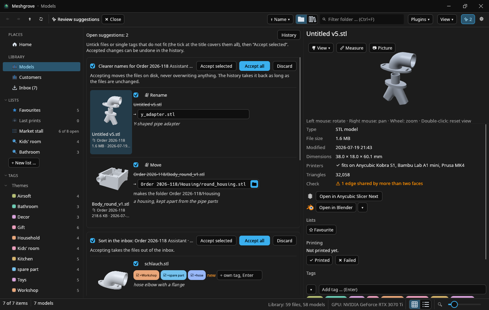

**Verlauf:** *Prüfliste → Verlauf* listet, was angenommen wurde. *↶ Rückgängig* nimmt genau diese
Änderungen zurück und lässt, was du seither von Hand geändert hast; *↷ Wiederherstellen* wendet sie
wieder an. *Einstellungen → KI & MCP* zeigt außerdem das **Zugriffsprotokoll** – welcher Assistent
wann was angesehen hat –, und *KI-Daten löschen* entfernt alle offenen Vorschläge, das Protokoll
und die Chat-Gespräche.

**KI-Chat (eigener Endpunkt oder ein Agent auf deinem Rechner):** Den Chat beantwortet entweder
ein eigener Endpunkt oder ein **KI-Agent auf deinem Rechner**, der das Agent Client Protocol
spricht – Claude Code (`claude-agent-acp`), Codex, Google Antigravity, Gemini CLI, OpenCode, Grok,
Copilot CLI, Qwen Code, goose. Meshgrove findet die installierten selbst (*Einstellungen → KI &
MCP → Wer den Chat beantwortet* zeigt sie mit Anmeldestatus und nimmt jeden weiteren ACP-Befehl
auf). Niemand wird für dich gewählt: Unter dem Nachrichtenfeld wählst du, wer antwortet (die Wahl
bleibt), *Verbinden* startet den Agenten – oder die erste Nachricht –, und in den Einstellungen
lässt sich einstellen, dass der Chat sich beim Aufgehen selbst verbindet: mit dem zuletzt
genutzten Assistenten oder einem bestimmten Agenten. Er erreicht die
Bibliothek über `meshgrove-mcp`; Meshgroves eigene Werkzeuge (sie lesen oder schlagen für die
Prüfung vor) darf er ausführen, vor allem anderen, was er ausführen will – ein Shell-Befehl, eine
Datei, was der Agent selbst mitbringt –, fragt Meshgrove dich im Chat. Seine Vorschläge zeigt er
als Karten wie der Endpunkt. Für einen Endpunkt trägst du unter *Eigener
Endpunkt* einen OpenAI-kompatiblen Dienst ein, den du selbst betreibst oder nutzt – Ollama, LM
Studio, llama.cpp, OpenAI, OpenRouter –, mit Modell und, wenn nötig, Schlüssel (er liegt im
Schlüsselbund). Unter dem Nachrichtenfeld wählst du, wer antwortet, und in einer
**durchsuchbaren Modellwahl**, welches Modell: Die Liste kommt vom Agenten oder vom Endpunkt
(OpenRouters klappt nach Anbietern), und ein Modell, das nicht darin steht, tippst du ein. Daneben
stehen die weiteren Wahlen: der **Denkaufwand** des Endpunkts (geht als `reasoning_effort` mit,
auch ein Feld in seinen Einstellungen) oder die Sitzungsoptionen, die der Agent anbietet (Claude
Code: Aufwand; sein Berechtigungsmodus gehört nicht dazu, denn Berechtigungen entscheidet Meshgrove
selbst, und der Schalter Prüfen | Automatisch sagt, was aus den Vorschlägen wird). Dann erscheint neben *Info* der Bereich **KI-Chat**: Frag
nach deiner Bibliothek, und mit `@` fügst du Dateien, Ordner, Tags, Listen, Drucker, den Eingang
oder eine Suche (`@tag:garten passt:mini`) als Verweis ein. Antworten nennen Dateien als
anklickbare Verweise; was die KI nachgeschlagen hat, steht eingeklappt darunter. Der Schalter
**Prüfen | Automatisch** entscheidet, ob ihre Tags, Notizen und Listen erst in die Prüfliste gehen
oder gleich angewendet werden; der Pfeil ↶ an deiner Nachricht nimmt alles zurück, was darauf hin
geändert wurde. Ein Cloud-Dienst sieht nur Bibliotheken, die für Cloud-KI freigegeben sind, und
vor dem ersten Senden zeigt Meshgrove, was rausgeht. Die Gespräche bleiben auf deinem Rechner.

**Deine eigene KI, wenn du willst.** Frag den Chat mit `@`-Verweisen (Dateien, Ordner, Tags,
eine Suche); er antwortet mit Links auf die Modelle, und was er ändern würde, wartet als Karte.

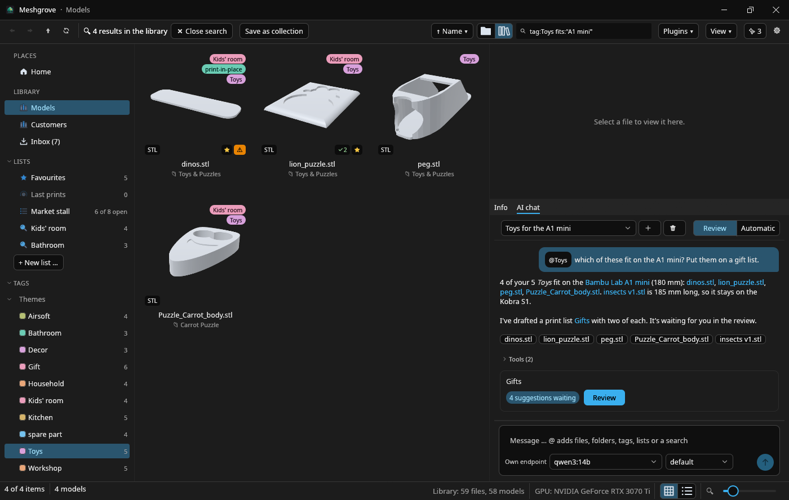

**Ein-Klick-Aktionen** gehen an den, der den Chat beantwortet: *✧ Einordnen* im Eingang (je
Gruppe oder alles) schlägt Tags vor, *✧ Tags vorschlagen* im Kontextmenü tut es für die Auswahl,
und *+ Neue Liste … → ✧ Oder beschreiben* macht aus „Geschenke unter 2 h für den A1 mini“ eine
Druckliste (die Druckzeit kommt aus dem G-Code, auch aus einem gleichnamigen neben dem Modell). Mit
einem Endpunkt kommen sie ohne Werkzeug-Aufrufe aus, also schaffen das auch kleine lokale Modelle;
mit einem Agenten wie Claude Code wird die Aufgabe eine Nachricht in einem eigenen Gespräch, und
der Agent macht die Vorschläge mit Meshgroves Werkzeugen. Die Ergebnisse warten in der Prüfliste
und stehen als Karte in diesem Gespräch, in dem du nachfragen kannst. ✧ neben dem Tag-Feld, das
Tags zum Anklicken anbietet, braucht einen Endpunkt. *✧ Im Chat erwähnen* legt die Auswahl ins Nachrichtenfeld, *Als KI-Verweis
kopieren* gibt `meshgrove:`-Verweise für einen Assistenten über MCP.

**Verschieben und Umbenennen:** Assistent und Chat können vorschlagen, Dateien, Archive oder Ordner
innerhalb ihrer Bibliothek zu verschieben oder umzubenennen, und mit *Einstellungen → KI & MCP →
Der KI erlauben, Dateien zwischen Bibliotheken zu verschieben* auch in eine andere freigegebene
Bibliothek. Das bleibt immer ein Vorschlag, auch im
automatischen Modus: Die Prüfliste zeigt alt → neu und welche Ordner dafür angelegt würden. Beim
Annehmen wird auf der Festplatte verschoben, ohne je etwas zu überschreiben – ist das Ziel
inzwischen belegt, wird es übersprungen. Tags, Notizen, Listen und Vorschaubilder ziehen mit,
nichts wird neu berechnet. Im Verlauf lässt es sich zurücknehmen, solange die Dateien unverändert
sind; eigens angelegte Ordner verschwinden dann wieder, wenn sie leer sind. Dateien in Archiven
bleiben, wo sie sind.

**Löschen:** Assistent und Chat können auch vorschlagen, Dateien, Archive oder Ordner in den
Papierkorb zu legen (`propose_delete`). Das wartet immer auf die Prüfliste, auch im automatischen
Modus, und beim Annehmen wandern sie in den Papierkorb des Systems, aus dem sie sich zurückholen
lassen; der Verlauf kann das nicht. Nichts in Archiven, und nie eine Bibliothek selbst.

**Archive:** `list_archive` sagt dem Assistenten, was ein Archiv enthält (Einträge mit ihren Ids
und ob es sich schreiben lässt), und `propose_archive` schlägt vor, ein Archiv neben sich zu
entpacken, Dateien in ein neues ZIP zu packen oder zu einem ZIP hinzuzufügen (7z, RAR und TAR
werden nur entpackt). Das wartet immer auf die Prüfliste, auch im automatischen Modus; nie wird
etwas ersetzt, und der Verlauf nimmt es zurück.

**Rückfragen:** Ist eine Bitte mehrdeutig, kann der Assistent nachfragen (`ask_user`): Seine
Fragen erscheinen im Chat mit Auswahlknöpfen für eine Antwort, Kästchen für mehrere und einem Feld
für eine Antwort in eigenen Worten; der Assistent wartet auf die Antwort (höchstens eine
Viertelstunde) und macht damit weiter. *Nicht antworten* oder Abbrechen lässt ihn ohne weitermachen.
Fragt ein Assistent über MCP (Claude Desktop, Cursor …), bekommt er in Meshgrove ein eigenes
Fenster, das sagt, wer fragt.

Auf der Kommandozeile macht `meshgrove-mcp setup` dasselbe (`--dry-run` zeigt es vorher,
`--client NAME` wählt einen aus), `meshgrove-mcp remove` nimmt die Einträge wieder heraus, und
`meshgrove-mcp --print-config claude-desktop` (oder `claude-code`, `lm-studio`, `cursor`, `vscode`,
bei Bedarf mit `--local`) gibt einen aus. Beim AppImage lautet der Befehl `Meshgrove.AppImage mcp`.

### Plugins (freiwillig)

Plugins erweitern Meshgrove um Werkzeuge, zum Beispiel Bingrove, einen Generator für
Gridfinity-Schubladeneinsätze, und Texgrove, das Texturen als echte Geometrie auf Modelle legt.
Ein Plugin ist eine einzige `.wasm`-Datei für alle Systeme und läuft
abgeschottet. Es darf nichts, bis du es unter *Einstellungen → Plugins* erlaubst, und was es
erzeugt, kommt als eine Änderung, die sich rückgängig machen lässt. Installieren, Rechte und
Plugins schreiben: [docs/plugins.md](plugins.md) (englisch).

### Zusammenarbeit mit Slicer und anderen Programmen

- **In Slicer öffnen** (Kontextmenü, oder der Knopf unter den Angaben im Bereich *Info* und im
  Modell-Fenster, gleich beim Druckbett-Check):
  öffnet die ausgewählten Modelle, gern mehrere auf einmal (STL, 3MF, STEP und OBJ; PLY und
  glTF öffnen die Slicer nicht). Dateien aus Archiven werden vorher in einen Cache-Ordner
  entpackt. Über 30 Slicer findet Meshgrove von selbst, für Filament- und für Resin-Drucker:

  | Drucker | Erkannt |
  |---|---|
  | Filament | Anycubic Slicer Next, OrcaSlicer, PrusaSlicer, Bambu Studio, UltiMaker Cura, Creality Print, SuperSlicer, Snapmaker Orca, Simplify3D, IdeaMaker, ElegooSlicer, QIDI Studio, FlashPrint, Snapmaker Luban, AnkerMake Studio, Slic3r, Repetier-Host, MakerBot Print, Z-Suite, KISSlicer, MatterControl |
  | Resin | Lychee Slicer, ChiTuBox, ChiTuBox Pro, Photon Workshop, UVtools, PreForm, Halot Box, NovaMaker, Voxeldance Tango, Voxeldance Additive, Asiga Composer, GKone |

  Gesucht wird dort, wo sie installiert werden: unter Linux als Paket der Distribution oder
  irgendwo im `PATH`, im Ordner eines Herstellers unter `/opt` oder `~/opt` (Anycubic Slicer Next
  in `~/opt/AnycubicSlicer`), als Flatpak oder Snap oder als AppImage in `~/Applications`,
  `~/Downloads` und ähnlichen Ordnern; unter Windows unter *Programme* oder im benutzereigenen
  *Programs*-Ordner; unter macOS in */Programme* oder *~/Programme*. MakerBot Print, Z-Suite,
  Voxeldance Additive, Asiga Composer und GKone werden nur unter Windows und macOS gesucht.
  *Einstellungen → Programme → Slicer* listet, was gefunden wurde: Die, die du nutzt, fügst du
  mit ＋ hinzu und wählst einen Standard; die übrigen hinzugefügten stehen im Untermenü
  *In anderem Slicer öffnen*.

  **Ist der Slicer schon offen**, landen die Dateien in diesem Fenster statt in einem neuen:
  Anycubic Slicer Next und OrcaSlicer bekommen sie unter Linux über D-Bus, PrusaSlicer wird in
  seinem Einzelinstanz-Modus gestartet. Nur wenn kein Fenster offen ist, startet ein neues. Die
  Statusleiste sagt, was passiert ist. (Unter macOS reicht das System Dateien ohnehin an eine
  laufende App weiter; unter Windows öffnet sich vorerst ein neues Fenster.)

  Jeden anderen Slicer richtest du unter *Einstellungen →
  Programme → Slicer* ein: Name, Programm und auf Wunsch ein Arbeitsordner.
- **Im Mesh-Editor öffnen** (Kontextmenü, oder der Knopf neben *In Slicer öffnen*): öffnet die
  ausgewählten Modelle in einem Mesh-Editor oder CAD-Programm, um sie zu reparieren oder zu
  ändern. Über 20 davon findet Meshgrove von selbst, an denselben Stellen wie die Slicer:

  | System | Erkannt |
  |---|---|
  | Linux, Windows und macOS | FreeCAD, Blender, MeshLab, SolidCraft, OpenSCAD, SolveSpace, CloudCompare, Plasticity, Wings 3D, Dust3D, Dune 3D, fstl, f3d |
  | Windows und macOS | Autodesk Fusion, Meshmixer, Rhino, SketchUp, Autodesk Netfabb, ZBrush, Shapr3D, Autodesk Maya |
  | Windows | SolidWorks, Autodesk Inventor, Autodesk 3ds Max |

  Blender öffnet nur seine eigenen Dateien, deshalb startet Meshgrove es mit einem kurzen
  Import-Skript: eine leere Szene in Millimetern mit den Modellen (STL, OBJ, PLY, glTF) darin.
  FreeCAD und die anderen bekommen die Dateien direkt. Jedes andere Programm richtest du unter
  *Einstellungen → Programme → Mesh-Editor* ein.
- **Kopieren (Strg+C):** legt die ausgewählten Dateien als echte Dateien in die
  Zwischenablage. Du kannst sie in Dolphin, im Explorer oder Finder, in vielen Slicern oder in
  einem Chat einfügen. Dateien aus Archiven werden vorher entpackt. *Pfad kopieren* legt
  stattdessen die Pfade als Text ab.
- **Einfügen (Strg+V):** kopiert die Dateien aus der Zwischenablage – aus Meshgrove, dem
  Dateimanager oder als Pfade – in den gezeigten Ordner, per Rechtsklick auch in eine
  Ordnerkachel. Nichts wird ersetzt (ein vergebener Name bekommt eine Nummer), die Kopien
  behalten Tags und Notizen, und der Verlauf nimmt es zurück.
- **Ausschneiden (Strg+X):** markiert die Auswahl (die Kacheln werden blass) und legt sie in
  die Zwischenablage; das nächste Einfügen verschiebt die Dateien stattdessen – innerhalb der
  Bibliothek mit Tags, Notizen und Vorschauen, im Verlauf rückgängig machbar. Dateimanager, die
  die Ausschneide-Markierung kennen (Dolphin, Nautilus), verschieben ebenfalls, und was sie
  ausschneiden, wird beim Einfügen hier verschoben.
- **Im Dateimanager zeigen:** öffnet Dolphin/Nautilus, den Explorer oder den Finder mit den
  Dateien markiert.
- **Mit Standardprogramm öffnen** (Kontextmenü): öffnet ein Modell im Standardprogramm des
  Systems, zum Beispiel dem Slicer, der für STL-Dateien eingetragen ist; andere Dateien öffnen
  sich dort per Doppelklick.

### Archive (ZIP, 7z, RAR, TAR)

Ein Doppelklick auf ein Archiv öffnet es wie einen Ordner, Ebene für Ebene: Die Ordner darin
öffnen sich wie Ordner auf der Platte, mit eigenen Mosaik-Kacheln, und *Unterordner einbeziehen*
zeigt alles unterhalb der Ebene, auf der du bist. Jedes Modell, Bild und PDF darin bekommt eine
Vorschau. Die Archiv-Kachel zeigt ein Mosaik des Inhalts – in der Bibliothek (aus dem Index) wie
außerhalb (aus dem Archiv gelesen), im Download-Ordner oder in der Import-Ansicht genauso.
Archive in der Bibliothek werden wie Ordner indiziert, also beziehen Bibliothekssuche, Tags,
Notizen und Duplikatsuche ihren Inhalt mit ein. Solide 7z/RAR-Archive werden einmal pro Besuch
entpackt, nicht einmal pro Datei.

**Archive verändern.** Rechtsklick → *Entpacken* legt den Inhalt eines Archivs in einen neuen
Ordner mit seinem Namen daneben (das Archiv bleibt; ein vergebener Name bekommt eine Nummer).
*Als ZIP packen* macht aus den gewählten Dateien und Ordnern ein neues ZIP in ihrem Ordner, mit
dem Namen, den du eintippst. *Zum Archiv hinzufügen* listet die ZIPs im selben Ordner, zu denen die
Auswahl kommen kann, und Strg+V in einem geöffneten ZIP (oder einem Ordner darin) fügt die
kopierten Dateien dort ein – ausgeschnittene Dateien werden nicht in ein Archiv verschoben. Nur
ZIP-Archive werden geschrieben; 7z, RAR und TAR lassen sich entpacken, aber nicht verändern. Nie
wird etwas ersetzt: Ein gleichnamiger Eintrag stoppt das ganze Hinzufügen, und ein neues ZIP
überschreibt keine Datei. Jede Operation ist ein Eintrag im Verlauf, der sie zurücknimmt, solange
das ZIP (oder die entpackten Dateien) seitdem unverändert sind. Die Bibliothek liest den Ordner
sofort ein, also bekommen die neuen Dateien und Einträge ihre Vorschauen und landen im Eingang.

### Dateien in den Papierkorb

Entf oder Rechtsklick → *In den Papierkorb verschieben* legt die ausgewählten Dateien nach
einer Rückfrage in den Papierkorb des Systems (freedesktop-Papierkorb unter Linux, Papierkorb
unter Windows und macOS). Dort kannst du sie wiederherstellen. Für Dateien in Archiven ist
Löschen nicht möglich. Unter Linux erkennt Meshgrove schreibgeschützt eingehängte Laufwerke
(etwa eine NTFS-Platte, die nur lesend eingehängt ist) und sperrt die Aktion mit einer
Erklärung.

### Sicherung, Export und Import

- **Automatische Sicherung:** Einmal am Tag (wenn sich etwas geändert hat) schreibt Meshgrove
  alle Tags, Notizen, Listen, das Druckprotokoll und die Tag-Farben in
  `user-data-JJJJ-MM-TT.json` im Sicherungsordner und behält die sieben neuesten.
  *Einstellungen → Daten und Speicher → Tags, Notizen & Listen sichern → Ordner öffnen* zeigt sie.
- **Export:** schreibt all das nach `meshgrove-tags-notizen-JJJJ-MM-TT.json` in deinen
  Dokumente-Ordner. Die Datei ist lesbares JSON und nennt zu jedem Fingerabdruck die Pfade, unter
  denen die Dateien lagen.
- **Import:** liest so eine Datei (oder eine Sicherung) und führt sie zusammen: Tags kommen
  dazu, Notizen werden für Dateien ohne Notiz übernommen, Listen werden nach Namen
  zusammengeführt und Drucke einmal übernommen. Gelöscht wird nichts. Weil alles am Inhalt
  hängt, klappt der Import auch, nachdem du deine Ordner umsortiert hast oder auf einen anderen
  Rechner umgezogen bist. Exporte älterer Versionen (nur Tags und Notizen) lassen sich ebenfalls
  importieren.

### Vorschauen in Dolphin und Dateidialogen (Linux)

Die .deb- und .rpm-Pakete und `install.sh` richten einen freedesktop-Thumbnailer ein. Dolphin,
die Dateidialoge von KDE und GTK und andere Dateimanager zeigen dann dieselben Vorschauen für
STL-, 3MF-, STEP-, OBJ-, PLY-, glTF- und G-code-Dateien. In Dolphin einmal einschalten: *Einstellungen → Dolphin einrichten → Oberfläche →
Vorschauen*. Dort die 3D-Modell-Einträge anhaken, falls sie aufgeführt sind, und für große
Modelle die Größengrenze für Vorschauen lokaler Dateien erhöhen. Danach den Ordner neu öffnen. Der
Thumbnailer teilt sich den Cache mit Meshgrove, also erscheinen Dateien, die du schon in der
App gesehen hast, sofort.

### Updates

Meshgrove kann dir sagen, wenn eine neue Version da ist, und wo es sich sicher selbst ersetzen
kann, aktualisiert es mit einem Klick. Gesendet wird nichts, bevor du einmal Ja gesagt hast: Nach
der Installation steht in der Titelleiste eine kleine Pille, **Nach Updates suchen?**, und ein
Klick darauf fragt dich. Ändern kannst du die Antwort jederzeit unter *Einstellungen → Allgemein →
Updates*.

- **Was du siehst:** Ist eine neuere Version da, erscheint in der Titelleiste eine Pille **Update
  auf 0.14.0** (in der Werkzeugleiste, wo der Desktop die Titelleiste zeichnet). Ihr Fenster zeigt
  die Release-Notes, den Knopf, der zu deiner Installation passt, **Diese Version überspringen**
  und **Später** (drei Tage Ruhe). *Einstellungen → Über* hat **Jetzt prüfen**, das auch bei
  ausgeschalteter automatischer Prüfung geht.
- **Was gesendet wird:** beim Start und einmal am Tag eine HTTPS-Anfrage,
  `GET https://api.github.com/repos/DonDavis-vibe/MeshGrove/releases/latest`, mit dem
  User-Agent `Meshgrove-update-check` und sonst nichts: keine Versionsnummer, keine Kennung, keine
  Nutzungsdaten. GitHub sieht sie wie jeden Besuch (deine IP-Adresse, die Uhrzeit). Ohne Netz
  erscheint nichts, und es wird eine Stunde später wieder versucht. `MESHGROVE_UPDATE_CHECK=0`
  schaltet jede Prüfung ab, auch die Frage.
- **Geprüft, bevor sich etwas ändert:** Jeder Download muss zu seiner SHA-256-Prüfsumme in der
  `SHA256SUMS.txt` des Releases passen. Einer, der nicht passt, wird gelöscht, und die installierte
  Version bleibt, wie sie war.
- **Das Programm bleibt an seinem Platz:** Ein Update ändert, was dort ist, nie, wo es ist. So
  funktionieren Starter, Menüeinträge, die Windows-Verknüpfungen und die MCP-Verbindungen der
  KI-Apps weiter. Ein AppImage behält deshalb seinen Dateinamen, auch die alte Versionsnummer darin.

| Installiert als | Der Update-Knopf |
|---|---|
| AppImage | lädt die neue Version neben die alte Datei, prüft sie und tauscht sie an ihrem Platz aus; dann **Jetzt neu starten** |
| Windows-Installer | lädt und prüft den Installer, schließt Meshgrove und aktualisiert es im selben Ordner; der Installer startet es wieder |
| Windows-ZIP | lädt und prüft das ZIP und tauscht die Programme in ihrem Ordner aus; dann **Jetzt neu starten** |
| macOS | lädt und prüft das Disk-Image und öffnet es: Meshgrove beenden und die neue App an den Platz der alten ziehen |
| .deb / .rpm | **Herunterladen** öffnet das Paket; das Fenster zeigt den Befehl `sudo apt install` / `sudo dnf install` zum Kopieren |
| Mit `install.sh` gebaut | zeigt `git pull && packaging/install.sh` und die Release-Seite |

Mit einem einfachen `cargo build` gebaute Versionen prüfen nie und zeigen nichts davon.

## Tastatur und Maus

Strg heißt auf macOS ⌘ Cmd.

| Tasten | Aktion |
|---|---|
| ← → ↑ ↓, Pos1, Ende | Auswahl bewegen |
| Enter | Ausgewählten Ordner oder Archiv öffnen; ein Modell im eigenen Fenster (oder wie für den Doppelklick eingestellt); andere Dateien im Standardprogramm |
| Esc (im Modell-Fenster) | Fenster schließen |
| Rücktaste, Alt+↑ | Übergeordneter Ordner |
| Alt+←, Alt+→, Maustasten 4 / 5 | Zurück, vor |
| Leertaste | Große Vorschau des gewählten Modells (Esc oder Leertaste schließt sie; ☰ zeigt ihre Werkzeuge) |
| F5 | Ordner neu laden und neu in den Index einlesen |
| Strg+D | Favorit an oder aus |
| Strg+1, Strg+2 | Kacheln, Liste |
| Strg+A | Alle angezeigten Dateien auswählen |
| Strg+Klick, Umschalt+Klick | Datei umschalten, Bereich auswählen |
| Strg+C | Ausgewählte Dateien in die Zwischenablage kopieren |
| Strg+V | Dateien aus der Zwischenablage in den gezeigten Ordner einfügen |
| Strg+X | Auswahl ausschneiden: das nächste Einfügen verschiebt sie |
| Entf | Auswahl in den Papierkorb (mit Rückfrage) |
| Strg+F | Aktuellen Ordner filtern |
| Strg+Umschalt+F | Ganze Bibliothek durchsuchen |
| Esc (im Suchfeld) | Suche leeren |
| Strg + `+` / `-`, Strg + Mausrad | Kachelgröße (Zeilenhöhe in der Liste) |
| Strg+, | Einstellungen |
| **Maus auf einer Modell-Kachel** | Darüberfahren: dreht sich · Ziehen: von Hand drehen · Mausrad beim Ziehen: zoomen |
| **Maus auf der Kopfzeile eines Bereichs** | Ziehen: Bereich verschieben (nicht, wenn in den Einstellungen fixiert) |
| **Maus im 3D-Viewer** | Linke Taste ziehen: drehen · rechte/mittlere Taste ziehen: verschieben · Mausrad: zoomen · Doppelklick: zurücksetzen |

## Unterstützte Dateitypen

| Typ | Endungen | Vorschau | 3D-Viewer | Hinweise |
|---|---|---|---|---|
| STL | `.stl` | ✔ | ✔ | Binär und ASCII; Binärdateien, die mit „solid“ beginnen, werden richtig erkannt |
| 3MF | `.3mf` | ✔ | ✔ | Zuerst das eingebettete Slicer-Bild (leere Platten werden übersprungen), sonst gerendert; Komponenten, Transformationen, Einheiten, Production-Erweiterung (`p:path`), mehrere Druckplatten, Filament-, Bemalungs- und Materialfarben |
| STEP | `.step`, `.stp` | ✔ | ✔ | Braucht den OpenCascade-Helfer `meshgrove-step-mesher`; einmal vernetzt, dann zwischengespeichert |
| OBJ | `.obj` | ✔ | ✔ | Farben aus der `.mtl` daneben (Grundfarbe oder Textur) und Vertex-Farben; wie bei den Slicern in Millimetern gelesen |
| PLY | `.ply` | ✔ | ✔ | ASCII und binär; Vertex- und Flächenfarben (Scans, MeshLab); Punktwolken ohne Flächen werden nicht gezeigt |
| glTF | `.glb`, `.gltf` | ✔ | ✔ | Alle Netze der Szene mit Grundfarben, Vertex-Farben und Texturen; externe Puffer und Texturen werden neben der Datei gelesen. glTF rechnet in **Metern**, ein Modell mit 1 Einheit Breite erscheint also als 1000 mm; für Modelle in Millimetern (KI-Generatoren, viele Exporte) *Einstellungen → Modelle & Einheiten → 3D-Modelle → Millimeter (wie STL)* wählen |
| Archive | `.zip`, `.7z`, `.rar`, `.tar`, `.tar.gz`, `.tgz`, … | Mosaik | Inhalt | Wie Ordner durchsuchbar, über libarchive |
| G-code | `.gcode`, `.gco`, `.g` | ✔ | – | Das vom Slicer eingebettete Bild (PNG, JPG, QOI), sonst die Druckbahnen; Druckangaben aus den Kommentaren (OrcaSlicer, Anycubic, Bambu Studio, PrusaSlicer, Cura). Binärer G-code (`.bgcode`) wird noch nicht gelesen |
| Bilder | `.png`, `.jpg`, `.jpeg`, `.webp`, `.gif`, `.bmp` | ✔ | – | Im Vorschau-Bereich groß angezeigt |
| PDF | `.pdf` | Erste Seite | – | Braucht `pdftoppm` von poppler |
| Text | `.txt`, `.md`, `.markdown`, `.nfo`, `README`, `LICENSE`, `COPYING` | Erste Seite | – | Im Vorschau-Bereich ganz angezeigt, Markdown formatiert; UTF-8, UTF-16 und Latin-1 |
| Alles andere | | Dateisymbol | – | Mit Endung angezeigt, damit die Ordneransicht vollständig ist |

## Einstellungen und Dateien auf der Platte

Alles lässt sich im Einstellungsfenster ändern (⚙ oben rechts oder Strg+,), links nach Seiten
geordnet: *Allgemein* (Sprache, Theme, Schrift und Titelleiste, was ein Doppelklick auf ein
Modell tut, die Bereiche), *Bibliothek* (Bibliotheksordner, Eingang, Duplikate, Import), *Tags*
(Farben, die Tag-Liste, Ablage nach Tag, Vorschläge), *Kacheln* (welche Markierung wo sitzt, an
einer Beispielkachel; Tags als Namen oder Punkte, Dateinamen, Kachelgröße, Ordnervorschau),
*3D-Ansicht* (Bildqualität der großen Vorschau und der Modellfenster, die 3D-Maus), *Modelle &
Einheiten* (die Einheit von glTF-Modellen, Größen in Millimetern oder Zoll), *Programme* (Slicer,
zuletzt gedruckt, Mesh-Editoren), *Drucker* (deine Drucker), *KI & MCP* (freiwilliger Assistent,
was er sehen darf, Zugriffsprotokoll), *Plugins*, *Daten und Speicher* (Sicherungen und der
Vorschau-Cache mit Größe und *Cache leeren*) und *Über Meshgrove*, das die genauen Pfade auf
deinem System nennt. Die Suche oben findet jede Einstellung. Eine Änderung wirkt sofort: *OK*
oder *Übernehmen* behält sie, *Abbrechen* nimmt sie zurück, und *Standard wiederherstellen*
setzt die gezeigte Seite zurück.

| Was | Linux | Windows | macOS |
|---|---|---|---|
| Einstellungen (`config.toml`) und Anordnung der Bereiche (`layout.json`) | `~/.config/meshgrove/` | `%APPDATA%\meshgrove\` | `~/Library/Application Support/meshgrove/` |
| Bibliotheks-Index (`library.db`) und `backups/` | `~/.local/share/meshgrove/` | `%APPDATA%\meshgrove\` | `~/Library/Application Support/meshgrove/` |
| KI-Vorschläge und Zugriffsprotokoll (`proposals.db`, erst wenn ein Assistent da war) | `~/.local/share/meshgrove/` | `%APPDATA%\meshgrove\` | `~/Library/Application Support/meshgrove/` |
| Das Gedächtnis der Update-Prüfung (`update.json`: letzte Prüfung, eine übersprungene Version) | `~/.local/share/meshgrove/` | `%APPDATA%\meshgrove\` | `~/Library/Application Support/meshgrove/` |
| Cache: Vorschauen, STEP-Netze, entpackte Archivdateien, das Log (`meshgrove.log`) | `~/.cache/meshgrove/` | `%LOCALAPPDATA%\meshgrove\` | `~/Library/Caches/meshgrove/` |
| Exportierte Bilder | `~/Bilder/Meshgrove` | `Bilder\Meshgrove` | `~/Bilder/Meshgrove` |
| Exportierte Drucklisten (PDF, CSV), Tags und Notizen | Dokumente-Ordner | Dokumente-Ordner | Dokumente-Ordner |

Den Cache kannst du jederzeit löschen; er wird bei Bedarf neu aufgebaut. Auch den Index kannst
du löschen, aber **darin stehen deine Tags, Notizen, Listen und das Druckprotokoll**: Exportiere
sie vorher oder behalte die Sicherungen.

`config.toml` ist reiner Text. Das Einstellungsfenster deckt alles ab, aber zum Nachschlagen:

```toml
library_roots = ["/home/ich/3D-Modelle", "/mnt/nas/drucke"]
last_folder = "/home/ich/3D-Modelle/minis"
tile_size = 160.0          # 96 … 384
only_models = false
sort_by = "name"           # name | modified | size | type
sort_descending = false
language = "de"            # "de", "en"; weglassen = Systemsprache
ui_theme = "nord"          # Id eines Themes; weglassen = Meshgroves eigener Look, hell oder dunkel wie das System
ui_font = "system"         # "system" oder eine Schriftfamilie; weglassen = Schrift des Themes
title_bar = "app"          # app (Meshgroves eigene, in den Farben des Themes) | system
lock_panes = false         # true: Bereiche nur in der Größe änderbar
double_click = "window"    # window | preview | slicer | editor | default_app
duplicates_keep = "extracted"  # Modell gepackt und entpackt: extracted | packed
preview_quality = "high"   # große Vorschau und Modellfenster: standard | high | studio
preview_controls = false   # große Vorschau: Name, Werkzeuge und Hinweise zeigen
gallery_view = "grid"      # grid (Kacheln) | list (Liste)
print_filter = "all"       # all | unprinted | printed | failed
colored_tags = true        # Tags farbig (sonst grau)
tile_tags = "names"        # names | dots
tile_tag_count = 3         # 1 … 8

[tile_layout]              # Markierungen auf den Kacheln, jede Liste von ihrer Ecke nach innen
top_left = ["filaments"]
top_right = ["duplicates", "tags"]
bottom_left = ["file_type"]
bottom_right = ["check", "favorite", "print_state"]
hidden = []
filaments = "dots"         # dots | stripe
check = "text"             # text | symbol
name_lines = 2             # 0 … 2
name_extension = true

[list_columns]
hidden = ["type"]          # preview, folder, type, size, dimensions, modified, tags, favorite, print
widths = { name = 320.0 }  # Spalten, die du breiter oder schmaler gezogen hast

[folder_previews]
enabled = false            # Modelle aus Unterordnern auf Ordnerkacheln
depth = 2                  # 1 … 5 Ebenen
cycle = true               # bei mehr als vier durchblenden

[slicer]                   # weglassen = automatisch erkennen
name = "Mein Slicer"
program = "/opt/meinslicer/bin/meinslicer"
args = []                  # stehen vor den Dateinamen
env = [["LD_LIBRARY_PATH", "/opt/meinslicer/lib"]]
workdir = "/opt/meinslicer"

[editor]                   # Mesh-Editor; weglassen = automatisch erkennen
name = "FreeCAD"
program = "/usr/bin/freecad"

inbox = true               # neue Dateien im Eingang sammeln

[[printers]]               # alle weglassen = aus den Slicern übernehmen
name = "Anycubic Kobra S1"
x = 250.0
y = 250.0
z = 250.0
nozzle = 0.4
materials = ["PLA", "PETG"]

[ai]                       # freiwilliger Assistent über MCP
enabled = false

chat_mode = "review"       # review | auto: Änderungen aus dem Chat erst prüfen oder gleich anwenden
cross_library_moves = false  # die KI darf Verschiebungen in eine andere freigegebene Bibliothek vorschlagen
assistant = "claude"       # wer den Chat beantwortet: "endpoint" oder die Id eines Agenten (claude, codex,
                           # antigravity, gemini, opencode, grok, copilot, qwen, goose oder einer aus ai.agents)
auto_connect = "last"  # wenn der Chat aufgeht: "" wartet auf Verbinden, "last" verbindet den zuletzt genutzten Assistenten, eine Agent-Id wählt und verbindet diesen
agent_models = { claude = "claude-opus-5-5" }  # das je Agent gewählte Modell
[ai.agent_options.claude]  # seine weiteren Sitzungsoptionen, wie gewählt (Denkaufwand, Modus …)
effort = "high"

[[ai.agents]]              # ein ACP-Agent, mit seinem Befehl eingetragen
id = "agent-1"
name = "Mein Agent"
command = "my-agent --acp"
local = false              # sein Modell läuft hier oder im eigenen Netz

[[ai.libraries]]
root = "/home/ich/3D-Modelle"
access = "cloud"           # none | local_only | cloud
images = true              # Vorschaubilder dürfen mit

[ai.endpoint]              # eigener Endpunkt für KI-Chat und Ein-Klick-Aktionen
base_url = "http://localhost:11434/v1"
model = "qwen3:8b"
local = true               # läuft hier oder im eigenen Netz
vision = false             # Modell versteht Bilder
tools = true               # Modell kann Werkzeuge benutzen
reasoning_effort = "high"  # geht als reasoning_effort mit; leer: Vorgabe des Dienstes
```

Umgebungsvariablen für Sonderfälle:

| Variable | Wirkung |
|---|---|
| `WGPU_BACKEND=gl` (oder `vulkan`, `dx12`, `metal`) | Grafik-Schnittstelle wählen, etwa wenn das Fenster schwarz bleibt |
| `RUST_LOG=meshgrove=debug` | Mehr Ausgaben (im Terminal und in `meshgrove.log`) |
| `MESHGROVE_STEP_MESHER=/pfad/zu/meshgrove-step-mesher` | Einen bestimmten STEP-Helfer benutzen |

Während der Entwicklung hieß Meshgrove *STL-Browser*. Beim ersten Start zieht es die Ordner
unter diesem Namen (`~/.config/stl-browser` …) in die neuen um, und Exporte unter dem alten
Namen lassen sich weiter importieren.

## Datenschutz und Sicherheit

- **Offline.** Meshgrove baut keine Netzwerkverbindungen auf, mit einer Ausnahme, die du selbst
  einschaltest: der Update-Prüfung, einer Anfrage an GitHub am Tag ohne Daten über dich
  ([Updates](#updates)). Keine Telemetrie, keine Konten.
- **KI nur, wenn du willst.** Der freiwillige MCP-Server läuft auf deinem Rechner und spricht über
  eine lokale Verbindung mit deinem Assistenten. Was der Assistent an seinen Modell-Anbieter
  weitergibt, ist eine Sache zwischen dir und diesem Anbieter; deshalb legst du pro Bibliothek
  fest, was er sehen darf, und Kundendateien können bei lokalen Modellen bleiben. Die
  Modelldateien verlassen den Rechner nie, und die KI kann nichts ändern, was du nicht annimmst.
- **Nichts bewegt sich ohne dein Okay.** Deine Modelldateien werden nur gelesen und nie
  verändert, Archive auch nicht. Meshgrove schreibt in seine eigenen Ordner für Einstellungen,
  Index und Cache, und sonst nur, wenn du es willst: Dateien in den Papierkorb, ein Import aus dem
  Download-Ordner, eine Verschiebung, die du angenommen hast, ein Export von Tags und Notizen oder
  einer Druckliste, ein gespeichertes Bild. Jede Verschiebung steht im Verlauf und lässt sich
  rückgängig machen.
- **Absturzsichere Helfer.** STEP-Vernetzung und PDF-Darstellung laufen als eigene Prozesse mit
  Zeitlimit; eine kaputte Datei kann die App nicht mitreißen. Eine Datei, die nicht klappt,
  bekommt eine ⚠-Kachel mit dem Grund im Tooltip.

## Geschwindigkeit

Meshgrove ist für Sammlungen mit Tausenden Dateien auf ganz normalen Festplatten gebaut:

- Ein einzelner Lese-Thread liest die Dateien in Ordnerreihenfolge, sichtbare Kacheln zuerst,
  damit die Platte nicht hin und her springt. Das Einlesen läuft auf allen Kernen, ein
  GPU-Thread rendert die Vorschauen.
- Vorschauen liegen als PNG im Cache, ein schon besuchter Ordner erscheint also sofort. In
  einem Test waren 450 Vorschauen eines noch nie gesehenen Ordnerbaums auf einer Festplatte
  nach 21 Sekunden fertig (RTX 3070 Ti); aus dem Cache erscheinen sie sofort.
- Der Bibliotheks-Index macht die Suche über Tausende Dateien sofort, und bei Änderungen
  werden nur die betroffenen Ordner neu gelesen.
- Modelle mit Millionen Dreiecken (zum Beispiel eine Miniatur mit 210 MB und 4,2 Millionen
  Dreiecken) lassen sich flüssig anzeigen und drehen. Normalen berechnet die Grafikkarte, sie
  kosten keinen Speicher.
- Im Leerlauf braucht die App keine CPU.

## Plattformen

| Funktion | Linux | Windows | macOS |
|---|---|---|---|
| Galerie, Listenansicht, Viewer, Bibliothek, Tags, Notizen, Listen, Druckprotokoll, Duplikate, Druckbett-Check | ✔ | ✔ | ✔ |
| G-code- und Readme-Vorschauen, PDF-Checklisten | ✔ | ✔ | ✔ |
| ZIP / 7z / RAR / TAR | ✔ | ✔ | ✔ |
| PDF-Vorschauen | ✔ mit poppler | ✔ mit poppler | ✔ mit poppler |
| STEP-Vorschauen | ✔ alle Pakete; Eigenbau mit OpenCascade | ✔ | ✔ |
| Dateien in die Zwischenablage kopieren | ✔ Wayland (X11: Pfade als Text) | ✔ | ✔ |
| Dateien aus der Zwischenablage einfügen | ✔ Wayland (X11: Pfade als Text) | ✔ | ✔ |
| Im Dateimanager zeigen | ✔ D-Bus (Dolphin, Nautilus, …) | ✔ Explorer | ✔ Finder |
| Slicer-Erkennung | ✔ | ✔ | ✔ |
| Schreibgeschützte Laufwerke erkennen | ✔ | – | – |
| Vorschauen im System-Dateimanager | ✔ freedesktop-Thumbnailer (.deb, .rpm, `install.sh`) | – | – |
| Menüeintrag und Symbol | ✔ .deb, .rpm, `install.sh` | ✔ Installer (Startmenü, *Öffnen mit*) | ✔ App-Bundle |

## Probleme und häufige Fragen

**Das Fenster bleibt schwarz oder die App startet nicht.**
Meshgrove braucht Vulkan (Linux, Windows), Metal (macOS) oder DirectX 12 (Windows). Aktualisiere
den Grafiktreiber. Als Ausweg eine andere Schnittstelle probieren: `WGPU_BACKEND=gl meshgrove`.
Das Log steht in `meshgrove.log` im Cache-Ordner; *Einstellungen → Über Meshgrove* zeigt den Pfad.

**Änderungen auf der Platte erscheinen erst nach einer Weile (Linux).**
Linux begrenzt, wie viele Programme Ordner beobachten dürfen
(`fs.inotify.max_user_instances`, oft 128). Auf vollen Desktops ist das Limit aufgebraucht;
Meshgrove prüft dann jede Minute selbst. Das Limit anheben:
`sudo sysctl fs.inotify.max_user_instances=512`. Damit es einen Neustart übersteht,
`fs.inotify.max_user_instances=512` in `/etc/sysctl.d/90-inotify.conf` eintragen. F5 liest den
aktuellen Ordner sofort neu ein, Rechtsklick → *Ordner neu einlesen* einen ganzen
Bibliotheksordner mit allem darunter.

**Dolphin zeigt keine 3D-Vorschauen.**
Die Vorschauen in Dolphins Einstellungen einschalten (siehe
[Vorschauen in Dolphin](#vorschauen-in-dolphin-und-dateidialogen-linux)) und die
Größengrenze erhöhen. `~/.cache/thumbnails/fail` löschen (das macht install.sh) und den Ordner
neu öffnen. Von Hand testen: `meshgrove-thumbnailer -s 256 modell.stl /tmp/test.png`. Das
AppImage bringt keinen Thumbnailer mit; dafür ein Paket oder den Eigenbau nehmen.

**STEP-Dateien melden „built without OpenCascade“.**
Das kommt nur beim Eigenbau vor: Der STEP-Helfer wurde ohne OpenCascade gebaut, oder mit einer
Version älter als 7.5. Die Entwicklungsdateien von OpenCascade installieren (siehe
[Aus dem Quellcode](development.de.md#aus-dem-quellcode-bauen)) und `packaging/install.sh` erneut ausführen.

**PDFs zeigen nur ein Symbol.**
poppler installieren (`pdftoppm` muss im `PATH` liegen).

**„In den Papierkorb“ ist ausgegraut.**
Die Datei liegt in einem Archiv, oder das Laufwerk ist schreibgeschützt eingehängt. Unter
Linux werden NTFS-Platten oft nur lesend eingehängt, wenn Windows nicht sauber heruntergefahren
wurde (Schnellstart).

**Der Slicer wird nicht gefunden oder startet nicht.**
Unter *Einstellungen → Programme → Slicer* einrichten. Anycubic Slicer Next braucht unter Linux seinen
Bibliotheksordner in `LD_LIBRARY_PATH`. Die automatische Erkennung richtet das ein, und die
Einstellungen behalten es, wenn du nur den Namen änderst.

**Beim Einfügen kommt nur Text an (Linux).**
Echte Dateien kopieren klappt in einer Wayland-Sitzung. Unter X11 kopiert Meshgrove
ersatzweise die Pfade als Text.

**Wo sind meine Tags nach einer Neuinstallation?**
Im Bibliotheks-Index und in den täglichen Sicherungen (siehe die
[Tabelle](#einstellungen-und-dateien-auf-der-platte)). Vor einem Umzug auf einen anderen
Rechner *Einstellungen → Daten und Speicher → Tags, Notizen & Listen sichern → Exportieren* nutzen, dort dann
*Importieren*.

**Verändert Meshgrove meine 3MF-/STL-Dateien?**
Nein. Es schreibt nie in Modelldateien oder Archive. Mit Import oder Ablage nach Tag verschiebt
es Dateien (nie ihren Inhalt), und der Verlauf nimmt jede Verschiebung zurück.
