# Meshgrove guide

[← Back to the README](../README.md) · [🇩🇪 Deutsche Version](guide.de.md)

Everything Meshgrove does, and how. Installation and the first steps are in the
[README](../README.md#installation); building Meshgrove yourself is in the
[development guide](development.md).

## Contents

- [Features at a glance](#features-at-a-glance)
- [User guide](#user-guide)
  - [Browsing the gallery](#browsing-the-gallery)
  - [The 3D viewer and its tools](#the-3d-viewer-and-its-tools)
  - [The details panel](#the-details-panel)
  - [Library, search and filters](#library-search-and-filters)
  - [Tags and notes](#tags-and-notes)
  - [Favourites, collections and print lists](#favourites-collections-and-print-lists)
  - [The print log](#the-print-log)
  - [G-code files](#g-code-files)
  - [Readmes and text files](#readmes-and-text-files)
  - [Printers and the bed check](#printers-and-the-bed-check)
  - [Printability check](#printability-check)
  - [The inbox](#the-inbox)
  - [Duplicate finder](#duplicate-finder)
  - [AI assistant and MCP (optional)](#ai-assistant-and-mcp-optional)
  - [Plugins (optional)](#plugins-optional)
  - [Working with your slicer and other apps](#working-with-your-slicer-and-other-apps)
  - [Archives (ZIP, 7z, RAR, TAR)](#archives-zip-7z-rar-tar)
  - [Moving files to the trash](#moving-files-to-the-trash)
  - [Backups, export and import](#backups-export-and-import)
  - [Thumbnails in Dolphin and file dialogs (Linux)](#thumbnails-in-dolphin-and-file-dialogs-linux)
  - [Updates](#updates)
- [Keyboard and mouse reference](#keyboard-and-mouse-reference)
- [Supported file types](#supported-file-types)
- [Settings and files on disk](#settings-and-files-on-disk)
- [Privacy and safety](#privacy-and-safety)
- [Performance](#performance)
- [Platform support](#platform-support)
- [Troubleshooting and FAQ](#troubleshooting-and-faq)

## Features at a glance

| Area | What you get |
|---|---|
| **Gallery** | Thumbnails for STL, 3MF, STEP, OBJ, PLY, glTF/GLB, G-code, images, PDFs and readmes; folder and archive tiles show a 2×2 mosaic of what is inside (optionally also models from subfolders on disk, fading through them); **tiles or a sortable list** with the columns you choose; resizable tiles (slider in the status bar, growing smoothly towards the pointer); sort by name, date, size or type; "models and G-code only"; "include subfolders" (all files below a folder in one grid); multi-selection |
| **Panes** | Places, files, preview and info are panes: drag a header to move one, drop it on an edge to split or on another header to stack; the dividers resize them; *Lock the panes* in the settings keeps them where they are |
| **Look** | 27 themes: SolidCraft's 25 and Meshgrove's own look as Meshgrove Dark and Meshgrove Light; with none chosen, Meshgrove follows the system from dark to light and back; its own title bar in the theme's colours on Linux and Windows |
| **Hover turntable** | Point at a model tile and the model spins in place. Drag to turn it yourself, and turn the wheel while dragging to zoom |
| **3D viewer** | In the side panel, or **double-click a model for a window of its own** (resizable, several at once, with "open in slicer"), or **press Space for a large preview** over the window (just the model until you click ☰); smoother edges and optional studio lighting for both; what a double-click does can be changed (model window, large preview, slicer, mesh editor or the default app); orbit, pan and zoom with a fixed pivot (turning never shifts the model); standard views (front, back, left, right, top, bottom, angled); **point-to-point measuring in mm**; **wireframe** (the triangles' edges on the surface); **picture export** as a 2048 px PNG |
| **3D mouse** | Navigate the 3D views with a **3Dconnexion SpaceMouse / SpaceNavigator or a DIY 3D mouse** (anything that reports as a HID multi-axis controller; Linux reads `/dev/hidraw` directly, Windows and macOS use HID): twist or tilt to turn the model, push to pan, push forward/back to zoom, left button resets the view, right button shows the next standard view; a 3D picture of the mouse in the settings follows the real knob; per-axis speed and inversion, dead zone, a choice of what each movement does, and a **calibration** that finds out which axis is which |
| **3MF projects** | Embedded slicer plate pictures (Bambu Studio, OrcaSlicer, Anycubic, Elegoo, Creality Print, PrusaSlicer); click a plate picture to see that plate in 3D; **multi-colour**: filament colours per object and part, painted models (multi-material painting) and 3MF material colours in the viewer and in rendered previews; filament swatches on tiles and in the details; title, designer and application from the metadata |
| **STEP / STP** | CAD files are tessellated by OpenCascade in a separate helper process, so a broken file cannot crash the app; results are cached |
| **Archives** | Open ZIP, 7z, RAR and TAR like folders; every model inside gets a preview; files are extracted only when another program needs them. Right-click: unpack an archive beside itself, pack the selection into a new ZIP, add files to a ZIP (or paste into an open one); each undoable in the history |
| **Library** | Index (SQLite) of all library folders; instant search such as `dragon ext:3mf tag:painted is:unprinted`; changes on disk are picked up automatically, and *Rescan folder* catches anything else |
| **Tags and notes** | Tags and notes belong to the file *content*, so they survive renames and moves; **tags in colours**, as pills or dots on the tiles; suggested tags for themes (garden, workshop, kids' room …), print properties and state; the search finds note text too; daily automatic backups; export and import as JSON |
| **Favourites and lists** | ★ favourites (Ctrl+D); **collections** across folders, hand-picked or a saved search that stays current; **print lists** with the copies you need of each model, ticked off as you print, then archived; a print list becomes a **PDF checklist** with pictures or a CSV file |
| **Print log** | Log a print as printed or failed (and undo it); tiles show ✓2 or ✗; show only what is not printed yet, printed or failed; search with `is:printed`, `is:unprinted`, `is:failed` |
| **G-code** | Previews from the picture the slicer embedded (PNG, JPG, QOI), or the toolpaths drawn when there is none; slicer, printer, print time, filament (grams, metres, material, colour), layers, nozzle and cost; a warning when a file was sliced for another printer |
| **Readmes** | Text files (`.txt`, `.md`, `.nfo`, `README`, `LICENSE`) get a page preview; the preview pane shows them in full, Markdown formatted with links that open in the browser; a selected folder shows its readme |
| **Printers** | All your printers with their build volumes, found in Anycubic Slicer Next, OrcaSlicer, Bambu Studio and PrusaSlicer or entered by hand; each model says which printers it fits on, tiles mark models that fit only when turned (↻ 41°) or on no printer (✕); G-code is matched to its printer; search with `passt:"Kobra S1"` and `is:zugross` |
| **Printability check** | Every model is checked for holes (open edges), edges shared by more than two faces, faces without area, separate parts and volume, and for suspicious sizes (drawn in inches?); ⚠ on the tile, details in the info pane, `is:problem` in the search |
| **Inbox** | New files are collected in an inbox, grouped by the folder or archive they came in (a customer's ZIP, a new download), with copies of known models counted apart; tick them off when sorted |
| **AI (optional)** | Meshgrove brings no AI, but your own assistant (Claude, LM Studio, Cursor …) can search the libraries you open to it over MCP and suggest tags, notes, lists and moves; the built-in AI chat with `@` references talks to an endpoint of your own (Ollama, LM Studio, OpenAI-compatible) or to an AI agent installed on your computer (Claude Code, Codex, Antigravity, OpenCode …), with a searchable model picker; with an endpoint there are one-click actions too. Nothing changes until you accept it, and everything can be undone |
| **Import and placement** | Name a downloads folder and Meshgrove offers its new models, G-code and archives for import into the landing folder of the library you pick in the import view (moved, numbered when a name is taken, archives whole or unpacked; undoable). *✨ Import and sort in* has your AI suggest their tags right after. A file in the landing folder that gets a theme tag is placed into that tag's folder, by a rule you set or by your assistant, with your okay or – out of the landing folder only – by itself |
| **Duplicates** | Finds exact copies and the same model saved differently (ASCII vs binary STL, STL vs 3MF, rotated or moved copies), suggests which copy to keep and can move the others to the trash |
| **Slicer and apps** | "Open in slicer" for one or many models (finds over 30 common filament and resin slicers, among them Anycubic Slicer Next, OrcaSlicer, Bambu Studio, PrusaSlicer, Cura, Creality Print, QIDI Studio, FlashPrint, Lychee, ChiTuBox and UVtools, whether installed as a package, Flatpak, Snap or AppImage; add the ones you use with a ＋ in the settings, pick a default, the others sit in a submenu), into the slicer window that is already open where the slicer allows it; "open in" your **mesh editors or CAD programs** (finds over 20 programs, among them Blender, FreeCAD, Autodesk Fusion, MeshLab, SolidCraft, OpenSCAD, SolveSpace, Rhino, SketchUp, SolidWorks and fstl, again in every install variant; add and choose a default in the settings); **Ctrl+C copies the files** for pasting into the file manager or slicer, **Ctrl+X cuts, Ctrl+V pastes** files from the clipboard into the folder; "show in file manager"; open with the default app |
| **Desktop integration** | Menu entry, icon, file associations; on Linux the same renderer also provides **thumbnails in Dolphin and file dialogs** |
| **Languages** | English and German, following the system language (switchable in the settings) |


## User guide

### Browsing the gallery

- **Navigate** with double-click (folders and archives open, models open in a window of their
  own or as set in *Settings → General → Opening models*, other files in their default app), the breadcrumb, the sidebar, or the keyboard: arrow keys move the selection, Enter
  opens, Backspace or Alt+↑ goes up, Alt+← / Alt+→ or the mouse buttons 4 / 5 go back and forward.
- **Tile size:** Ctrl + mouse wheel, Ctrl + `+` / `-`, or the slider in the status bar or the
  *View* menu. The tiles grow smoothly, and the one under the pointer stays where it is.
- **View menu:** tiles or list (also the two buttons next to the size slider, or Ctrl+1 and
  Ctrl+2); sort by name, modified date, size or type (ascending or descending); *Models and
  G-code only* hides everything else (folders stay so you can navigate); *Include subfolders*
  lists every file below the current folder in one grid, each with its folder name under it;
  *Print state* shows everything, only what is not printed yet, what was printed or what failed
  last time.
- **List view:** the same files as a table with a small preview, name, type, size, dimensions,
  modification date, tags, ★ and print state, plus the folder in search results, lists and
  *Include subfolders*. Click a column title to sort by it (again for the other direction),
  drag the borders between the titles to make columns wider, and right-click a title to show or
  hide columns. The row height follows the size slider, until you drag the preview column wider:
  then the previews (and the rows) take that size, until the slider is used again. The previews
  do all a tile does: folders fade through their pictures, resting the pointer on a model spins
  it, dragging turns it by hand, and the wheel zooms it while a button is held. Selecting, the
  keyboard, the context menu and double-click work as in the grid.
- **Filter the folder:** type into the search field (Ctrl+F) with the 📁 scope selected to
  narrow the current folder by name.
- **Select several files:** Ctrl+click toggles, Shift+click selects a range, Ctrl+A selects
  everything shown. Actions in the context menu (right-click) apply to the whole selection.
- **Hover turntable:** point at a model tile and it turns slowly around its own axis. Hold the
  left mouse button and drag to turn it by hand; turn the mouse wheel while holding the button
  to zoom into the tile.
- **Badges on tiles:** the file type at the bottom left; `2×`, `3×` … at the top right when the
  library holds duplicates of this file, and the file's tags below it (as pills or dots); at the
  bottom right the print bed check (↻ angle or ✕), ★ for favourites and the print state (✓2
  printed twice, ✗ last print failed, on a print list the copies done of those needed); `⚠ 🖨`
  on G-code sliced for another printer. *Settings → Tiles* shows a sample tile: drag its badges
  into other corners or out of sight, and choose how tags, filaments, the check and the name look.
- **Panes:** drag a pane's header to move it; drop it on the edge of another pane to split
  that, or on another header to stack both as tabs. While you drag, Meshgrove shows where the
  pane will land, and it glides into place. The dividers between panes resize them.
  *Settings → General → Panes → Lock the panes* keeps them where they are, so they can only be
  resized (a pane on its own then shows no header); *Reset the layout* there puts them back.
- **Themes and title bar:** *Settings → General → Appearance* offers 27 themes: SolidCraft's 25
  and Meshgrove's own look as Meshgrove Dark and Meshgrove Light. With none chosen, Meshgrove
  follows the system from dark to light and back. *Import theme file…* adds a SolidCraft theme
  file of your own (`.json`), kept in Meshgrove's settings folder under `themes`; right-click an
  imported theme to remove it. The font list there shows each family in itself. On Linux and Windows Meshgrove draws its own title bar in the theme's colours, for the
  main window and the model windows; *Title bar → System* goes back to the desktop's.
- **Large preview:** Space shows the selected model large over the window, at first nothing but
  the model. ☰ in its top right corner adds the file name, the viewer's tools and the hints
  (Meshgrove remembers the choice). Space, Esc or a click outside closes it.
  *Settings → 3D view → Large preview and model windows* sets the picture quality: *High* renders at
  twice the resolution for smooth edges, *Studio* adds glossy studio lighting.
- **Double-click on a model** opens its model window. *Settings → General → Opening models* can
  make it show the large preview, open the model in the slicer or the mesh editor, or open it
  with the system's default application instead (Enter does the same). Models that program
  does not open still get a model window.
- **Only the model, from the file manager:** *Open with → Meshgrove Viewer* (Linux packages and
  `install.sh`) shows a model in its model window alone, without the main window. Nothing of
  the library is loaded (no scan, no thumbnails, no index) and no settings are written. Several
  files open in a window each, and *Show in Meshgrove* opens the main window at the file.
  *Open with → Meshgrove* beside it always shows the main window; your file manager sets which
  of the two a double-click starts. On Windows and with the AppImage Meshgrove is one entry:
  there *Settings → General → Opening models → From the file manager → Model window* makes it
  open models that way.
- **Folder previews from disk:** folder tiles outside the library can show models from their
  subfolders too (*Settings → Tiles → Folder previews*, off by default, up to five levels
  deep). With more than four models the pictures slowly fade through them.

**Your look.** The same window in four of the 27 themes.

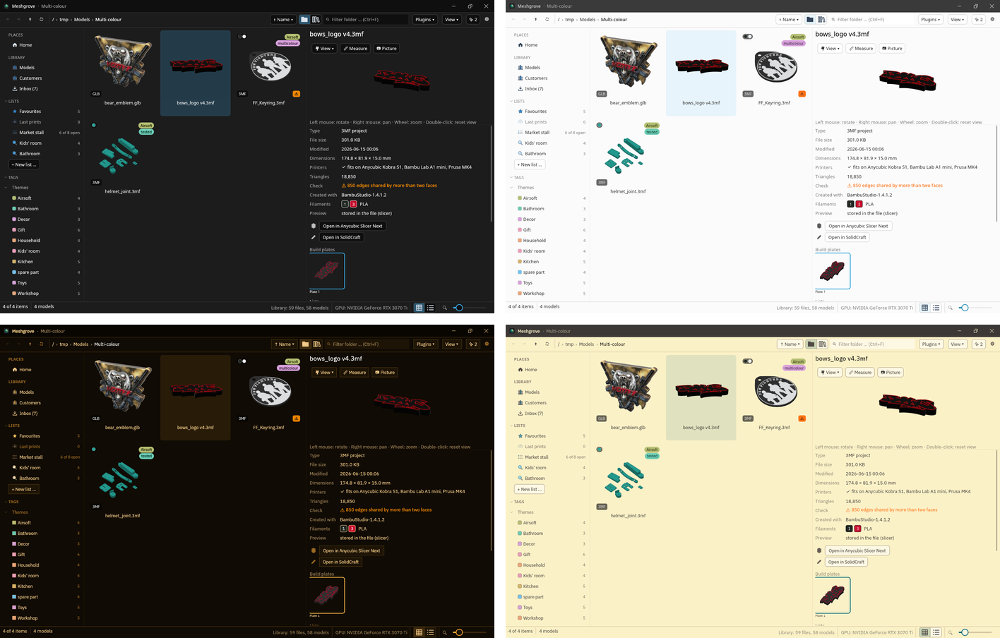

**Folder tiles show what is inside.** Every folder and archive gets a mosaic of its first
models, so you can navigate by looking instead of reading names.

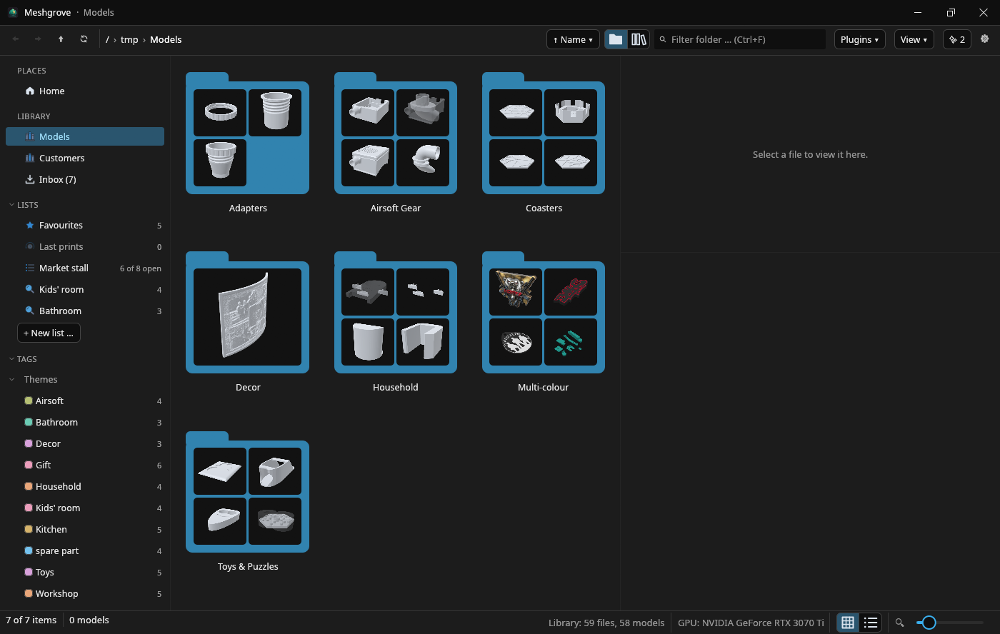

**The list view.** The same files as a table, with dimensions, tags, favourites and the print log
at a glance. Click a column title to sort by it, right-click it to choose the columns.

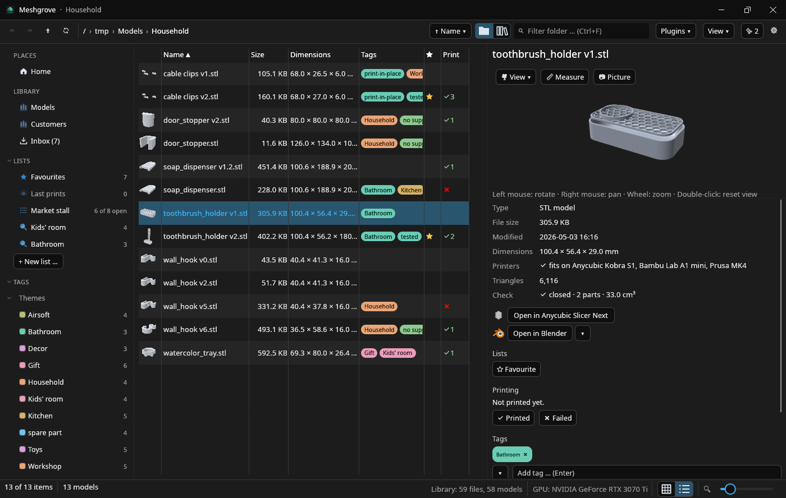

### The 3D viewer and its tools

The right panel shows the selected model in 3D. **Double-click a model** (or press Enter) to
open it in a window of its own: it can be made as large as the screen, several models can be
open side by side, each with its own camera, and the window has the same tools, the model's
facts and buttons to open it in the slicer or the mesh editor. Esc or the close button closes it.

| Action | Mouse |
|---|---|
| Turn | Drag with the left button |
| Move (pan) | Drag with the right or middle button |
| Zoom | Mouse wheel |
| Reset the view | Double-click |

The camera always turns around the centre of the model at a fixed distance, so the model never
jumps or zooms while you turn it.

The buttons above the view:

- **🎥 View** — jump to a standard view: angled (default), front, back, left, right, top,
  bottom.
- **📏 Measure** — click a point on the model, then a second one. Meshgrove shows the
  distance in millimetres and the difference along X, Y and Z (for example `47.2 mm (ΔX 3.1 ·
  ΔY 5.4 · ΔZ 46.8)`). A third click starts a new measurement. Click *Measure* again to leave
  the mode. Points snap to the real surface; the model is loaded into memory once for this.
- **📷 Picture** — saves exactly what you see as a 2048-pixel PNG with a transparent
  background in `Pictures/Meshgrove` (on Linux `~/Bilder/Meshgrove` or `~/Pictures/Meshgrove`,
  depending on your language). This is useful for documentation, sales listings or chats.

**Multi-plate 3MF projects** (Bambu Studio, OrcaSlicer, Anycubic Slicer Next) show the
pictures of all plates below the facts. Click a plate picture to show that plate in the
viewer.

**Multi-colour 3MF projects** show their colours in the viewer, the hover turntable and the
previews Meshgrove renders itself:

- each object and part in the colour of the filament the slicer assigned to it (Bambu Studio,
  OrcaSlicer, Anycubic Slicer Next, PrusaSlicer)
- painted models: multi-material painting (`paint_color` / `mmu_segmentation`) is decoded
  into the painted areas
- plain 3MF files with standard material colours (`basematerials`, `colorgroup`), as CAD
  programs write them
- modifiers, negative volumes and support blockers are not drawn, just as they are not printed

Tiles of slicer projects show a dot per filament colour, and the details list the filaments
with their slot number and material.

**Every model in a window of its own.** Double-click a model to open it next to the gallery, as
large as you like and with the same tools. Here it measures a coaster holder: click two points
on the surface to get the distance in mm, with the difference along each axis. The left and
right arrow keys show the previous and the next model of the folder, as a picture viewer does.
*Wireframe* (or the W key) draws the edges of the triangles on the surface, so you see how fine
the mesh is; the picture export keeps them. The facts beside the model say whether the mesh is
closed, in how many parts, and its volume, or what is wrong with it (open edges, edges shared
by more than two faces, triangles without area). A model file dropped on the window is shown in
it, and further ones dropped with it get windows of their own; under Wayland the files do not
arrive yet, there they open from the file manager.

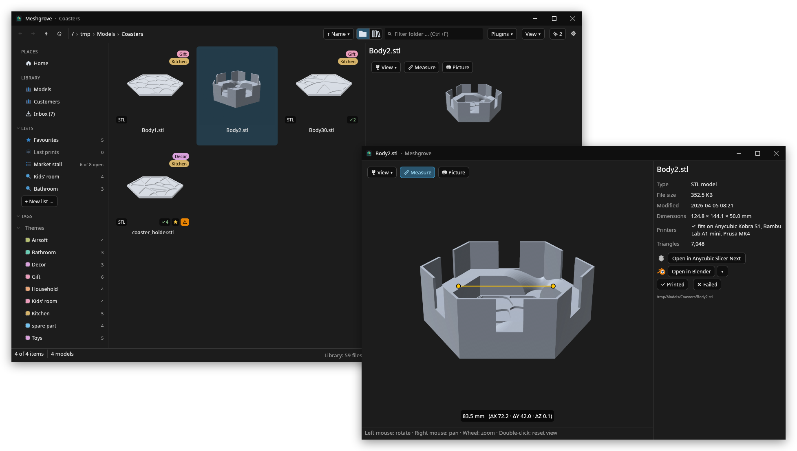

**Models in their colours.** Multi-colour 3MF projects show the filament of every part and
their painted areas, plain 3MF files their material colours, and OBJ, PLY and glTF their vertex
colours and textures. Tiles get a dot per filament; the details list slot and material.

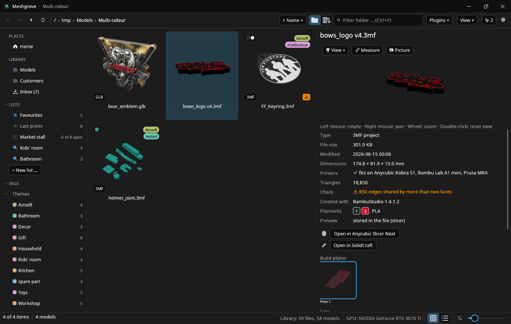

### The details panel

The *Info* pane (below the viewer unless you move it) shows:

- type, file size and modification date
- **dimensions** in mm (X × Y × Z) and the **triangle** count
- which of your **printers** it fits on (see [Printers and the bed check](#printers-and-the-bed-check))
- the **printability check** (see [Printability check](#printability-check))
- for 3MF: title, designer, the application that wrote it, the **filaments** (colour, slot and
  material) and whether the preview comes from the slicer's embedded picture
- for G-code: slicer, printer, print time, filament, layers, nozzle and cost (see
  [G-code files](#g-code-files))
- buttons to open the model in the slicer or the mesh editor
- the **lists** the file is on and its ★ (click a list to show it), the **print log** with
  *Printed* / *Failed* / *Undo*, and on a shown print list the copies with − and +
- **tags** and the **note** (for files in the library)
- the full path

With several files selected, the panel shows how many and their total size. Tags and the note
then apply to all of them.

### Library, search and filters

**Library folders** are the folders Meshgrove indexes. Add as many as you like (sidebar or
*Settings → Library → Library folders*). The index stores names, sizes, dates, dimensions, triangle
counts, content fingerprints, tags and notes. It is kept current automatically: changes are
noticed through the operating system's file notifications, and a quick check runs in regular
intervals as a safety net.

**Library search:** select the 📚 scope next to the search field (or press Ctrl+Shift+F) and
type. Results come from all library folders at once.

| You type | Finds |
|---|---|
| `dragon` | files whose name, folder path or note contains "dragon" (case-insensitive) |
| `castle tower` | files containing both words, anywhere |
| `"castle tower"` | the exact phrase |
| `ext:3mf` (also `type:` / `typ:`) | only 3MF files; works with `stl`, `step`, `obj`, `ply`, `glb`, `zip`, `pdf`, `png` … |
| `tag:painted` | only files with that tag |
| `tag:"to print"` | tags with spaces |
| `is:fav` | favourites (also `is:favourite`, `is:favorit`) |
| `is:printed`, `is:unprinted`, `is:failed` | printed at least once, never printed (models and G-code only), newest print failed |
| `passt:"Kobra S1"` (also `fits:`) | fits on that printer (G-code: sliced for it) |
| `is:zugross` (also `is:toobig`), `is:problem` | fits on none of your printers; possible printing problems |
| `is:neu` (also `is:new`), `is:ohne-tags` (also `is:untagged`) | waiting in the inbox; models and G-code without tags |
| `list:market` (also `liste:`) | files on the list "market" |
| `dragon ext:stl tag:painted` | all conditions combined |

Right-click a search result → *Show in folder* jumps to the folder containing it. *✕ Close
search* (or Esc in the field) returns to the folder.

The sidebar's **TAGS** section lists every tag with its count, grouped into themes, print
properties, state and your own. Click one to search for it; Ctrl+click adds it to the tags
searched for, or takes it out again. *Save as collection* in the search bar keeps a search as
a collection that stays current.

**Rescan folder:** the index normally follows every change by itself. If something was missed,
for example files copied while Meshgrove was closed onto a drive that another system changed,
right-click a library folder in the sidebar or its tile → *Rescan folder*. Meshgrove reads that
folder and everything below it again and says what changed; only changed files are hashed
again. F5 re-reads the current folder.

**One search for the whole library.** Here `body` finds every model with "body" in its name,
from four different folders.

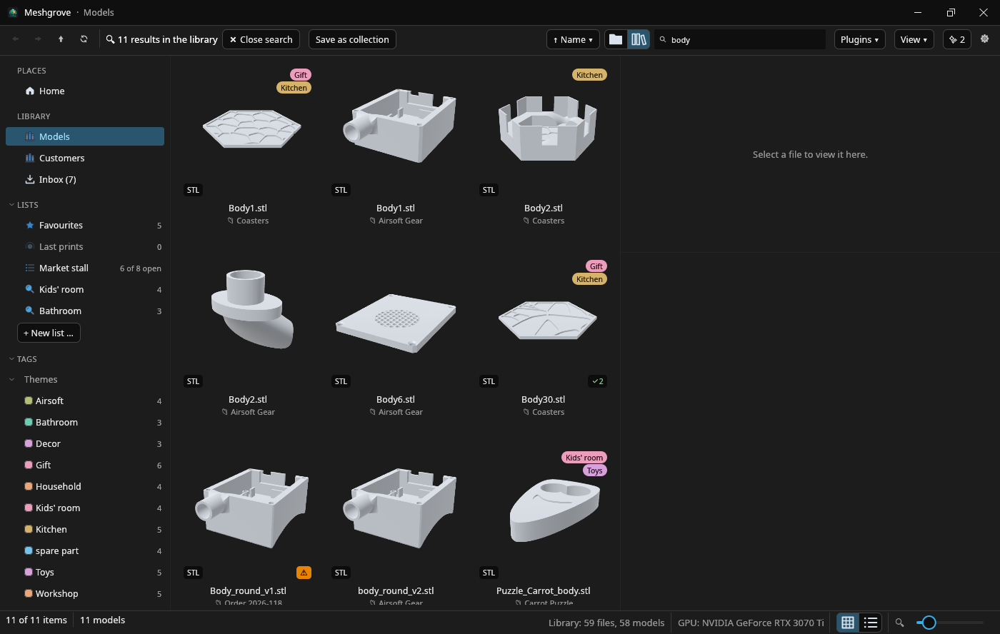

### Tags and notes

- **Add a tag:** select one or more files in the library, type into *Add tag …* in the details
  panel and press Enter, or click one of the suggested existing tags. The ▾ button next to the
  field offers ready-made tags: themes (household, garden, workshop, kids' room, tabletop,
  cosplay …), print properties (multicolour, print-in-place, no supports, magnets …) and state
  (own design, remix, tested, needs tweaking …). Right-click → *Edit tags …* jumps straight
  into the field.
- **Colours:** every tag gets a colour of its own, the same everywhere. Right-click a tag in the
  sidebar to choose another one. *Settings → Tags* turns colours off; *Settings → Tiles* chooses
  whether tiles show tags as names or as coloured dots, and how many.
- **Remove a tag:** click the tag chip (`painted ✕`). With several files selected, chips show
  how many of them carry the tag (`painted (2/5)`).
- **Notes:** write anything into the *Note* field: print settings, colours, what went wrong
  last time. It is saved automatically a moment after you stop typing. With several files
  selected, the note is written to all of them. If they had different notes, the field says
  so and your text replaces them.
- **They follow the content:** tags and notes are attached to a fingerprint of the file's
  content (BLAKE3), not to its path. Rename or move a file, even into another library folder,
  and its tags and note come along. Identical copies share them.

### Favourites, collections and print lists

The sidebar's **LISTS** section holds three kinds of lists. All of them hold files of the
library and, like tags, follow the file's content, so moving or renaming a file keeps it on its
lists.

- **★ Favourites:** Ctrl+D, the ☆ *Favourite* chip in the *Info* pane or the context menu mark
  the selection; a gold ★ on the tile shows it.
- **🕘 Last prints:** the models you last sent to the slicer, newest first (10 by default; how
  many in *Settings → Programs*).
- **Collections** (📁) gather files from any folders, for a project or a theme. A collection can
  also be a saved search: search the library (for example `tag:garden ext:3mf`) and click *Save as
  collection* above the results. It then always shows the current results.
- **Print lists** (🖨) are for what you want to print, say for a market stall or a gift. Each file
  on it has a number of copies (− and + in the *Info* pane while the list is shown). Logging a
  print while the list is shown counts a copy as done; tiles show `1/3`, turning green when all
  copies are done, and finished files sink to the end. The sidebar shows how many are still open.

Create a list with *+ New list …*, or right-click files → *Add to list* → type a new name. The
context menu also takes files off the shown list. Right-click a list in the sidebar to rename or
delete it (the files stay where they are), or for print lists:

- **✓ Finish the list:** it moves to the collapsed *Finished* section below, where *Open again*
  brings it back. The print log stays.
- **Export as PDF checklist:** an A4 page with a picture of each model, its folder, size and
  filament colours, and a box per copy to tick by hand (copies already done are ticked). It is
  saved in your Documents folder and opened right away, ready to print.
- **Export as CSV:** the same as a table for spreadsheets (with `;` as separator in German).

**Favourites, collections and print lists.** A print list for a market stall: every model with
the copies done of those needed (`1/3`), finished ones in green at the end, tags in their
colours, and a 150 MB lithophane in the viewer. The sidebar holds the favourites, print
lists and collections (hand-picked or a saved search), and the tags in groups.

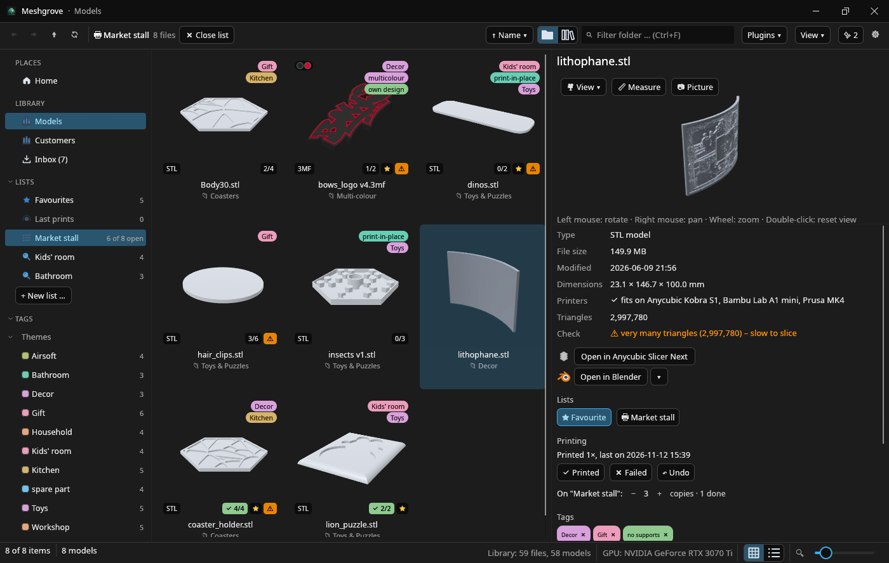

### The print log

*✓ Log as printed* and *✗ Log as failed* (context menu, the *Printing* row in the *Info* pane,
or the buttons in a model window) record a print with its date. The *Info* pane then says
*Printed 2×, last on 12.10.2026* or *Last print failed*, and *↶ Undo* takes back the newest
entry. Tiles show `✓2` in green or a red `✗`. *View → Print state* shows only what is not
printed yet, what was printed, or what failed last time; the search knows `is:printed`,
`is:unprinted` and `is:failed`. Models and G-code have a print state; other files do not.

### G-code files

G-code files (`.gcode`, `.gco`, `.g`) get a preview like models:

- **The slicer's own picture** when the file contains one (PrusaSlicer, OrcaSlicer, Bambu Studio,
  Anycubic Slicer Next, Cura with a thumbnail plugin; PNG, JPG and QOI). The largest one is used.
- **Otherwise the toolpaths**, drawn from above at an angle in the filament colour and shaded by
  height. The purge line of the start code is left out. Even a 50 MB file takes well under a
  second.

The *Info* pane lists what the slicer wrote into the file: slicer and version, the printer, print
time, filament in grams and metres with material and colour, the number of layers and the layer
height, nozzle and filament cost (in the currency of your slicer profile). When a file was sliced
for none of your printers (see [Printers and the bed check](#printers-and-the-bed-check)), the printer is shown in
orange and the tile gets a small `⚠ 🖨` badge, so a file for the wrong machine does not end up on
the SD card. G-code counts as printable: it has a print log and passes *Models and G-code only*.
A double-click opens the file in its default app, usually the slicer's G-code viewer.

### Readmes and text files

Readmes, licences and notes (`.txt`, `.md`, `.markdown`, `.nfo`, and `README`, `LICENSE`,
`COPYING` without an extension) show the beginning of their first page on the tile. Selected,
the preview pane shows the whole text: Markdown with headings, lists, tables and links (they
open in your browser), `.nfo` files in a fixed-width font for their ASCII art, everything else
as wrapped text. Select a **folder** and the preview pane shows its readme (or else its licence),
with a button to open it. Model packs from Thingiverse and similar sites usually bring one, with
the designer, the licence and print tips.

### Printers and the bed check

Meshgrove compares every model's size with the build volume of each of your printers:

- **Fits on all:** nothing on the tile. The info pane says *✔ fits on Anycubic Kobra S1, Bambu
  Lab A1 mini* (with one printer: *✔ fits on Anycubic Kobra S1*).
- **Fits only when turned:** an amber ↻ badge with the angle, for example ↻ 41° for a long
  part that fits only diagonally.
- **Fits on some:** the info pane lists them, and those it is too big for (*✕ too big for Bambu
  Lab A1 mini*); hover for by how much.
- **Fits on none:** a red ✕ badge on the tile.

*Settings → Printer* lists your printers. On the first start Meshgrove takes every printer set
up in **Anycubic Slicer Next**, **OrcaSlicer**, **Bambu Studio** and **PrusaSlicer**: the
selected one, your own profiles and the models picked in their setup wizards, following
profiles that inherit from system profiles. Add more with ＋, edit or remove them, or enter one
by hand (name, build volume, nozzle, materials). The ● marks the main printer, named first.

G-code shows the printer it was sliced for; a ⚠ appears only when that is none of your
printers. In the search, `passt:"Kobra S1"` (also `fits:`) finds what fits on that printer and
G-code sliced for it, `is:zugross` (also `is:toobig`) what fits on none.

**Several printers and a printability check.** Which printers a model fits on, and what the
check found: open or non-manifold edges, several parts, suspicious sizes.

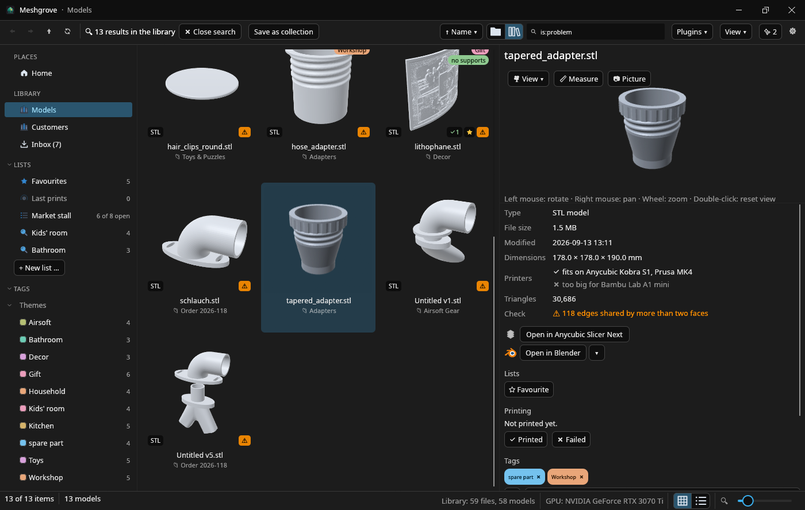

### Printability check

Every model (STL, 3MF, OBJ, PLY, glTF) is checked once, while its thumbnail is made or, for
files already in the cache and very large meshes, in the background while nothing else needs
the disk:

- **Open edges:** holes in the surface. Slicers repair small ones themselves, but with
  customer files it pays to look.
- **Edges shared by more than two faces** and **faces without area.**
- **Parts:** how many separate pieces the file holds, and the **volume** of a closed surface.
- **Suspicious sizes:** a model of a few millimetres may be drawn in inches (*very small
  (3.2 mm) – drawn in inches? That would be 81 mm*); one of metres has the wrong unit.
- **Unreadable files** are noted as such.

Results show as ⚠ on the tile, with the reasons in its tooltip, and as a *Check* row in the info
pane (*✔ closed · 1 part · 41.2 cm³*). `is:problem` finds every model with something to look at,
including those too big for every printer. The check belongs to the file content, so copies
share it.

### The inbox

Files whose content Meshgrove did not know before come into the **inbox**: the sidebar shows
*📥 Inbox (n)* once something arrived. What is in a library when it is searched for the first
time does not count as new, so the inbox starts empty.

The inbox groups the new files by the drop they came with: the topmost new folder, or the
archive, such as a customer's ZIP or a model pack. Each group says how many files are new, how
many are copies of models the library already had, since when, and how many have possible
printing problems. Sort the files (tags, lists), then click *✓ Done* for the group, right-click a
file for *✓ Done*, or *✓ All done*. Tagging alone does not take a file out of the inbox.

`is:neu` (also `is:new`) finds the files waiting in the inbox, `is:ohne-tags` (also `is:untagged`)
models and G-code without tags. *Settings → Library → Inbox* switches the inbox off.

**An inbox for new deliveries.** New files grouped by the folder or ZIP they came in, copies of
known files counted, possible printing problems marked; *✧ Sort in* suggests tags.

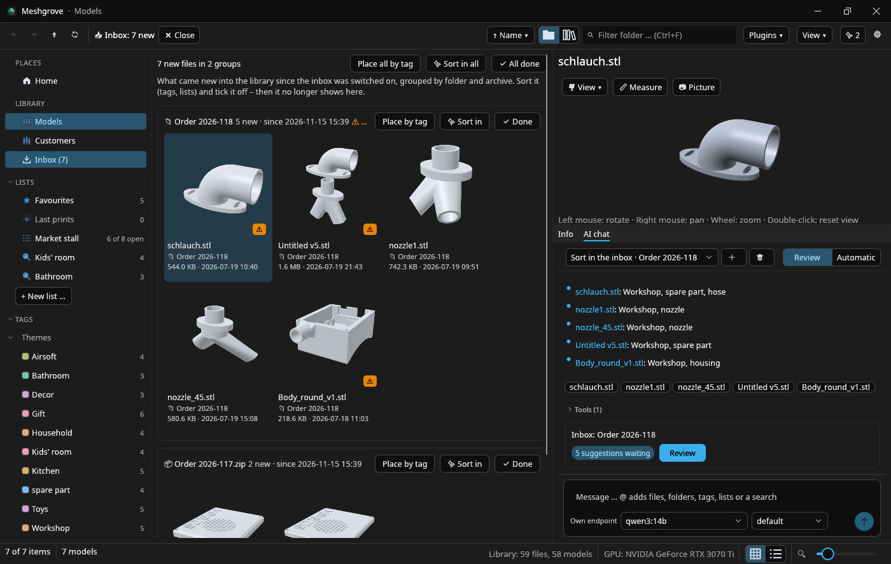

### Duplicate finder

Click **Duplicates (n)** in the sidebar. Meshgrove groups:

- **Exact copies:** byte-identical files (same BLAKE3 hash).
- **Same geometry:** the same model saved differently, such as ASCII vs binary STL, STL vs 3MF,
  re-exported, moved or rotated. These are detected by a rotation-independent signature of the
  mesh (triangle count, surface area, volume, moments of inertia).

Groups are sorted by wasted space. The ★ *Keep* badge marks the suggested copy: one outside an
archive (or inside one, as set under *Settings → Library → Duplicates*), then the oldest, then
the one with the shortest path; to keep another copy, point at it and click ☆ *Keep*. *Move all but ★ to the trash* cleans up a group after a
confirmation. Once you have looked through them, tick the groups where the choice is right (or
*All suggestions are fine*) and *Clean up selected* clears them all with one confirmation.
Copies you want to keep as they are get *Ignore*: the group is no longer listed, counted in the
sidebar or badged on its tiles; *Show ignored* lists such groups again, with *Watch again* to
undo it. What is ignored is kept with your tags and notes (and in the user-data export).
While a cleanup runs, a bar on top says how many files are through, and each group or archive
whose copies are going is tinted green from the left as far as it got, its buttons resting.
Tiles everywhere in the gallery show a `2×` / `3×` badge for files that have duplicates.

**Packed and extracted.** A model pack that lies in the library both as the ZIP and extracted
gives one group per model, and a member of an archive cannot be trashed by itself. The setting
*A model both packed and extracted: keep the extracted copy | the packed copy* decides which side
★ suggests, so *All suggestions are fine* → *Clean up selected* settles them all at once. Above
the groups, *Archives with extracted copies* lists each such archive with how many of its models
are extracted and where the copies lie, and settles it with one click: keep the archive and trash
its extracted copies, or keep the copies and trash the archive, the latter only once every model
in it is extracted (the button says how many would be lost otherwise). Two buttons above the rows
do the same for all archives at once. The groups that belong to these archives are settled there
and are folded away among the groups (*Show them below* lists them); a locked group names the
archive it belongs to and points to that row. *Archives that hold the same models* lists pairs of
archives of which one holds nothing the other does not (a pack that is in the library twice):
that one can go to the trash as a whole, which settles groups whose copies are both inside
archives. Config: `duplicates_keep = "extracted" | "packed"`.

**Duplicate finder.** Exact copies and identical geometry, grouped, with a suggestion which
copy to keep and one click to move the others to the trash.

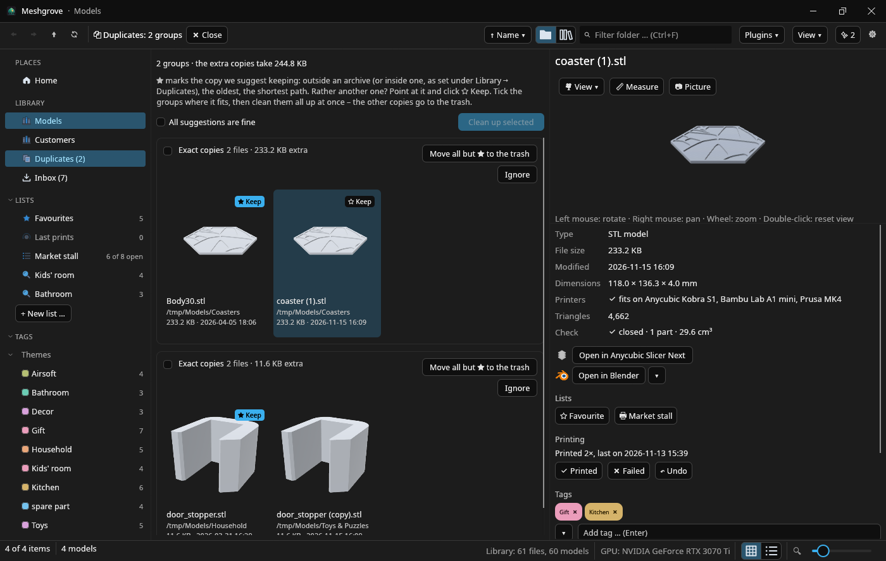

### AI assistant and MCP (optional)

Meshgrove brings **no AI of its own** and is off by default. If you use an AI assistant that
speaks the [Model Context Protocol](https://modelcontextprotocol.io) – Claude Desktop, Claude
Code, LM Studio, Cursor, VS Code and others – it can work with your library: search it ("all
garden models under 2 hours that fit on the A1 mini"), look at new customer files, and suggest
tags, notes or print lists. **Nothing changes until you accept it in Meshgrove**, and accepted
changes can be undone.

**Set up:**

1. *Settings → AI & MCP:* tick *Switch AI features on*.
2. *What AI may see:* for each library choose *no AI*, *local AI only* or *cloud AI too*, and
   whether thumbnails may be sent. New libraries start hidden. Pick *local AI only* for
   customer files when your assistant uses a model on your computer or network (LM Studio,
   Ollama) – that assistant is set up with `--local`.
3. *Make Meshgrove available to the AI apps on this computer* (on by default): Meshgrove adds
   itself to the assistants it finds – Claude Desktop, Claude Code, LM Studio, Cursor, VS Code,
   Codex, Gemini CLI, Copilot CLI, Windsurf, Zed, OpenCode – and lists them there. Only its own
   entry changes; each file is kept as `.bak` first. Restart the assistant. Any other assistant:
   *Set up by hand* gives the entry to copy.

The assistant starts `meshgrove-mcp` itself; Meshgrove need not be running. It sees only the
libraries you opened to it, gets ids like `Garten/Rankhilfe/rose.stl` instead of your folder
paths (the full path only when it asks about one file, to hand it to a slicer or a printer
server), and never the model files themselves. Ready-made tasks come with it: *eingang-
einordnen* (sort the inbox), *druckliste-zusammenstellen* (put together a print list) and
*tags-aufraeumen* (clean up tags) and *ordner-aufraeumen* (tidy up a folder).

**Review:** suggestions wait in Meshgrove. The ✧ button in the toolbar shows how many; it
opens the review, where each batch shows what was suggested for which file: tags to add (✓ to
keep, tags the library does not have yet marked *new*), tags to remove, notes, new lists. Untick a
file or click a tag to leave it out (the tick at the title covers the whole batch), then *Accept
selected*, *Accept all* or *Discard*. Everything can be changed on the way: type a tag of your
own into the *+ own tag* field, rewrite a note (and choose whether it replaces the old one or goes
below it), type another name or place for a move, rename a list, switch it between print list and
collection, untick items and set the copies. What you accept is what you see. Accepting a batch for the inbox also takes its files out of
the inbox. Tags and notes belong to the content, so they also reach identical copies; the review
says when. *Settings → AI & MCP → Accept suggestions automatically* skips the review for new
suggestions of AI apps and one-click actions; moves always wait.

**Nothing changes before you say so.** Suggestions from the chat, the one-click actions or an
MCP assistant wait in the review, old → new; anything accepted can be undone in the history.

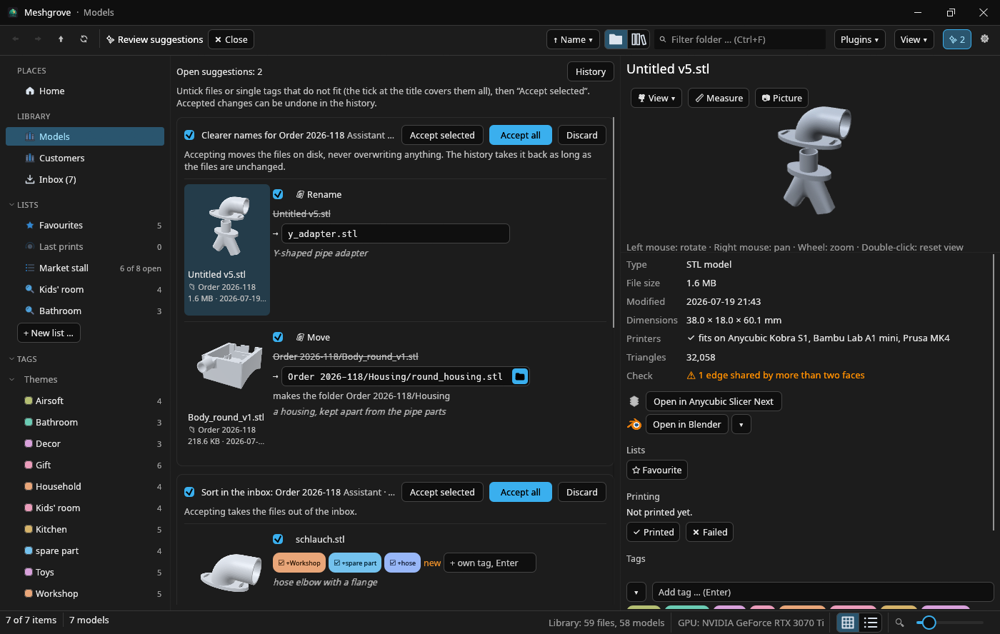

**History:** *Review → History* lists what was accepted. *↶ Undo* takes back exactly those
changes, leaving what you changed by hand since; *↷ Redo* applies them again. *Settings → AI &
MCP* also shows the **access log** – which assistant looked at what, and when – and *Delete AI
data* removes all open suggestions, the log and the chat conversations.

**AI chat (your own endpoint, or an agent on your computer):** the chat is answered either by
an endpoint of your own or by an **AI agent installed on your computer** that speaks the Agent
Client Protocol – Claude Code (`claude-agent-acp`), Codex, Google Antigravity, Gemini CLI,
OpenCode, Grok, Copilot CLI, Qwen Code, goose. Meshgrove finds the installed ones by itself
(*Settings → AI & MCP → Who answers the chat* lists them with their sign-in state, and takes any
other ACP command you add). Nobody is picked for you: under the message field you choose who
answers (the choice is kept), *Connect* starts the agent – or the first message does –, and in
the settings the chat can be set to connect by itself when it opens: the assistant used last, or
one agent in particular. It reaches the library
through `meshgrove-mcp`; Meshgrove lets it run Meshgrove's own tools (which read, or suggest for
the review) and asks you in the chat before anything else it wants to run – a shell command, a
file, whatever the agent brought. What it suggests shows as cards like the endpoint's. For an endpoint, enter in *Your own
endpoint* an OpenAI-compatible service you run or use – Ollama, LM Studio, llama.cpp, OpenAI,
OpenRouter – with a model and, if needed, a key (kept in the system keyring). Under the message
field you pick who answers and, in a **searchable model picker**, which model: the list comes
from the agent or the endpoint (OpenRouter's folds under its vendors), and a model that is not
listed can be typed. Beside it sit the other selectors: the endpoint's **reasoning effort**
(sent as `reasoning_effort`, also a field in its settings), or whatever session options the agent
offers (Claude Code: effort; its permission mode is not among them, as Meshgrove decides permissions
itself and the Review | Automatic switch says what becomes of the suggestions). The **AI chat** pane appears next to *Info*: ask about your library, and type `@` to
add files, folders, tags, lists, printers, the inbox or a search (`@tag:garden fits:mini`) as
references. Answers name files as clickable references; what the AI looked up is folded below.
The **Review | Automatic** switch decides whether its tags, notes and lists go to the review
first or are applied right away; the ↶ arrow on your message takes back everything changed in
answer to it. A cloud service sees only the libraries opened to cloud AI, and before the first
message Meshgrove shows what goes out. Conversations stay on your computer.

**Your own AI, if you want it.** Ask the chat about `@` references (files, folders, tags, a
search); it answers with links to the models, and what it would change waits as a card.

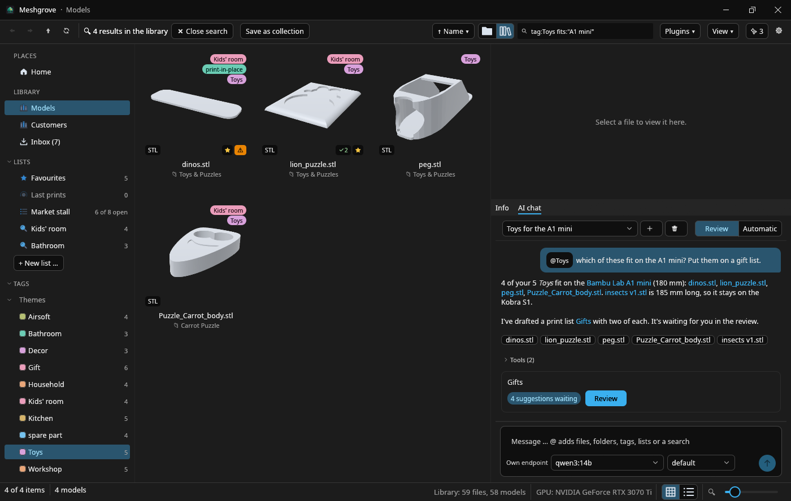

**One-click actions** go to whoever answers the chat: *✧ Sort in* in the inbox (per group or
all) suggests tags, *✧ Suggest tags* in the context menu does it for the selection, and *+ New
list … → ✧ Or describe* turns "gifts under 2 h for the A1 mini" into a print list (print times
come from G-code, also from one of the same name next to the model). With an endpoint they need no
tool calling, so small local models manage them; with an agent such as Claude Code the task
becomes a message in a conversation of its own and the agent makes the suggestions with
Meshgrove's tools. The results wait in the review and appear as a card in that conversation to
ask about. ✧ next to the tag field, which offers tags to click, needs an endpoint. *✧ Mention in chat* puts the selection into
the message field; *Copy as AI reference* gives `meshgrove:` references for an assistant over MCP.

**Moving and renaming:** the assistant and the chat can suggest moving or renaming files,
archives or folders within their library, and with *Settings → AI & MCP → Allow the AI to move
files between libraries* also into another library you opened to it. That always stays a suggestion, also in automatic
mode: the review shows old → new and which folders would be made. Accepting moves them on disk
without ever overwriting anything – a place taken by then is skipped. Tags, notes, lists and
thumbnails go along, nothing is computed again. The history takes it back as long as the files
are unchanged; folders made for it go again when empty. Files inside archives stay where they are.

**Deleting:** the assistant and the chat can also suggest putting files, archives or folders into
the trash (`propose_delete`). That always waits for the review, also in automatic mode, and
accepting it moves them into the system's trash, from where they can be brought back; the history
cannot. Nothing inside an archive and never a library itself.

**Archives:** `list_archive` tells the assistant what an archive holds (members with their ids,
and whether it can be written), and `propose_archive` suggests unpacking an archive beside itself,
packing files into a new ZIP, or adding files to a ZIP (7z, RAR and TAR are only unpacked). That
always waits for the review, also in automatic mode; nothing is ever replaced, and the history
takes it back.

**Questions back:** when a request is ambiguous, the assistant can ask you (`ask_user`): its
questions appear in the chat with radio buttons for one answer, checkboxes for several, and a
field for an answer in your own words; the assistant waits for the answer (a quarter of an hour at
most) and carries on with it. *Don't answer* or stopping the answer lets it go on without one. An
assistant that asks over MCP (Claude Desktop, Cursor …) gets a window of its own in Meshgrove,
naming who asks.

On the command line, `meshgrove-mcp setup` does the same (`--dry-run` shows it first,
`--client NAME` picks one), `meshgrove-mcp remove` takes the entries out again, and
`meshgrove-mcp --print-config claude-desktop` (or `claude-code`, `lm-studio`, `cursor`, `vscode`,
with `--local` if needed) prints one. With the AppImage the command is `Meshgrove.AppImage mcp`.

### Plugins (optional)

Plugins add tools to Meshgrove, for example Bingrove, a generator for Gridfinity drawer inserts,
and Texgrove, which puts textures onto models as real geometry. A plugin is one `.wasm` file for
every system and runs sealed off. It may do nothing until you allow it in *Settings → Plugins*,
and what it makes comes in as one change you can undo.
Installing, granting and writing plugins: [docs/plugins.md](plugins.md).

### Working with your slicer and other apps

- **Open in slicer** (context menu, or the button below the facts in the *Info* pane and in a
  model window, next to the print bed check):
  opens the selected models, several at once if you like (STL, 3MF, STEP and OBJ; the slicers
  do not open PLY and glTF). Files inside archives are extracted to a cache folder first.
  Meshgrove finds over 30 slicers by itself, for filament and for resin printers:

  | Printers | Detected |
  |---|---|
  | Filament | Anycubic Slicer Next, OrcaSlicer, PrusaSlicer, Bambu Studio, UltiMaker Cura, Creality Print, SuperSlicer, Snapmaker Orca, Simplify3D, IdeaMaker, ElegooSlicer, QIDI Studio, FlashPrint, Snapmaker Luban, AnkerMake Studio, Slic3r, Repetier-Host, MakerBot Print, Z-Suite, KISSlicer, MatterControl |
  | Resin | Lychee Slicer, ChiTuBox, ChiTuBox Pro, Photon Workshop, UVtools, PreForm, Halot Box, NovaMaker, Voxeldance Tango, Voxeldance Additive, Asiga Composer, GKone |

  It looks where they get installed: on Linux as a distribution package or anywhere on your
  `PATH`, in a vendor's folder below `/opt` or `~/opt` (Anycubic Slicer Next in
  `~/opt/AnycubicSlicer`), as a Flatpak or a Snap, or as an AppImage in `~/Applications`,
  `~/Downloads` and similar folders; on Windows in *Program Files* or the per-user *Programs*
  folder; on macOS in */Applications* or *~/Applications*. MakerBot Print, Z-Suite, Voxeldance
  Additive, Asiga Composer and GKone are looked for on Windows and macOS only.
  *Settings → Programs → Slicer* lists what was found: add the ones you use with ＋ and pick a
  default; the others you added sit in the submenu *Open in another slicer*.

  **If the slicer is already open**, the files go into that window instead of a new one:
  Meshgrove hands them to Anycubic Slicer Next and OrcaSlicer over D-Bus on Linux, and starts
  PrusaSlicer in its single-instance mode. Only when no window is open does a new one start.
  The status bar says which happened. (On macOS the system passes files to a running app
  anyway; on Windows a new window opens for now.)

  Any other slicer can be set in *Settings → Programs → Slicer*:
  give it a name, the program and optionally a working folder.
- **Open in the mesh editor** (context menu, or the button next to *Open in slicer*): opens the
  selected models in a mesh editor or CAD program to repair or change them. Meshgrove finds
  over 20 of them by itself, in the same places as the slicers:

  | System | Detected |
  |---|---|
  | Linux, Windows and macOS | FreeCAD, Blender, MeshLab, SolidCraft, OpenSCAD, SolveSpace, CloudCompare, Plasticity, Wings 3D, Dust3D, Dune 3D, fstl, f3d |
  | Windows and macOS | Autodesk Fusion, Meshmixer, Rhino, SketchUp, Autodesk Netfabb, ZBrush, Shapr3D, Autodesk Maya |
  | Windows | SolidWorks, Autodesk Inventor, Autodesk 3ds Max |

  Blender only opens its own files, so Meshgrove starts it with a short import script: an
  empty scene in millimetres with the models (STL, OBJ, PLY, glTF) in it. FreeCAD and the
  others get the files directly. Any other program can be set in *Settings → Programs → Mesh editor*.
- **Copy (Ctrl+C):** puts the selected files on the clipboard as real files. Paste them into
  Dolphin, Explorer or Finder, into many slicers, or into a chat. Archive members are
  extracted first. *Copy path* puts the paths as text instead.
- **Paste (Ctrl+V):** copies the files on the clipboard – from Meshgrove, the file manager or
  as paths – into the folder shown, or by right-click into a folder tile. Nothing is replaced
  (a taken name gets a number), the copies keep their tags and notes, and the history undoes
  it.
- **Cut (Ctrl+X):** marks the selection (the tiles fade) and puts it on the clipboard; the
  next paste moves the files instead – within the library with tags, notes and previews along,
  undoable in the history. File managers that know the cut marker (Dolphin, Nautilus) move
  them too, and what they cut is moved when pasted here.
- **Show in file manager:** opens Dolphin/Nautilus, Explorer or Finder with the files selected.
- **Open with default app** (context menu): opens a model in the system's default application,
  for example the slicer registered for STL files; other files open there with a double-click.

### Archives (ZIP, 7z, RAR, TAR)

Double-click an archive to browse it like a folder, level by level: the folders inside it open
like folders on disk, with their own mosaic tiles, and *Include subfolders* shows everything below
the level you are at. Every model, image and PDF inside gets a preview. The archive's tile shows a
mosaic of its contents, inside the library (from the index) and outside it (read from the archive),
in a downloads folder or the import view alike. Archives in the library are indexed like folders,
so the library search, tags, notes and the duplicate finder include their contents. Solid 7z/RAR
archives are unpacked once per visit, not once per file.

**Changing archives.** Right-click → *Unpack* puts an archive's contents into a new folder named
after it, beside it (the archive stays; a taken name gets a number). *Pack as ZIP* makes a new ZIP
of the selected files and folders in their folder, under the name you type. *Add to archive* lists
the ZIPs in the same folder to add the selection to, and Ctrl+V while a ZIP (or a folder inside
it) is open adds the copied files there – cut files are not moved into an archive. Only ZIP
archives are written; 7z, RAR and TAR can be unpacked but not changed. Nothing is ever replaced:
a member of the same name stops the whole addition, and a new ZIP never overwrites a file. Each
operation is one entry in the history, which takes it back as long as the ZIP (or the unpacked
files) are unchanged since. The library lists the folder right away, so the new files and members
get their previews and land in the inbox.

### Moving files to the trash

Delete or right-click → *Move to trash* moves the selected files to the system trash (the
freedesktop trash on Linux, the Recycle Bin on Windows, the Trash on macOS) after a
confirmation. You can restore them from there. Deleting is not possible for files inside
archives, and on Linux Meshgrove detects read-only mounts (such as an NTFS drive mounted
read-only) and disables the action with an explanation.

### Backups, export and import

- **Automatic backups:** once a day (when something changed) Meshgrove writes all tags, notes,
  lists, the print log and tag colours to `user-data-YYYY-MM-DD.json` in the backup folder and
  keeps the newest seven.
  *Settings → Data and storage → Back up tags, notes & lists → Open folder* shows them.
- **Export:** writes all of that to `meshgrove-tags-notes-YYYY-MM-DD.json` in your Documents
  folder. The file is readable JSON and lists, for each fingerprint, the paths where those files
  were.
- **Import:** reads such a file (or a backup) and merges it: tags are added, notes are taken
  over for files that have none, lists are merged by name and prints are added once. Nothing is
  deleted. Because everything is keyed by content, an import also works after you reorganised
  your folders or moved to another computer. Exports from older versions (tags and notes only)
  import as well.

### Thumbnails in Dolphin and file dialogs (Linux)

The .deb and .rpm packages and `install.sh` register a freedesktop thumbnailer, so Dolphin,
the KDE and GTK file dialogs and other file managers show the same previews for STL, 3MF,
STEP, OBJ, PLY, glTF and G-code files. In
Dolphin, enable them once: *Settings → Configure Dolphin → Interface → Previews*. Tick the
3D-model entries if they are listed, and raise *Skip previews for local files above* for big
models. Then reopen the folder. The thumbnailer shares Meshgrove's cache, so files you have
already seen in the app show up instantly.

### Updates

Meshgrove can tell you when a new version is out, and where it can replace itself safely, it
updates with one click. Nothing is sent until you say yes once: after installing, the title bar
shows a small pill, **Check for updates?**, and a click on it asks you. You can change the
answer any time under *Settings → General → Updates*.

- **What you see:** when a newer version is out, a pill reading **Update to 0.14.0** appears in
  the title bar (in the toolbar where the desktop draws the title bar). Its window shows the
  release notes, the button that fits your installation, **Skip this version** and **Later**
  (three days of quiet). *Settings → About* has **Check now**, which also works with the
  automatic check off.
- **What is sent:** one HTTPS request at start and once a day,
  `GET https://api.github.com/repos/DonDavis-vibe/MeshGrove/releases/latest`, with the
  User-Agent `Meshgrove-update-check` and nothing else: no version number, no identifier, no
  usage data. GitHub sees it like any visit (your IP address, the time). Offline, nothing shows
  and the check is tried again an hour later. `MESHGROVE_UPDATE_CHECK=0` turns every check off,
  the question too.
- **Checked before anything changes:** every download must match its SHA-256 in the release's
  `SHA256SUMS.txt`. One that does not is deleted, and the installed copy stays as it was.
- **The program keeps its place:** an update changes what is there, never where it is, so
  launchers, menu entries, the Windows shortcuts and the AI apps' MCP connections keep working.
  An AppImage therefore keeps its file name, the old version number in it too.

| Installed as | The update button |
|---|---|
| AppImage | downloads the new version beside the old file, checks it and swaps it in place; then **Restart now** |
| Windows installer | downloads and checks the installer and starts it; once it runs, Meshgrove closes, and the installer updates it in the same folder and starts it again |
| Windows ZIP | downloads and checks the ZIP and swaps the programs in their folder; then **Restart now** |
| macOS | downloads and checks the disk image and opens it: quit Meshgrove and drag the new app to where the old one is |
| .deb / .rpm | **Download** opens the package; the window shows the `sudo apt install` / `sudo dnf install` command to copy |
| Built with `install.sh` | shows `git pull && packaging/install.sh` and the release page |

On Windows, an installation for all users (under *Program Files*) needs administrator rights:
Windows asks, and Meshgrove waits for your answer. If you say no or leave the question unanswered,
Meshgrove stays open and unchanged, and the button tries again. The installer ends a running AI
connection (`meshgrove-mcp.exe`), so restart the AI app afterwards. Its log is
`%TEMP%\meshgrove-update\setup.log`.

Builds made with plain `cargo build` never check and show none of this.

## Keyboard and mouse reference

Ctrl means ⌘ Cmd on macOS.

| Keys | Action |
|---|---|
| ← → ↑ ↓, Home, End | Move the selection |
| Enter | Open the selected folder or archive; a model in its own window (or as set for double-click); other files in their default app |
| Esc (in a model window) | Close the window |
| ←, → (in a model window) | The previous, the next model of the folder |
| W (in a model window) | Wireframe on or off |
| Backspace, Alt+↑ | Parent folder |
| Alt+←, Alt+→, mouse buttons 4 / 5 | Back, forward |
| Space | Large preview of the selected model (Esc or Space closes it; ☰ shows its tools) |
| F5 | Reload the folder and read it into the index again |
| Ctrl+D | Favourite on or off |
| Ctrl+1, Ctrl+2 | Tiles, list |
| Ctrl+A | Select all shown files |
| Ctrl+click, Shift+click | Toggle a file, select a range |
| Ctrl+C | Copy the selected files to the clipboard |
| Ctrl+V | Paste the files on the clipboard into the folder shown |
| Ctrl+X | Cut the selection: the next paste moves it |
| Delete | Move the selection to the trash (with confirmation) |
| Ctrl+F | Filter the current folder |
| Ctrl+Shift+F | Search the whole library |
| Esc (in the search field) | Clear the search |
| Ctrl + `+` / `-`, Ctrl + wheel | Tile size (row height in the list) |
| Ctrl+, | Settings |
| **Mouse on a model tile** | Hover: spin · drag: turn · wheel while dragging: zoom |
| **Mouse on a pane header** | Drag: move the pane (not when locked in the settings) |
| **Mouse in the 3D viewer** | Left drag: turn · right/middle drag: pan · wheel: zoom · double-click: reset |

## Supported file types

| Type | Extensions | Preview | 3D viewer | Notes |
|---|---|---|---|---|
| STL | `.stl` | ✔ | ✔ | Binary and ASCII; binary files that start with "solid" are recognised correctly |
| 3MF | `.3mf` | ✔ | ✔ | Embedded slicer picture first (blank plates are skipped), otherwise rendered; components, transforms, units, Production extension (`p:path`), multiple build plates, filament, paint and material colours |
| STEP | `.step`, `.stp` | ✔ | ✔ | Needs the OpenCascade helper `meshgrove-step-mesher`; tessellated once, then cached |
| OBJ | `.obj` | ✔ | ✔ | Colours from the `.mtl` next to it (diffuse colour or texture) and vertex colours; read as millimetres like the slicers do |
| PLY | `.ply` | ✔ | ✔ | ASCII and binary; vertex and face colours (scans, MeshLab); point clouds without faces are not shown |
| glTF | `.glb`, `.gltf` | ✔ | ✔ | All meshes of the scene with base colours, vertex colours and textures; external buffers and textures are read from next to the file. glTF counts in **metres**, so a model 1 unit wide shows as 1000 mm; for models meant in millimetres (AI generators, many exports) choose *Settings → Models & Units → 3D models → Millimetres (like STL)* |
| Archives | `.zip`, `.7z`, `.rar`, `.tar`, `.tar.gz`, `.tgz`, … | Mosaic | Members | Browsed like folders through libarchive |
| G-code | `.gcode`, `.gco`, `.g` | ✔ | – | The picture the slicer embedded (PNG, JPG, QOI), otherwise the toolpaths; print facts from the comments (OrcaSlicer, Anycubic, Bambu Studio, PrusaSlicer, Cura). Binary G-code (`.bgcode`) is not read yet |
| Images | `.png`, `.jpg`, `.jpeg`, `.webp`, `.gif`, `.bmp` | ✔ | – | Shown large in the preview pane |
| PDF | `.pdf` | First page | – | Needs `pdftoppm` from poppler |
| Text | `.txt`, `.md`, `.markdown`, `.nfo`, `README`, `LICENSE`, `COPYING` | First page | – | Shown in full in the preview pane, Markdown formatted; UTF-8, UTF-16 and Latin-1 |
| Everything else | | File icon | – | Shown with its extension so the folder view is complete |

## Settings and files on disk

Everything can be changed in the settings window (⚙ at the top right, or Ctrl+,), sorted into
pages on the left: *General* (language, theme, font and title bar, what a double-click on a
model does, the panes), *Library* (library folders, the inbox, duplicates, import), *Tags*
(colours, the tag list, placement by tag, suggested tags), *Tiles* (which badges show where on a
sample tile, tags as names or dots, file names, tile size, folder previews), *3D view* (picture
quality of the large preview and the model windows, the 3D mouse), *Models & Units* (the unit of
glTF models, sizes in millimetres or inches), *Programs* (slicers, last prints, mesh editors),
*Printer* (your printers), *AI & MCP* (optional assistant, what it may see, access log),
*Plugins*, *Data and storage* (backups, and the preview cache with its size and a *Clear cache*
button) and *About Meshgrove*, which lists the exact paths on your system. The search at the top
finds any setting. A change shows at once: *OK* or *Apply* keeps it, *Cancel* takes it back, and
*Restore defaults* resets the page shown.

| What | Linux | Windows | macOS |
|---|---|---|---|
| Settings (`config.toml`) and pane layout (`layout.json`) | `~/.config/meshgrove/` | `%APPDATA%\meshgrove\` | `~/Library/Application Support/meshgrove/` |
| Library index (`library.db`) and `backups/` | `~/.local/share/meshgrove/` | `%APPDATA%\meshgrove\` | `~/Library/Application Support/meshgrove/` |
| AI suggestions and access log (`proposals.db`, only once an assistant was used) | `~/.local/share/meshgrove/` | `%APPDATA%\meshgrove\` | `~/Library/Application Support/meshgrove/` |
| The update check's memory (`update.json`: last check, a skipped version) | `~/.local/share/meshgrove/` | `%APPDATA%\meshgrove\` | `~/Library/Application Support/meshgrove/` |
| Cache: previews, STEP meshes, extracted archive files, the log (`meshgrove.log`) | `~/.cache/meshgrove/` | `%LOCALAPPDATA%\meshgrove\` | `~/Library/Caches/meshgrove/` |
| Exported pictures | `~/Pictures/Meshgrove` (localised, e.g. `~/Bilder`) | `Pictures\Meshgrove` | `~/Pictures/Meshgrove` |
| Exported print lists (PDF, CSV), tags and notes | Documents folder | Documents folder | Documents folder |

The cache can always be deleted; it is rebuilt when needed. The index can be deleted too, but
**tags, notes, lists and the print log live in it**, so export them first or keep the backups.

`config.toml` is plain text. The settings window covers everything, but for reference:

```toml
library_roots = ["/home/me/3D-Models", "/mnt/nas/prints"]
last_folder = "/home/me/3D-Models/minis"
tile_size = 160.0          # 96 … 384
only_models = false
sort_by = "name"           # name | modified | size | type
sort_descending = false
language = "en"            # "de", "en"; leave out to follow the system
ui_theme = "nord"          # a theme's id; leave out for Meshgrove's own look, as dark or light as the system
ui_font = "system"         # "system" or a font family; leave out for the theme's font
title_bar = "app"          # app (Meshgrove's own, in the theme's colours) | system
lock_panes = false         # true: panes can only be resized, not moved
double_click = "window"    # window | preview | slicer | editor | default_app
duplicates_keep = "extracted"  # a model both packed and extracted: extracted | packed
preview_quality = "high"   # large preview and model windows: standard | high | studio
preview_controls = false   # large preview: show name, tools and hints
gallery_view = "grid"      # grid | list
print_filter = "all"       # all | unprinted | printed | failed
colored_tags = true        # tags in colours (otherwise grey)
tile_tags = "names"        # names | dots
tile_tag_count = 3         # 1 … 8

[tile_layout]              # badges on the tiles, each list from its corner inwards
top_left = ["filaments"]
top_right = ["duplicates", "tags"]
bottom_left = ["file_type"]
bottom_right = ["check", "favorite", "print_state"]
hidden = []
filaments = "dots"         # dots | stripe
check = "text"             # text | symbol
name_lines = 2             # 0 … 2
name_extension = true

[list_columns]
hidden = ["type"]          # preview, folder, type, size, dimensions, modified, tags, favorite, print
widths = { name = 320.0 }  # columns you made wider or narrower

[folder_previews]
enabled = false            # models from subfolders on folder tiles
depth = 2                  # 1 … 5 levels
cycle = true               # fade through more than four

[slicer]                   # leave out to detect automatically
name = "My Slicer"
program = "/opt/myslicer/bin/myslicer"
args = []                  # put before the file names
env = [["LD_LIBRARY_PATH", "/opt/myslicer/lib"]]
workdir = "/opt/myslicer"

[editor]                   # mesh editor; leave out to detect automatically
name = "FreeCAD"
program = "/usr/bin/freecad"

inbox = true               # collect new files in the inbox

[[printers]]               # leave all out to take them from the slicers
name = "Anycubic Kobra S1"
x = 250.0
y = 250.0
z = 250.0
nozzle = 0.4
materials = ["PLA", "PETG"]

[ai]                       # optional assistant over MCP
enabled = false

chat_mode = "review"       # review | auto: changes from the chat reviewed first, or applied at once
cross_library_moves = false  # the AI may suggest moves into another library it may see
assistant = "claude"       # who answers the chat: "endpoint", or an agent's id (claude, codex, antigravity,
                           # gemini, opencode, grok, copilot, qwen, goose, or one of ai.agents)
auto_connect = "last"  # when the chat opens: "" waits for Connect, "last" connects the assistant used last, an agent id picks and connects that one
agent_models = { claude = "claude-opus-5-5" }  # the model picked per agent
[ai.agent_options.claude]  # its other session options, as picked (reasoning effort, mode …)
effort = "high"

[[ai.agents]]              # an ACP agent added by its command
id = "agent-1"
name = "My agent"
command = "my-agent --acp"
local = false              # its model runs here or on your own network

[[ai.libraries]]
root = "/home/me/3D-Models"
access = "cloud"           # none | local_only | cloud
images = true              # thumbnails may be sent

[ai.endpoint]              # your own endpoint for the AI chat and one-click actions
base_url = "http://localhost:11434/v1"
model = "qwen3:8b"
local = true               # runs here or on your own network
vision = false             # the model understands pictures
tools = true               # the model can use tools
reasoning_effort = "high"  # sent as reasoning_effort; empty: the service's default
```

Environment variables for special cases:

| Variable | Effect |
|---|---|
| `WGPU_BACKEND=gl` (or `vulkan`, `dx12`, `metal`) | Choose the graphics backend, e.g. if the window stays black |
| `RUST_LOG=meshgrove=debug` | More log output (on the terminal and in `meshgrove.log`) |
| `MESHGROVE_STEP_MESHER=/path/to/meshgrove-step-mesher` | Use a specific STEP helper |

Meshgrove was called *STL-Browser* during development. On the first start it moves the
folders of that name (`~/.config/stl-browser` …) to the new ones, and it imports exports
made under the old name.

## Privacy and safety

- **Offline.** Meshgrove makes no network connections, with one exception you turn on yourself:
  the update check, one request to GitHub a day with nothing about you
  ([Updates](#updates)). No telemetry, no accounts.
- **AI only if you want it.** The optional MCP server runs on your computer and talks to your
  assistant over a local pipe. What the assistant sends on to its model provider is between you
  and that provider, so choose per library what it may see; customer files can stay with local
  models. The model files never leave the computer, and AI cannot change anything you did not
  accept.
- **Nothing moves without your say-so.** It reads your model files and never modifies them or
  archives. It writes to its own settings, index and cache folders, and otherwise only when you
  ask: files to the trash, an import from a downloads folder, a move you accepted, an export of
  tags and notes or a print list, a saved picture. Every move is in the history and can be
  undone.
- **Crash-safe helpers.** STEP tessellation and PDF rendering run as separate processes with
  timeouts, so a malformed file cannot take the app down. A file that fails gets a ⚠ tile with
  the reason in its tooltip.

## Performance

Meshgrove is built for collections of thousands of files on ordinary hard drives:

- A single reader thread reads files in folder order, visible tiles first, to avoid seeking.
  Parsing runs on all cores, and one GPU thread renders the previews.
- Previews are stored as PNGs in the cache, so a folder you have seen before appears
  instantly. In a test, 450 previews of a folder tree on a hard drive, never seen before, were
  ready in 21 seconds (RTX 3070 Ti); from the cache they appear immediately.
- The library index makes searching thousands of files instant, and only changed folders are
  re-read when something changes.
- Models with millions of triangles (for example a 210 MB, 4.2-million-triangle miniature)
  display and turn smoothly. Normals are computed on the GPU, so no memory is spent on them.
- The app uses no CPU while idle.

## Platform support

| Feature | Linux | Windows | macOS |
|---|---|---|---|
| Gallery, list view, viewer, library, tags, notes, lists, print log, duplicates, bed check | ✔ | ✔ | ✔ |
| G-code and readme previews, PDF checklists | ✔ | ✔ | ✔ |
| ZIP / 7z / RAR / TAR | ✔ | ✔ | ✔ |
| PDF previews | ✔ with poppler | ✔ with poppler | ✔ with poppler |
| STEP previews | ✔ all packages; source build with OpenCascade | ✔ | ✔ |
| Copy files to the clipboard | ✔ Wayland (X11: paths as text) | ✔ | ✔ |
| Paste files from the clipboard | ✔ Wayland (X11: paths as text) | ✔ | ✔ |
| Show in file manager | ✔ D-Bus (Dolphin, Nautilus, …) | ✔ Explorer | ✔ Finder |
| Slicer detection | ✔ | ✔ | ✔ |
| Read-only drive detection | ✔ | – | – |
| Thumbnails in the system file manager | ✔ freedesktop thumbnailer (.deb, .rpm, `install.sh`) | – | – |
| Menu entry and icon | ✔ .deb, .rpm, `install.sh` | ✔ installer (Start menu, *Open with*) | ✔ app bundle |

## Troubleshooting and FAQ

**The window stays black or the app does not start.**
Meshgrove needs Vulkan (Linux, Windows), Metal (macOS) or DirectX 12 (Windows); on Windows it
takes DirectX 12 where the graphics card speaks it. Update the graphics driver. As a workaround,
try another backend: `WGPU_BACKEND=gl meshgrove` (or `vulkan`). The log is `meshgrove.log` in
the cache folder; *Settings → About Meshgrove* shows its path.

**Changes on disk show up only after a while (Linux).**
Linux limits how many programs may watch folders (`fs.inotify.max_user_instances`, often 128).
On busy desktops that limit is used up, and Meshgrove then falls back to checking every
minute. To raise the limit: `sudo sysctl fs.inotify.max_user_instances=512`. To keep it
after a reboot, put `fs.inotify.max_user_instances=512` into
`/etc/sysctl.d/90-inotify.conf`. F5 reads the current folder again immediately, and
right-click → *Rescan folder* a whole library folder with everything below it.

**Dolphin shows no 3D previews.**
Enable the previews in Dolphin's settings (see
[Thumbnails in Dolphin](#thumbnails-in-dolphin-and-file-dialogs-linux)) and raise the size
limit. Delete `~/.cache/thumbnails/fail` (install.sh does this) and reopen the folder.
`meshgrove-thumbnailer -s 256 model.stl /tmp/test.png` tests the thumbnailer by hand. The
AppImage brings no thumbnailer; use a package or the source build for that.

**STEP files show "built without OpenCascade".**
This only happens with a source build: the STEP helper was built without OpenCascade, or with
a version older than 7.5. Install the OpenCascade development files (see
[From source](development.md#building-from-source)) and run `packaging/install.sh` again.

**PDFs show only an icon.**
Install poppler (`pdftoppm` must be on the `PATH`).

**"Move to trash" is greyed out.**
The file is inside an archive, or the drive is mounted read-only. On Linux, NTFS drives are
often mounted read-only when Windows was not shut down cleanly (Fast Startup).

**The slicer is not found or does not start.**
Set it in *Settings → Programs → Slicer*. Anycubic Slicer Next on Linux needs its library folder in
`LD_LIBRARY_PATH`. The automatic detection sets that up, and the settings keep it when you
only change the name.

**Copying files pastes only text (Linux).**
Copying real files needs a Wayland session. Under X11, Meshgrove falls back to copying the
paths as text.

**Where are my tags if I reinstall?**
In the library index and in the daily backups (see the [table](#settings-and-files-on-disk)).
Use *Settings → Data and storage → Back up tags, notes & lists → Export* before moving to another computer, then
*Import* there.

**Does Meshgrove change my 3MF/STL files?**
No. It never writes to model files or archives. With import or placement by tag switched on it
moves files (never their contents), and the history takes every move back.
