<!-- Release notes template: the release workflow fills in the version and adds the checksums.
     Add this release's highlights below before publishing the draft. -->
**Meshgrove @VERSION@**, a fast, native gallery for 3D-print files on Linux, Windows and macOS.
Video, screenshots and every download at a glance: [meshgrove.redneck-design.de](https://meshgrove.redneck-design.de)

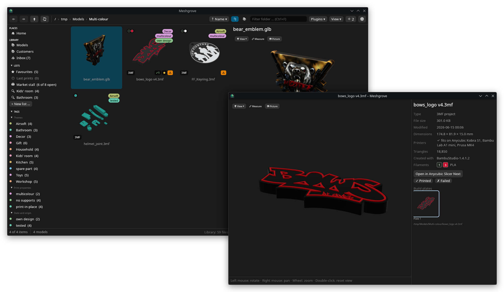

## Highlights

**For plugin authors** (new in 0.11)

- Plugin API 0.3: a panel can let you choose where its files go, any folder of any library instead of the inbox, a new one too, with Meshgrove's own folder chooser (`pick_folder`, `FolderPicked`, `Bundle.target`). The plugin gets a token for the folder, never its path, and needs no library access; what lands there is one step in the history like any bundle. Plugins written for 0.1 and 0.2 keep working; one that declares `api: "0.3.0"` needs Meshgrove 0.11 or newer. See [how to write a plugin](https://github.com/DonDavis-vibe/MeshGrove/blob/v@VERSION@/docs/plugins.md).

**Your AI agent answers the chat** (new in 0.10) – the agents, the review, archives and duplicates of this release come from [@Rec0iL](https://github.com/Rec0iL), thank you.

- The chat can be answered by an **AI agent installed on your computer** instead of an endpoint: Claude Code, Codex, Google Antigravity, Gemini CLI, OpenCode, Grok, Copilot CLI, Qwen Code, goose, or any command that speaks the Agent Client Protocol. Meshgrove finds the installed ones by itself (*Settings → AI & MCP → Who answers the chat*, with their sign-in state). Nobody is picked for you: under the message field you choose who answers, *Connect* starts the agent (or the first message does), and the settings can let the chat connect by itself when it opens, to the assistant used last or to one agent in particular. Nothing from the library goes out before your first message.
- The agent reaches the library through `meshgrove-mcp`. Meshgrove lets it run Meshgrove's own tools, which read or suggest for the review, and asks you in the chat before anything else it wants to run: a shell command, a file, whatever the agent brought. What it suggests shows as cards like the endpoint's; a needed sign-in shows a button or the command to run.
- A **searchable model picker** under the message field, for agents and endpoints alike: the list comes from the agent or the endpoint, OpenRouter's models fold under their vendors, and a model that is not listed can be typed. Beside it sit the endpoint's reasoning effort or whatever session options the agent offers. Picks are remembered per agent.
- The one-click actions go to whoever answers the chat; with an agent the task becomes a conversation of its own, with the results as a card to ask about. With an endpoint they now ask for no reasoning, so a thinking local model no longer spends its whole context on an inbox batch and answers nothing.
- The assistant can **ask you back**: its questions appear in the chat with radio buttons, checkboxes or a field for your own words; from an MCP app (Claude Desktop, Cursor …) they get a window of their own in Meshgrove, naming who asks. It can also suggest putting files, archives or folders into the system's trash, which always waits for the review, and, with *Allow the AI to move files between libraries* on, moves into another library you opened to it.

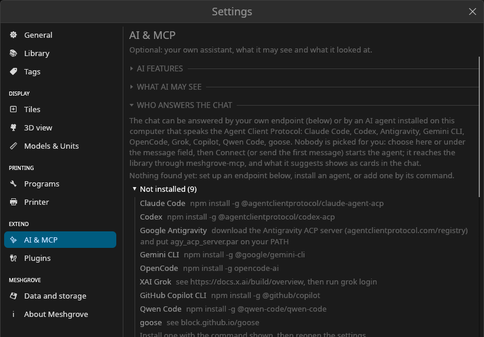

**The review: change before you accept, and watch it apply** (new in 0.10)

- Everything in a batch can be changed before accepting: type a tag of your own into the *+ own tag* field, rewrite a note (and choose whether it replaces the old one or goes below it), give a move another name or place, rename a list, switch it between print list and collection, untick items and set the copies. What you accept is what you see.
- A batch being applied stays in the list with a green sweep that follows the library's progress and fades out once the batch is recorded; the next batch's buttons land exactly where the clicked ones were. A backlog of hundreds of suggestions is settled with the pointer at rest, and the list no longer flickers or loses your ticks when it reloads.
- Accepted tag suggestions now remove what they say: a suggestion that only takes a tag away, or a tag merge, used to do nothing. A tag renamed through the AI keeps the spelling it was given instead of folding back to the old one.

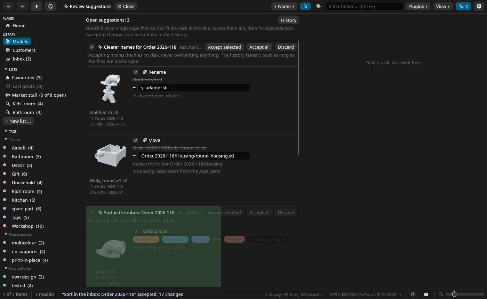

**Archives: browse, unpack, pack, add** (new in 0.10)

- ZIP, 7z, RAR and TAR open level by level like folders, with folder tiles and mosaics inside, also outside the library (in a downloads folder, in the import view); *Include subfolders* works inside them.
- Right-click → *Unpack* puts an archive's contents into a new folder named after it, beside it. *Pack as ZIP* makes a new ZIP of the selected files and folders under the name you type, *Add to archive* lists the ZIPs of the same folder to add the selection to, and Ctrl+V while a ZIP is open adds the copied files there. Only ZIP archives are written; 7z, RAR and TAR are unpacked. Nothing is ever replaced (a member of the same name stops the whole addition), and each operation is one entry in the history, which takes it back as long as the archive is unchanged since.
- Your assistant gets the same three operations (`list_archive`, `propose_archive`), always reviewed; the review shows what goes where.

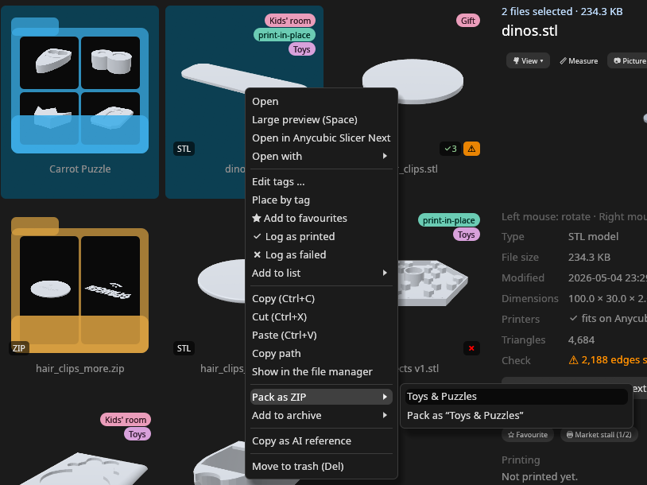

**Duplicates: packed or extracted, one decision per archive** (new in 0.10)

- A model pack that lies in the library both as the ZIP and extracted gave one locked group per model, because a member of an archive cannot be trashed by itself. Now *Settings → Library → Duplicates* says which copy ★ suggests, the extracted or the packed one, so *All suggestions are fine* → *Clean up selected* settles them all at once. Above the groups, *Archives with extracted copies* lists each such archive and settles it with one click: keep the archive and trash its extracted copies, or keep the copies and trash the archive, the latter only once every model in it is extracted (the button says how many would be lost otherwise).
- *Ignore* keeps a group as it is: no longer listed, counted in the sidebar or badged on its tiles. *Show ignored* lists such groups again, with *Watch again* to undo it.

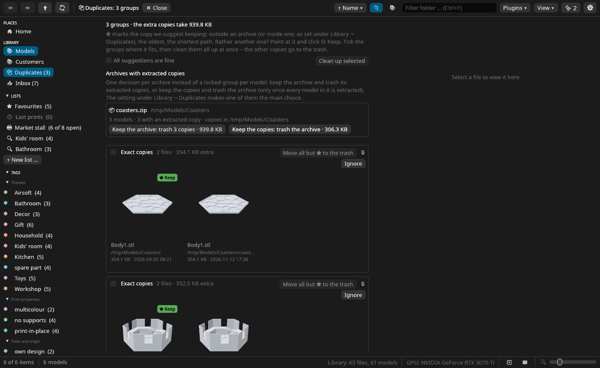

**Smaller things** (new in 0.10)

- The context menu of a tile is grouped: opening, tags and lists, files, AI, trash. The usual ways to open a file stay on top; the default program, mesh editors, other slicers and plugins sit under *Open with*.
- List view: the preview column can be dragged wider (the rows follow), and its previews do what tiles do: folders fade through their pictures, resting the pointer on a model spins it, dragging turns it, the wheel zooms it.
- A tag whose files have all left the library is no longer listed in the sidebar with 0 files, nor seen by the AI as in use; it comes back with the files.
- Chat cards wrap in a narrow pane instead of cutting off their buttons.
- The inbox: Ctrl- and Shift-click select several files, Ctrl+A all of them, and the tags, lists and marks in Info apply to the whole selection; a tile's menu is the gallery's, with *Done* on top.
- *Place by tag* takes the files out of the inbox once their moves are accepted: they no longer stay listed there, and the count in the sidebar drops with them. A file whose move was skipped stays in the inbox; undo puts the others back.
- Config: `ai.assistant`, `ai.auto_connect`, `ai.agents`, `ai.agent_models`, `ai.agent_options`, `ai.cross_library_moves`, `ai.endpoint.reasoning_effort`, `duplicates_keep`, `list_columns.widths.preview`; all documented in the READMEs.

**Texgrove, the second plugin** (new in 0.9)

- [Texgrove](https://github.com/DonDavis-vibe/Texgrove) puts textures onto your models as real geometry, relief the printer prints: knurls, hexagons, weaves, wood, leather and your own pictures, laid on from all round, round a cylinder or as a stamp where you click, outside only or everywhere, with the bottom left smooth.
- Right-click one or several models and choose *Apply texture …*; the textured file lands beside the original, with every setting in its note. A 3MF project keeps its other objects, plates and settings.
- Your AI can do it as well ("knurl the handle, 0.6 mm deep"); the file waits in the review. Get `texgrove.wasm` from [Texgrove's releases](https://github.com/DonDavis-vibe/Texgrove/releases) and install it in *Settings → Plugins*.

**Plugins work on your models** (new in 0.9)

- A plugin can take models straight from the gallery: right-click one or a whole selection and pick its entry, or use the button it adds in the Info pane. It may read exactly these files, also when it is not allowed to read the library.
- What it makes can land beside the original, under its own name, instead of in a new folder; the original is never touched, and undo removes only the new files.
- For a slicer project with several objects, a plugin swaps just the objects it changed: plates, settings and the other objects stay as they were.
- A plugin's 3D preview can be painted on: a brush (Shift erases) or a click on a surface, to show the plugin where its work goes. Pictures in a plugin's panel can be clicked, for a gallery to choose from.
- An AI can start work that takes longer than a minute: it runs in the background with progress and a cancel button in the status bar, and what it made always waits in the review, even with *Accept without review* or the chat's automatic mode on.

**A plugin's preview shows the space it plans for** (new in 0.9)

- A plugin can hand its 3D preview the space the model is meant to fit. [Bingrove 0.5](https://github.com/DonDavis-vibe/Bingrove/releases/tag/v0.5.0) shows the drawer, the shelf or the wall as a blue box round the plate and the bins, and the sides they stick out of turn red: a grid planned larger than its shelf shows before anything is printed. *Frame* above the preview hides it.

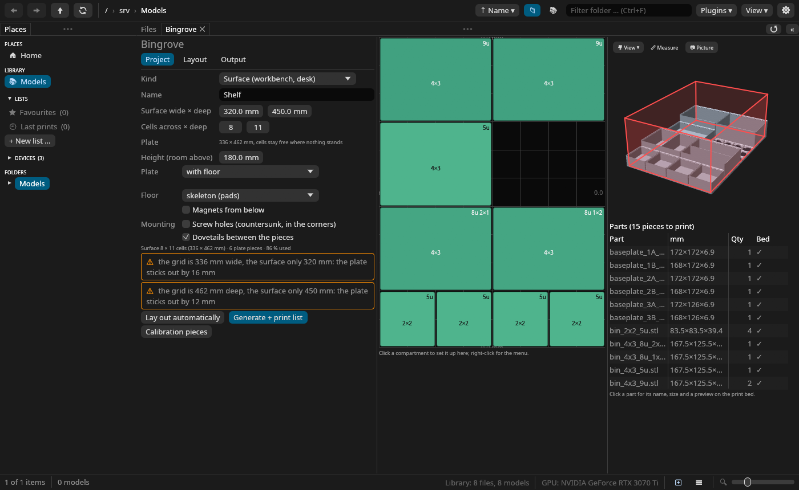

**Smaller things** (new in 0.9)

- Signs such as ✔, ✖ and the ✨ of the AI actions show on Windows too, where some of them were empty boxes: every sign Meshgrove uses now comes in a font it brings along.
- Rows in a plugin's panel wrap when the panel is narrow, instead of running off its edge, and a scroll bar no longer covers the last line.
- For plugin authors: plugin API 0.2 brings all of the above to plugins; plugins written for 0.1 keep working. See [how to write a plugin](https://github.com/DonDavis-vibe/MeshGrove/blob/v@VERSION@/docs/plugins.md).

**Checked on Windows** (new in 0.8.3) – a day in a Windows 11 VM, and what Linux never showed:

- Files Windows marks hidden (`desktop.ini`, `Thumbs.db`) no longer show up as tiles; the two names are left out on every system, NTFS drives on Linux included.
- A file handed to Meshgrove from another program with its path spelled differently (`c:\…`) is found in the library with its tags; the same goes for a path through a symlink on Linux.
- The print list as CSV opens in Excel with umlauts and × intact.
- A STEP preview and its thumbnail no longer trip over each other while the file is tessellated.
- The context menu says *Explorer* on Windows and *Finder* on macOS.
- A plugin's files before there is a library (Bingrove on a fresh install): Meshgrove asks where they should go, that folder becomes the library, and the files come in with their tags and lists.
- A fresh install explains itself: the Info pane says there is no library yet and offers *Add this folder*; a plugin's refused bundle says why in your language; the Info pane's scroll bar stays visible.

**Plugins** (new in 0.8)

- Meshgrove can now be extended with plugins: small programs (WebAssembly) that bring tools and panels of their own. They run sealed off – no network, only their own folder, limited time and memory – and see your library only if you allow it. Nothing changes until you install one.
- *Settings → Plugins* looks for plugins in your Downloads, the import folders and Meshgrove's plugins folder and offers *Install*, or *Update* for a newer version; *Browse …* picks one by hand, and a `.wasm` dropped on the window is installed at once. What each plugin may do is up to you, one switch each: *Tools for the AI*, *Put files into the library*, *Read the library* (no, what local AI sees, or everything) and *Accept without review*.
- A plugin's panel opens from the *Plugins* menu as a tab of its own, with forms, tables (drag a column wider to read a value whole), a 3D preview on your printer's bed, a grid editor or a drawing canvas. Preview and Info fold away while it is in front, so the panel gets the room.
- What a plugin makes comes into the library as one change: a new folder of models with their tags, notes and print lists, which the history takes back with one click. Made from its panel, it goes in at once, and the panel hears whether it worked; asked for by an AI, it waits in the review.
- Plugin tools join the AI chat and `meshgrove-mcp`, so your assistants can use them too. Stopping the chat stops a running tool, and pictures a tool returns show in the chat.
- For developers: [how to write a plugin](https://github.com/DonDavis-vibe/MeshGrove/blob/v@VERSION@/docs/plugins.md), the `meshgrove-plugin-api` crate (MIT or Apache-2.0, so a plugin can use any license) and the small `hello-box` example.

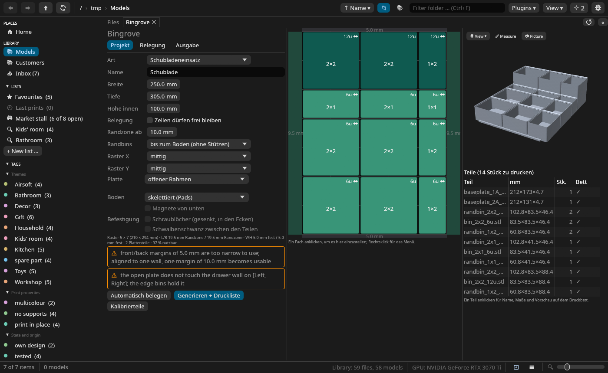
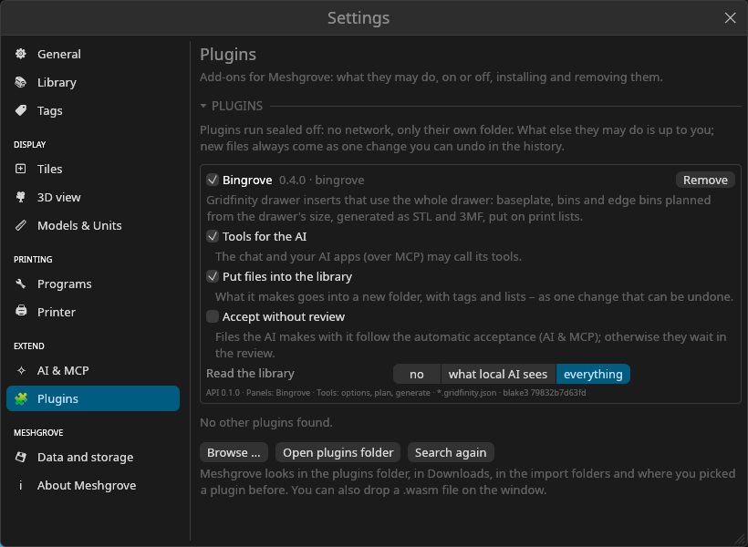

**Bingrove, the first plugin** (new in 0.8)

- [Bingrove](https://github.com/DonDavis-vibe/Bingrove) makes Gridfinity inserts for your drawers: give it the drawer's size, arrange the bins in the grid editor (move, resize, merge, split, add holders), and it puts the STLs, the print beds and a print list into your library. Magnet holes are an option, and calibration pieces test the fit before the big print.
- Your AI can do it as well: "Gridfinity inserts for my 250 × 305 mm drawer" in the chat or in an AI app.
- Get `bingrove.wasm` from [Bingrove's releases](https://github.com/DonDavis-vibe/Bingrove/releases) and install it in *Settings → Plugins*.

**Smaller things** (new in 0.8)

- Preview and Info fold away with » at the right above the files, or *View → Preview and info*; « brings them back. *Settings → General → Panes* switches off their folding away for plugin panels.
- Fixed (Windows): a folder's tile now shows models from its subfolders too, the inbox counts known files in subfolders, and a folder that is gone no longer leaves its subfolders behind in the index.

**From Downloads into the library** (since 0.7)

- Name a downloads folder in *Settings → Library → Import* (one click for your Downloads). At start, or with *⬇ Import* in the sidebar, Meshgrove shows the new models, G-code and archives with models in there; tick what should come in and it moves them into the library's landing folder (`Import`), across drives too, numbered when a name is taken. Archives come in whole or unpacked, as you choose. Files still downloading and content the library has already are left out.
- Imported files land in the inbox like any new file; the history brings them back to where they were. Power users let the import run by itself at start.

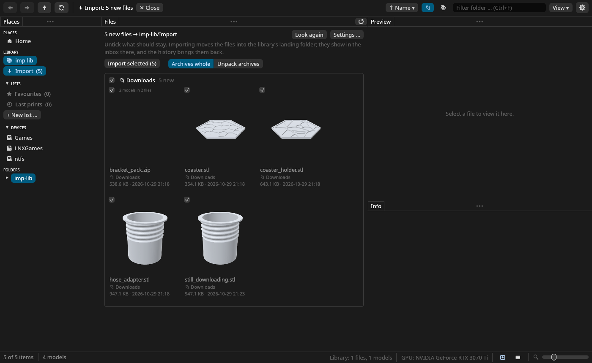

**Placed by tag** (since 0.7)

- A file in the landing folder that gets a theme tag – from you, from the inbox's *✨ Sort in* or from your assistant – is placed into that tag's folder (`Garten/`), with missing folders made. *Settings → Tags → Placement by tag* holds the folder for each theme and for your own tags, in order of precedence: with several tags, the topmost wins (your own tags before the themes, a deeper folder before a flat one; drag a row by its handle or use ▲▼ to reorder). The review shows the other folders that fit, to choose instead.
- Placement is a suggestion like an assistant's and waits in the review; with *Accept suggestions automatically* on, moves out of the landing folder are applied by themselves – but only when exactly one folder fits; otherwise the file waits for your choice. Your own folders are never rearranged without you: *Place by tag* in the context menu asks, and every move can be undone.
- Assistants over MCP learn the rules too (`list_tags` names each tag's folder, `library_overview` the landing folder) and the *eingang-einordnen* task places what it tags.

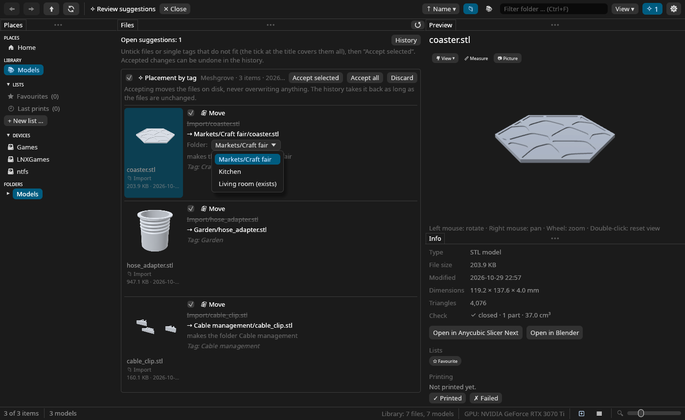
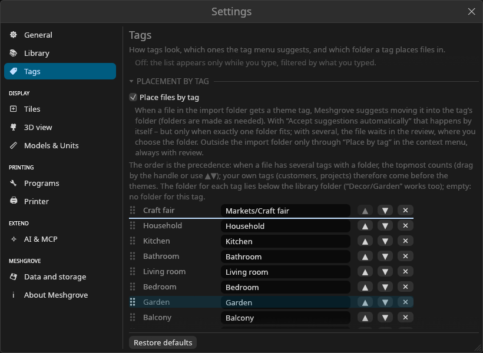

**Duplicates cleaned up at once** (since 0.7)

- After looking through the duplicates, tick the groups whose ★ copy is the right one – or *All suggestions are fine* – and *Clean up selected* moves the extra copies of all of them to the trash with one confirmation. Rather keep another copy? Point at it and click ☆ *Keep*.

**Cut and paste** (since 0.7)

- Ctrl+V (or *Paste* in the context menu, on a folder tile or the empty part of the view) copies the files on the clipboard into the folder: what you copied in Meshgrove with Ctrl+C, in Dolphin, Explorer or Finder, or paths as text. Taken names get a number, nothing is replaced, the copies keep their tags and notes (they are the same model), and the history undoes it.
- Ctrl+X (or *Cut*) marks the selection – the tiles fade – and the next paste moves the files instead: within a library with tags, notes and previews along, from elsewhere like an import; journalled and undoable like every move. Dolphin and Nautilus honour the cut marker, and what they cut is moved when pasted in Meshgrove.

**Smaller things** (since 0.7)

- *Zuletzt gedruckt / Last printed* below the favourites in the sidebar: the models you last sent to the slicer, newest first. How many it keeps (10 unless you change it, or off) is a slider in *Settings → Programs*.
- Sorting moved into its own toolbar button next to the folder/library switch, and files Meshgrove cannot show (stray `.txt`, `.ini` and the like) now come after the ones it can, whatever the sort order; the same menu turns that off.

**Your AI apps connect themselves** (since 0.6)

- While AI is on, Meshgrove adds itself to the assistants it finds on your computer – Claude Desktop, Claude Code, LM Studio, Cursor, VS Code, Codex, Gemini CLI, Copilot CLI, Windsurf, Zed and OpenCode – and *Settings → AI & MCP* lists them with their state. No more copying entries; restart an app once and it can use Meshgrove.
- Only Meshgrove's own entry changes in their settings, each file is kept as `.bak` before the first change, your own entries are left alone, and switching it off takes the entries out again. `meshgrove-mcp setup` (and `remove`) does the same from a terminal.
- The idea and the code that finds and edits the apps' settings come from [SolidCraft](https://github.com/tangency-labs/solidcraft) – thank you.

**Settings, rearranged** (since 0.6)

- The pages are grouped (display, printing, extend), each says in a line what it holds, and its sections fold away with a click on their title.
- Labels and controls sit in aligned columns, choices among a few are buttons side by side, and *Restore defaults* puts a page back to how Meshgrove comes (your library folders, programs, printers and AI permissions stay).

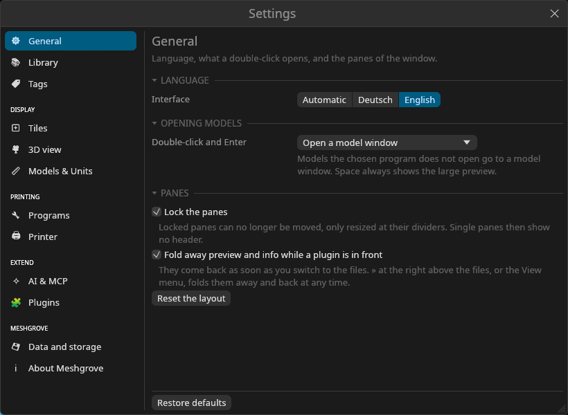

**Reviewing suggestions** (since 0.6)

- A tick for each file and one for the whole batch: leave out what does not fit, then *Accept selected*.
- New, for experienced users: *Accept suggestions automatically*. New suggestions of AI apps and one-click actions are applied without the review; moves still wait for you, and everything can be undone in the history.
- Fixed: back in the library after a tag or a search, its folders had no pictures and files were missing until F5.

**Tiles your way** (since 0.5.2)

- *Settings → Tiles* shows a sample tile with every badge on it. Drag the file type, filament colours, duplicates, tags, print bed check, favourite and print state into any corner of the picture, reorder them within a corner, or drop them into a tray to hide them; a right-click does the same.
- Tags as names or colour dots, filament colours as dots or a stripe along the picture's edge, the bed check with text or as a symbol only, and file names on two, one or no lines, with or without the extension. The tile size and the folder previews have moved there too.
- Nothing changes until you change it: the standard layout looks exactly as before.

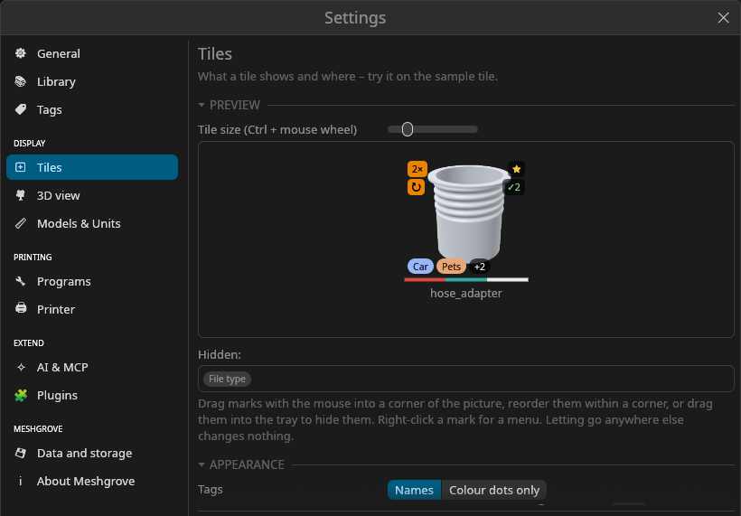

**Your own AI, if you want it** (since 0.5) – optional and off until you switch it on. Meshgrove brings no AI of its own.

- **MCP server** `meshgrove-mcp`: Claude Desktop, Claude Code, LM Studio, Cursor, VS Code and other MCP assistants can search the libraries you open to them and suggest tags, notes, lists, moves and renames. Ready-made tasks: sort the inbox, put together a print list, clean up tags, tidy up a folder.
- **AI chat** with an OpenAI-compatible endpoint of your own (Ollama, LM Studio, llama.cpp, OpenAI, OpenRouter …): `@` adds files, folders, tags, lists, printers or a search as references, answers link the files they name.
- **One-click actions** that work with small local models too: sort a delivery from the inbox, suggest tags for the selection or right in the tag field, a print list from a description ("gifts under 2 h for the A1 mini").
- **You decide:** suggestions wait in a review with old → new; in the chat's automatic mode an undo arrow sits on your message. Moves always wait for the review and never overwrite anything. Everything accepted can be undone in the history.
- **Per library:** no AI, local AI only (for customer files) or cloud AI too, with or without thumbnails; an access log shows what was looked at.

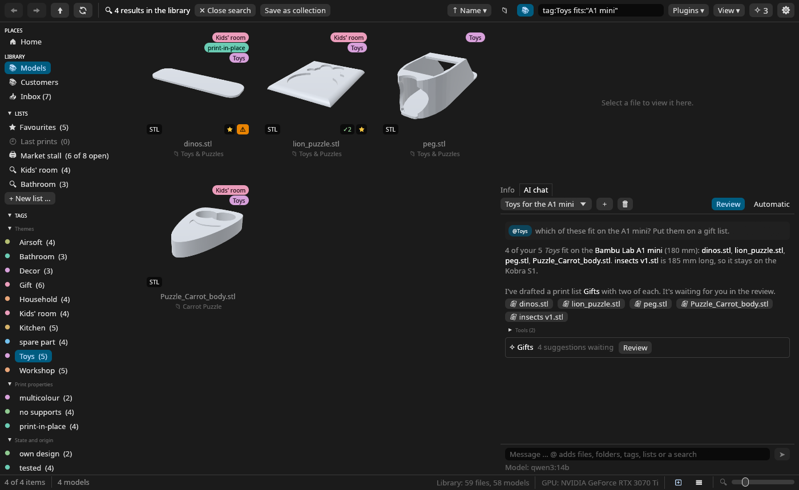
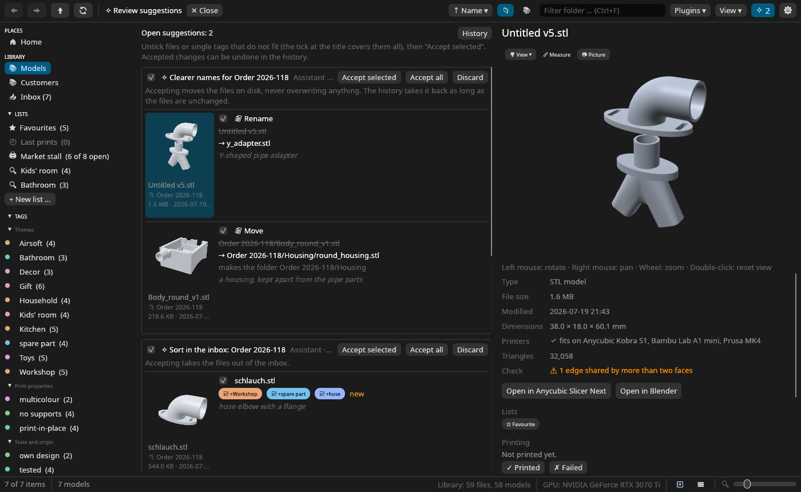

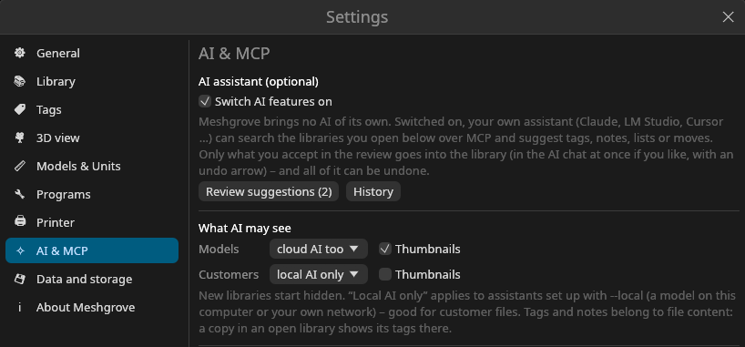

**For several printers and customer files**

- **Several printers** with their build volumes, found in your slicers; `passt:"A1 mini"` and "fits on / too big for" everywhere.
- **Printability check:** open edges, non-manifold edges, several parts, volume, suspicious sizes (inches?), too big for every printer; `is:problem`.
- **Inbox:** everything new since the last time, grouped by the folder or ZIP it came in, with copies of files you already have counted as known.

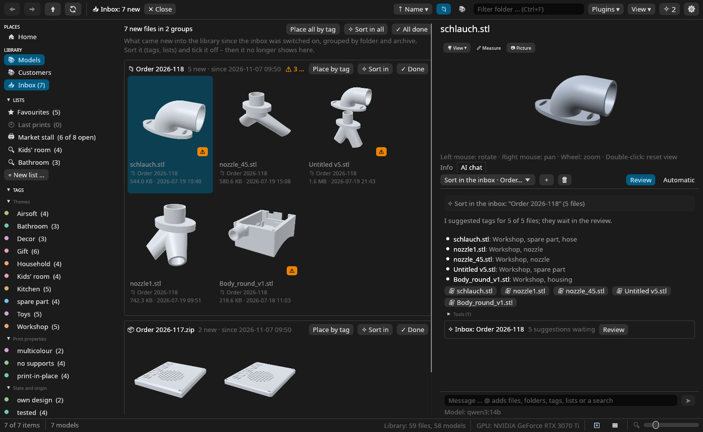
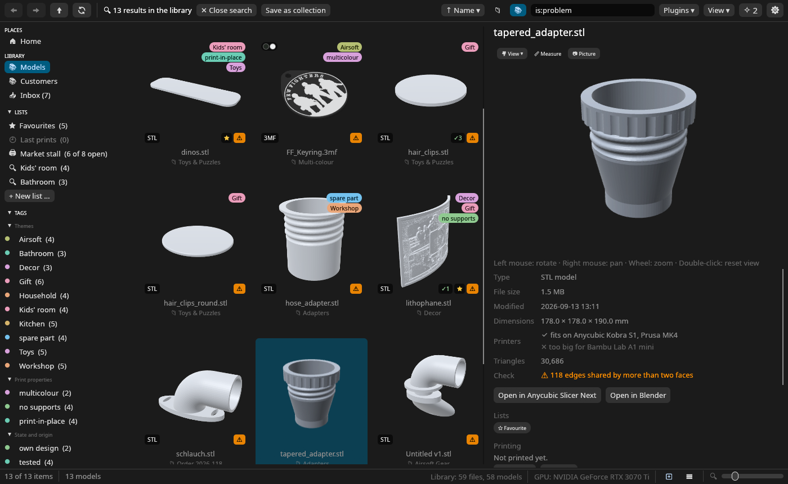

**Lists, print log and more** (never released as 0.4, so here they are)

- ★ Favourites, collections (hand-picked or a saved search) and print lists with copies, ticked off as you print, exported as a PDF checklist or CSV.
- A print log (printed / failed) with `is:printed`, `is:unprinted`, `is:failed`.
- G-code previews with slicer, printer, print time and filament; readmes in the preview; a sortable list view; *Rescan folder*.
- Thanks to [@Rec0iL](https://github.com/Rec0iL): several slicers and mesh editors, found automatically in every common install, your own tag themes, files in inches and imperial display units, and 3D mice (SpaceMouse and DIY).
- The sidebar folds: lists, tags (each tag group too) and devices fold away with a click on their title, and stay folded.
- Fixed: models in a folder inside a ZIP or another archive get their sizes, check and duplicate matches; until now the library never finished "Indexing" for them.
- Fixed: copy and paste in text fields and the copy buttons (such as the MCP entry in Settings → AI & MCP), which did nothing before.
- Windows: Meshgrove now also writes its log to `meshgrove.log` (*Settings → About Meshgrove* shows where), so problems can be reported without a console.
- Fixed (Windows): the Claude Code command for the MCP server works in the command prompt (cmd) as well as in PowerShell.
- Fixed: the hints about the trash and copied files no longer name Dolphin on Windows and macOS.

## Downloads

Every package includes STEP previews (OpenCascade). Nothing needs to be built.

| System | File | Notes |
|---|---|---|
| **Windows** 10/11 x64 | `Meshgrove-@VERSION@-windows-x64-setup.exe` | Installer. Installs for your user without admin rights (or for all users), with a Start menu entry and "Open with" for STL, 3MF, STEP, OBJ, PLY and glTF files. SmartScreen may warn because the program is not signed: choose *More info → Run anyway*. |
| | `Meshgrove-@VERSION@-windows-x64-portable.zip` | The same without installing: unpack anywhere and start `meshgrove.exe`. |
| **macOS** 11 or newer, Apple Silicon and Intel | `Meshgrove-@VERSION@-macos-universal.dmg` | Open it and drag Meshgrove onto *Applications*. The app is not notarized, so on the first start right-click it and choose *Open*, or run `xattr -dr com.apple.quarantine /Applications/Meshgrove.app`. |
| **Linux** x86_64, any distribution | `Meshgrove-@VERSION@-x86_64.AppImage` | Make it executable (`chmod +x`) and start it. Runs on distributions from 2022 on (glibc 2.35, e.g. Ubuntu 22.04, Debian 12). |
| **Ubuntu 24.04** | `meshgrove_@VERSION@-1_ubuntu24.04_amd64.deb` | `sudo apt install ./meshgrove_…deb`. Uses the system's libarchive and OpenCascade, and adds the menu entry and Dolphin/file-manager thumbnails. Also for Linux Mint 22 and other 24.04-based systems. |
| **Ubuntu 26.04** | `meshgrove_@VERSION@-1_ubuntu26.04_amd64.deb` | As above, for Ubuntu 26.04 and systems based on it. |
| **Debian 13** | `meshgrove_@VERSION@-1_debian13_amd64.deb` | As above, for Debian 13 (trixie). |
| **Fedora 44** | `meshgrove-@VERSION@-1.fc44.x86_64.rpm` | `sudo dnf install ./meshgrove-…rpm`. Uses the system's libarchive and OpenCascade, with menu entry and thumbnails. |

- **PDF previews** need poppler's `pdftoppm` on all systems (`dnf`/`apt install poppler-utils`, `brew install poppler`, or poppler for Windows). The .deb and .rpm recommend it.
- Other distributions: take the AppImage, or build from source (see the [README](https://github.com/DonDavis-vibe/MeshGrove#installation)).

## Known limitations

- Linux is the main platform. The Windows and macOS builds are built and tested automatically but have seen little real-world use yet, so please [report problems](https://github.com/DonDavis-vibe/MeshGrove/issues).
- On Windows, "Open in slicer" always opens a new slicer window.
- There are no thumbnails in Windows Explorer or the macOS Finder; the AppImage brings none for Linux file managers either (the .deb and .rpm do).

## License

Meshgrove is free software under the GPL-3.0-or-later. Each package contains `LICENSE` and `THIRD-PARTY-LICENSES.md` with the licenses of all libraries and fonts built into the program. The Windows, macOS and AppImage packages contain OpenCascade (LGPL-2.1) in the STEP helper; its source code is attached here as `opencascade-…-source.tar.gz`.

If Meshgrove saves you time, you can leave a tip on [Ko-fi](https://ko-fi.com/don_davis). Thanks!

<b>🇩🇪 Kurzfassung auf Deutsch</b>

**Meshgrove @VERSION@**: eine schnelle, native Galerie für 3D-Druck-Dateien unter Linux, Windows und macOS, mit echten Vorschauen für STL, 3MF, STEP, OBJ, PLY, glTF, G-code, Modelle in ZIP/7z/RAR, PDFs und Readmes, dazu Favoriten, Drucklisten und einem Druckprotokoll.

**Neu in 0.11:** Für Plugin-Autoren: Plugin-API 0.3. Ein Plugin-Panel kann dich mit Meshgroves eigener Ordnerauswahl wählen lassen, in welchen Ordner welcher Bibliothek seine Dateien kommen, auch in einen neuen; das Plugin sieht dabei keine Pfade. Plugins für 0.1 und 0.2 laufen weiter.

**Neu in 0.10** (Agenten, Prüfliste, Archive und Duplikate von [@Rec0iL](https://github.com/Rec0iL), danke!)**:** Den KI-Chat beantwortet jetzt wahlweise ein **KI-Agent auf deinem Rechner** – Claude Code, Codex, Antigravity, Gemini CLI, OpenCode, Grok, Copilot CLI, Qwen Code, goose oder jedes andere Programm, das das Agent Client Protocol spricht. Meshgrove findet die installierten selbst (*Einstellungen → KI & MCP → Wer den Chat beantwortet*), du wählst unter dem Eingabefeld, wer antwortet, und *Verbinden* startet ihn; auf Wunsch verbindet sich der Chat beim Öffnen von selbst. Der Agent erreicht die Bibliothek über `meshgrove-mcp`, Meshgroves eigene Werkzeuge darf er nutzen, vor allem anderen fragt er dich im Chat. Dazu eine durchsuchbare Modellauswahl mit Reasoning-Stufe für Agenten und Endpunkte, Rückfragen des Assistenten als Fragen im Chat (aus KI-Apps in einem eigenen Fenster), Löschvorschläge in den Papierkorb (immer über die Prüfliste) und auf Wunsch Verschiebungen in eine andere Bibliothek. In der **Prüfliste** lässt sich vor dem Annehmen alles ändern – eigene Tags, Notizen, Ziel und Name einer Verschiebung, Listenname, -art und -einträge –, ein laufender Block zeigt seinen Fortschritt als grünen Balken, und die Knöpfe des nächsten Blocks landen genau unter dem Zeiger; Tag-Vorschläge entfernen jetzt auch, was sie entfernen sollen. **Archive** (ZIP, 7z, RAR, TAR) öffnen sich Ebene für Ebene wie Ordner, auch außerhalb der Bibliothek; per Rechtsklick *Entpacken*, *Als ZIP packen* und *Zum Archiv hinzufügen* (Strg+V in ein offenes ZIP geht auch) – nur ZIP wird geschrieben, nichts wird je ersetzt, der Verlauf nimmt alles zurück; die KI kann dasselbe vorschlagen. Bei den **Duplikaten** entscheidet eine Einstellung, ob bei gepackt *und* entpackt vorliegenden Modellen ★ die entpackte oder die gepackte Kopie vorschlägt, und über den Gruppen wird jedes Archiv mit einem Klick erledigt: Archiv behalten oder Kopien behalten. *Ignorieren* nimmt eine Gruppe aus der Liste. Kleineres: im Eingang lassen sich mehrere Dateien markieren (Strg/Umschalt-Klick, Strg+A) und zusammen taggen, mit *Nach Tag ablegen* verschobene Dateien verlassen den Eingang (auch in der Zahl der Seitenleiste), das Kachelmenü ist in Gruppen geordnet (seltene Öffnen-Wege unter *Öffnen mit*), die Vorschau-Spalte der Listenansicht lässt sich breiter ziehen und ihre Bilder verhalten sich wie Kacheln, Tags ohne Dateien verschwinden aus der Seitenleiste, Chat-Karten brechen in schmalen Bereichen um.

**Neu in 0.9:** Plugins arbeiten an deinen Modellen. Per Rechtsklick auf ein oder mehrere Modelle (oder über ihren Knopf im Info-Bereich) bekommt ein Plugin genau diese Dateien; was es macht, landet auf Wunsch neben dem Original, und in einem 3MF-Projekt tauscht es nur die geänderten Objekte aus – Platten, Einstellungen und die anderen Objekte bleiben. In der 3D-Vorschau eines Plugins lässt sich malen, und Arbeit, die deine KI anstößt, läuft im Hintergrund und wartet danach immer in der Prüfliste. Zweites Plugin ist [Texgrove](https://github.com/DonDavis-vibe/Texgrove): Texturen als echte Geometrie – Rändel, Waben, Holz, Leder oder eigene Bilder –, als neue Datei neben dem Original. Bingroves Vorschau zeigt den Platz, für den es plant (Schublade, Regal, Wand), und *Rahmen* blendet ihn aus. Behoben: Zeichen wie ✔ und ✨ erscheinen auch unter Windows, und Zeilen in Plugin-Panels brechen um. Für Plugin-Autoren: Plugin-API 0.2, für 0.1 geschriebene Plugins laufen weiter.

**Seit 0.8:** Plugins – kleine Programme (WebAssembly), die Meshgrove um eigene Werkzeuge und Panels erweitern. Sie laufen abgeschottet (kein Netz, nur ihr eigener Ordner) und sehen deine Bibliothek nur, wenn du es erlaubst. *Einstellungen → Plugins* findet sie in Downloads, den Import-Ordnern und im Plugin-Ordner und bietet *Installieren* oder *Aktualisieren* an; *Durchsuchen …* oder eine aufs Fenster gezogene `.wasm` gehen auch. Was jedes Plugin darf – *Werkzeuge für die KI*, *Dateien in die Bibliothek legen*, *Bibliothek lesen*, *Ohne Prüfung übernehmen* –, schaltest du einzeln frei. Ein Plugin-Panel öffnet sich über das Menü *Plugins* als eigener Tab, mit Formularen, Tabellen (Spalten lassen sich breiter ziehen), 3D-Vorschau auf dem Druckbett und Raster-Editor; Vorschau und Info klappen dabei weg. Was ein Plugin erzeugt, kommt als eine Änderung in die Bibliothek – ein neuer Ordner mit Tags, Notizen und Drucklisten – und lässt sich im Verlauf mit einem Klick zurücknehmen. Die Werkzeuge der Plugins stehen auch im KI-Chat und über `meshgrove-mcp` deinen KI-Apps zur Verfügung. Erstes Plugin ist [Bingrove](https://github.com/DonDavis-vibe/Bingrove): Gridfinity-Einsätze für deine Schubladen, im Raster-Editor angeordnet, mit Haltern, Magnetlöchern und Kalibrierteilen, als STLs, Druckbetten und Druckliste direkt in der Bibliothek – auch auf Zuruf deiner KI (die `bingrove.wasm` gibt es bei den Bingrove-Releases). Vorschau und Info lassen sich außerdem von Hand mit » einklappen. Behoben (Windows): Ordner-Kacheln zeigen auch Modelle aus Unterordnern, und der Eingang zählt bekannte Dateien in Unterordnern mit.

**Seit 0.7:** Nenne unter *Einstellungen → Bibliothek → Import* deinen Download-Ordner, und Meshgrove zeigt beim Start oder über *⬇ Import* in der Seitenleiste, welche neuen Modelle, G-Codes und Archive dort liegen; ein Klick holt sie in den Landeordner der Bibliothek (verschoben, auch über Laufwerke hinweg, Archive ganz oder entpackt, rückgängig machbar). Bekommt eine Datei dort einen Themen-Tag, legt Meshgrove sie in den Ordner des Tags ab – nach den Regeln unter *Einstellungen → Tags → Ablage nach Tag* (bei mehreren Tags zählt der oberste; die Prüfliste bietet die anderen passenden Ordner an), als Vorschlag in der Prüfliste oder mit „automatisch annehmen“ von selbst, wenn genau ein Ordner passt. Deine eigenen Ordner werden nie ungefragt umgeräumt; „Nach Tag ablegen“ im Rechtsklick-Menü fragt immer. Strg+V (oder „Einfügen“ im Rechtsklick-Menü) kopiert Dateien aus der Zwischenablage in den Ordner – aus Meshgrove, dem Dateimanager oder als Pfade – ohne etwas zu ersetzen, mit Tags und Notizen und rückgängig machbar; nach Strg+X („Ausschneiden“) verschiebt das Einfügen stattdessen. Bei den Duplikaten hakst du nach der Sichtung die Gruppen ab, deren ★-Kopie passt, und bereinigst alle auf einmal; ☆ *Behalten* wählt eine andere Kopie. Dazu „Zuletzt gedruckt“ in der Seitenleiste (die zuletzt an den Slicer geschickten Modelle) und ein eigener Sortier-Knopf, bei dem unterstützte Dateien zuerst kommen. Dein KI-Assistent kennt die Regeln ebenfalls.

**Seit 0.6:** Meshgrove trägt sich selbst bei deinen KI-Apps ein (Claude Desktop, Claude Code, LM Studio, Cursor, VS Code, Codex, Gemini CLI und weitere; Idee und Code von SolidCraft) – kein Eintrag muss mehr kopiert werden. Die Einstellungen sind neu geordnet: Seiten in Gruppen, einklappbare Abschnitte, ausgerichtete Zeilen und „Standard wiederherstellen“. In der Prüfliste gibt es Häkchen pro Datei und pro Block, und wer möchte, lässt neue Vorschläge automatisch annehmen (Verschiebungen warten immer). Behoben: Nach einem Tag oder einer Suche zeigte die Bibliothek ihre Ordner ohne Bilder, bis man F5 drückte.

**Seit 0.5:** mehrere Drucker, ein Druckbarkeits-Check und ein Eingang für neue Dateien und Kundenlieferungen. Dazu, freiwillig und ab Werk aus, deine eigene KI: ein MCP-Server für Claude, LM Studio, Cursor & Co. und mit eigenem Endpunkt (Ollama, LM Studio, OpenAI-kompatibel) ein KI-Chat mit `@`-Verweisen und Ein-Klick-Aktionen. Die KI schlägt vor, du nimmst an, und alles lässt sich rückgängig machen. Außerdem lassen sich Listen, Tags und Tag-Gruppen in der Seitenleiste einklappen, und Kopieren und Einfügen in Textfeldern funktioniert.

**Seit 0.5.2:** Unter *Einstellungen → Kacheln* stellst du an einer Beispielkachel selbst zusammen, welche Markierungen wo auf den Kacheln stehen: einfach in eine Ecke ziehen oder ausblenden, dazu Tags als Namen oder Punkte, Filamente als Punkte oder Streifen und den Dateinamen ein- oder zweizeilig, mit oder ohne Endung. Unter Windows schreibt Meshgrove jetzt eine Log-Datei (`meshgrove.log`, Pfad unter *Über Meshgrove*), der MCP-Befehl für Claude Code funktioniert auch in der Eingabeaufforderung, und die Hinweise zu Papierkorb und kopierten Dateien nennen nicht mehr Dolphin.

**Installation** (alle Pakete können STEP, nichts muss gebaut werden):
- **Windows:** `…-windows-x64-setup.exe` ausführen. Installiert ohne Adminrechte für dich (oder für alle Benutzer), mit Startmenü-Eintrag und „Öffnen mit“ für STL, 3MF, STEP, OBJ, PLY und glTF. Bei der SmartScreen-Warnung *Weitere Informationen → Trotzdem ausführen* wählen. Ohne Installation: die `…-portable.zip` entpacken und `meshgrove.exe` starten.
- **macOS** (Apple Silicon und Intel): die DMG öffnen, Meshgrove auf *Programme* ziehen und beim ersten Start mit Rechtsklick → *Öffnen* starten.
- **Linux:** das AppImage ausführbar machen und starten (jede Distribution ab 2022). Für Ubuntu 24.04/26.04 und Debian 13 gibt es .deb-Pakete, für Fedora 44 ein .rpm; diese nutzen libarchive und OpenCascade des Systems und bringen Menüeintrag und Vorschaubilder für Dolphin mit.
- **PDF-Vorschauen** brauchen auf allen Systemen poppler.

Probleme bitte im [Issue-Tracker](https://github.com/DonDavis-vibe/MeshGrove/issues) melden. Wenn dir Meshgrove Zeit spart, freuen wir uns über ein Trinkgeld auf [Ko-fi](https://ko-fi.com/don_davis).

